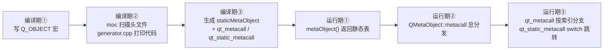
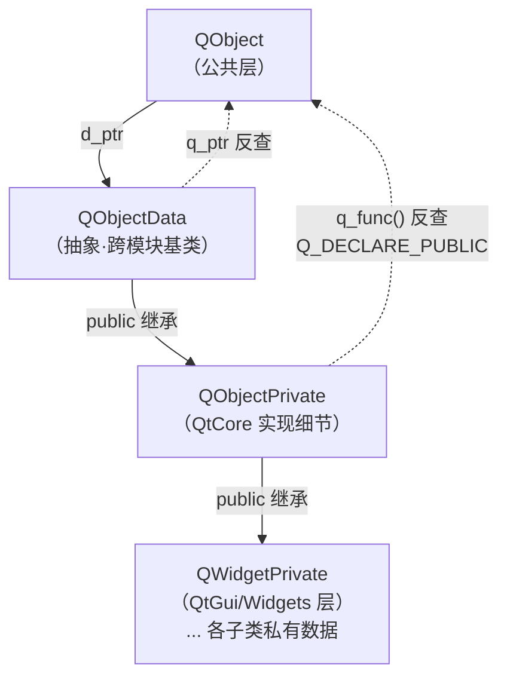
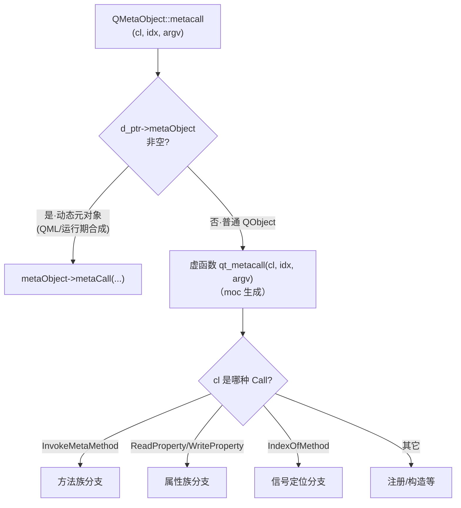
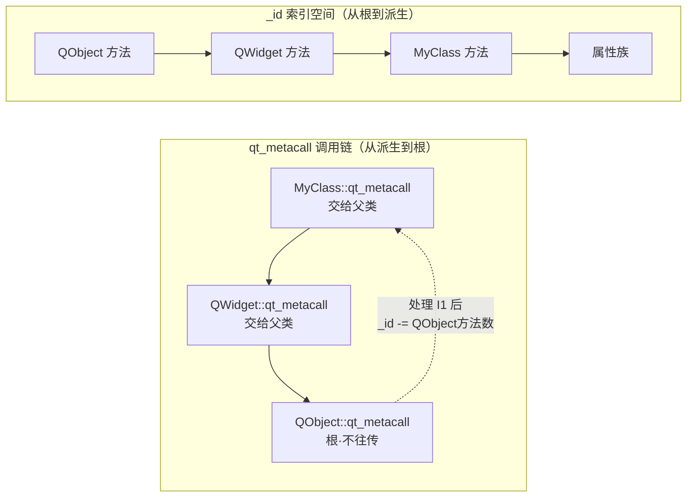

# QObject 元对象系统源码拆解

## 前言：为什么要拆解 QObject 的源码

咱们写过无数次的开场就是这两行，您闭着眼估计都能敲出来：

```cpp
class MyClass : public QObject {
    Q_OBJECT
```

写到 `Q_OBJECT` 的时候，大家心里都有数，这是把类交给了 moc 处理。不过往下再追问三个问题，多数人就要停住了：`metaObject()` 返回的那个 `QMetaObject`，里面到底装了什么？`qt_metacall` 的函数体，咱们在 QObject 头文件里翻烂了也找不到，它是从哪冒出来的？您再传一个 `int` 索引进去，它凭什么就能变成一次方法调用、一次属性读写？

您把上面的问题连起来看，正好就是元对象系统的脊梁。入门篇的 [1.1 QObject 与元对象系统](../../beginner/01-qtbase/01-qobject-meta-system-beginner.md) 教过咱们怎么用：`QObject` 怎么继承、父子关系怎么管、`Q_OBJECT` 怎么写、`READ/WRITE/NOTIFY` 的属性怎么声明，咱们停在知其然就够了。这一篇咱们往知其所以然走，把 `QObject` 的源码摊开，去看看那个不透明的 `d_ptr` 指针背后藏着什么，看看 `QMetaObject` 的静态表怎么布局，再看看运行期的一次元调用是怎么分发出去的。

您要是读过进阶篇的 [QObject 属性系统深度拆解](../../advanced/01-qtbase/01-qobject-property-system-advanced.md)，会发现那一篇聚焦的是 `Q_PROPERTY` 这套怎么用、怎么设计。那些内容本篇就不重复了，咱们把镜头对准元对象系统本身的骨架：属性系统的运行期分发（`ReadProperty`/`WriteProperty`）在源码里其实只是 `metacall` 的一个分支，笔者点到这个分支就收手，`argv` 数组的布局细节就不展开了。

咱们把脚步收在内存模型、静态元数据、metacall 分发框架这三件事上：信号发射链 `QMetaObject::activate` 咱们不去碰，那是 [02 篇信号槽源码](./02-signal-slot-internals-expert.md) 的主场。对象树的 `setParent_helper` 增删子对象也不深挖，那是 [21 篇对象树源码](./21-object-tree-ownership-expert.md) 的内容。这一篇把元对象系统的地基打好，后面的所有篇都能回头引用它。

## 环境说明

本篇的源码引用都基于 `qt_src/qt6.9.1`。这个目录是官方 Qt 6.9.1 源码在咱们本地的检出，咱们已经把它 gitignore 了，所以不随仓库分发。行号可能随 Qt 版本升级而漂移。您对照阅读时要是发现行号对不上，拿函数名或字段名去对应文件里搜索定位就行了。涉及 `moc/generator.cpp` 的行号尤其脆弱，那是 moc 工具的生成器模板，Qt 每次小版本都可能调整它的打印逻辑，所以这类行号笔者都挂了脚注 `[^moc-gen]` 提醒。

咱们本篇会碰到的源码文件，按它们出现的顺序列在下面：

| 文件 | 角色 |
|---|---|
| `qt_src/qt6.9.1/qtbase/src/corelib/kernel/qobject.h` | QObject 公共声明、QObjectData 基类字段集 |
| `qt_src/qt6.9.1/qtbase/src/corelib/plugin/qlibrary.cpp` | 插件加载期的 Qt 版本核对 |
| `qt_src/qt6.9.1/qtbase/src/corelib/kernel/qobject.cpp` | QObject 构造、保护构造实现 |
| `qt_src/qt6.9.1/qtbase/src/corelib/kernel/qobject_p.h` | QObjectPrivate 私有实现层 |
| `qt_src/qt6.9.1/qtbase/src/corelib/global/qtclasshelpermacros.h` | Q_DECLARE_PUBLIC / Q_D 宏定义 |
| `qt_src/qt6.9.1/qtbase/src/corelib/kernel/qobjectdefs.h` | QMetaObject 结构、Data 七槽位、Call 枚举 |
| `qt_src/qt6.9.1/qtbase/src/corelib/kernel/qtmetamacros.h` | Q_OBJECT 宏展开 |
| `qt_src/qt6.9.1/qtbase/src/tools/moc/generator.cpp` | moc 生成器模板（打印 qt_metacall/qt_static_metacall） |
| `qt_src/qt6.9.1/qtbase/src/corelib/kernel/qmetaobject.cpp` | metacall 总分发入口 |
| `qt_src/qt6.9.1/qtbase/src/corelib/global/qsystemdetection.h` | QT_NO_DATA_RELOCATION 的平台定义 |
| `qt_src/qt6.9.1/qtbase/src/corelib/kernel/qtmochelpers.h` | indexOfMethod 成员指针比较模板 |

本篇咱们不配 example，最直接的理由：纯源码解析的篇目，实在没有合理的可跑 demo。您不会为了看 `d_ptr` 的布局去单独写一个工程，咱们对照 `qt_src` 翻源码，就是最好的实验了。

## 核心概念讲解

咱们在动身以前对一遍路线图。元对象系统的地盘横跨编译期和运行期，迷糊往往就是因为把两头搅在一起了，所以全链路咱们看清楚了再走：



左半边是编译期的故事：咱们写 `Q_OBJECT`，moc 工具读的是咱们的头文件，用 `generator.cpp` 里的模板打印出一份 `moc_myclass.cpp`，里面填好了 `staticMetaObject` 静态表和 `qt_metacall`/`qt_static_metacall` 两个函数。右半边就轮到运行期了：代码里调 `obj->metaObject()`，拿到的就是 moc 准备好的静态表，接着咱们调 `QMetaObject::metacall` 进总分发，最终落到 moc 生成的 `qt_metacall` 里按索引分支。

咱们接下来就顺着图上的链走。不过动身以前，咱们还得解决一个更底层的问题：`QObject` 对象在内存里到底长什么样？那个 `d_ptr` 又是什么？这是整条链的地基。

### d_ptr：QObject 只持有一个不透明指针

咱们从一个数数的问题进：`QObject` 自己，到底持有几个数据成员？您猜一把，怎么也得几十个：对象名、父子关系、信号槽、定时器，您数哪个都得占几个字段。咱们数出来的答案是 1 个。

咱们翻到 `qobject.h` 的成员声明区验货（`qt_src/qt6.9.1/qtbase/src/corelib/kernel/qobject.h:375`）：

```cpp
    QScopedPointer<QObjectData> d_ptr;
```

咱们看到的就只有一行。咱们能想到的状态都在这儿了：对象名、父子关系、信号槽连接表、定时器、动态属性，全都塞在了 `d_ptr` 这个不透明指针的背后。这套手法的名字叫 PIMPL（Pointer to Implementation），直译过来就是指向实现的指针，收益很实在：ABI 被冻结了。只要 `QObject` 的公共部分只露出一个指针，Qt 内部往 `QObjectPrivate` 里加的字段、动的布局，都不会弄坏您已经编译好的代码的二进制兼容性。您拿 Qt 6.2 编译的插件，放进 Qt 6.9 的应用程序里通常也还能加载，靠的就是它。

不过收益也有边界。它保证的是同一主版本以内的向后二进制兼容。跨主版本它就管不着了，咱们拿 Qt 5 的插件放进 Qt 6 的程序里，是加载不了的。QPluginLoader 会核对插件链接的 Qt 版本。qtbase 在加载期就拿插件元数据里记录的版本号比对（`qt_src/qt6.9.1/qtbase/src/corelib/plugin/qlibrary.cpp:782-784`），主版本对不上的时候，它直接报一句插件用了不兼容的 Qt 库，加载就被挡下了。跨主版本的时候 ABI 和源码都不兼容，这可不是 PIMPL 一层能兜住的事。

那这个指针什么时候绑上去？答案在 `QObject` 的一个受保护构造函数里。咱们把它请出来看（`qt_src/qt6.9.1/qtbase/src/corelib/kernel/qobject.cpp:946-952`）：

```cpp
QObject::QObject(QObjectPrivate &dd, QObject *parent)
    : d_ptr(&dd)
{
    Q_ASSERT_X(this != parent, Q_FUNC_INFO, "Cannot parent a QObject to itself");

    Q_D(QObject);
    d_ptr->q_ptr = this;
```

这个构造函数干了两件要紧的事。第一件事是把传进来的 `QObjectPrivate &dd` 绑到 `d_ptr` 上。您注意 `dd` 是引用，子类构造时会传一个属于它自己的 `QObjectPrivate`（或派生类）进来，于是每个具体类（`QWidget`、`QTimer`、`QNetworkAccessManager`）都有自己的私有数据类型。第二件事是 `d_ptr->q_ptr = this` 回填了一个反向指针，私有数据就能反查到它自己挂在了哪个 `QObject` 上。公共对象和私有数据的双向引用，就是这么一来一回建起来的。

这个构造函数是受保护的，咱们在外部根本调不到，咱们看到的声明就一行（`qt_src/qt6.9.1/qtbase/src/corelib/kernel/qobject.h:372`）：

```cpp
    QObject(QObjectPrivate &dd, QObject *parent = nullptr);
```

能调它的只有子类，而且得在自己构造函数的初始化列表里。比如咱们最熟悉的 `QWidget`，它的构造函数会传一个继承自 `QObjectPrivate` 的 `QWidgetPrivate` 进来，于是 `QWidget` 既有 `QObject` 的全部私有数据，又叠上了自己的窗口系统字段。Qt 整个控件树里私有数据一层层叠加的机制，根子就落在了这里。

### QObjectData 与 QObjectPrivate：两层数据布局

现在咱们钻进 `d_ptr` 背后。这里有个容易把初学者绕晕的设计，私有数据其实分成了两层：`QObjectData` 和 `QObjectPrivate`。咱们把关系画明白：



`QObjectData` 是个彻头彻尾的抽象基类，咱们看它的析构（`qt_src/qt6.9.1/qtbase/src/corelib/kernel/qobject.h:71`）：

```cpp
    virtual ~QObjectData() = 0;
```

析构被声明成了纯虚，`QObjectData` 也就没法独立实例化了。那它装了什么？咱们最熟悉的其实是对象树的三个字段（`qt_src/qt6.9.1/qtbase/src/corelib/kernel/qobject.h:72-74`）：

```cpp
    QObject *q_ptr;
    QObject *parent;
    QObjectList children;
```

`q_ptr` 是反查公共对象的指针（d_ptr 一节的构造函数回填的就是它），`parent` 和 `children` 是对象树的父子关系。它们放在 `QObjectData` 基类这一层是有讲究的：跨模块、跨子类通用，不管您手上是 `QWidget` 还是 `QTimer`，对象树的表示方式都一样。所以 `children()` 这个公共 API 几乎零开销就能拿到子对象列表，咱们看它的实现（`qt_src/qt6.9.1/qtbase/src/corelib/kernel/qobject.h:203`）：

```cpp
    inline const QObjectList &children() const { return d_ptr->children; }
```

直接返回 `d_ptr->children` 的 const 引用，连拷贝都省了。它能这么写，咱们顺着刚才的两层结构就能看懂：`children` 字段在基类 `QObjectData` 的地盘上，持有它的 `d_ptr`（类型 `QScopedPointer<QObjectData>`）就能直接看到。

不过咱们要是只把 `QObjectData` 认成对象树三字段，那就把它看小了。咱们把整个声明读完，后面的东西还排着一整列（`qt_src/qt6.9.1/qtbase/src/corelib/kernel/qobject.h:76-91`）：

```cpp
    uint isWidget : 1;
    uint blockSig : 1;
    // ... 共 13 个位标志：信号阻塞、删除状态、事件收发开关等 ...
    QAtomicInt postedEvents;
    QDynamicMetaObjectData *metaObject;
    QBindingStorage bindingStorage;
```

13 个位标志管的是信号阻塞、正在删除一类的状态。`postedEvents` 是投递进来的事件计数。`metaObject` 是动态元对象的数据指针，metacall 一节做二分时看的那个 `d_ptr->metaObject`，指的就是这个字段。`bindingStorage` 撑着 Qt 6 的绑定系统。所以咱们更准确的说法是：`QObjectData` 定义的是跨模块共有的基础字段集，对象树三字段只是里面咱们最眼熟的一部分。

真正的实现细节则塞在派生类 `QObjectPrivate` 里，咱们接着往下看（`qt_src/qt6.9.1/qtbase/src/corelib/kernel/qobject_p.h:73-76`）：

```cpp
class Q_CORE_EXPORT QObjectPrivate : public QObjectData
{
public:
    Q_DECLARE_PUBLIC(QObject)
```

咱们把这两层的关系串起来看：`QObjectPrivate` 用 public 继承把 `QObjectData` 的基础字段集接了过来，再叠上 `QtCore` 自己的实现细节（连接表、定时器、信号索引、线程亲和性这些）。这里有个要紧的宏 `Q_DECLARE_PUBLIC(QObject)`，咱们把它和 d_ptr 一节用过的 `Q_D(QObject)` 放在一块儿看，它俩正好是对偶：`Q_D` 让公共层拿到私有层的指针（`d_func()`），`Q_DECLARE_PUBLIC` 让私有层反过来拿到公共层的指针（`q_func()`）。

`Q_D` 和 `Q_Q` 两个宏的定义，在 6.9 里已经搬进了 `qtbase/src/corelib/global/qtclasshelpermacros.h:146-168`，您去看就是一对直白的展开：`Q_D(Class)` 展开成的就是 `Class##Private * const d = d_func()`，`Q_Q(Class)` 的情况同理，展开出来的是 `Class * const q = q_func()`。`Q_DECLARE_PUBLIC` 的定义也在同一份头文件里，就在咱们刚引的几行更前面。Qt 源码里到处都是的 `d->xxx`（公共方法里访问私有数据）和 `q->xxx`（私有方法里回调公共 API），底层机制靠的就是这一对宏。

咱们把两层理清以后，手里就有地图了：公共对象 `QObject` 的手里只有一个 `d_ptr`，它指向的是 `QObjectPrivate`（及其子类）。`QObjectPrivate` 里既有基类 `QObjectData` 的通用字段（对象树、位标志、动态元对象指针），又有自己的实现细节。后面要看的 `metaObject()` 分发、信号槽连接表、线程亲和性，全挂在 `d_ptr` 背后的私有数据网上。

### QMetaObject：一张只读的静态元数据表

私有数据讲完了，现在咱们转向编译期 moc 塞进来的东西。咱们来看 `QMetaObject` 这个类型本身长什么样（`qt_src/qt6.9.1/qtbase/src/corelib/kernel/qobjectdefs.h:233`）：

```cpp
struct Q_CORE_EXPORT QMetaObject
{
    // ...
```

您注意它是 `struct`（默认公有），而且每个类对应一个 `QMetaObject` 实例，一个类也就那么一份，跟建了多少个对象没有关系，是编译期就定好的静态对象。它本质是一张只读的静态元数据表，不存任何对象的状态，描述的只有这个类有哪些方法、信号、槽、属性、枚举。

那么表是怎么和咱们的类绑上的？答案在 `Q_OBJECT` 宏里。咱们看它展开后声明了什么（`qt_src/qt6.9.1/qtbase/src/corelib/kernel/qtmetamacros.h:133-140`）：

```cpp
    static const QMetaObject staticMetaObject;
    virtual const QMetaObject *metaObject() const;
    virtual void *qt_metacast(const char *);
    virtual int qt_metacall(QMetaObject::Call, int, void **);
```

`Q_OBJECT` 宏给咱们的类声明了四样主角：一个静态成员 `staticMetaObject`（它就是元数据表的本体），咱们还拿到三个虚函数 `metaObject`/`qt_metacast`/`qt_metacall`。咱们看到的四行都是声明，定义在哪儿？答案是 moc 生成的 `moc_myclass.cpp` 里。咱们写的头文件里只有声明，moc 扫描后生成的是定义，所以咱们改了信号槽声明却没重跑 moc 的话，新旧两份代码就对不上了（风险一节咱们专门说这个）。

不过这四样只是主角阵容，`Q_OBJECT` 实际注入的还有 `qt_static_metacall` 的声明（qt_static_metacall 一节的主角）、`QPrivateSignal` 标签结构和 `tr` 系列翻译函数，咱们用到谁再提谁。

现在咱们钻进 `staticMetaObject` 静态表的内部结构。`QMetaObject` 的内部有一个 `Data` 结构体，固定的槽位有七个（`qt_src/qt6.9.1/qtbase/src/corelib/kernel/qobjectdefs.h:600-609`）：

```cpp
    struct Data { // private data
        SuperData superdata;
        const uint *stringdata;
        const uint *data;
        typedef void (*StaticMetacallFunction)(QObject *, QMetaObject::Call, int, void **);
        StaticMetacallFunction static_metacall;
        const SuperData *relatedMetaObjects;
        const QtPrivate::QMetaTypeInterface *const *metaTypes;
        void *extradata; //reserved for future use
    } d;
```

（中间那行的 typedef 不是槽位，是给函数指针类型起的别名，咱们数槽位时跳过它）

咱们一个槽一个槽看。`superdata` 指向父类的 `QMetaObject`，这就是 `superClass` 链的源头，元对象系统靠它把继承关系串了起来。咱们在 `stringdata` 里能找到类名、方法名、参数类型名，它是一张压缩过的字符串表，引用全靠的是整数偏移，内存也就省下来了。`data` 装的是一张 `uint` 数组，描述每个方法/信号/槽/属性的元信息（参数个数、偏移、标志位），编码用的全是整数。`static_metacall` 装的则是一个函数指针，静态元调用的入口就落在它身上，咱们在 qt_metacall、qt_static_metacall 两节里，会反复地见到它。`metaTypes` 收集的是元类型信息。剩下的 `relatedMetaObjects` 和 `extradata` 两个槽，咱们单独说，因为它们和字面直觉之间的差距有点远。

`relatedMetaObjects` 装的是关联元对象数组，但在 Qt 6 里它装的不是 `Q_INTERFACES` 声明的接口。moc 往这个槽里放的是自己生成的 `qt_meta_extradata_类名`（`generator.cpp:459-462`[^moc-gen] 打印），内容是按两类收集的：属性类型所属的已知 `QObject`/`Q_GADGET` 作用域，和信号槽参数里带作用域的枚举，每一项都是 `SuperData::link` 类型的记录。咱们在运行期按名字找元对象时，走的是 `qmetaobject.cpp:1054` 起的 `QMetaObject_findMetaObject`，顺着表挨个找的就是它。至于 `Q_INTERFACES` 的解析，它改走了 `qt_metacast` 的路，moc 生成的 `qt_metacast` 里按接口名逐个 `strcmp`（`generator.cpp:505-509`[^moc-gen]）。

`extradata` 就更朴素了：您看引文里那行 reserved for future use 的注释，moc 生成 `Data` 初始化时给这一槽填的恒是 `nullptr`（`generator.cpp:467`[^moc-gen]）。您想找动态属性的话，就别往静态表里翻了。动态属性是每个对象自己的状态，存在了 `QObjectPrivate` 里，跟类级的静态表没有关系。

`superdata` 这个槽位值得咱们单独停下来看，因为它涉及一个跨平台的小技巧。它的类型是一个叫 `SuperData` 的包装而非裸指针（`qt_src/qt6.9.1/qtbase/src/corelib/kernel/qobjectdefs.h:575-598`）：

```cpp
    struct SuperData {
        using Getter = const QMetaObject *(*)();
        const QMetaObject *direct;
        // ...
#else
        constexpr SuperData(Getter g) : direct(g()) {}
```

`SuperData` 包装了父类 `QMetaObject` 的引用，走的是双模式。正常情况下（能静态链接定位到父类元对象的平台），构造时调用传入的 getter 函数 `g()`，取出父类 `staticMetaObject` 的地址，`direct` 持有的就是父类元对象地址。咱们要留意的正是这一点：`direct` 存的是 getter 调用后取出的地址，而不是 getter 函数指针本身。但在定义了 `QT_NO_DATA_RELOCATION` 的平台上，它退而存一个 getter 函数指针 `indirect`，到了运行期再调 getter 去取。

哪些平台会定义这个宏？答案可能和您的直觉不同：是 Windows。宏的定义点在 `qtbase/src/corelib/global/qsystemdetection.h:137-143`，Windows 上 dllimport 进来的变量指针不是常量表达式，为了保住 `QMetaObject` 这类初始化的 `constexpr`，也就只好改存函数了。这个细节平时咱们用不到，但理解它有助于您看懂 moc 生成代码里 `QMetaObject::SuperData::link<QWidget::staticMetaObject>()` 一类的写法。

第四槽 `static_metacall` 是谁填的？填答案的是 moc 生成器。咱们看 `generator.cpp` 怎么打印这一槽（`qt_src/qt6.9.1/qtbase/src/tools/moc/generator.cpp:454-455`[^moc-gen]）：

```cpp
    if (hasStaticMetaCall)
        fprintf(out, "    qt_static_metacall,\n");
```

`generator.cpp` 是 moc 工具的源码。它本身不是运行期会执行的 QObject 代码，而是 moc 在编译期用来打印生成代码的模板。这段逻辑说的是：如果这个类有静态元调用（绝大多数 `Q_OBJECT` 类都是有的），就把 `qt_static_metacall` 这个函数指针写到 `Data` 的第四槽。注意这里用的是 `fprintf(out, ...)` 在打印字符串，moc 生成出来的是一份 C++ 源文件，真正的 `qt_static_metacall` 函数体要到它里面去找。生成器源码与产物源码的区分，是读 moc 相关代码最容易绊倒人的地方，后面 qt_metacall、qt_static_metacall 两节的取证，咱们靠的都是 `generator.cpp` 源码文件。

### metacall：元调用的总分发入口

元数据表有了，现在咱们看运行期怎么用它。运行期里所有发出去的元调用，`QMetaObject::invokeMethod` 的反射调用也好，`QMetaProperty::read`/`write` 的属性读写也好，最后汇聚到的都是 `QMetaObject::metacall` 这个总入口（`qt_src/qt6.9.1/qtbase/src/corelib/kernel/qmetaobject.cpp:343-348`）：

```cpp
int QMetaObject::metacall(QObject *object, Call cl, int idx, void **argv)
{
    if (object->d_ptr->metaObject)
        return object->d_ptr->metaObject->metaCall(object, cl, idx, argv);
    else
        return object->qt_metacall(cl, idx, argv);
}
```

咱们在这里纠正一个很容易混进来的印象：`qobject_cast` 的类型转换并不走这个入口，它走的是 `qt_metacast` 与 `superdata` 静态链，和 `metacall` 的分发是两条路。笔者把它从汇聚名单里请出去，后面就不再提了。

这个函数干的只有一件事，就是静态/动态的二分。您要是以为里面还藏着一个庞大的 switch 来分发各种 Call 类型，那咱们翻开看到的，其实只有两行 if-else。它看的是 `object->d_ptr->metaObject` 这个成员是不是空的。它非空就说明这个对象挂上了一个动态元对象（典型场景是 QML 或某些运行期合成元对象的场景），走的就是动态分支 `metaObject->metaCall(...)`。如果是空的（绝大多数普通 `QObject` 子类都是空的），走的就是静态分支，直接调的是虚函数 `object->qt_metacall(...)`，也就是 moc 给咱们类生成的那个函数。

对了，这个 `metaObject` 成员您应该眼熟：它就是两层数据布局一节 `QObjectData` 基类里那个 `QDynamicMetaObjectData *metaObject` 字段，动态元对象挂上时填的就是它。

这里有一个对后续理解很要紧的细节：`metacall` 这个总入口做的只有二分，它不关心您具体要干什么。具体干什么，决定权在第二个参数 `Call cl` 的手里。咱们看 `Call` 这个枚举列了哪些分支（`qt_src/qt6.9.1/qtbase/src/corelib/kernel/qobjectdefs.h:553-565`）：

```cpp
    enum Call {
        InvokeMetaMethod,
        ReadProperty,
        WriteProperty,
        ResetProperty,
        CreateInstance,
        IndexOfMethod,
        // ... 注册元类型、可绑定属性等 ...
        ConstructInPlace,
    };
```

咱们可以把一次元调用写成 `(Call 类型, int 索引, void** 参数)`。`Call` 类型决定了这是一次方法调用、一次属性读写还是一次类型查询，索引 `_id` 决定的是调第几个方法、读写第几个属性，`argv` 装的是参数和返回值。`metacall` 把这三样原封不动传给 moc 生成的 `qt_metacall`，真正的分支逻辑是 `qt_metacall` 的事，那正是咱们接下来一节的主场。

咱们把整个分发关系画出来：



### qt_metacall：链式调父类与索引递减

现在咱们进了 moc 生成的 `qt_metacall` 函数体。笔者一开始在这里卡了好一阵：QObject 的源码里搜不到 `qt_metacall` 的函数体。它是 moc 的生成物，它的定义在 `moc_myclass.cpp` 里，而它要等编译期才生成，咱们在 `qt_src` 里根本翻不到它。那咱们怎么研究它？

笔者在这里用的是双证据法，咱们看两样东西。头一样是运行期的总入口 `metacall`，metacall 一节咱们已经看过，它告诉咱们 `qt_metacall` 被怎么调用。另一样是 moc 的生成器模板 `generator.cpp`，它告诉咱们 `qt_metacall` 的函数体长什么样。`generator.cpp` 的手法是拿 `fprintf` 打印出生成代码，咱们读那些 `fprintf` 的字符串，就能还原出 `qt_metacall` 的真面目。

咱们看 moc 怎么打印 `qt_metacall` 函数的开头（`qt_src/qt6.9.1/qtbase/src/tools/moc/generator.cpp:849-855`[^moc-gen]）：

```cpp
    if (!purestSuperClass.isEmpty() && !isQObject) {
        QByteArray superClass = purestSuperClass;
        fprintf(out, "    _id = %s::qt_metacall(_c, _id, _a);\n", superClass.constData());
    }
```

咱们把例子确定下来，继承链选的是 `QObject → QWidget → MyClass`。这段逻辑生成的代码，翻译成咱们的白话就是：`qt_metacall` 的第一件事，是把 `_id` 交给父类的 `qt_metacall` 处理。咱们注意 `!isQObject` 这个守卫。`QObject` 是继承链的根，它没有可以传的父类，所以 QObject 自己的 `qt_metacall` 不往上传。而咱们的 `MyClass` 会调 `QWidget::qt_metacall`，接着 `QWidget` 又调的是 `QObject::qt_metacall`，从派生类到根类的调用链就这么串起来了。

为什么要这样链式调用？咱们拿索引空间一说就明白。元对象的索引空间是叠加的，咱们顺着 `superdata` 静态链从根往下看，方法索引 `_id` 是这样编排的：`[0, QObject方法数)` 是 `QObject` 的方法，`[QObject方法数, 再加QWidget方法数)` 是 `QWidget` 的方法，再往后才是 `MyClass` 自己的方法。

`MyClass::qt_metacall` 把 `_id` 交给的是父类，父类把自己范围里的方法处理掉，再把 `_id` 减去自己的方法数后返回。咱们盯着减完以后的 `_id` 看：要是发现 `_id < 0`，说明请求落在了父类的范围里，本层就直接返回了。`_id >= 0`，才轮到本层处理自己的方法。

这套减法机制就是 `qt_metacall` 的骨架。咱们看 `_id < 0` 守卫是怎么生成的（`qt_src/qt6.9.1/qtbase/src/tools/moc/generator.cpp:866-867`[^moc-gen]）：

```cpp
    if (_id < 0)
        return _id;
```

生成的就是一行 `if (_id < 0) return _id;`。咱们读它的含义：父类处理完返回的 `_id` 如果已经是负数，说明这个请求已经被更上层的类认领了，本层也就什么都不用做了，把这个负数原样往上传就行了。这是链式调用里的短路。

接下来轮到的是本层自己按 `Call` 类型分支处理。咱们把方法族 `InvokeMetaMethod` 的生成逻辑完整看一遍（`qt_src/qt6.9.1/qtbase/src/tools/moc/generator.cpp:871-874`[^moc-gen]）：

```cpp
        fprintf(out, "    if (_c == QMetaObject::InvokeMetaMethod) {\n");
        fprintf(out, "        if (_id < %d)\n", int(methodList.size()));
        fprintf(out, "            qt_static_metacall(this, _c, _id, _a);\n");
        fprintf(out, "        _id -= %d;\n    }\n", int(methodList.size()));
```

这里请您留意一个容易搞错的层次：打印出来的这几行里没有 `switch`。生成的代码只判断 `_id` 是否落在本类方法数以内，落进去了，就把这次调用原封不动地转交给 `qt_static_metacall`，跳转表咱们留到 qt_static_metacall 一节细看。转交完了，`_id` 再减去本类的方法数。属性族的转交也是同样的模式，咱们看 `qt_src/qt6.9.1/qtbase/src/tools/moc/generator.cpp:887-893`[^moc-gen]：

```cpp
        fprintf(out,
            "    if (_c == QMetaObject::ReadProperty || _c == QMetaObject::WriteProperty\n"
            "            || _c == QMetaObject::ResetProperty || _c == QMetaObject::BindableProperty\n"
            "            || _c == QMetaObject::RegisterPropertyMetaType) {\n"
            "        qt_static_metacall(this, _c, _id, _a);\n"
            "        _id -= %d;\n    }\n", int(cdef->propertyList.size()));
```

您数数，读、写、重置、绑定、注册属性元类型这五类 `Call` 全都合在了同一个分支里，同样的一句 `qt_static_metacall(this, _c, _id, _a)` 就办了转交，再补上的就是一句 `_id -= 属性数`。每个分支处理完都减去自己的数量，函数末尾 `return _id` 把剩余的（或负数）往上传。

咱们把链画出来，索引空间的划分就一目了然：



理解了递减机制，您也就理解了为什么 `qt_metacall` 的签名返回 `int` 而不是 `void`。它要把处理后的 `_id` 一路传回去，好让调用方知道这个请求最终落在了哪一层、还剩了多少，负数本身就是带着信息的：继承链里有某一层把这个请求办完了。

按 `Call` 类型分支的总框架，咱们到这里就走完了。`qt_static_metacall` 里的 `switch` 怎么从 `_id` 跳到一个方法调用，下一节咱们就能见到实物。属性族的 `argv` 数组怎么布局，这个细节本篇就不展开了，需要的时候咱们对照具体类的 `moc_*.cpp` 看。

咱们拿一道算术题检验一下递减机制。咱们假设继承链是 `QObject → QWidget → MyClass`，三者各自的方法数分别是 100、200、10。一次 `invokeMethod` 解析出的绝对索引 `_id = 150`，进门的位置是 `MyClass::qt_metacall`。请您推一遍：最后执行的是哪个类的 `qt_static_metacall`？它收到的 `_id` 是多少？整条链顶层拿到的返回值又是多少？

答案咱们一步一步走。咱们看到 `MyClass` 把 `_id` 转给 `QWidget`，再看到 `QWidget` 把它转给了 `QObject`。`QObject` 发现 150 超出自己的 100，所以没有动手执行，把 `_id` 减掉了 100，剩下的 50 往回交。`QWidget` 收到的 50 落在自己 200 个方法的范围内，所以调的是 `QWidget::qt_static_metacall`，它收到的 `_id` 就是 50，办完再减掉自己的 200，剩下的就是 -150。最后回到的是 `MyClass`，它看到的 -150 小于 0，所以就原样往上传了。咱们把三个答案收拢一下：`QWidget` 的 `qt_static_metacall`、局部 `_id` 50、顶层返回 -150。

### qt_static_metacall：switch 跳转表与线性查找

最后咱们看 `qt_static_metacall`。它就是 QMetaObject 一节里 `Data` 第四槽存的那个函数指针。它和 `qt_metacall` 是两套不同的入口。`qt_metacall` 走的是虚函数，每个类沿着继承链都持有自己的一份，管索引的传递和递减。`qt_static_metacall` 则是每类一份的静态入口，虚表它是不走的。

您可别从名字里的 static 推断它只办和对象状态无关的事。`CreateInstance`、`IndexOfMethod` 这类纯元数据的查询确实归它，但 qt_metacall 一节转交过来的方法调用、属性读写，最后也落到了它身上执行。它把入参 `_o` 转回具体类类型的指针（`generator.cpp:944`[^moc-gen] 打印的 `auto *_t = static_cast<类名 *>(_o);`），然后就在 `_t` 上调起了成员函数。真正的执行发生在具体的对象上，只是入口是每类一份的。

咱们看它给 `CreateInstance` 生成 `switch` 跳转表的样子（`qt_src/qt6.9.1/qtbase/src/tools/moc/generator.cpp:965-979`[^moc-gen]）：

```cpp
        fprintf(out, "    if (_c == QMetaObject::CreateInstance) {\n");
        fprintf(out, "        switch (_id) {\n");
        // ... 每个可反射构造的构造函数一个 case ...
        fprintf(out, "        default: break;\n");
```

生成出来的代码是一个标准的 `switch(_id)`，每个 case 对应一个可反射构造的构造函数。`InvokeMetaMethod` 在静态元调用里也有同款的跳转表，`generator.cpp:1001-1002`[^moc-gen] 打印的就是它的开头，qt_metacall 一节那句转交的落点正是这里，把 `_id` 映射到具体的方法调用。元对象系统把 `int` 索引变成函数调用的最终落点，咱们到这里也算见到实物了：一个编译期生成好的 `switch` 跳转表，运行期一次跳转就到了。

不过有一个 `Call` 类型不走 `switch`，说的就是 `IndexOfMethod`。笔者头一回读到这段还愣了一下：您看别的 `Call` 都能 switch，怎么偏偏它特殊？它的生成逻辑确实很特别，咱们直接看（`qt_src/qt6.9.1/qtbase/src/tools/moc/generator.cpp:1078-1083`[^moc-gen]）：

```cpp
        fprintf(out, "    if (_c == QMetaObject::IndexOfMethod) {\n");
        for (int methodindex = 0; methodindex < int(cdef->signalList.size()); ++methodindex) {
            // ...
            fprintf(out, "        if (QtMocHelpers::indexOfMethod<%s (%s::*)(",
```

咱们注意这里是一个 `for` 循环，对每个信号生成的是一条 `if` 判断，拿 `QtMocHelpers::indexOfMethod` 做的是成员指针比较。咱们要找的那个模板住在 `qtbase/src/corelib/kernel/qtmochelpers.h:111-119`，核心的逻辑就一句：和传入指针不相等的候选直接返回 false，对得上的才把当前索引写回去。您给我一个信号地址，我从第 0 个信号开始一个一个比，比上了就返回它的索引。

这是一个 O(信号数) 的线性查找。为什么不像别的那样用 `switch`？因为 `IndexOfMethod` 的输入是一个成员函数指针（编译期符号地址），不是咱们手里的整数索引，而 C++ 的 `switch` 只接受整数或枚举做条件，对指针是跳转不了的。平时咱们可以把这个线性开销忽略掉。一个类的信号能有几十个就算多了。但您要是真的写了一个信号数量极多的类（比如某些自动生成的 RPC 接口桩），`connect` 时元对象查询的线性开销就可能体现出来。咱们知道这样一个冷知识就行，不必为此过度设计了。

咱们在这里出一道理解题：`InvokeMetaMethod`、`CreateInstance` 都能生成 `switch(_id)` 的跳转表，为什么偏偏 `IndexOfMethod` 做不到？您别从 moc 偷懒的方向想。提示只给一句：把 `CreateInstance` 收到的输入和 `IndexOfMethod` 收到的输入摆在一起，比一比两者的类型差在哪，答案就出来了，这一题咱们就不代答了。

元对象系统的骨架，到这里就走完了。接下来咱们看几个实战里真会出事的操作，每一个都能从前面几节找到它的根源。

## 风险与故障预防

第一类风险：咱们改了信号槽或 `Q_OBJECT` 声明，而 moc 没有重跑，运行期的元对象数据和源码就对不上了。根源咱们在 QMetaObject 一节看得很清楚：`staticMetaObject`、`metaObject()`、`qt_metacall` 这些声明靠 `Q_OBJECT` 宏注入，而定义的来源是 moc 生成的 `moc_myclass.cpp`。您在头文件里加了一个新信号 `void mySignal(int)`，而 moc 没有重新跑，生成的 `moc_myclass.cpp` 就还是旧的：`staticMetaObject` 里没有这个新信号，`qt_static_metacall` 的 `switch` 跳转表也没有它的 case。

接下来的失败分两种模样，咱们得分开认。指针语法（`connect(this, &MyClass::mySignal, ...)`、`emit mySignal(...)`）会停在链接的这一步：信号在咱们代码里只有声明，函数体是 moc 生成的（`generator.cpp:1296`[^moc-gen] 起的 `generateSignal` 负责打印信号定义），对 `&MyClass::mySignal` 取地址会迫使链接器去找它要的符号，旧产物里没有它的定义，`ld` 直接报出的就是 `undefined reference to 'MyClass::mySignal(int)'`。这样的失败其实很友好，错误信息里直接写着信号的名字，构建期就拦下来了。

真正难缠的是字符串语法（`SIGNAL("mySignal(int)")`、`invokeMethod("mySignal")`）。编译、链接都顺利过了关，运行期的 `connect` 沿着 `superClass()` 链逐层做 `IndexOfMethod` 查找，哪一层都找不到这个信号的影子，`qobject.cpp:5242-5248` 会打出一条说 signal not found 的 `qCWarning`，返回的是空连接。程序照跑、咱们就是收不到信号，这才是极难定位的问题。

咱们的解法很直接：走标准的 `CMAKE_AUTOMOC`，别自己手写 moc 的调用。AUTOMOC 的边界也是明确的，咱们挑两类最常见的说。一类是不在 target sources 里、又不和源文件同 base 名（含 `_p` 后缀约定）的头文件，它就扫不到了。另一类是 `.cpp` 里直接写了 `Q_OBJECT`，配套的 `#include "<base>.moc"` 却没写，少了这一行的话就等于没生成。咱们真怀疑是 moc 没重跑，就清掉 `build` 目录做一次全量的重建。这是排障用的手段，咱们日常构建用不上。

第二类风险：咱们想直接碰 `d_ptr`，或者把 `QObjectData` 误当成了能独立使用的东西。d_ptr 一节咱们看到 `QObject` 只有一个 `d_ptr` 指针，有人可能动直接读 `d_ptr` 里那个 `parent` 字段、省一次函数调用的念头。这念头咱们千万别动。一来 `QObjectData` 是纯虚的析构，您没法独立实例化它。二来 `d_ptr` 的类型是 `QScopedPointer<QObjectData>`，它指向的真实对象其实是 `QObjectPrivate`（或更深的子类），布局完全由 Qt 的内部决定，跨了版本就会变。您要是硬通过 `QObjectData` 的字段去 `reinterpret_cast` 操作私有布局，ABI 一变的后果就是段错误。今天在 Qt 6.9 上能跑的偏移，到 6.10 可能就指到别的字段去了，给您一个漂亮的 segfault。

咱们的解法：只走 `QObject` 的公共 API（`parent()`、`children()`、`objectName()` 等）。`children()` 既然走的是 inline 返回 const 引用，额外的开销本来就没有，咱们没必要绕。

第三类风险：咱们手动调 `qt_metacall` 时传错 `_id` 索引。咱们读完 qt_metacall 一节，可能有人就跃跃欲试了，心里想的是直接调 `obj->qt_metacall(QMetaObject::InvokeMetaMethod, idx, argv)` 来反射调用一个方法。这是非常危险的做法。`_id` 的索引空间是叠加的，而且和方法族/属性族的编排强绑定（索引空间怎么编排的，qt_metacall 一节讲的正是它）。您自己算 `idx`，少算了父类方法的数量、或者搞混了方法族和属性族的范围，传进去的 `_id` 就会落到错的分支，可能调到完全无关的方法，也可能把属性的值读写错、甚至越界访问 `argv` 数组。轻的后果是数据错乱，重的后果是 segfault。

这一类的解法是走高层 API：反射调用方法咱们用 `QMetaObject::invokeMethod`（它内部通过 `methodOffset` 和元对象表算好正确的索引再交给 `metacall`），读写属性咱们用 `QMetaProperty::read`/`write`。这些高层 API 替您处理了索引空间的复杂编排，`qt_metacall` 留给 Qt 内部和 moc 自己用就行了。

## 练习项目

本篇是纯源码解析的篇目，练习咱们就走源码阅读和验证的路子，四个题目咱们都只给方向和验证手段，完整工程留给您自己搭。

咱们从第一题开始：把 moc 产物挖出来读。您找一个开了 `CMAKE_AUTOMOC` 的工程完整编译一遍，到 `build` 目录里找 moc 生成的 `moc_*.cpp`（`.cpp` 内写 `Q_OBJECT` 的则是 `<base>.moc`）。咱们的任务是在里面找到三样东西：`qt_metacall` 开头那句转交父类的 `_id = 父类::qt_metacall(...)`、方法族分支里的 `_id -= N`，还有 `qt_static_metacall` 里的 `switch (_id)`。验证的手段就是拿 qt_metacall、qt_static_metacall 两节的引文逐行对照，咱们数一数 `N` 和类里方法、属性的个数对不对得上。

第二题咱们把索引叠加空间打印出来。咱们用 `QMetaObject::methodOffset()` 和 `methodCount()`，顺着 `superClass()` 链从自家的类一路走到 `QObject`，把每一层的区间 `[offset, offset + count)` 打出来。咱们的伪代码长这样：

```cpp
// mo 从 obj->metaObject() 出发，循环里顺着 superClass() 往上走
// 每层打印 methodOffset() 与 methodCount()，拼出 [offset, offset + count)
```

验证的标准：每一层的 methodOffset 恰好等于它上方所有层的 methodCount 之和，这正是 qt_metacall 一节减法机制的逆运算，对上了就说明咱们真看懂了索引空间。

第三题咱们亲手复现一遍旧 moc 产物的两种失败。做法咱们在 QMetaObject 一节和风险一节都铺垫过：咱们准备一个带 `Q_OBJECT` 和一个信号的类，跑一次 `moc myclass.h -o moc_myclass.cpp` 把生成的产物编进工程，然后咱们往头文件里再加一个新信号，只重编使用方、链接旧的 moc 产物。您会看到指针语法 `connect(&obj, &MyClass::newSignal, ...)` 停在链接期，错误文本里带着 `MyClass::newSignal` 的名字。您换成字符串语法 `SIGNAL("newSignal()")`，链接就放行了，运行期收到 signal not found 的 `qCWarning` 和一个空连接。咱们把两种失败都亲手触发一次，风险一节的第一类就再也不是纸面知识了。

第四题咱们给动态属性找到真正的家。咱们在 QMetaObject 一节断言动态属性存在 `QObjectPrivate` 里，这一题请您亲手验证：到 `qt_src/qt6.9.1` 里找 `qobject_p.h` 的 `ExtraData` 结构，认清 `propertyNames` 和 `propertyValues` 两个成员的样子，再顺着 `QObject::setProperty` 对未知属性的处理往下读，名字和值是怎么挂进 `ExtraData` 的就一目了然了。您读到 `staticMetaObject` 全程没参与，QMetaObject 一节的断言也就落实了。

## 官方文档参考链接

[Qt 文档 · QObject](https://doc.qt.io/qt-6.9/qobject.html)——QObject 类的官方参考，咱们查公共 API 时以它为准

[Qt 文档 · QMetaObject](https://doc.qt.io/qt-6.9/qmetaobject.html)——元对象类的官方参考，咱们查 methodOffset、propertyOffset 这些索引计算接口时以它为准

[Qt 文档 · The Meta-Object System](https://doc.qt.io/qt-6.9/metaobjects.html)——元对象系统的总览文档，讲 QObject 继承、Q_OBJECT 宏与 moc 三者的关系，咱们做入门回顾时可以翻一翻

---

走到了这里，QObject 元对象系统的骨架咱们就从源码层面走完了。笔者走完这一趟，感受最大的一点是：这套机制比看上去的要薄。真正的重活压在编译期 moc 那一头，[17 篇 MOC 编译器原理](./17-moc-compiler-expert.md) 会专门带咱们看，运行期这边的 metacall 分发其实相当克制。咱们刚走过的这套机制，本篇里实际见它跑的是两条路：方法族的一支通向信号槽，属性族的一支通向属性系统。事件系统和 QML 互操作也建在咱们这套元对象系统上。后面看信号槽的 `activate` 调用链、对象树的 `setParent_helper`，甚至 moc 编译器本身的源码时，咱们都会回头用到这一篇。

您要是想把本篇涉及的所有行号证据拿来一一核对，咱们已经把它们按源码机制归好类、收在三个文件里：[d_ptr 与两层数据布局](../code-index/qtbase/qobject-dptr-pimpl.md)、[QMetaObject 静态元数据表](../code-index/qtbase/qmetaobject-static-metadata.md)、[metacall 分发框架](../code-index/qtbase/metacall-dispatch.md)，您带着行号直接去 `qt_src/qt6.9.1` 翻原文就行。

[^moc-gen]: 咱们引用的这类行号来自 `qt_src/qt6.9.1/qtbase/src/tools/moc/generator.cpp`，是 moc 生成器的源码模板行号，而不是产物行号。`generator.cpp` 用 `fprintf` 打印出 `moc_*.cpp` 的内容，咱们引用它来还原 moc 生成的 `qt_metacall`/`qt_static_metacall` 函数体长什么样。Qt 升级的时候这部分行号漂移最快，您对照阅读时，以函数名和逻辑定位为准就行了。
