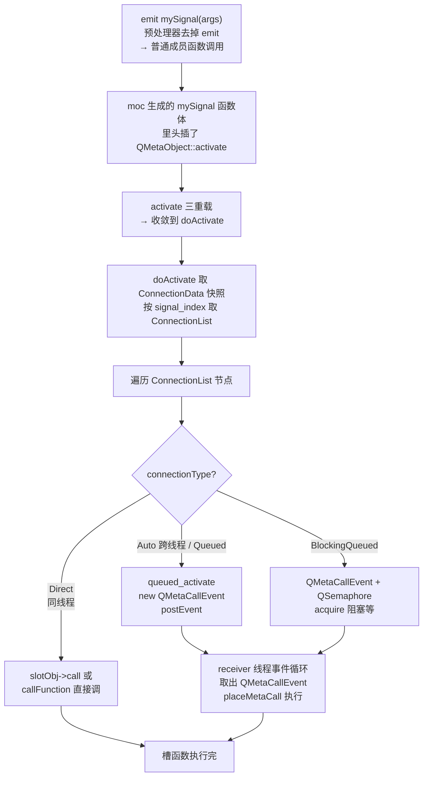
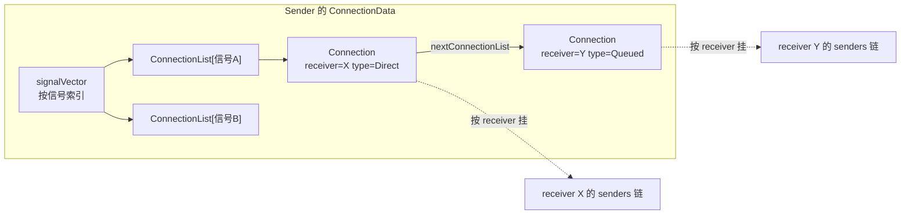

# 信号槽底层：QMetaObject::activate 调用链

## 前言：为什么信号槽值得拆源码

`connect(sender, &Sender::valueChanged, receiver, &Receiver::onValue)` 这样的一行，咱们都写过无数遍，`emit valueChanged(x)` 也发了无数回。可要是您停下来追问几句，问题就一个接一个冒出来了：`emit` 这个关键字到底做了什么？同样一行 `connect`，跨线程的时候，槽函数为什么会自动跑到接收线程去执行？`Qt::BlockingQueuedConnection` 放在同线程里，为什么会死锁？在槽函数里新 `connect` 的连接，为什么这一轮发射轮不到它？

这些问题单靠观察者模式的概括，是挡不住的。笔者被它们堵住的那一回，干脆把 `emit` 之后的整条调用链从源码里挖了出来，挖通了才发现，里面其实没有什么黑魔法，全是肉眼可见的代码。入门篇的 [1.2 信号与槽](../../beginner/01-qtbase/02-signal-slot-beginner.md) 教过咱们 `connect` 的重载怎么挑、`Qt::ConnectionType` 怎么选、lambda 怎么接。进阶篇的 [1.2 信号与槽：工程级深度剖析](../../advanced/01-qtbase/02-signal-slot-advanced.md) 把连接类型的工程取舍讲得很细。这一篇咱们干另一件事：从 `emit` 开始，一路追到槽函数真正被执行的那一刻，中间每一跳在源码里的落点，咱们都去按一遍。

咱们这一篇直接承接 [QObject 元对象系统源码拆解](./01-qobject-meta-system-expert.md)。上一篇讲的是元调用的通用框架 `metacall`，咱们按索引调方法、读写属性，走的都是它。这一篇讲的是信号发射的专用链路 `activate`。两条链路的关系，咱们在讲 emit 空宏的一节里就会交代清楚：`emit` 触发的是 `activate`，而不是 `metacall`。但 `activate` 分发到具体槽的时候，有一类槽会反过来走 `metacall` 的 `InvokeMetaMethod` 分支。这个关系理顺了，您读这一篇就不费劲了。

本篇顺着信号发射、连接表遍历、四类分流、槽执行、析构清理的主链走。moc 是怎么从头文件里扫描出信号列表、怎么生成 `staticMetaObject` 的，那是 [17 篇 MOC 编译器原理](./17-moc-compiler-expert.md) 的主场，咱们这里只把 moc 生成出来的信号函数体拿来用。

## 环境说明

咱们本篇的所有源码引用基于 `qt_src/qt6.9.1`，行号可能随 Qt 版本升级而漂移，您对照阅读时发现对不上，您拿函数名或字段名在对应文件里搜索定位就行。涉及 `moc/generator.cpp` 的行号尤其脆弱，那是 moc 工具的生成器模板，笔者都挂了脚注 `[^moc-gen]` 提醒。

咱们本篇会碰到的源码文件，按它们出现的顺序列在下面：

| 文件 | 角色 |
|---|---|
| `qt_src/qt6.9.1/qtbase/src/corelib/kernel/qtmetamacros.h` | emit 空宏定义 |
| `qt_src/qt6.9.1/qtbase/src/tools/moc/generator.cpp` | moc 在信号函数体里插 activate（生成器模板） |
| `qt_src/qt6.9.1/qtbase/src/corelib/kernel/qobject.cpp` | activate / doActivate / queued_activate / queuedConnectionTypes / connectImpl / addConnection / ~QObject 清理 |
| `qt_src/qt6.9.1/qtbase/src/corelib/kernel/qobject_p_p.h` | Connection / ConnectionList / ConnectionData / SignalVector 完整定义 |
| `qt_src/qt6.9.1/qtbase/src/corelib/kernel/qobjectdefs.h` | activate 可变参数模板重载、Connection 的布尔转换（operator RestrictedBool） |
| `qt_src/qt6.9.1/qtbase/src/corelib/kernel/qobject_p.h` | QMetaCallEvent 跨线程调用载体 |
| `qt_src/qt6.9.1/qtbase/src/corelib/kernel/qobject.h` | 函数指针（PMF）版 connect 取参数元类型表的入口 |
| `qt_src/qt6.9.1/qtbase/src/corelib/kernel/qobject_impl.h` | ConnectionTypes 对未注册类型的静默特化 |

咱们本篇不配 example，理由和上一篇讲的一样直白：纯源码拆解，您对照着 `qt_src` 翻原文，就是最好的实验。动手类的练习咱们挪到练习项目一节再做，走的是源码阅读加小验证的路子。

## 核心概念讲解

咱们动身以前把路线图对一遍。信号槽的调用链是一条单向主干，它从 `emit` 一路通到槽函数的执行，中间要过的两道弯，就是连接表的遍历和连接类型的分流：



链上有几个要紧的站，咱们顺着走，它的源头是 `emit`。

### emit 的真相：空宏，活儿都是 moc 干的

笔者刚学 Qt 的那会儿，一直以为 `emit` 是个特殊的关键字，追着它琢磨了很久，它到底触发了什么机制。直到笔者翻到它的定义（`qt_src/qt6.9.1/qtbase/src/corelib/kernel/qtmetamacros.h:49-52`），人愣住了：

```cpp
# define Q_EMIT
#ifndef QT_NO_EMIT
# define emit
#endif
```

`emit` 被定义成了空。您把 `emit mySignal(x)` 交给预处理器，出来的是赤裸裸的 `mySignal(x)`，一次普通的成员函数调用。`emit` 纯粹是写给人看的语法糖，让咱们读代码的时候一眼认出这是一次信号发射。而编译器和运行期压根就不认识这个词。

那信号发射的真身在哪？`mySignal()` 既然是普通函数调用，它的函数体总得有内容。这个函数体不是咱们写的，咱们只在 `signals:` 段下写了一行 `void mySignal(int x);` 声明，函数体是 moc 生成的。咱们看 moc 生成器怎么对待无参信号（`qt_src/qt6.9.1/qtbase/src/tools/moc/generator.cpp:1308-1311`[^moc-gen]）：

```cpp
if (def->arguments.isEmpty() && def->normalizedType == "void" && !def->isPrivateSignal) {
    fprintf(out, ")%s\n{\n"
            "    QMetaObject::activate(%s, &staticMetaObject, %d, nullptr);\n"
            "}\n", constQualifier, thisPtr.constData(), index);
```

这段是 moc 生成器的逻辑，它对每一个无参信号的处理都一样：用 `fprintf` 打印出一份函数体，里面装的只有一行：`QMetaObject::activate(this, &staticMetaObject, index, nullptr)`。所以咱们写 `emit mySignal()` 的时候，实际执行的是 moc 生成的 `mySignal()` 函数体，里面调了 `QMetaObject::activate`。信号发射的本质，其实就是调 `activate`。有参信号的函数体复杂一些，要把参数准备齐了再传进去，末尾那一句 `QMetaObject::activate` 调用倒是没有变。

这里要和上一篇的 `metacall` 做个区分，笔者觉得这是整篇最容易混的地方，卡在这儿的话后面都读不顺。`metacall` 是按索引调一个方法的通用框架，`QMetaObject::invokeMethod` 的反射调用、属性读写，走的都是它。`activate` 是信号发射的专用链路，它的工作是把一次信号通知给所有连上来的槽。两条链路后面会汇合：`activate` 遍历到一个用元方法方式连接的槽时，那个槽的执行会走 `metacall` 的 `InvokeMetaMethod` 分支。但源头咱们分得清楚，`emit` 触发的只有 `activate`。

### activate 三重载：全部收敛到 doActivate

知道了 `emit` 调的是 `activate`，咱们再来看 `activate` 本身。`QMetaObject::activate` 的公开重载有三个，参数的组合各不相同，可它们最后都收敛到了同一个内部模板函数 `doActivate` 里。咱们把最常用的那个重载请出来（`qt_src/qt6.9.1/qtbase/src/corelib/kernel/qobject.cpp:4198-4207`）：

```cpp
void QMetaObject::activate(QObject *sender, const QMetaObject *m, int local_signal_index,
                           void **argv)
{
    int signal_index = local_signal_index + QMetaObjectPrivate::signalOffset(m);

    if (Q_UNLIKELY(qt_signal_spy_callback_set.loadRelaxed()))
        doActivate<true>(sender, signal_index, argv);
    else
        doActivate<false>(sender, signal_index, argv);
}
```

您看这个函数，它干的活儿不多。它一头把传进来的局部信号索引 `local_signal_index` 加上了 `signalOffset(m)`，转成了全局信号索引 `signal_index`。为什么要转？一个类的信号索引，是本类自己声明的信号从 0 开始数的，可要在对象的整张连接表里定位，得用包含基类继承偏移的全局索引，而 `signalOffset` 装的就是这个继承偏移。另一头则把活儿整个委托给了 `doActivate`。

咱们来认清 `doActivate` 的身份：它是个模板函数，模板的参数是 `bool`，咱们去查两个版本的差别，查到的只有一处：要不要回调 `signal_spy`，它是 Qt 内部的信号监听钩子，GammaRay 这类调试工具的底层就靠它吃饭。正常的路径走 `doActivate<false>`，开了 spy 才走 `doActivate<true>`。三个公开重载的落点分别在 4198、4212、4226 行，无一例外地收敛到了 `doActivate`，后面的遍历和分流全在它里面发生。

### 连接表：信号到槽的映射存哪

`doActivate` 要把信号通知给所有连上来的槽，咱们得让它知道，这个信号到底连上了哪些槽。答案存在每个 QObject 对象自己的连接表里。咱们把连接表的数据结构理清楚。笔者第一次读这段的时候绕了好一阵，但后面的一切都踩在它上面，咱们把它啃下来，后面就顺了。

咱们看 `doActivate` 一进门拿的东西，就是连接表的快照（`qt_src/qt6.9.1/qtbase/src/corelib/kernel/qobject.cpp:4061-4068`）：

```cpp
QObjectPrivate::ConnectionDataPointer connections(sp->connections.loadAcquire());
QObjectPrivate::SignalVector *signalVector = connections->signalVector.loadRelaxed();

const QObjectPrivate::ConnectionList *list;
if (signal_index < signalVector->count())
    list = &signalVector->at(signal_index);
else
    list = &signalVector->at(-1);
```

咱们像剥洋葱一样，一层一层地看。最外面的一层是 `sp->connections`，每个 QObject 的私有数据里，都持有一个指向 `ConnectionData` 的指针。而 `loadAcquire()` 干的是原子读，保证咱们后续对连接表的读，能看到所有在此之前发生的连接写入。拿到了 `ConnectionData` 以后，咱们从里面取 `signalVector`，一个按信号索引组织的向量，再拿全局的 `signal_index` 当下标，取出对应的 `ConnectionList`。咱们一路走到头，拿到的就是连到这个信号的所有槽组成的链表。

这些数据结构都定义在 Qt 更内层的私有头 `qobject_p_p.h` 里，咱们注意它带着两个 `_p`，比 `qobject_p.h` 还要更里面的一层。咱们从最贴着手的 `ConnectionList` 看起（`qt_src/qt6.9.1/qtbase/src/corelib/kernel/qobject_p_p.h:28-33`）：

```cpp
// ConnectionList is a singly-linked list
struct QObjectPrivate::ConnectionList
{
    QAtomicPointer<Connection> first;
    QAtomicPointer<Connection> last;
};
```

您看它，就是个带 `first`/`last` 的单链表容器，每个元素装的都是一个 `Connection` 节点。而一个信号对应一个 `ConnectionList`，里面串着所有连到这个信号的连接。

咱们再看 `Connection` 节点本身，它就是连接表的基本单元（`qt_src/qt6.9.1/qtbase/src/corelib/kernel/qobject_p_p.h:69-95`）：

```cpp
struct QObjectPrivate::Connection : public ConnectionOrSignalVector
{
    Connection **prev;
    QAtomicPointer<Connection> nextConnectionList;
    Connection *prevConnectionList;

    QObject *sender;
    QAtomicPointer<QObject> receiver;
    // ...
    ushort connectionType : 2; // 0 == auto, 1 == direct, 2 == queued, 3 == blocking
```

咱们看 `Connection` 节点是怎么同时挂上两条链的。一条链按信号组织：`nextConnectionList` 和 `prevConnectionList` 把连到同一个信号的所有 `Connection` 串起来，就是上面 `ConnectionList` 里装着的链。另一条链按接收者组织：`prev` 和 `next`（`next` 在基类 `ConnectionOrSignalVector` 里）把同一个 receiver 接收的所有连接串起来，挂在 receiver 的 `senders` 链上。为什么这么设计？咱们到析构清理一节看那两类清理就明白了：断开某个信号的所有连接，断开某个对象接收的所有连接，两边的断开都要能高效办到，析构清理的两头全指着它们。

咱们把末尾的 `connectionType : 2` 单独认一下，它是个 2-bit 的位域，里面存着四种连接类型的编号，编号的 0、1、2、3，分别对应的是 Auto、Direct、Queued、Blocking。一个连接的类型在 `connect` 时就定死了，发射期分流靠的就是这个字段，四类连接一节里咱们马上会用到它。

最外层的 `ConnectionData`，咱们把它想成整张连接表的入口（`qt_src/qt6.9.1/qtbase/src/corelib/kernel/qobject_p_p.h:136-145`）：

```cpp
struct QObjectPrivate::ConnectionData
{
    // the id below is used to avoid activating new connections. When the object gets
    // deleted it's set to 0, so that signal emission stops
    QAtomicInteger<uint> currentConnectionId;
    QAtomicInt ref;
    QAtomicPointer<SignalVector> signalVector;
    Connection *senders = nullptr;
    Sender *currentSender = nullptr;
    std::atomic<TaggedSignalVector> orphaned = {};
```

`ConnectionData` 手里管的东西，咱们挑要紧的认：`currentConnectionId` 是递增的连接 id，重入保护要靠的也就是它，咱们到重入保护一节再见。`ref` 装的是引用计数，它让正在发射信号时的连接表不被析构。`signalVector` 是按信号索引的连接向量。`senders` 是本对象作为接收者挂着的所有连接链。旁边的那个 `orphaned`，暂存的是已经断开、还没到安全清理时机的连接。咱们把注释里那句 `When the object gets deleted it's set to 0, so that signal emission stops` 单独念一遍，它值得咱们多看一眼：`currentConnectionId` 在析构时会被置 0，这是重入保护的第二道防线，咱们到重入保护一节回来接它。

咱们把这套结构画出来，连接表的全貌长这样：



### 连接的建立：connect 到底存了什么

结构认识了，咱们看一次 `connect` 调用往里存了什么。`QObject::connect` 的各种重载，最后都走到内部的 `connectImpl`（`qt_src/qt6.9.1/qtbase/src/corelib/kernel/qobject.cpp:5318-5334`）：

```cpp
std::unique_ptr<QObjectPrivate::Connection> c{new QObjectPrivate::Connection};
c->sender = s;
c->signal_index = signal_index;
// ...
c->connectionType = type;
c->isSlotObject = true;
c->slotObj = slotObj.release();
// ...
QObjectPrivate::get(s)->addConnection(signal_index, c.get());
```

咱们看 `connectImpl` 干的事：new 出一个 `Connection` 节点，把字段填好了。`sender` 记的是发送者，`signal_index` 存的是信号全局索引，`connectionType` 标的是连接类型，`isSlotObject` 加 `slotObj` 管的是函数对象式连接，lambda 或 `std::bind` 的结果会包成一个 `SlotObj`。字段填完了就去调 `addConnection`，把节点插到了连接表里。

咱们接着看 `addConnection`，它的插入有前后两段，方向是不一样的（`qt_src/qt6.9.1/qtbase/src/corelib/kernel/qobject.cpp:282-300`）：

```cpp
ConnectionList &connectionList = cd->connectionsForSignal(signal);
if (connectionList.last.loadRelaxed()) {
    // ...
    connectionList.last.loadRelaxed()->nextConnectionList.storeRelaxed(c);
} else {
    connectionList.first.storeRelaxed(c);
}
c->id = ++cd->currentConnectionId;
// ...
c->prev = &(rd->connections.loadRelaxed()->senders);
c->next = *c->prev;
*c->prev = c;
```

咱们分开看。前一段插的是信号链：找到这个信号对应的 `ConnectionList`，把新节点尾插到了链尾，也就是更新 `last` 的 `nextConnectionList`。插的时候还给它发了张身份证，`c->id = ++cd->currentConnectionId`，一个递增的 id，到了重入保护一节，咱们拿它当判定的凭据。后一段插的是接收者链：把新节点头插到 receiver 的 `senders` 链表头部。这两步走完了，连接表一节说的双链就齐了，新连接一边挂在 sender 的信号链上，一边挂在 receiver 的 `senders` 链上。等到了下次信号发射，`doActivate` 顺着信号链就能摸到它了。

### 四类连接：发射期怎么分流

连接表建好了，咱们回到 `doActivate` 的主循环。它遍历当前信号的 `ConnectionList`，按每个 `Connection` 节点的 `connectionType` 决定怎么调槽。四类连接落到代码里的是三条执行路径，而 Auto 在发射期现判，归进了 Direct 或 Queued，咱们把三条路径读通以后，自动切线程、同线程死锁之类的怪现象，就全都解释得通了。

咱们看 Direct 连接，它走的是快路径（`qt_src/qt6.9.1/qtbase/src/corelib/kernel/qobject.cpp:4141-4159`）：

```cpp
if (c->isSlotObject) {
    SlotObjectGuard obj{c->slotObj};
    {
        Q_TRACE_SCOPE(QMetaObject_activate_slot_functor, c->slotObj);
        obj->call(receiver, argv);
    }
} else if (c->callFunction && c->method_offset <= receiver->metaObject()->methodOffset()) {
    // ...
    callFunction(receiver, QMetaObject::InvokeMetaMethod, method_relative, argv);
```

Direct 分支里又分出了两种。函数对象式的连接（`isSlotObject`，比如咱们随手写的 lambda），咱们直接用 `slotObj->call(receiver, argv)` 把它调过去，而它连元对象系统都不用经过。传统的元方法连接，走的是 `callFunction(receiver, QMetaObject::InvokeMetaMethod, ...)`，咱们在这儿和上一篇的 `metacall` 汇合了，槽方法的执行靠的就是 `InvokeMetaMethod` 这个 Call 类型。两种方式都是同步的，而且都在发送线程里直接调，参数也没有做任何的拷贝，Direct 同步调完了就返回，所以栈帧没退，参数也就自然地一直活着。

> 带参信号的 `argv` 是怎么备齐的，笔者顺带交代一句：moc 生成的函数体早就不是老式 `void *argv[]` 数组的写法了，它调的是 `activate` 的可变参数模板重载，在栈上把 `void *_a[]` 现场搭了起来（`qobjectdefs.h:299-307` 就是这个重载、`generator.cpp:1340-1350`[^moc-gen] 打印的正是那个调用），数组元素是信号函数帧上每个参数的地址。

咱们翻到 Auto 和 Queued，它们走的是另一条路（`qt_src/qt6.9.1/qtbase/src/corelib/kernel/qobject.cpp:4102-4104`）：

```cpp
if ((c->connectionType == Qt::AutoConnection && !receiverInSameThread)
            || (c->connectionType == Qt::QueuedConnection)) {
    queued_activate(sender, signal_index, c, argv);
```

请您留意 Auto 的判定，`c->connectionType == Qt::AutoConnection && !receiverInSameThread`，这是发射期现判的。Auto 连接在 `connect` 时存的类型是 0，可它到底走的是 Direct 还是 Queued，取决于发射的那一刻，就看发送的和接收的线程是不是同一个。`receiverInSameThread` 是发射时查出来的，跨了线程，Auto 也就退化成了 Queued。

咱们在这儿出一道场景题，检验一下您有没有真读懂这个现判。您用 `Qt::AutoConnection` 把 worker 的信号连到一个 QObject 接收者的槽上，咱们让 worker 住后台线程、接收者住主线程。那第一次 emit 的时候，槽在哪个线程执行？后来您把接收对象 `moveToThread` 挪到了后台线程，您再 emit 一回，又轮到谁？咱们把推导走一遍：第一次发射，发送的线程和接收的线程不是同一个，所以条件成立，也就走进了 `queued_activate`，槽被投给接收线程的事件循环，在主线程里异步地执行。挪完线程以后的第二次发射，两边已经变成了同一个线程，这个条件不成立了，连接就落到了 Direct 分支，槽在发送线程里同步地执行，也就是跑在了后台线程里。同一个连接、前后两次的行为却不一样，变的不是连接，而是线程关系。

轮到 `queued_activate` 干活了，咱们看它一进门做的第一件事不是构造事件，而是查参数的元类型表（`qt_src/qt6.9.1/qtbase/src/corelib/kernel/qobject.cpp:3961-3974`）：

```cpp
const int *argumentTypes = c->argumentTypes.loadRelaxed();
if (!argumentTypes) {
    QMetaMethod m = QMetaObjectPrivate::signal(sender->metaObject(), signal);
    argumentTypes = queuedConnectionTypes(m);
    if (!argumentTypes) // cannot queue arguments
        argumentTypes = &DIRECT_CONNECTION_ONLY;
    // ...
}
if (argumentTypes == &DIRECT_CONNECTION_ONLY) // cannot activate
    return;
```

这一小段咱们单独指出来，因为它是风险一节里第二类风险的源头。`c->argumentTypes` 是连接自带的参数元类型表，字符串版 `connect`（`SIGNAL()`/`SLOT()` 宏的写法）会在建立连接时就把它查好。PMF 版 `connect`（`&Sender::signal` 函数指针写法）拿不到已注册的类型时，会静默地留一个空。到了发射这一刻，表还是空的，于是现场调了 `queuedConnectionTypes(m)` 补查，补不出来的话，拿到的就是 `DIRECT_CONNECTION_ONLY`，接下来的动作就是直接 return，这个连接本轮就被跳过了，而且以后每一轮也都跳过。两条路径各自怎么走，咱们留到风险一节再展开。

查表过关了，咱们把事件怎么构造、怎么投递的这一段拎出来看（`qt_src/qt6.9.1/qtbase/src/corelib/kernel/qobject.cpp:3989-4020`）：

```cpp
QMetaCallEvent *ev = c->isSlotObject ?
        new QMetaCallEvent(c->slotObj, sender, signal, nargs) :
        new QMetaCallEvent(c->method_offset, c->method_relative, c->callFunction, sender, signal, nargs);
// ...
    for (int n = 1; n < nargs; ++n)
        args[n] = types[n].create(argv[n]);
// ...
QCoreApplication::postEvent(receiver, ev);
```

咱们看 `queued_activate` new 出一个 `QMetaCallEvent`，跨线程调用的载体，咱们到 QMetaCallEvent 一节详讲它。然后有一段代码值得咱们停下来看，就是那个从下标 1 起跑的循环，`args[n] = types[n].create(argv[n])`，它对每个参数都做了深拷贝。为什么必须拷？参数要跨线程传递，原 `argv` 在发送线程的栈上，而 Queued 是异步的，发送线程投递完了就继续跑，而且不会等接收线程把槽执行完，栈一退了，参数就没了。所以必须复制一份存进事件里，复制出来的数据生存期跟着事件走：在队列里排多久都行，处理或丢弃的时候也就由它释放了。到了最后一步，`QCoreApplication::postEvent(receiver, ev)` 把事件投进 receiver 线程的事件队列，sender 这边到这儿就算发射完了，它头也不回地往下走、谁也不等。

咱们最后请出 BlockingQueued，而它会把发送线程整个拖住，咱们看它是怎么办到的（`qt_src/qt6.9.1/qtbase/src/corelib/kernel/qobject.cpp:4107-4131`）：

```cpp
} else if (c->connectionType == Qt::BlockingQueuedConnection) {
    if (receiverInSameThread) {
        qWarning("Qt: Dead lock detected while activating a BlockingQueuedConnection: "
                 "Sender is %s(%p), receiver is %s(%p)",
                 sender->metaObject()->className(), sender,
                 receiver->metaObject()->className(), receiver);
    // ...
    QSemaphore semaphore;
    {
        // ...
        QMetaCallEvent *ev = ... new QMetaCallEvent(c->slotObj, sender, signal_index, argv, &semaphore) ...;
        QCoreApplication::postEvent(receiver, ev);
    }
    semaphore.acquire();
    continue;
```

咱们看它的逻辑：构造一个带 `QSemaphore` 的 `QMetaCallEvent`，投进了 receiver 线程的事件队列，然后咱们看 `semaphore.acquire()` 把发送线程挂起，等 receiver 线程执行完了槽函数，release 了信号量，而 sender 这才继续走。跨线程的同步调用，就是这么实现的。

开头那个 `if (receiverInSameThread)` 是冲着死锁来的，可惜的是它只喊不拦。要是 sender 和 receiver 用的是同一个线程，`postEvent` 把事件投进当前线程的队列，而当前线程此刻正阻塞在 `acquire()` 上等这个事件被处理，所以事件永远轮不到处理，而 `acquire` 永远等不到 `release`，结果就是死锁。Qt 在这里用 `qWarning` 报了警，warning 里带完整的 Sender 和 receiver 类名加指针，算是给咱们留了定位线索。风险一节的第一类风险，咱们还会回来接着说。

还有一个对比值得咱们写下来，BlockingQueued 的 `argv` 是原样传进事件的、不做深拷贝。`qobject_p.h:372` 的注释写得明白，`blocking queued with semaphore - args always owned by caller`。凭什么敢不拷？您想，sender 是会一直阻塞到槽返回的，它的栈帧没退，`argv` 指向的参数从头到尾都活着，拷贝就成了白费功夫，而 Queued 那边就非深拷贝不可，道理正好反了过来。至于 BlockingQueued 分支不查参数元类型表的这一层，风险一节的第二类风险咱们带着行号细说。

### QMetaCallEvent：跨线程调用的载体

Queued 和 BlockingQueued 这两边咱们都见过了，它们把槽调用打包成了 `QMetaCallEvent`、再投出去。咱们看看这个事件类封装了什么（`qt_src/qt6.9.1/qtbase/src/corelib/kernel/qobject_p.h:369-423`）：

```cpp
class Q_CORE_EXPORT QMetaCallEvent : public QAbstractMetaCallEvent
{
public:
    // blocking queued with semaphore - args always owned by caller
    QMetaCallEvent(ushort method_offset, ushort method_relative, ...) ...
    // ...
    inline int id() const { return d.method_offset_ + d.method_relative_; }
    inline const void * const* args() const { return d.args_; }
    // ...
    virtual void placeMetaCall(QObject *object) override;
```

您把它装的东西数一遍：`method_offset_` 加 `method_relative_` 拼出槽方法的全局 id，`id()` 方法干的就是把两者相加。`slotObj` 或 `callFunction` 决定的是槽怎么调。`args_` 是深拷贝后的参数数组。再有一个可选的 `semaphore`，它是给 BlockingQueued 用的。咱们要在它身上单独认一个方法，`placeMetaCall`：receiver 线程的事件循环从队列里取出这个事件并处理时，调的就是它，真正的槽调用在里面发生。

咱们把跨线程的全程串一遍：sender 线程 emit 了信号、activate 接手，`doActivate` 发现了是 Queued，`queued_activate` 构造了 `QMetaCallEvent`、深拷贝了参数，`postEvent` 完成了投递，sender 就继续干自己的事。receiver 线程的事件循环稍后取出事件、调 `placeMetaCall`，把槽执行了。槽函数始终是在 receiver 线程里执行的，跨线程信号槽的自动切线程，用的就是一个事件队列加一个事件类，再没有多出来的部件。

### 析构清理：断开所有连接

一个 QObject 析构的时候，它涉及的连接必须全部清掉，不然别的对象 emit 时会访问到已释放的 receiver，或者已释放的对象还作为 sender 被查询。~QObject 里的清理分两类，咱们一类一类看。

咱们看第一类，清的是自己作为 sender 发出的连接（`qt_src/qt6.9.1/qtbase/src/corelib/kernel/qobject.cpp:1060-1074`）：

```cpp
for (int signal = -1; signal < receiverCount; ++signal) {
            QObjectPrivate::ConnectionList &connectionList = cd->connectionsForSignal(signal);
            while (QObjectPrivate::Connection *c = connectionList.first.loadRelaxed()) {
                // ...
                cd->removeConnection(c);
```

咱们看这段，它遍历自己的整张连接表，它的 `signal` 从 -1 起跑到 receiverCount，-1 是一个特殊的桶，装的是不分信号的连接。每个 `ConnectionList` 里的节点，咱们看它们被逐个 `removeConnection` 摘掉。回想连接表一节的双链设计，这里清的就是按信号组织的一条链。

咱们看第二类，清的是接收侧（`qt_src/qt6.9.1/qtbase/src/corelib/kernel/qobject.cpp:1077-1105`）：

```cpp
/* Disconnect all senders:
     */
        while (QObjectPrivate::Connection *node = cd->senders) {
            // ...
            QObject *sender = node->sender;
            // ...
            QObjectPrivate::ConnectionData *senderData = sender->d_func()->connections.loadRelaxed();
            // ...
            senderData->removeConnection(node);
```

这次遍历的是 `cd->senders`，本对象作为接收者挂着的所有连接，双链的另一条。咱们对每个节点，用 `node->sender` 反查到了发送者对象，再走进发送者的连接表，把它 `removeConnection` 掉了。笔者觉得，连接表一节那套双链最值钱的地方就在这儿：析构清理全靠 `sender` 指针定位对方，而没有它，悬垂的连接根本没法清干净。

咱们把两类清理合起来看：一个 QObject 析构以后，没有任何悬垂的 `Connection` 节点指向它，别的对象再 emit，也摸不到已释放的那一端。

### 重入保护：发射期间新增的连接怎么办

最后咱们讲一个和发射时序相关的细节：信号发射期间的重入保护。咱们假设信号 `A()` 连着槽 `slot1`，`slot1` 里又写了一行 `connect(this, &T::A, this, &T::slot2)`。这行 `connect` 会在 `A` 的 `ConnectionList` 末尾追加一个新连接。问题来了：当前 `doActivate` 正在遍历这个 `ConnectionList`，它会遍历到这个新追加的 `slot2` 连接吗？要是会，`slot2` 就会被卷进这一轮的发射里触发，可写代码的人意图多半是下次发射才触发。

笔者读到这段的时候没料到，Qt 为了本轮不触发，专门设了两道防线。第一道防线靠的是 `highestConnectionId` 快照（`qt_src/qt6.9.1/qtbase/src/corelib/kernel/qobject.cpp:4073-4075`）：

```cpp
// We need to check against the highest connection id to ensure that signals added
// during the signal emission are not emitted in this emission.
uint highestConnectionId = connections->currentConnectionId.loadRelaxed();
```

`doActivate` 一进门就把当前的 `currentConnectionId` 拍成了快照，存进了 `highestConnectionId`。到了后面遍历连接链的时候，有一个 while 条件检查的是 `c->id <= highestConnectionId`，只有 id 不超过快照的连接才触发。检查的那一行在 4178 行，和上面的声明隔了大约一百行，咱们把它单独拎出来看（`qt_src/qt6.9.1/qtbase/src/corelib/kernel/qobject.cpp:4178`）：

```cpp
} while ((c = c->nextConnectionList.loadRelaxed()) != nullptr && c->id <= highestConnectionId);
```

发射期间新 `connect` 的连接，它的 id 是 `++currentConnectionId`，咱们拿快照一比，必然超了，条件在它面前就成了假，循环还没走到它就停了，本轮就跳过了它，而要等到下一次发射才轮到它。另外新连接是尾插进链表的，它天然排在遍历起点的后面，顺带又多了一层排序上的保障。

咱们照例出一道题，您拿 id 机制推一遍。咱们还是用上面那个场景，`slot1` 里 `connect` 了 `slot2`，这一轮发射轮得到 `slot2` 吗？要是把这行 `connect` 挪到 emit 之前写，答案变不变？推法是这样的：写在 `slot1` 里，新连接的 id 必然超过快照，4178 行的 id 检查拦下它，本轮就不触发了。而挪到 emit 之前的话，`connect` 发生的时刻早于快照，它的 id 不超过快照值，本轮就照常触发了。判定的标准自始至终只有一个：id 和快照比大小，`connect` 写在哪段代码里和这件事没有直接的关系，而和它发生在快照之前还是之后有关系。

第二道防线要到析构的时候才上场。连接表一节咱们提过 `ConnectionData` 注释里那句：对象删除时 `currentConnectionId` 置 0，信号发射也就停止了（`qt_src/qt6.9.1/qtbase/src/corelib/kernel/qobject.cpp:1133`）：

```cpp
cd->currentConnectionId.storeRelaxed(0);
```

咱们看这是在 ~QObject 里执行的。而置 0 之后，要是此刻正好有别的线程在发射指向这个对象的信号、遍历它的连接表，激活循环会在 4184-4185 行检测到 `currentConnectionId` 变成了 0，于是设置了 `senderDeleted` 标志，4187 行的 `if (!senderDeleted)` 就不再去做 orphan 连接清理，避免析构途中再去碰已经不完整的连接表。

最后咱们补一个和生命周期相关的细节，`Connection` 节点靠的是引用计数管理（`qt_src/qt6.9.1/qtbase/src/corelib/kernel/qobject_p_p.h:85-118`）：

```cpp
QAtomicInt ref_{
        2
    }; // ref_ is 2 for the use in the internal lists, and for the use in QMetaObject::Connection
    // ...
    void deref()
    {
        if (!ref_.deref()) {
            Q_ASSERT(!receiver.loadRelaxed());
            Q_ASSERT(!isSlotObject);
            delete this;
        }
    }
```

`Connection` 的 `ref_` 初值是 2，一份给了内部连接表，一份给了 `QMetaObject::Connection` 句柄，句柄就是 `connect` 的返回值。`removeConnection` 只是把它从链表里摘了下来，把 `ref_` 减了 1，其实并不立即 delete。要等外部持有的句柄也析构，咱们再 deref 一次，等 `ref_` 归了零，节点才真正释放了。所以您手里攥着一个 `QMetaObject::Connection`，节点内存就陪您活着，可它说明的只是句柄合法，而不代表连接还挂在链上。这里面的细节，风险一节的第三类咱们摊开讲。

## 风险与故障预防

四类连接一节和重入保护一节咱们留了几个话头，同线程 BlockingQueued 的死锁、查表失败的两条路径、句柄和连接的存活之别，现在咱们挨个摊开。

第一类风险是 BlockingQueuedConnection 用在同线程时的死锁，机制咱们在四类连接一节已经看过：事件投进当前线程的队列，而当前线程正阻塞在 `acquire()` 上等它，偏偏等不到 `release`。咱们接着说后果：那句 Dead lock 警告不打断、也不解锁，很多人是不开 warning 输出的，也就看不见它了。等真出了事，剩下的就是界面冻住、线程挂死，定位起来是非常痛苦的。解法也直接：BlockingQueued 只用在确定的跨线程场景，发送和接收线程的生命周期都要可控。您要是拿不准线程关系，就用 AutoConnection 好了，发射期现判替您兜底。您在同线程想要同步拿结果，DirectConnection 或者直接函数调用都是可行的，咱们别图省事去上 BlockingQueued。

第二类风险：跨线程 Queued 连接传了没注册 `qRegisterMetaType` 的自定义类型，结果槽不触发。咱们在四类连接一节看过，`queued_activate` 进门要查的是参数元类型表、查不到就换成 `DIRECT_CONNECTION_ONLY` 提前返回。那报警长什么样、什么时候打？这里笔者把 6.9.1 的真实行为摆出来，因为它和网上流传的老说法对不上：老教程里常把报警写成 `QMetaType::create: error copying type`，这一句在 6.9.1 的 qtbase 里搜不到。真实的警告文本在 `queuedConnectionTypes` 里（`qobject.cpp:91-94`）：

```cpp
qCWarning(lcConnect,
          "QObject::connect: Cannot queue arguments of type '%s'\n"
          "(Make sure '%s' is registered using qRegisterMetaType().)",
          typeName.constData(), typeName.constData());
```

输出走的是 `qt.core.qobject.connect` 这个日志分类。触发时机分了两条路，咱们分开认。字符串版的 connect，也就是 `SIGNAL()`/`SLOT()` 宏的写法：connect 时就查，`qobject.cpp:3160-3162` 的判断里，`queuedConnectionTypes` 拿不到类型就打上面的警告，connect 当场返回了一个空连接、等于压根没建立：

```cpp
int *types = nullptr;
if ((type == Qt::QueuedConnection) && !(types = queuedConnectionTypes(signal)))
    return QMetaObject::Connection(nullptr);
```

PMF 版的 connect，咱们看它的路数：connect 时 `QtPrivate::ConnectionTypes<...>::types()` 对未注册类型静默返回 nullptr，调用点的位置在 `qobject.h:257-259`，`qobject_impl.h:34-35` 是那个不吭声的特化，连接还是正常建立了。等到了第一次 emit，`queued_activate` 头部的补查失败，警告在那时候打了出来，然后 `argumentTypes` 就被换成了 `DIRECT_CONNECTION_ONLY`、直接 return。它从此每次 emit 都被静默地跳过，警告其实只在第一次打一次，因为 `testAndSetOrdered` 把结果缓存住了。

失败的模式只有一种：槽不触发。您不会收到垃圾数据，更不存在参数损坏的情况，因为执行路径根本走不到 `types[n].create(argv[n])` 那一行的深拷贝，在 3973-3974 行就提前返回了。这类问题阴险的地方在同线程测试全部通过：Direct 路径不查表也不深拷贝，倒是一切正常，一上多线程就哑了。四类连接一节末尾咱们指过一句对照，这里咱们补上行号证据：BlockingQueued 分支完全不查元类型表，4107-4131 一路没有 `argumentTypes` 的影子，未注册的类型也能传过去，当然同线程死锁的风险您还是得自己扛。解法：跨线程信号槽要传的每个自定义类型，初始化时咱们用 `qRegisterMetaType<MyStruct>()` 注册上。大对象咱们尽量传 `const MyStruct&`，Direct 路径走的是零拷贝，Queued 路径还是会拷一次的，但至少类型是已知的。您传指针就得自己管好对象的生命周期。

第三类风险：把 `QMetaObject::Connection` 句柄的存活，当成连接的存活。重入保护一节末尾咱们留了一个话头，这里咱们摊开讲。有一种流传的讲法是，连接断了以后，手里的句柄转成布尔值可能还是真，所以不能用 `if (connection)` 判断有效性。笔者这次把 6.9.1 的源码翻透了，这个说法其实是站不住的，而行为恰好相反：断开之后，布尔值是可靠返回 false 的。证据链咱们走一遍。所有的断开路径，句柄版 disconnect、按 signal/receiver/method 的各重载、任一端对象析构，而最后都经过 `ConnectionData::removeConnection`。它的第一个动作就是清空 receiver，咱们看源码（`qt_src/qt6.9.1/qtbase/src/corelib/kernel/qobject.cpp:303-307`）：

```cpp
void QObjectPrivate::ConnectionData::removeConnection(QObjectPrivate::Connection *c)
{
    Q_ASSERT(c->receiver.loadRelaxed());
    ConnectionList &connections = signalVector.loadRelaxed()->at(c->signal_index);
    c->receiver.storeRelaxed(nullptr);
```

而句柄的布尔值，走的是 `operator RestrictedBool`（`qobjectdefs.h:672`），里面调的就是 `isConnected_helper`。它返回什么，咱们把下面这段原文翻出来（`qt_src/qt6.9.1/qtbase/src/corelib/kernel/qobject.cpp:5653-5659`）：

```cpp
bool QMetaObject::Connection::isConnected_helper() const
{
    Q_ASSERT(d_ptr);    // we're only called from operator RestrictedBool() const
    QObjectPrivate::Connection *c = static_cast<QObjectPrivate::Connection *>(d_ptr);

    return c->receiver.loadRelaxed();
}
```

返回的就是 `c->receiver`。receiver 在摘链的第一步就被清空了，所以布尔值想不为 `false` 都难。那真正的混淆点在哪？在重入保护一节那套 `ref_` 引用计数：摘链只是 deref，节点内存要等您的句柄也析构才释放。于是同一个 `QMetaObject::Connection` 就有了两重身份：它作为对象是合法的、能安全持有，您再调一次 `disconnect(connection)` 也不会出事，只是返回 false 罢了。而作为连接，它可能早就没了。所以咱们管连接生命周期，别指着攥句柄：要么用带 context 的 connect，让连接随 context 的析构自动断开。要么存下句柄、主动 `disconnect(connection)` 管理。而至于布尔值本身，单线程里倒是能放心用。

## 练习项目

本篇是纯源码解析的篇目，没有配套的 example，练习就走源码阅读加小验证的路子。四个题目咱们都只给方向和验证手段，完整工程留给您自己搭。

第一题咱们就把 moc 产物挖出来读。您找一个开了 `CMAKE_AUTOMOC` 的工程完整编译一遍，到 build 目录里翻 moc 生成的 `moc_*.cpp`，咱们的任务是在里面找到信号函数体、亲眼看一眼 `QMetaObject::activate` 那个调用。无参信号的函数体应该只有 activate 一行，末尾的参数是 nullptr。有参信号的函数体，而参数会存进局部变量，取地址往 activate 里传。验证的手段就是拿 emit 空宏一节的引文逐行对照，`generator.cpp` 打印出来的东西，和您手里的产物应该严丝合缝。

第二题咱们亲眼看一次 Auto 的换挡。咱们准备一个后台线程，把一个 QObject 接收者用 `moveToThread` 挪了进去，sender 留在了主线程，连接选的是 `Qt::AutoConnection`，咱们在槽里打印 `QThread::currentThreadId()`。伪代码的方向：

```cpp
// worker 线程启动；receiver moveToThread(worker)
// connect(sender, &S::sig, receiver, &R::slot, Qt::AutoConnection)
// 槽里打印 QThread::currentThreadId()
// 第一轮 emit，观察输出；receiver 挪回主线程，第二轮 emit，再观察
```

咱们验证的标准就一条：两次输出的线程 id 不同，第一次落在了接收线程（后台），第二次跑在了发送线程（主线程），正好对应四类连接一节里 4102 行那个条件的一真一假。对上了，Auto 的发射期现判就算亲手摸过了。

第三题咱们复现发射期新增连接的跳过。咱们让信号 `A` 连槽 `slot1`，您在 `slot1` 里写一行 `connect`、把 `slot2` 也挂到 `A` 上，然后咱们手动 emit 两次。您数一数触发次数：第一次 emit，跑的只有 `slot1`，`slot2` 被 4178 行的 id 检查拦下。到了第二次 emit，`slot1` 和 `slot2` 就都跑了。对照重入保护一节的 id 快照机制，把两次结果的道理讲给自己听一遍，讲得通了，这道题也就过关了。

第四题咱们亲耳听一句真实的 Cannot queue 警告。咱们准备一个没注册过的自定义结构体，用跨线程的 Queued 连接传它，验证分了两步走。第一步咱们用 PMF 版 connect：connect 应当成功，第一次 emit 时打了一条 `QObject::connect: Cannot queue arguments of type '...'` 警告，槽就永远不触发了，再 emit 也不重打了。第二步咱们换成字符串版 `SIGNAL()`：connect 当场打同款警告并返回空连接，您拿布尔值一验便知。警告默认是会输出到 stderr 的，用的分类是 `qt.core.qobject.connect`，想精细控制的话咱们再动 `QT_LOGGING_RULES`。对照风险一节里第二类的那几处行号，两条路径的差异您就亲眼见过了。

## 官方文档参考链接

[Qt 文档 · Signals & Slots](https://doc.qt.io/qt-6/signalsandslots.html)——信号槽机制的总览，连接类型的语义说明也在里面，咱们做整体回顾时可以翻一翻（本篇的基线是 `6.9.1`，线上页面是随小版本更新的）

[Qt 文档 · QObject](https://doc.qt.io/qt-6/qobject.html)——QObject 的类参考，咱们查 connect、disconnect、sender 的官方说法时，都是以它为准的

[Qt 文档 · Qt::ConnectionType](https://doc.qt.io/qt-6/qt.html#ConnectionType-enum)——连接类型的枚举与语义，咱们查语义以它为准。页面上还附了一条官方警告，说同线程用 BlockingQueuedConnection 是会死锁的，咱们正好拿它和四类连接一节的源码互相印证

---

走到了这里，信号槽的 `activate` 调用链，咱们就从源码层面走完了。笔者的感受和上一篇走 `metacall` 时一样：一层层追下来，没有哪一步是翻不到代码的。下一篇咱们挪去 [03 QString 内存模型](./03-qstring-memory-expert.md)，看一个 QString 在内存里到底长什么样，写时复制的 detach 走哪几条路。MOC 编译器本身的源码，[17 篇 MOC 编译器原理](./17-moc-compiler-expert.md) 还在老地方等着咱们。

您要是想把本篇的所有行号证据拿来一一核对，咱们已经把它们按源码机制归好类、收在三个文件里：[emit 与 activate 发射链](../code-index/qtbase/signal-emit-activate.md)、[连接表数据结构](../code-index/qtbase/signal-connection-table.md)、[四类分流与析构清理](../code-index/qtbase/signal-dispatch-cleanup.md)，您带着行号直接去 `qt_src/qt6.9.1` 翻原文就行。

[^moc-gen]: 咱们引用的这类行号来自 `qt_src/qt6.9.1/qtbase/src/tools/moc/generator.cpp`，是 moc 生成器的源码模板行号，而不是产物行号，两者咱们要分开认。`generator.cpp` 用 `fprintf` 打印出 `moc_*.cpp` 的内容，咱们引用它来还原 moc 生成出来的信号函数体。Qt 升级时这部分行号是漂移最快的，您对照阅读时，请您以函数名和逻辑定位为准。
