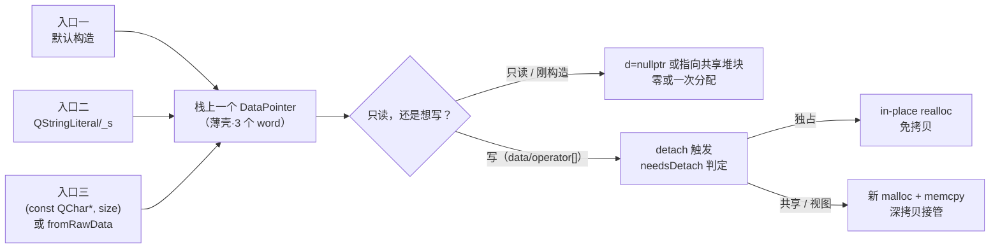

# QString 内存模型源码拆解

## 前言：QString 天天在用，它在内存里长什么样

咱们动源码以前，笔者把当年写代码时冒出来、又一直答不上来的三个问题摆在这里：

短串怎么放？QString 会不会学 `std::string` 的 SSO（短串优化）把字符存在对象内部，连一次堆分配都不做？拷贝怎么算？咱们把一个 1MB 的大字符串拷给另一个 QString，那 1MB 会不会真的被复制一遍？字面量怎么来？天天有人劝咱们用 `QStringLiteral`，它省的到底是哪一段，凭什么被叫作零分配？

咱们把三个问题连起来看，它们正好压在 QString 内存模型的三条主轴上，短串的存放、拷贝的代价、字面量的来历。入门篇的 [1.3 字符串与编码](../../beginner/01-qtbase/03-string-encoding-beginner.md) 带咱们走过了 QString 怎么用、编码怎么回事，进阶篇的 [1.3 QString 深度性能与陷阱](../../advanced/01-qtbase/03-qstring-advanced.md) 讲的是更高阶的用法。咱们这一篇往深处走，把 QString 在内存里的样子，连同一行行的源码，拆出来给大家看。

咱们同一卷里还有两篇同门。[19.COW 隐式共享](./19-cow-implicit-sharing-expert.md) 把 Qt 容器的那套 COW（Copy-On-Write，写时复制）通用机制（`QArrayData` 头部、`QArrayDataPointer` 智能指针、原子引用计数）从源码拆了一遍，[04.COW 容器实战](./04-cow-container-practice-expert.md) 拿 `QList`、`QByteArray` 把它练到了手上。本篇就站在它俩的肩膀上，只盯 QString 自己的内存特性。SSO 到底有没有？空串怎么做到零分配？字面量凭什么一次堆都不分配？这几个都是 QString 独有的问题，通用的 COW 招式笔者点到为止，练过的就不重复了。

咱们把边界也划清楚，免得走着走着散了。本篇讲的只有内存模型，QString 和 QByteArray 之间那套 `QStringConverter`、`QTextCodec` 的编解码链路属于编码转换的主题，这里咱们不碰。这一块入门篇的 1.3 字符串与编码第 5 节讲过，就是 GBK、UTF-8 互转的用法，`QTextCodec` 迁移到 `QStringConverter` 的视角见入门篇的 [5.25 Qt5Compat 兼容层与迁移指南](../../beginner/05-other-modules/25-qt5compat-migration-beginner.md)，源码层面的链路拆解本教程暂时没有专篇。

## 环境说明

本篇的源码引用都基于 `qt_src/qt6.9.1`，这个目录是官方 Qt 6.9.1 源码在咱们本地的检出。咱们已经把它 gitignore 了，所以不随仓库分发，您想自备一份，去 qt.io 下载源码或者用 git 检出 v6.9.1 的标签都行。行号会随 Qt 版本升级而漂移。您对照阅读时要是发现行号对不上，拿函数名或字段名去对应的文件里搜一下就能定位。本篇涉及的关键源码文件，咱们按出场顺序列在下面：

| 文件 | 角色 |
|---|---|
| `qtbase/src/corelib/text/qstring.h` | QString 类声明、构造/detach/reserve/squeeze 内联实现 |
| `qtbase/src/corelib/text/qstringliteral.h` | QStringLiteral 宏、QStringPrivate typedef、qMakeStringPrivate |
| `qtbase/src/corelib/tools/qarraydatapointer.h` | COW 智能指针 QArrayDataPointer（三成员、needsDetach 短路） |
| `qtbase/src/corelib/tools/qarraydata.h` | 共享数据头部 QArrayData（ref_/flags/alloc 字段） |
| `qtbase/src/corelib/thread/qbasicatomic.h` | QBasicAtomicInt 原子引用计数（ref/deref 平台特化） |
| `qtbase/src/corelib/tools/qrefcount.h` | 另一套引用计数封装 RefCount（-1 静态短路语义） |
| `qtbase/src/corelib/text/qstring.cpp` | QString 大部分非内联实现（构造、reallocData、fromRawData、_empty 定义） |
| `qtbase/src/corelib/tools/qarraydata.cpp` | QArrayData 的分配与增长策略（reallocateUnaligned） |
| `qtbase/src/corelib/text/qstringview.h` | QStringView 只读视图 |

咱们本篇不配 example，不配的理由和 [01.qobject 篇](./01-qobject-meta-system-expert.md) 一样：纯源码拆解没有合理的可跑 demo，咱们不会为了看 QString 的内存布局去单独搭一个工程，对照 `qt_src` 翻源码就是最好的实验。

## 核心概念讲解

咱们下源码以前把全貌对一遍。QString 的内存模型拆下来就三样东西，栈上的薄壳、堆上可选的数据块、几条不同的入口。咱们容易绕晕，多半是把构造、拷贝、字面量这几条入口搅在一起了。路线图咱们看一眼：



三条入口（默认构造、字面量、带数据的构造）最后都汇聚到栈上那个叫 `DataPointer` 的薄壳，剩下的事只有一件：咱们接下来读它还是写它。只读的时候数据原地不动，想写的时候 detach 才登场。咱们这一篇就顺着图走一遍。不过咱们动身以前，还有一块地基要刨：QString 到底有没有 SSO？

### QString 没有 SSO：栈上的薄壳连一个字符的位置都没留

SSO 的全称是 Small String Optimization（短串优化），它是 `std::string` 那套把短字符串直接存在对象内部、不分配堆的招式。很多朋友会下意识地觉得 QString 也该有，毕竟 `"ok"` 这样的短串，每个都 malloc 一下太亏了。笔者当年也是这么猜的，翻开源码要验的头一件事就是它。咱们直接看 QString 类的私有成员声明（`qt_src/qt6.9.1/qtbase/src/corelib/text/qstring.h:1099-1100`）：

```cpp
    DataPointer d;
    static const char16_t _empty;
```

咱们要找的私有成员就这两行：一个 `DataPointer d`，外加一个静态的 `char16_t _empty`。`DataPointer` 又是什么？咱们往上追一层 typedef（`qt_src/qt6.9.1/qtbase/src/corelib/text/qstringliteral.h:24`）：

```cpp
using QStringPrivate = QArrayDataPointer<char16_t>;
```

`DataPointer` 的真身是 `QStringPrivate`，而它就是 `QArrayDataPointer<char16_t>`。咱们再往里追一层，看这个模板里装了什么（`qt_src/qt6.9.1/qtbase/src/corelib/tools/qarraydatapointer.h:516-518`）：

```cpp
    Data *d;
    T *ptr;
    qsizetype size;
```

咱们数下来是三个字段，一个指向数据头部的指针 `d`，一个指向实际字符的指针 `ptr`，外加一个记录长度的 `size`。模板按 `T = char16_t` 实例化了以后，一个 QString 实例在栈上占的就是三个 machine word（64 位下 24 字节），跟字符串的长短没有半点关系。您注意看，这里没有任何内联的 `char16_t` 数组，存在对象内部的字符数是零。

Qt 6.9.1 的 QString 不走 SSO，短串和长串在这儿拿到的是同一个待遇。构造和字面量这些入口给出的字符落点就三处：堆上、字面量（静态存储期）、静态的 `_empty`，字符也没进过对象的内部，`fromRawData` 借的外部缓冲另算一档，咱们讲到 `fromRawData` 时再算它。这和 `std::string` 的 SSO 是两条完全不同的路。那短串的省从哪来？咱们能找到的省法有两处，一处是空串和默认构造的零分配，另一处是字面量的编译期视图。咱们往下看。

### 内存全貌：栈上薄壳与堆上那块连续分配

地基刨开了，咱们把 QString 的内存全貌画出来。它一头是栈上的薄壳（`DataPointer`，咱们刚看过它的三个字段），另一头是它真持有数据时堆上的那块连续分配。堆这块的结构，大头是一个叫 `QArrayData` 的头部，紧跟在头部后面的就是字符数据。头部里装的是共享元信息（`qt_src/qt6.9.1/qtbase/src/corelib/tools/qarraydata.h:42-44`）：

```cpp
    QBasicAtomicInt ref_;
    ArrayOptions flags;
    qsizetype alloc;
```

头部的字段有三个。`ref_` 是原子引用计数（下面 detach 一节就靠它判断是不是我在独占），`flags` 装着 `CapacityReserved` 之类的标志（reserve 和 squeeze 会用到），`alloc` 记的是已分配容量。这里有个 Qt 6 相对 Qt 5 的精简：Qt 5 的头部还带 `size` 和 `offset` 字段，Qt 6 把 `size` 下沉到了 `QArrayDataPointer`（就是前面 `QArrayDataPointer` 的 `d`/`ptr`/`size` 三字段里的 `size`），`offset` 也移除了，头部更瘦了。

咱们接着看引用计数的增减，它由头部的一对内联函数包办（`qt_src/qt6.9.1/qtbase/src/corelib/tools/qarraydata.h:57-67`）：

```cpp
    bool ref() noexcept
    {
        ref_.ref();
        return true;
    }

    /// Returns false if deallocation is necessary
    bool deref() noexcept
    {
        return ref_.deref();
    }
```

您看 `ref`，它永远返回 `true`（咱们可以把它读成共享成功）。`deref` 返回 `false` 时才表示计数归零、该释放了，调用方（`QArrayDataPointer` 的析构）就据此决定要不要 free。底层那一对 `ref_.ref()` 和 `ref_.deref()` 是 `QBasicAtomicInt` 的原子操作（`qt_src/qt6.9.1/qtbase/src/corelib/thread/qbasicatomic.h:47-48`）：

```cpp
    bool ref() noexcept { return Ops::ref(_q_value); }
    bool deref() noexcept { return Ops::deref(_q_value); }
```

`Ops` 是平台特化的实现，x86 上是带 `lock` 前缀的 inc/dec，ARM 上是 ldrex/strex 那样的一对指令。这俩是真正的原子指令，所以多线程里两个 QString 抢着增减同一个计数，也踩不到对方的脚上。这是整个 COW 机制能用在多线程里的地基，详细的原子语义咱们在 [19.COW 篇](./19-cow-implicit-sharing-expert.md) 和 [原子引用计数操作](../code-index/qtbase/atomic-operations.md) 里讲过，code-index 是本教程按源码机制收录行号证据的索引栏目，本篇文末就有它的入口，这里就不展开了。

这里笔者要专门拎出一个容易看混的地方。Qt 还备着另一套引用计数的封装 `RefCount`（住在 `qrefcount.h`），它有一套 `ref == -1` 表示静态对象、增减都跳过的语义（`qt_src/qt6.9.1/qtbase/src/corelib/tools/qrefcount.h:18-30`）：

```cpp
    inline bool ref() noexcept {
        int count = atomic.loadRelaxed();
        if (count != -1) // !isStatic
            atomic.ref();
        return true;
    }
```

读到这段您也许会琢磨，QString 的静态空对象是不是也靠这个 `-1` 机制？它靠的并不是这个机制。`QArrayData` 头部直接用的是 `QBasicAtomicInt`，中间不经过 `RefCount` 的包装，所以它没有 `-1` 的静态短路。QString 的静态空走的是另一条更朴素的路，咱们下一节就看。

### 空串的零分配：_empty 接了 sharedNull 的班

咱们都有这个习惯：拿 `QString s;` 默认构造一个空串时，理所当然觉得它什么都不分配。这个直觉是对的，但背后的机制，Qt 5 和 Qt 6 却是两套完全不同的做法。咱们看 Qt 6.9.1 的真相（`qt_src/qt6.9.1/qtbase/src/corelib/text/qstring.cpp:76`）：

```cpp
const char16_t QString::_empty = 0;
```

咱们要找的就这一行。`_empty` 是一个静态的 `char16_t`，它的值是 0，也就是 null 终止符的本尊。这一行里没有头部的影子，引用计数的影子也没有，它朴素到只剩一个标量了。空 QString 的 `d` 字段是 `nullptr`（没有头部），而 `ptr` 借的是这个 `_empty` 的地址。咱们看默认构造函数体（`qt_src/qt6.9.1/qtbase/src/corelib/text/qstring.h:1410`）：

```cpp
constexpr QString::QString() noexcept {}
```

函数体是空的，而且是 `constexpr`。它其实什么都不做，完全依赖 `DataPointer`（也就是 `QArrayDataPointer`）的默认构造把 `d`、`ptr`、`size` 全部置成 `nullptr` / `0`。连 `_empty` 的边都没沾，要等到咱们第一次调 `data()` / `unicode()` 想读字符的时候，它才回头去借 `_empty` 的地址。

这里又是一处 Qt 5 的遗留，套路跟前面 `RefCount` 的 `-1` 静态短路是同款。Qt 5 的 QString 空串共享对象是 `QArrayData::sharedNull()`，那是一个完整的 `QArrayData` 静态头部，引用计数天生就初始化成了 `-1`，靠 `RefCount` 的静态短路语义永不释放。Qt 6.9.1 把这整套删了，`sharedNull()` 没了，`-1` 头部也没了，手里只剩一个静态的 `char16_t _empty`，空串的 `d` 直接是 `nullptr`。所以您在 Qt 6 里 grep `sharedNull`，全 corelib 只留给咱们 `qstring.cpp:2856` 一处历史注释，函数本身早就不存在了。

咱们把这两步分开认：默认构造的零分配，靠的是 `DataPointer` 的默认值全空（`nullptr/nullptr/0`）。而真要读空串字符的时候，它才回退去借 `_empty` 的地址。咱们把这两样合起来看，Qt 6 空串的完整画像，到这里也就出来了——它是个空视图，而不是 SSO。

### 带数据的构造：三条路径和一次手写的终止符

默认构造看完了，咱们看带数据的构造。最典型的是 `QString(const QChar *unicode, qsizetype size)`（`qt_src/qt6.9.1/qtbase/src/corelib/text/qstring.cpp:2491-2507`）：

```cpp
QString::QString(const QChar *unicode, qsizetype size)
{
    if (!unicode) {
        d.clear();
    } else {
        if (size < 0)
            size = QtPrivate::qustrlen(reinterpret_cast<const char16_t *>(unicode));
        if (!size) {
            d = DataPointer::fromRawData(&_empty, 0);
        } else {
            d = DataPointer(size, size);
            Q_CHECK_PTR(d.data());
            memcpy(d.data(), unicode, size * sizeof(QChar));
            d.data()[size] = '\0';
        }
    }
}
```

咱们看这个构造函数，它的三条路径在这里分得很清爽。传进来的指针是空（`!unicode`），咱们直接 `d.clear()` 置成空视图。指针非空而长度为 0 的情况，走的是 `fromRawData(&_empty, 0)`，去借那个静态的空对象。指针非空、长度也大于 0 的时候，才是真正干活的那一路：`DataPointer(size, size)` 在堆上分配一块（容量和长度都设成 `size`），`memcpy` 把字符拷了进去，null 终止符 `d.data()[size] = '\0'` 也是它亲手写上去的。

这里有个细节值得咱们停一下：null 终止符是构造函数自己手写的，而不是在 `allocate` 里自动加的。为什么？因为 QString 要保证 `data()` 返回的指针能直接喂给 C 风格的 API，也就是那些期待 null 结尾字符串的接口（比如 `wcslen`、某些系统调用）。这个 null 终止符是它和 C 世界对接的约定，Qt 选择由每次写数据的调用方负责补上。

咱们看拷贝构造，它是个简单的浅拷贝（`qt_src/qt6.9.1/qtbase/src/corelib/text/qstring.h:1340-1341`）：

```cpp
QString::QString(const QString &other) noexcept : d(other.d)
{ }
```

它直接把 `DataPointer` 的三字段复制过来，函数体是空的，咱们在源码里看到的就是这一行，连 `ref()` 的调用都不在这一层。引用计数的 +1 下沉到了 `QArrayDataPointer` 自己的拷贝构造里（那里会调 `ref()`）。这就是拷贝一个 1MB 的 QString 不会复制 1MB 的答案：拷贝只是三个 `machine word` 的复制，真正的数据共享着，直到有人写它的时候才分开。

### detach：写下去那一刻的三条路

Copy-On-Write 的中文说法就是写时才复制，这个咱们在 [19.COW 篇](./19-cow-implicit-sharing-expert.md) 里讲过原理。本篇咱们聚焦 QString 的具体实现：谁触发了那次深拷贝，深拷贝又走的是哪几条路。触发点是一切可能改数据的非 const 接口，咱们看最典型的 `data()`（`qt_src/qt6.9.1/qtbase/src/corelib/text/qstring.h:1326-1330`）：

```cpp
QChar *QString::data()
{
    detach();
    Q_ASSERT(d.data());
    return reinterpret_cast<QChar *>(d.data());
}
```

`data()` 的非 const 版本，进门的第一行就是 `detach()`。`begin()`、`end()` 这样的非 const 迭代器也一样，进去的头一行都是 `detach()`。`operator[]` 的非 const 版本则通过调 `data()` 间接把 detach 带出来。咱们翻遍整个 QString，凡是要把写权限交出去的接口，进门的第一件事全是 `detach()`。

咱们把 `detach()` 自己请出来看（`qt_src/qt6.9.1/qtbase/src/corelib/text/qstring.h:1334-1335`）：

```cpp
void QString::detach()
{ if (d.needsDetach()) reallocData(d.size, QArrayData::KeepSize); }
```

`detach()` 里的判断只有一句：`d.needsDetach()` 返回真的时候，深拷贝的活才轮到 `reallocData` 来干。`needsDetach` 判的是引用计数大于 1（有人在共享），或者这是个不可变的视图。如果是独占的场景（`ref == 1` 且不是视图），`needsDetach` 返回的就是假，`detach()` 什么都不干。真正干活的是 `reallocData`，咱们往下看它的三条路（`qt_src/qt6.9.1/qtbase/src/corelib/text/qstring.cpp:2781-2802`）：

```cpp
void QString::reallocData(qsizetype alloc, QArrayData::AllocationOption option)
{
    if (!alloc) {
        d = DataPointer::fromRawData(&_empty, 0);
        return;
    }

    // don't use reallocate path when reducing capacity and there's free space
    // at the beginning: might shift data pointer outside of allocated space
    const bool cannotUseReallocate = d.freeSpaceAtBegin() > 0;

    if (d->needsDetach() || cannotUseReallocate) {
        DataPointer dd(alloc, qMin(alloc, d.size), option);
        Q_CHECK_PTR(dd.data());
        if (dd.size > 0)
            ::memcpy(dd.data(), d.data(), dd.size * sizeof(QChar));
        dd.data()[dd.size] = 0;
        d = dd;
    } else {
        d->reallocate(alloc, option);
    }
}
```

咱们从头一条读起：目标容量是 0 的时候，直接退回的就是 `_empty` 空视图、一步分配都不做，这和空串一节的画像正好呼应。需要深拷贝的那一路：要么 `d->needsDetach()` 为真（有别人在共享），要么 `freeSpaceAtBegin() > 0`（头部前面留了空闲空间，就地 realloc 会让数据指针越出分配区，源码注释给它的名字是 `cannotUseReallocate`），那就老老实实 malloc 一块新的，咱们用 `memcpy` 把旧数据搬过去、把 null 终止符也补上，再把新的 `DataPointer` 赋给 `d`，深拷贝说的就是这一路。剩下的一路：既独占、又没有前置空闲空间，最后调 `d->reallocate(alloc, option)` 去走 in-place 的扩展。

第三条路值得咱们多说一句，因为它是个藏着的免拷贝快路径。咱们追下去会看到 `reallocate` 最终落在 `QArrayData::reallocateUnaligned` 身上（`qt_src/qt6.9.1/qtbase/src/corelib/tools/qarraydata.cpp:225-252`）：

```cpp
    Q_ASSERT(!data || !data->isShared());
    ...
    QArrayData *header = static_cast<QArrayData *>(::realloc(data, size_t(allocSize)));
    if (header) {
        header->alloc = capacity;
        dataPointer = reinterpret_cast<char *>(header) + offset;
    }
```

开头的 `Q_ASSERT(!data || !data->isShared())` 是一条硬性检查：只有独占（`ref == 1`）才许走进这个分支。咱们进来以后看到的直接就是 C 的 `::realloc`，操作系统有可能就在原地把堆块伸长，咱们连一个字节的拷贝都省了。

### resize、reserve、squeeze 与翻倍增长

咱们讲完 detach，容量管理的事就顺理成章了。咱们把 `resize`、`reserve`、`squeeze` 三个接口放在一起看，它们最后都落在 `reallocData` 的身上，区别只在传什么选项、设什么标志。`resize` 是改长度的（`qt_src/qt6.9.1/qtbase/src/corelib/text/qstring.cpp:2664-2674`）：

```cpp
void QString::resize(qsizetype size)
{
    if (size < 0)
        size = 0;

    if (d->needsDetach() || needsReallocate(*this, size))
        reallocData(size, QArrayData::Grow);
    d.size = size;
    if (d->allocatedCapacity())
        d.data()[size] = u'\0';
}
```

需要 detach 或者需要扩容的时候，它调 `reallocData` 时传的是 `Grow` 选项（这个选项会让分配多预留一些增长空间，咱们下面马上讲）。随后咱们看到它置 `d.size`、再补上 null 终止符。您注意最后那行有个前提 `d->allocatedCapacity()`，空串视图（`alloc == 0`）是不写终止符的，因为 `_empty` 本身存的就是 0，咱们就不用画蛇添足了。

`reserve` 是咱们用来预留容量的（`qt_src/qt6.9.1/qtbase/src/corelib/text/qstring.h:1413-1419`）：

```cpp
void QString::reserve(qsizetype asize)
{
    if (d.needsDetach() || asize >= capacity() - d.freeSpaceAtBegin())
        reallocData(qMax(asize, size()), QArrayData::KeepSize);
    if (d.constAllocatedCapacity())
        d.setFlag(Data::CapacityReserved);
}
```

它和 `resize` 的区别，是传 `KeepSize` 而不是 `Grow`，意思是不主动多预留增长的系数，扩张到咱们要的 `asize` 就收手。扩张完了它再置一个 `CapacityReserved` 标志。这个标志的作用是告诉后续的 detach：这是用户明确预约过的容量，深拷贝的时候尽量给我保留住，别自作主张地截短到 `size`。

`squeeze` 是 `reserve` 的反操作，咱们用它把容量收缩到刚好等于长度（`qt_src/qt6.9.1/qtbase/src/corelib/text/qstring.h:1421-1429`）：

```cpp
void QString::squeeze()
{
    if (!d.isMutable())
        return;
    if (d.needsDetach() || size() < capacity())
        reallocData(d.size, QArrayData::KeepSize);
    if (d.constAllocatedCapacity())
        d.clearFlag(Data::CapacityReserved);
}
```

开头 `if (!d.isMutable()) return;` 是给视图准备的，`fromRawData` 来的对象 `isMutable()` 返回假，`squeeze` 就直接啥也不做了（视图本来就不持有容量，没什么可收缩的）。真要收缩的时候走的也是 `reallocData(d.size, KeepSize)`，咱们也就能把容量收到刚好等于长度，最后清掉的是 `CapacityReserved` 标志。

最后咱们说增长策略。咱们把 `Grow` 选项递进去以后，容量到底会涨到多少？答案是翻倍，更准确地说，是上取整到最近的 2 的幂（`qt_src/qt6.9.1/qtbase/src/corelib/tools/qarraydata.cpp:84-108`）：

```cpp
    qsizetype bytes = qCalculateBlockSize(elementCount, elementSize, headerSize);
    ...
    size_t morebytes = static_cast<size_t>(qNextPowerOfTwo(quint64(bytes)));
    if (Q_UNLIKELY(qsizetype(morebytes) < 0)) {
        bytes += (morebytes - bytes) / 2;
    } else {
        bytes = qsizetype(morebytes);
    }
```

`qNextPowerOfTwo` 把所需字节数上取整到 2 的幂，每次不够了就翻一倍，均摊下来每次 `append` 的代价是 O(1)。那个 `Q_UNLIKELY` 分支是兜底：翻倍后要是超过了 `qsizetype` 能表示的上限（变成负数），翻倍就退化成了加一半，免得咱们在 32 位平台上傻乎乎地去尝试分配刚好 2G。

咱们讲完增长策略，再补一个藏在分配里的细节。前面说过 null 终止符是调用方手写的，那它占不占 capacity？咱们看到的是不占，而且这个名额不是凭空送的，是 Qt 在算块大小时做了手脚（`qt_src/qt6.9.1/qtbase/src/corelib/tools/qarraydata.cpp:118-126`）：

```cpp
    constexpr qsizetype FooterSize = qMax(sizeof(QString::value_type), sizeof(QByteArray::value_type));
    if (objectSize <= FooterSize)
        headerSize += FooterSize;
```

`FooterSize` 取的是 `qMax(sizeof(char16_t), sizeof(char))`，算出来的值就是 2。QString 的 `value_type` 是 `char16_t`，代入后 `objectSize` 的取值正好是 2，`objectSize <= FooterSize` 的条件成立，于是 2 字节的 null 终止符预算并进了 `headerSize`，而不是算在元素区里。所以咱们调 `capacity()` 拿到的就是精确的字符容量，那个 `\0` 是 Qt 额外送的、不占名额。整块（头部 + 数据 + 终止符）还是一次 `::malloc` 拿下来的连续分配，这样的布局对 cache 也友好。

### 字面量与 fromRawData：不分配头部的只读视图

讲完堆分配的那套，咱们回头看路线图里的第二条入口：字面量。这是 QString 内存模型里最容易让人看错的一块，因为网上大量教程是照着 Qt 5 写的，而 Qt 6 把它改了个干净。咱们看 `QStringLiteral` 到底干了什么（`qt_src/qt6.9.1/qtbase/src/corelib/text/qstringliteral.h:27-38`）：

```cpp
template <qsizetype N>
static Q_ALWAYS_INLINE QStringPrivate qMakeStringPrivate(const char16_t (&literal)[N])
{
    // NOLINTNEXTLINE(cppcoreguidelines-pro-type-const-cast)
    auto str = const_cast<char16_t *>(literal);
    return { nullptr, str, N - 1 };
}

#define QStringLiteral(str) \
    (QString(QtPrivate::qMakeStringPrivate(QT_UNICODE_LITERAL(str)))) \
    /**/
```

咱们盯着 `qMakeStringPrivate` 的返回值看：`{ nullptr, str, N - 1 }`。它的 `d` 字段给的是 `nullptr`，头部和引用计数在这儿都是不存在的。`ptr` 直接指向那个编译期的 `char16_t` 字面量（它被编译器放进 `.rodata` 段，享受的是静态存储期——进程活着它就活多久）。长度给的是 `N - 1`，减 1 的原因是数组引用的大小 `N` 包含了末尾的 null，咱们得把它去掉。

`QStringLiteral` 在运行期是什么都不分配的，连头部都省得构造了，咱们拿到的就是一个指针加长度打包成的 `QString` 薄壳。咱们读它是零成本，写它的时候才会触发 detach 走深拷贝，下面 `fromRawData` 一节讲的就是这个机制。

这里笔者必须强调那个版本差异，因为它实在太容易把人带偏了。Qt 5 的 `QStringLiteral` 是另一套：它用 `Q_STATIC_ARRAY_DATA` 宏在编译期构造了一个货真价实的 `QArrayData` 静态头部，引用计数又被初始化成了 `-1`，靠着静态短路的语义永不释放。所以您在 Qt 5 时代的教程里会看到 QStringLiteral 在编译期生成 QArrayData 的说法，那在 Qt 5 是对的，在 Qt 6.9.1 是错的。Qt 6 把它改成了纯 `nullptr`-head 的编译期视图，连那个 `-1` 头部都省了。

咱们再看 `operator""_s` 这个用户定义字面量（user-defined literal，咱们下文简称 UDL），写出来就是 `"hello"_s` 的样子，它走的是完全一样的路（`qt_src/qt6.9.1/qtbase/src/corelib/text/qstring.h:1732-1735`）：

```cpp
inline QString operator""_s(const char16_t *str, size_t size) noexcept
{
    return QString(QStringPrivate(nullptr, const_cast<char16_t *>(str), qsizetype(size)));
}
```

这里同样构造的是 `QStringPrivate(nullptr, str, size)`。咱们把宏和 UDL 两条字面量转 `QString` 的路放在一起看，它们在 Qt 6 里其实是一回事，都是不分配头部的编译期视图。

`QString::fromRawData` 是同一思路的运行期版本，咱们拿它把一段外部的、不属于 Qt 管的字符缓冲区包成一个 `QString`（`qt_src/qt6.9.1/qtbase/src/corelib/text/qstring.cpp:9381-9384`）：

```cpp
QString QString::fromRawData(const QChar *unicode, qsizetype size)
{
    return QString(DataPointer::fromRawData(const_cast<char16_t *>(reinterpret_cast<const char16_t *>(unicode)), size));
}
```

`DataPointer::fromRawData` 这个工厂咱们在 [04.COW 实战篇](./04-cow-container-practice-expert.md) 和 [QArrayDataPointer COW 智能指针](../code-index/qtbase/qarraydatapointer.md) 里见过，它返回的正是 `{nullptr, rawData, length}`：`d` 是 `nullptr`，咱们在这儿看不到持有和拷贝。咱们读它是零成本，写它的时候才轮到深拷贝接管。

那写它就深拷贝的判断，在 `d == nullptr` 的时候到底怎么短路？咱们追到 `needsDetach` 的定义体就明白了（`qt_src/qt6.9.1/qtbase/src/corelib/tools/qarraydatapointer.h:453-456`）：

```cpp
    bool isMutable() const noexcept { return d; } // Returns false if this object is fromRawData()
    bool isShared() const noexcept { return !d || d->isShared(); }
    bool isSharedWith(const QArrayDataPointer &other) const noexcept { return d && d == other.d; }
    bool needsDetach() const noexcept { return !d || d->needsDetach(); }
```

您看到 `needsDetach` 里那个 `!d ||` 了没有？当 `d` 是 `nullptr` 的时候，`!d` 就成了真，整个表达式就直接返回了 `true`，也就用不着去解引用 `d->needsDetach()` 了。这样的视图连可以查引用计数的头部都没有，所以干脆一律判定需要 detach，`fromRawData` 的对象一写就深拷贝。配套的 `isMutable()`（返回值就是 `d` 本身，`nullptr` 的时候为假）、`isShared()`（`!d` 为真的时候视为已共享），都是同一套针对视图的短路。

### QStringView：彻底不持有的只读视图

上一节的 `fromRawData` 只是把头部省了，字符还是别人的。咱们看 `QStringView`，它连 `DataPointer` 都不要了，和 `QString` 的关系差不多是 `std::string_view` 和 `std::string`，一个彻底不持有的只读视图（`qt_src/qt6.9.1/qtbase/src/corelib/text/qstringview.h:432-439`）：

```cpp
private:
#if QT_VERSION >= QT_VERSION_CHECK(7, 0, 0) || defined(QT_BOOTSTRAPPED)
    const storage_type *m_data = nullptr;
    qsizetype m_size = 0;
#else
    qsizetype m_size = 0;
    const storage_type *m_data = nullptr;
#endif
```

它的字段只有两个，一个指向字符的 `const` 指针 `m_data`，外加一个记录长度的 `m_size`。咱们在这里找不到 `DataPointer`、`d` 头部和引用计数。咱们在 6.9.1（非 bootstrap）走的是 `m_size` 在前、`m_data` 在后的 `#else` 分支，那个 `#if` 是 Qt 7 准备调换字段顺序的兼容代码，本版本咱们不用管。

两个字段意味着 `QStringView` 拿到一段 `QString` 的字符后，不增不减任何引用计数——`QString` 那边一旦提前释放了，这个 view 就成了悬空指针。所以您用 `QStringView` 的时候，生命周期您得自己心里有数，这一点和 `std::string_view` 是一模一样的。它的价值也很直白：函数参数、临时只读引用，传它比传 `const QString&` 还省（连引用计数的原子操作都省了），比传 `QString` 值更是省到头了（什么 COW 都不触发）。

## 风险与故障预防

第一类风险是顺着 QString 该有 SSO 的错觉栽下去的。前面的源码咱们已经看完，Qt 6.9.1 的 QString 没有 SSO，每个非空、非字面量的字符串构造都是真 `malloc`。有些朋友在性能热点的位置随手写 `QString s = func(); return s + "_id";` 这类代码，循环里成千上万次地构造短串，以为短串在栈上、构造是零成本的，结果每次都进了堆分配器，profile 出来的全是 `malloc`/`free`。根子就在构造一节写过的 `DataPointer(size, size)` 加 `memcpy` 的路径上，短串走的也是它。后果就是热点函数被堆分配拖慢了好几倍。解法咱们也看得清楚：别在热点上无脑构造。只读的场合咱们传 `QStringView`（就是 QStringView 一节咱们看过的两字段视图，连原子操作都省了），常量咱们交给 `QStringLiteral` 或 `u"..."_s`（就是字面量一节的编译期视图、零分配），实在要反复拼接的场合，咱们就提前 `reserve()` 把容量一次性开够，避开翻倍增长里的多次 realloc。

第二类风险是 `fromRawData` 用爽了之后改数据。字面量一节咱们讲过，`fromRawData` 读的时候零成本，写的时候深拷贝。有些代码拿到一个 `fromRawData` 的 `QString`，图省事直接用 `s[i] = 'x'` 的写法改一个字符，以为改的是那块原始缓冲区，结果第一行非 const 访问就触发了 `detach()`：`needsDetach` 的 `!d` 短路立刻判定需要分离，走 `reallocData` 的深拷贝路，新 `malloc` 一块、把原始数据整个 `memcpy` 了一遍，那一下字符的修改排在最后。后果轻的是悄悄多了一次整块拷贝，您还以为只改了一个字节。重的就惨了，如果原始缓冲区是个临时的栈变量，`fromRawData` 之后栈帧已经退了，咱们攥着的就是一根野指针。咱们等于拿野指针当宝贝，收获一个漂亮的 segfault。解法很明确：`fromRawData` 只用在保证只读、且缓冲区生命周期长于这个 `QString` 的场景。咱们要改数据的话，一开始就老老实实用普通构造（构造一节写过的 `memcpy` 路径），内存也就交给 Qt 自己接管了。

第三类风险出在多线程传值的身上。内存全貌一节咱们看到，QString 的引用计数 `ref`/`deref` 是真原子操作（`lock` 前缀指令、ldrex/strex 之类），这是 COW 多线程安全的代价。有些朋友在多线程之间、或者高频调用的函数里，习惯性地按值传 `QString`（`void f(QString s)`），觉得反正有 COW、拷贝就是 O(1) 的水平。拷贝本身确实复制的只有三个 word，但是每一次按值传参都触发一次 `ref()`（进函数构造副本）和一次 `deref()`（出函数析构副本），这俩是咱们前面见过的原子指令，比一次普通的整数加减贵得多。在一个被调几百万次的小函数上，这点原子开销能堆成可观的 CPU 时间，原本该是零开销的传参就变成了原子操作的放大器。咱们的解法很直接：函数参数咱们改成传 `const QString&`，它不会去增减任何的计数。只读的场景传 `QStringView` 更好，连引用计数的边都不碰。咱们把按值传 `QString` 留给真的需要获得所有权的场景。

## 练习项目

本篇和 [01.qobject 篇](./01-qobject-meta-system-expert.md) 一样走的是纯源码拆解的路子，练习咱们就走验证的路，四道题咱们都只给方向和验证手段，完整工程留给您自己搭。

头一道题咱们把薄壳量出来。您写一个只打印 `sizeof` 的小程序，量一量 64 位下 `QString`、`QStringView`、`QByteArray` 各占的字节数。对照没有 SSO 一节的三字段声明，`QString` 该占的就是三个 word，也就是 24 字节的样子。`QStringView` 对着两个字段的声明应该是 16 字节。您顺手把 `std::string` 的 sizeof 也打出来，跟 `QString` 比一比谁占的地盘大。这个数字随标准库的实现浮动，libstdc++ 和 libc++ 给出的就不一样，量到的是什么样就是什么样。

第二道题咱们亲眼看一次 detach。咱们准备一个几百 KB 的 `QString` 并拷一份出来，然后只对拷出来的那个调 `data()` 改一个字符。改动之前两份的 `constData()` 指针应该是相同的（这就是浅拷贝的共享）。改动之后被改的那个指针挪了窝，另一个还待在原来的地方。咱们再把 `constData()` 和原缓冲区的地址都比一比，对上了号，detach 一节那套新 malloc 加 memcpy 的深拷贝，咱们也就亲眼见着了。

第三道题咱们验证容量的跳档台阶。咱们从一个空 `QString` 出发，一个字符一个字符地往里 `append`，每加一次咱们就打印一次 `size()` 和 `capacity()`。您会看到 `capacity()` 长时间都按兵不动，动的每一次都是往上跳一大档，这正是增长策略一节 `qNextPowerOfTwo` 的形状：按 2 的幂上取整的是整块的字节数，头部的固定开销也折在块里，所以换算到元素容量，每一档跳的都不止两倍。咱们再试一次提前 `reserve()` 的版本，对比两种曲线下 realloc 发生的次数，reserve 的价值您就摸到手了。

第四道题咱们回到源码里做核对。您到 `qt_src/qt6.9.1` 里搜 `sharedNull`，验证全 corelib 是不是只剩下了 `qstring.cpp:2856` 一处注释，函数本体是不是真的没了。然后再打开 `qarraydata.cpp` 的增长策略那几行，把 `Q_UNLIKELY` 兜底分支上方的注释读一遍，看看 Qt 自己怎么解释 32 位平台上刚好 2G 的分配，为什么要躲开它？两处都对上了，空串一节和增长一节的断言也就落了地。

## 官方文档参考链接

[Qt 文档 · QString](https://doc.qt.io/qt-6.9/qstring.html)——官方的参考，咱们查 QString 的构造、容量这些接口时以它为准，本篇的基线是 6.9.1、线上页面跟着小版本滚动。

[Qt 文档 · QStringView](https://doc.qt.io/qt-6.9/qstringview.html)——官方的参考，咱们查只读视图的语义时以它为准。

[Qt 文档 · Implicit Sharing](https://doc.qt.io/qt-6.9/implicit-sharing.html)——COW 的总览文档，涵盖 QString/QByteArray/QList 共享数据的语义，咱们正好拿它和本篇的 detach 拆解互相印证。

[Qt 文档 · QStringLiteral](https://doc.qt.io/qt-6.9/qstring.html#QStringLiteral)——官方的说明，咱们拿它和字面量一节的源码拆解对照着读。

---

走到了这里，QString 的内存模型咱们就从源码层面拆完了。笔者拆完最深的感受，是 Qt 6 这套设计比看上去要薄、也比 Qt 5 要干净：一个 `QString` 实例就是栈上三个 `machine word` 的薄壳，真正的数据和共享元信息全在堆上那块连续分配里。空串更是连头都不要了，借一个静态 `char16_t _empty` 就够了，连 `QStringLiteral` 这样的编译期常量都被改造成了不构造头部的纯视图。咱们从 QString 没有 SSO 这个最反直觉的事实出发，一路看到了引用计数怎么靠原子操作保多线程安全、写时复制怎么靠 `needsDetach` 判断要不要深拷贝、`reallocData` 的三条路怎么在共享深拷贝、独占 in-place realloc、空串退回视图之间分流、容量怎么按 2 的幂翻倍增长，以及字面量和 `fromRawData` 怎么用 `d == nullptr` 表达不持有。这套模型和咱们同卷的 [19.COW 隐式共享](./19-cow-implicit-sharing-expert.md)、[04.COW 容器实战](./04-cow-container-practice-expert.md) 共用同一套 `QArrayData` / `QArrayDataPointer` 骨架，您以后拆别的容器、回头翻这两篇的时候，还会反复用到这一篇的判断。

您要是想把本篇涉及的所有行号证据拿来一一核对，这些证据咱们已经按源码机制归了类，[code-index · QString 内存模型与编译期视图](../code-index/qtbase/qstring-memory-layout.md) 就是本篇的专页，通用的 [`QArrayDataPointer` 智能指针机制](../code-index/qtbase/qarraydatapointer.md)、[`QArrayData` 头部与分配增长策略](../code-index/qtbase/qarraydata.md)、[原子引用计数](../code-index/qtbase/atomic-operations.md) 另有专文收录，您带着行号直接去 `qt_src/qt6.9.1` 翻原文就行。
