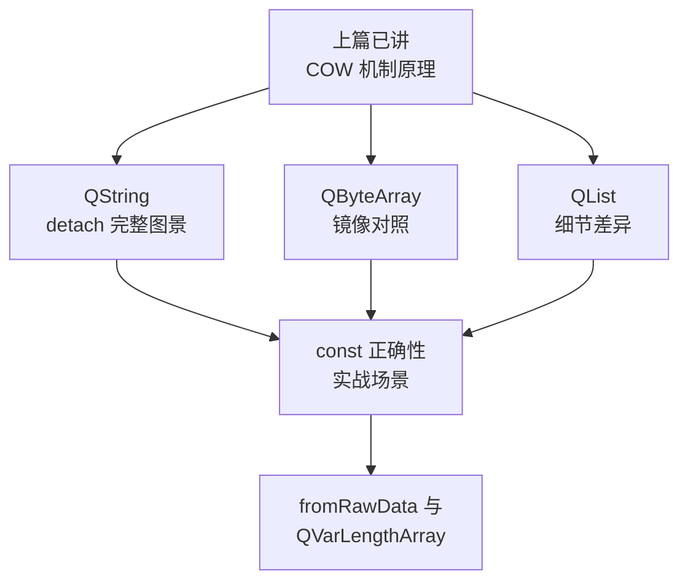
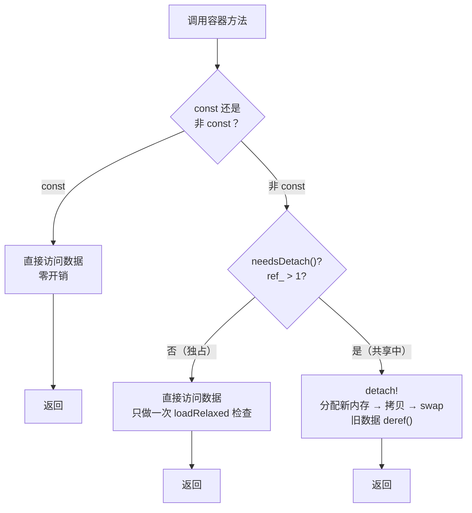
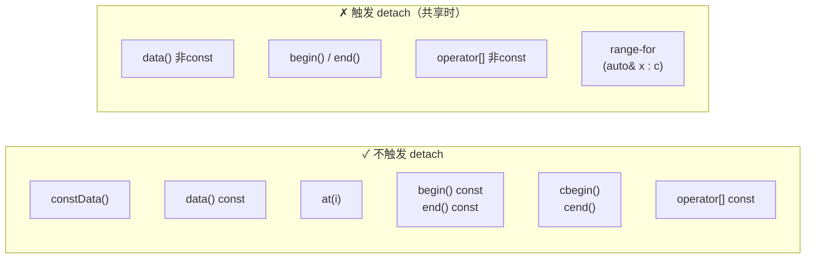

# COW 在 Qt 容器中的实战

## 前言：从怎么实现到怎么触发

上一篇咱们把 COW 的机制拆了个遍。在 [COW 隐式共享机制一篇](./19-cow-implicit-sharing-expert.md) 里咱们从原子操作一路看到 detach_helper，知道了 QList 的拷贝构造只花一次原子加法，知道了 detach 分配新内存然后 swap，也知道了 QArrayDataPointer 要等到析构，deref 归零了才真正释放。机制层面的事，那一篇算是交代完了。

但那一篇刻意绕开了一个问题：到底哪些操作会触发 detach？咱们当时只说了非 const 方法会触发，剩下的细节留给了本篇。这一篇要翻的是 QString、QByteArray、QList 三个主力容器，咱们把它们逐个过一遍，看清楚每个方法在源码层面是怎么处理 COW 的。这件事弄清楚了，您写代码时就能精确判断这一行会不会导致深拷贝，而不是凭感觉猜。

## 环境说明

本篇的源码引用都基于 `qt_src/qt6.9.1`，这个目录是官方 Qt 6.9.1 源码在咱们本地的检出，已经被 gitignore 了、不随仓库分发。行号会随 Qt 版本升级而漂移，您对照阅读时要是发现行号对不上，拿函数名或字段名去对应的文件里搜一下就能定位。本篇涉及的源码文件，咱们按出场顺序列在下面：

| 文件 | 角色 |
|---|---|
| `qt_src/qt6.9.1/qtbase/src/corelib/text/qstring.h` | QString 接口与内联实现 |
| `qt_src/qt6.9.1/qtbase/src/corelib/text/qstring.cpp` | QString 非内联实现 |
| `qt_src/qt6.9.1/qtbase/src/corelib/text/qbytearray.h` | QByteArray 接口与内联实现 |
| `qt_src/qt6.9.1/qtbase/src/corelib/tools/qlist.h` | QList 接口与内联实现 |
| `qt_src/qt6.9.1/qtbase/src/corelib/tools/qarraydataops.h` | QList 底层操作（emplace 等） |
| `qt_src/qt6.9.1/qtbase/src/corelib/tools/qvarlengtharray.h` | QVarLengthArray（对比） |

## 核心概念讲解

咱们动身翻容器以前，把本篇要覆盖的范围对一遍。上一篇讲的是原子计数、数据头部、智能指针这一整套底层机制，本篇咱们要把这些机制放进三个主力容器里，看它们各自是怎么被调用的：



### detach 的触发模式：三个容器共用一条路

三个容器身上有一条共同的规律，咱们动手翻源码以前把它摆出来：所有 detach 触发走的都是同一条路，非 const 的方法调 detach()，const 的方法则不调。这其实不是巧合，它背后是 Qt 有意定下的设计规范，三种容器遵守的是同一套规则，差别只在具体实现的细节上。

咱们把这套判断画成一幅流程图放在下面。



三个容器的具体实现全都遵循这个流程，后面咱们逐个用源码验证。

| 操作类型 | const 版本 | 非 const 版本 |
|---|---|---|
| `data()` | 直接返回 `d.data()`，不触发 | 调过 `detach()` 再返回 |
| `begin()` / `end()` | 返回 `const_iterator`，不触发 | 调过 `detach()` 再返回 `iterator` |
| `operator[]` | 走 `at()`，不触发 | 走 `data()[i]`，间接触发 |
| `at()` | 直接读数据，不触发 | —（只有 const 版本） |
| `constData()` | 等价于 `data() const` | —（只有 const 版本） |

这个表您留在手边，后面三个容器的源码验证的全是它。

### QString：detach 的完整图景

QString 是三个容器里最值得细看的一个，因为它有自己的 `reallocData()`，而不是直接用 QArrayDataPointer 的 `reallocateAndGrow()`。原因上一篇咱们提过：QString 要处理尾部的 null 终止符（QChar(0)），处理它的逻辑比 QList 多一步。

咱们从头一个看起：拷贝构造，确认它是 O(1) 的浅拷贝（`qt_src/qt6.9.1/qtbase/src/corelib/text/qstring.h:1340-1341`）：

```cpp
QString::QString(const QString &other) noexcept : d(other.d)
{ }
```

您看到的就一行：用 QArrayDataPointer 的拷贝构造去初始化 d，浅拷贝和 ref() 的活全在这一行里。开销永远是 O(1) 的水平，跟字符串的长度没有关系。

然后咱们看 detach 的入口。非 const 的 `data()` 是最常见的触发点（`qt_src/qt6.9.1/qtbase/src/corelib/text/qstring.h:1326-1330`）：

```cpp
QChar *QString::data()
{
    detach();
    Q_ASSERT(d.data());
    return reinterpret_cast<QChar *>(d.data());
}
```

进门的头一行就是 `detach()`。要是 `d.needsDetach()` 返回了 true（ref_ > 1），深拷贝的活就轮到 `reallocData()` 来干，咱们直接看它的源码（`qt_src/qt6.9.1/qtbase/src/corelib/text/qstring.cpp:2781-2802`）：

```cpp
void QString::reallocData(qsizetype alloc, QArrayData::AllocationOption option)
{
    if (!alloc) {
        d = DataPointer::fromRawData(&_empty, 0);
        return;
    }
    const bool cannotUseReallocate = d.freeSpaceAtBegin() > 0;
    if (d->needsDetach() || cannotUseReallocate) {
        DataPointer dd(alloc, qMin(alloc, d.size), option);
        Q_CHECK_PTR(dd.data());
        if (dd.size > 0)
            ::memcpy(dd.data(), d.data(), dd.size * sizeof(QChar));
        dd.data()[dd.size] = 0;
        d = dd;
    } else {
        d->reallocate(alloc, option);
    }
}
```

这段代码值得咱们停下来看的地方有三处。头一处是 alloc 为 0 的分支，空字符串 detach 完了还是空字符串，堆上的内存一个字节都不分配。`_empty` 是一个静态的 char16_t 常量，所有空 QString 共享的就是这个地址，`fromRawData(&_empty, 0)` 的 d 是 nullptr、没有头部也没有引用计数。第二处在深拷贝的那一路，需要 detach 的时候用 memcpy 把数据搬过去，末尾还写了一个 null 终止符 `dd.data()[dd.size] = 0`，这正是 QString 和 QList 的关键区别。第三处是独占时的快路径，不需要 detach、头部前面也没有 freeSpaceAtBegin（prepend 攒下的预留空间）的时候，它可以原地 `reallocate()`，连一个字节的数据都不用拷。

非 const 的 `operator[]` 不直接调 detach()，咱们看它怎么通过 `data()` 间接触发（`qt_src/qt6.9.1/qtbase/src/corelib/text/qstring.h:1431-1432`）：

```cpp
QChar &QString::operator[](qsizetype i)
{ verify(i, 1); return data()[i]; }
```

`data()` 里调了 detach()，返回的是可写指针，然后咱们用 `[i]` 取偏移。const 版本的 `operator[]` 走的是 `at()`，直接读 `d.data()[i]` 里的数据，也就不触发任何 detach 了。

咱们接着看非 const 的 `begin()` 和 `end()`，它们的做法同样如此（`qt_src/qt6.9.1/qtbase/src/corelib/text/qstring.h:1435-1444`）：

```cpp
QString::iterator QString::begin()
{ detach(); return reinterpret_cast<QChar*>(d.data()); }
QString::iterator QString::end()
{ detach(); return reinterpret_cast<QChar*>(d.data() + d.size); }
```

而 const 版本的 `begin() const` 和 `end() const` 直接返回 `const_iterator`，而不调 detach。这也就给咱们解释了一件事：为什么 `for (auto& c : str)` 会在循环开始前触发一次 detach（str 被共享的话），而 `for (const auto& c : str)` 不会。

还有个细节咱们也看一眼，默认构造的 QString 不分配任何内存（`qt_src/qt6.9.1/qtbase/src/corelib/text/qstring.h:1410`）：

```cpp
constexpr QString::QString() noexcept {}
```

`constexpr` 的意思是编译期就能完成，d 的三个成员全部零初始化、d.d == nullptr。咱们头一次对它调 const 方法时，返回的是 `&_empty`，头一次调非 const 方法的时候，`needsDetach()` 返回了 true（d == nullptr），`reallocData()` 这才分配真正的内存。

### QByteArray：和 QString 几乎镜像

QByteArray 的 COW 实现跟 QString 是同一套模式，只把 QChar 换成了 char。咱们快速过一遍，验证掉这个镜像的判断。

咱们从拷贝构造看起（`qt_src/qt6.9.1/qtbase/src/corelib/text/qbytearray.h:634-635`）：

```cpp
inline QByteArray::QByteArray(const QByteArray &a) noexcept : d(a.d)
{}
```

您看这一行，跟 QString 的做法一样，干的就是浅拷贝的活。

非 const 的 `data()` 也是触发 detach 的入口，咱们看源码（`qt_src/qt6.9.1/qtbase/src/corelib/text/qbytearray.h:616-620`）：

```cpp
inline char *QByteArray::data()
{
    detach();
    Q_ASSERT(d.data());
    return d.data();
}
```

const 的版本不触发，咱们对照着看（`qt_src/qt6.9.1/qtbase/src/corelib/text/qbytearray.h:622-625`）：

```cpp
inline const char *QByteArray::data() const noexcept
{
    // ...
    return d.data() ? d.data() : &_empty;
}
```

咱们再看 `constData()`，它就是 `data() const` 的别名（`qt_src/qt6.9.1/qtbase/src/corelib/text/qbytearray.h:124`）：

```cpp
const char *constData() const noexcept { return data(); }
```

所以在 QByteArray 这里，咱们看到 `constData()` 和 `data() const` 是完全等价的、都不会触发 detach。非 const 的 `data()` 是唯一的触发入口，这一点跟 QString 那边是一样的，`operator[]` 也是通过 `data()` 间接调用的。

### QList：detach 的细节差异

QList 跟 QString 有一个咱们要注意的重要区别：QList 直接用 QArrayDataPointer 的 `detach()`（上一篇分析过的那个），不需要自己的 `reallocData()`，这让 QList 的 detach 路径更简洁。

拷贝构造和赋值的做法跟 QString 完全对称，干的还是浅拷贝加 ref 的活，咱们就不重复贴了。下面咱们看几个 QList 独有的细节。

头一个咱们看 detach 的入口，QList 的 `detach()` 就是直接委托（`qt_src/qt6.9.1/qtbase/src/corelib/tools/qlist.h:457`）：

```cpp
void detach() { d.detach(); }
```

没有 QString 那样的 `reallocData()`，直接走的就是 `QArrayDataPointer::detach()`，再往下就落到了 `reallocateAndGrow()` 身上。原因咱们前面说过，QList 没有要处理的 null 终止符。

非 const 的 `begin()`/`end()` 跟 QString 一个路数：进门直接调 detach()，咱们看源码（`qt_src/qt6.9.1/qtbase/src/corelib/tools/qlist.h:656-657`）：

```cpp
iterator begin() { detach(); return iterator(d->begin()); }
iterator end() { detach(); return iterator(d->end()); }
```

const 的版本不触发，咱们对照看（`qt_src/qt6.9.1/qtbase/src/corelib/tools/qlist.h:659-660`）：

```cpp
const_iterator begin() const noexcept { return const_iterator(d->constBegin()); }
const_iterator end() const noexcept { return const_iterator(d->constEnd()); }
```

这里有个 noexcept 的差异值得咱们停一下：const 的版本是 noexcept，非 const 的版本不是，因为 detach() 有抛异常的可能（分配内存失败）。

QList 的 `operator[]` 跟 QString 一个路数，也是通过 `data()` 间接触发的，咱们看源码（`qt_src/qt6.9.1/qtbase/src/corelib/tools/qlist.h:482-488`）：

```cpp
reference operator[](qsizetype i)
{
    Q_ASSERT_X(size_t(i) < size_t(d->size), "QList::operator[]", "index out of range");
    // don't detach() here, we detach in data below:
    return data()[i];
}
const_reference operator[](qsizetype i) const noexcept { return at(i); }
```

请您留意源码里的那行注释：`// don't detach() here, we detach in data below`。Qt 的开发者故意不在 operator[] 里直接调 detach()，而是让 data() 去调，data() 已经做了这件事，重复是没有必要的。const 的版本走的是 `at()`，完全安全的（`qt_src/qt6.9.1/qtbase/src/corelib/tools/qlist.h:477-479`）：

```cpp
const_reference at(qsizetype i) const noexcept
{ /* bounds check */ return d->data()[i]; }
```

咱们再看 `replace()` 的安全 detach，它是 QList 一个值得单说的模式（`qt_src/qt6.9.1/qtbase/src/corelib/tools/qlist.h:574-580`）：

```cpp
void replace(qsizetype i, parameter_type t)
{
    Q_ASSERT_X(i >= 0 && i < d->size, "QList<T>::replace", "index out of range");
    DataPointer oldData;
    d.detach(&oldData);
    d.data()[i] = t;
}
```

这一句把旧数据指针交换到了 oldData 里，而不是让临时对象当场析构。咱们要问一句为什么？因为 `d.data()[i] = t` 执行的时候，旧数据必须还是活的。要是 t 是一个引用了旧数据中元素的值，旧数据提前释放的话，这行赋值读到的就是已释放的内存。oldData 要等到 `replace()` 返回的时候才析构，那时候赋值已经完成了，旧数据被安全地 deref。

咱们再看 emplace 的快路径，QList 的 `emplaceBack()` 有一条不需要 detach 的优化路径（`qt_src/qt6.9.1/qtbase/src/corelib/tools/qarraydataops.h:142-167`）：

```cpp
void emplace(qsizetype i, Args &&... args)
{
    bool detach = this->needsDetach();
    if (!detach) {
        if (i == this->size && this->freeSpaceAtEnd()) {
            new (this->end()) T(std::forward<Args>(args)...);
            ++this->size;
            return;
        }
        if (i == 0 && this->freeSpaceAtBegin()) {
            new (this->begin() - 1) T(std::forward<Args>(args)...);
            --this->ptr;
            ++this->size;
            return;
        }
    }
    // ... 需要 detach 的慢路径
}
```

容器处在独占状态（ref_ == 1）的时候，而且尾部有空余空间（`freeSpaceAtEnd()`），咱们就直接用 placement new 在尾部把元素构造出来，随后 size 也跟着加了一。分配内存的活没有、拷贝数据的活也没有，连 detach() 都省了。头部有空余空间的时候同理。只有两条快路径都走不通的时候，或者真的需要 detach，才进入分配新内存的慢路径。

### const 正确性：性能就藏在这里

前面三个容器的源码咱们都翻过了，它们遵循的是同一个模式：非 const 的方法调 detach()，const 的方法不调。这表明 const 不只是一个编译器的检查，它在运行时直接决定您的代码会不会触发一次深拷贝。咱们看一张总结图：



左边这些是安全的接口，都是不触发 detach 的写法，额外的开销是零。右边这些在容器被共享的时候会触发一次完整的深拷贝。咱们拿几个实际场景过一遍。

咱们看头一个场景，函数的参数传递：

```cpp
// 每次调用都可能在函数体内触发 detach
void process(QString s) { /* s 是拷贝，ref+1 但在函数内修改会 detach */ }

// 安全：const 引用不增加引用计数，也不触发 detach
void process(const QString& s) { /* 只读访问，零开销 */ }
```

咱们按值传参，调用的时候会 ref+1（O(1) 不做深拷贝），但函数内部对 s 的非 const 操作会触发 detach。传 const 引用的话，咱们连 ref+1 都省了。

咱们再看 range-based for 的场景：

```cpp
QString str = computeBigString();
auto copy = str;  // ref_ = 2

// 触发 detach！非 const begin() → memcpy 全部字符串数据
for (auto& c : str) { /* ... */ }

// 不触发。const begin() → 直接读
for (const auto& c : str) { /* ... */ }

// 等价写法：std::as_const() 把左值转成 const 引用
for (auto& c : std::as_const(str)) { /* ... */ }
```

咱们再看只读遍历 QList 的场景：

```cpp
QList<int> list = {1, 2, 3, 4, 5};
auto other = list;  // ref_ = 2

// 触发 detach：非 const begin()
for (auto it = list.begin(); it != list.end(); ++it) { /* 只读，但 detach 已发生 */ }

// 不触发：cbegin()/cend() 或 const 容器上的 begin()/end()
for (auto it = list.cbegin(); it != list.cend(); ++it) { /* 纯读，零开销 */ }
```

这里的教训很直白：您不打算修改容器，就一定要用 const 的接口。这不是代码风格的问题，而是性能的问题——在共享状态下，一次非 const 的 `begin()` 就能触发一次完整的深拷贝。

### fromRawData：不拥有数据的视图

Qt 容器还有一种特殊的构造方式：`fromRawData()`。它让容器指向一块外部的内存，不拥有也不管理它的生命周期。它在 QArrayDataPointer 里的实现，咱们直接看源码（`qt_src/qt6.9.1/qtbase/src/corelib/tools/qarraydatapointer.h:63`）：

```cpp
static QArrayDataPointer fromRawData(const T *rawData, qsizetype length) noexcept
{
    // d = nullptr, ptr = rawData, size = length
}
```

`fromRawData()` 创建的 QArrayDataPointer，它的 d 是 nullptr。咱们还记得上一篇的 `needsDetach()` 吗？它的实现是 `!d || d->needsDetach()`，d 为 nullptr 的时候会直接返回 true。这带来一个直接的推论：对 fromRawData 创建的容器做任何非 const 操作，都会触发一次完整的内存分配和数据拷贝。原因其实很直白，fromRawData 只是把外部数据看了一眼，它没有自己的 QArrayData 头部，原地修改也就无从谈起了。

这个设计的用途是：您有一块已有的内存（比如网络收到的原始字节、mmap 映射的文件内容），想用 QByteArray 的接口读它，又不想付出拷贝的代价。只要咱们只做 const 操作，fromRawData 就是零拷贝的。一旦您需要修改，Qt 会自动把它升级成一块真正拥有的内存，这和 COW 的 detach 逻辑完全一致，只是触发的原因从被共享变成了不拥有数据。

### QVarLengthArray：不用 COW 的容器

Qt 还有一个经常被咱们忽略的容器：`QVarLengthArray`。它跟 QList 的设计哲学完全相反，咱们在它身上找不到 COW、引用计数、detach 的任何影子，每次拷贝都是实打实的深拷贝。

咱们把 `qt_src/qt6.9.1/qtbase/src/corelib/tools/qvarlengtharray.h` 全文 1063 行从头到尾翻了一遍，再拿 `detach`、`ref`、`deref`、`QSharedData`、`QAtomicInt`、`isShared` 这几个关键词 grep 了一遍，结果其实一个匹配都没有。

QVarLengthArray 的策略，咱们看下来就一条：在栈上预分配一块固定大小的缓冲区，默认的大小是 256 个元素。元素少的时候直接用栈内存，堆分配都省了，只有超出预分配的大小了才去堆上申请。引用计数、共享、detach 的开销在这里一概不存在。

什么时候该选 QVarLengthArray 而不是 QList？咱们挑它的时候看的是这几条：临时性的、局部的、不会被拷贝的短数组。函数内部的临时缓冲区、算法中的中间结果存储、OpenGL 顶点数据组装，都是它的典型场景。这些场景吃不到 COW 拷贝 O(1) 的好处，反而要交原子操作的开销：每次做非 const 访问的时候都要查一次 needsDetach()，单次只是一下 loadRelaxed() 的水平，热循环里积少成多也就攒出了可观的代价。

咱们再把容器放到多个对象之间传递、拷贝、当返回值，QList 的 COW 优势就显出来了：拷贝是 O(1) 的，修改的时候才付出代价。

## 风险与故障预防

头一类的风险藏在 range-based for 循环里。[入门篇讲容器的那一篇](../../beginner/01-qtbase/04-container-beginner.md) 里提过它，这里咱们从源码层面把它讲清楚。您写 `for (auto& c : str)` 的时候，编译器展开后调用的是非 const 的 `str.begin()` 和 `str.end()`，QString 的实现咱们刚看过（`qt_src/qt6.9.1/qtbase/src/corelib/text/qstring.h:1435`）：

```cpp
QString::iterator QString::begin()
{ detach(); return reinterpret_cast<QChar*>(d.data()); }
```

`detach()` 在循环开始之前就被调用了一次。这一下的代价取决于 str 是否被共享（ref_ > 1），共享着的话就会触发 memcpy 拷贝整个字符串。循环本身不会再触发额外的 detach（detach 之后 ref_ 变成了 1），但要是多处代码都在同一个共享字符串上做 range-based for 的话，每处都会触发一次 detach 的深拷贝，性能也就在不知不觉里塌了下去。后果是程序变慢而不是崩溃，排查的难度也特别高，因为每处代码看上去都只多做了一次深拷贝、合情合理。解法咱们也看得清楚：任何不需要修改的遍历，都换成 `const auto&` 或 `std::as_const()` 的写法。

第二类的风险是 detach 之后迭代器失效。入门篇的那一篇也提过它，这里咱们补一个实战场景：

```cpp
QList<int> list = {1, 2, 3};
auto it = list.begin();        // it 指向 list 的数据区
QList<int> copy = list;        // ref_ = 2
copy.push_back(4);             // copy detach → 新内存
list.push_back(5);             // list 也 detach → 又一块新内存
*it = 99;                      // it 指向原始数据区，ref_=?
```

两次 detach 把原始数据块的 ref_ 从 2 压到 1（copy detach 后），接着又压到了 0（list detach 后），然后这块内存就被释放了。it 变成了悬垂指针，写 `*it = 99` 这一下就是未定义行为了。实际代码里的同类 bug 往往更隐蔽，咱们可能在一个函数里持有迭代器，另一个线程或者回调里又对同一个容器的另一个引用做了修改。您能遇到的后果，从 segfault、读到垃圾数据、到在我机器上没问题的幽灵 bug，咱们一样一样都见得着。解法咱们也看得清楚：持有迭代器的期间，要确保别的路径都没有触发 detach 的机会。真要一边遍历一边修改的话，就把容器拷出一份独立的副本。

第三类的风险出在 fromRawData 身上：用它包好的容器，您改了原始数据，就以为容器里的内容也跟着变了。实际的行为咱们看代码：

```cpp
char buffer[] = "hello";
QByteArray ba = QByteArray::fromRawData(buffer, 5);
buffer[0] = 'H';         // 修改了原始数据
// ba[0] 现在也是 'H'   // 因为 ba 的 ptr 指向 buffer

ba[0] = 'J';             // 非 const operator[] → data() → detach()
// 现在 ba 指向新分配的内存，和 buffer 无关了
// buffer[0] 仍然是 'H'
```

fromRawData 创建的容器和原始数据共享内存，但您对它做任何非 const 操作，detach 都会切断这层共享的关系：分配新内存、拷贝数据，从此容器和原始数据就各走各路了。如果您依赖改原始数据就改容器的行为，detach 之后这个依赖就断了。后果是数据的不一致，您以为改了的东西没改，以为没改的东西被改了。解法咱们照旧直说：fromRawData 只留给只读的场景。真需要修改的话，就直接构造一个拥有数据的 QByteArray，fromRawData 就不要用了。

## 练习项目

本篇和 [01.qobject 篇](./01-qobject-meta-system-expert.md) 一样走的是纯源码拆解的路子，练习咱们就走验证的路，三道题咱们都只给方向和验证手段，完整工程留给您自己搭。

头一道题咱们亲眼看一次 detach 的发生。您准备一个几百 KB 的 QString 和它的一份拷贝，对比两份的 `constData()` 指针，此刻它俩指的应该是同一块内存。然后您只对其中一份调 `data()` 改一个字符，咱们再对比一次，改过的那个指针挪了窝，另一份还待在原来的地方。您亲眼见到的这一幕，对应的就是 QString 一节里 `reallocData` 的深拷贝路。

第二道题把 range-for 的两种写法放在同一份共享容器上跑。您准备一个被共享的 QList，咱们分别用 `auto&` 和 `const auto&` 各走一遍循环，每遍循环的前后都打印一次 `constData()` 指针。`auto&` 的那遍会看到指针挪窝，detach 已经发生了，`const auto&` 的那遍指针原封不动。您再拿 `std::as_const()` 的写法比一比，三种写法的差别就都摆在眼前了。

第三道题验证 fromRawData 一写就深拷贝的本性。您在栈上放一个 char 数组，咱们用 `QByteArray::fromRawData` 把它包起来，读一次它的 `constData()`，指针应该就落在那块栈内存的地址上。然后您对 ba 做一次非 const 访问，再读一次 `constData()` 的返回，指针已经换成新分配的堆地址了，而原始数组从头到尾一个字节没动。两步的指针都打出来印证，本篇 fromRawData 一节的判断也就落了地。

## 官方文档参考链接

[Qt 文档 · Implicit Sharing](https://doc.qt.io/qt-6.9/implicit-sharing.html)——COW 的总览文档，咱们拿它和本篇的 detach 触发点互相印证，本篇的基线是 6.9.1、线上页面跟着小版本滚动。

[Qt 文档 · QString](https://doc.qt.io/qt-6.9/qstring.html)——官方的参考，咱们查 detach 相关的说明时以它为准。

[Qt 文档 · QByteArray](https://doc.qt.io/qt-6.9/qbytearray.html)——官方的参考，咱们查 QByteArray 的接口语义时以它为准。

[Qt 文档 · QList](https://doc.qt.io/qt-6.9/qlist.html)——官方的参考，咱们查 QList 的迭代器与修改接口时以它为准。

[Qt 文档 · QVarLengthArray](https://doc.qt.io/qt-6.9/qvarlengtharray.html)——咱们做选型的时候，拿它跟 QList 的文档对照着读，它走的路线是不用 COW、栈内存当主力。

---

走到了这里，Qt COW 从机制原理到容器实战的路，咱们就算完整拆完了。从 `fetch_add` 的原子操作，到 `reallocateAndGrow` 的内存管理，再到三个容器各自的 detach 触发点和 const 正确性的性能影响，这些都是写高性能 Qt 代码时要精确掌握的东西。临走前咱们把最简单的规则再念一遍：不修改的时候就用 const 接口，要修改就看好手里的迭代器。

您要是想把本篇涉及的全部行号证据拿来一一核对，这些证据咱们已经归好了类：[源码索引 · QArrayDataPointer](../code-index/qtbase/qarraydatapointer.md) 收录的是 QArrayDataPointer 相关的行号证据，[源码索引 · 边界情况](../code-index/qtbase/cow-edge-cases.md) 收录的是边界与对比类的证据，您带着行号直接去 `qt_src/qt6.9.1` 翻原文就行。
