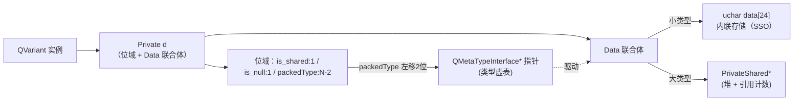

# QVariant 源码拆解

## 前言：QVariant 天天在用，它凭什么装下任意类型

`QVariant` 是 Qt 里一个挺神奇的东西，咱们拿它能装 `int`、能装 `QString`，也能装自己写的结构体，连 `QObject*` 这样的指针都装得进去。C++ 明明是强类型的语言，一个变量却装得进不同的类型，这件事是怎么做到的？笔者见过用了好几年 `QVariant` 的人，也说不清它的内部到底是个什么结构。

笔者当年有几个答不上来的问题。咱们知道 `QVariant` 不是拿模板写的，类里的虚函数也一个都没有，那它凭什么在运行时知道装的是什么类型？装一个 `int` 和装一个自定义的 200 字节结构体，`QVariant` 对象本身的大小会一样吗？还有最容易误判的一处：装着默认构造 `QString()` 的 `QVariant`，`isNull()` 在 Qt5 和 Qt6 里的结果不一样，为什么会不一样？

头两个问题的答案，落在 `QVariant` 设计的两条主轴上。咱们把两条主轴分开看：类型擦除管的是运行时怎么识别装进来的类型，存储策略管的是不同大小的类型怎么放。第三个问题是 Qt6 的重构动过的行为，咱们放到后面的 isNull 一节单独讲。入门篇的 [5.变体与类型](../../beginner/01-qtbase/05-variant-type-beginner.md) 教了 `QVariant` 怎么用，进阶篇的 [5.QVariant 与 QMetaType 进阶](../../advanced/01-qtbase/05-qvariant-metatype-advanced.md) 则讲了类型注册，也讲了转换的用法。本篇咱们要往源码里走：打开 `qvariant.h` 和 `qmetatype.h`，看看 `packedType` 位域怎么把类型描述符的指针藏进一个 `quintptr`，小类型怎么内联在 24 字节的联合体里省掉堆分配，`QMetaTypeInterface` 那串函数指针又是怎么驱动构造和析构的，还有 Qt6 做的那场把 `QVariant` 整个塞进 `QMetaType` 的重构。

边界咱们也交代清楚。`QVariant` 的序列化不在本篇的范围内。您要找 JSON 互转的用法，[16 JSON 解析与 CBOR 内核](./16-json-parser-expert.md) 的 3.5 节有整节的拆解（QVariant 互转中间绕一道 CBOR），本篇就不重复了。`QDataStream` 读写涉及 `QMetaTypeInterface` 的 `dataStream` 函数指针和 `QDataStream` 自己的二进制格式，本篇也就不往里走了。用户自定义类型的注册（`Q_DECLARE_METATYPE` 宏）咱们只讲到“编译期生成 `QMetaTypeInterface` 静态实例”，宏背后的模板元编程不展开。

## 环境说明

本篇的源码引用都基于 `qt_src/qt6.9.1`，这个目录是官方 Qt 6.9.1 源码在咱们本地的检出，被 gitignore 了、不随仓库分发。行号会随着 Qt 版本的升级而漂移，您对照阅读时要是发现行号对不上，拿函数名或字段名去对应的文件里搜一下就能定位。涉及的关键文件，咱们按出场顺序列在下面：

| 文件 | 角色 |
|---|---|
| `qtbase/src/corelib/kernel/qvariant.h` / `qvariant.cpp` | QVariant 公共声明与实现（构造/setValue/value/equals） |
| `qtbase/src/corelib/kernel/qvariant_p.h` | QVariantPrivate（Private 结构 + Data 联合体 + 模板构造） |
| `qtbase/src/corelib/kernel/qmetatype.h` | QMetaType 句柄 + QMetaTypeInterface 虚表 |
| `qtbase/src/corelib/kernel/qmetatype_p.h` | QtMetaTypePrivate（函数指针分发 + 短路） |
| `qtbase/src/corelib/kernel/qmetatype.cpp` | QMetaType 实现（construct/convert/canConvert） |

本篇跟前几篇走了一样的路子，不配 example 的工程，对照 `qt_src` 翻代码就是最好的实验，动手验证的练习咱们放在文末的练习项目里。

## 核心概念讲解

咱们动手翻源码以前，把 `QVariant` 对象的内部结构对一遍。下面这幅图能帮您看清一个 `QVariant` 实例在内存里到底由什么组成：



一个 `QVariant` 实例的核心就是 `Private d`，它把类型信息和数据都塞进了一个紧凑的结构：类型信息藏在位域 `packedType` 里（存的实际是个右移过的指针），数据放在了 `Data` 联合体里（小类型内联、大类型堆指针）。位域占掉一个字长的空间，联合体再占 24 字节的空间，64 位平台上的 `sizeof(QVariant)` 就是 32。咱们顺着图上的结构往下拆。

### 类型擦除：类型指针右移两位，藏进位域

咱们前面提过，`QVariant` 不是拿模板写的，类里的虚函数也一个都没有，那它运行时怎么知道装的是 `int` 还是 `QString`？笔者头一回翻到答案的时候，有点被它的简洁惊到了。答案咱们直接看位域（`qt_src/qt6.9.1/qtbase/src/corelib/kernel/qvariant.h:116-118`）：

```cpp
        quintptr is_shared : 1;
        quintptr is_null : 1;
        quintptr packedType : sizeof(QMetaType) * 8 - 2;
```

`packedType` 这个位域占了 `sizeof(QMetaType) * 8 - 2` 个 bit，前面的 `is_shared` 和 `is_null` 各占 1 bit，全部加起来就是一个 `quintptr` 的大小（64 位平台上 8 字节）。咱们要注意，`packedType` 里存的并非 typeId，它存的是一个右移过的 `QMetaTypeInterface*` 指针。咱们看还原的逻辑（`qt_src/qt6.9.1/qtbase/src/corelib/kernel/qvariant.h:130-133`）：

```cpp
        inline const QtPrivate::QMetaTypeInterface *typeInterface() const
        {
            return reinterpret_cast<const QtPrivate::QMetaTypeInterface *>(packedType << 2);
        }
```

`packedType << 2`，左移 2 位就还原成了指针。为什么存进去的时候敢右移 2 位？因为 `QMetaTypeInterface` 的实例由 Qt 静态生成，指针至少做了 4 字节的对齐，低 2 位是恒定的 0，存着也是白费的。Qt 的做法是干脆右移 2 位再存，把省下来的 2 个 bit 给 `is_shared` 和 `is_null` 用。构造的时候咱们反过来看（`qt_src/qt6.9.1/qtbase/src/corelib/kernel/qvariant_p.h:77-79`）：

```cpp
    : is_shared(false), is_null(false), packedType(quintptr(iface) >> 2)
{
    Q_ASSERT((quintptr(iface) & 0x3) == 0);
```

咱们看存的过程：右移了 2 位才存进去，旁边还跟着一个兜底的 `Q_ASSERT((quintptr(iface) & 0x3) == 0)` 断言，确认指针的低 2 位确实是 0（4 字节对齐），任何平台的构建它都参与检查。类型擦除的实质就在这儿了：`QVariant` 不需要任何的模板参数，运行时拿着 `typeInterface()` 还原出来的 `QMetaTypeInterface*`，咱们就能知道里面装的是什么类型，构造和析构该怎么做也一清二楚了。

### 存储策略：小类型内联，大类型上堆

接下来咱们看数据怎么放，笔者觉得这部分最能体现 Qt 的工程功夫。咱们在 `Private` 里能找到一个 `Data` 联合体（`qt_src/qt6.9.1/qtbase/src/corelib/kernel/qvariant.h:99-115`）：

```cpp
    static constexpr size_t MaxInternalSize = 3 * sizeof(void *);
    template <size_t S> static constexpr bool FitsInInternalSize = S <= MaxInternalSize;
    template<typename T> static constexpr bool CanUseInternalSpace =
            (QTypeInfo<T>::isRelocatable && FitsInInternalSize<sizeof(T)> && alignof(T) <= alignof(double));
    ...
    union
    {
        uchar data[MaxInternalSize] = {};
        PrivateShared *shared;
        double _forAlignment; // we want an 8byte alignment on 32bit systems as well
    } data;
```

`MaxInternalSize` 的大小由 `3 * sizeof(void *)` 决定，在 64 位平台上的尺寸是 24 字节，32 位平台上的尺寸是 12 字节。咱们看联合体的三个成员：`uchar data[24]` 是内联放小类型的地方，`PrivateShared *shared` 指向堆分配的大类型，`double _forAlignment` 是个对齐用的小技巧，它保证了 32 位系统上的联合体也有 8 字节的对齐，靠的就是 `double` 自带的 8 字节对齐。

咱们来看类型能不能内联，这件事由 `CanUseInternalSpace` 说了算，它定下了三个条件：类型得是 relocatable 的，能安全地 `memcpy`，内部也没有自指的指针，大小要装得进 24 字节的空间，对齐要落在 8 字节的范围之内。三个条件都满足了，placement-new 就直接把对象构造到联合体的 `data.data` 里，连一次堆分配的代价都没有。条件不满足的，就走上 `PrivateShared` 的堆分配，`is_shared` 标志位也就置成了 1。咱们读数据的时候在这里分流（`qt_src/qt6.9.1/qtbase/src/corelib/kernel/qvariant.h:124-125`）：

```cpp
        const void *storage() const
        { return is_shared ? data.shared->data() : &data.data; }
```

`is_shared` 为真就返回堆的指针，不然就返回内联数组的地址。这就是 SSO 的泛化版。SSO 是 Small String Optimization 的缩写，也有的资料写成 Short String Optimization，中文的说法叫小字符串优化：小类型省掉一次 `malloc` 和 `free` 的开销，对 `int`、`QChar`、小结构体这类高频的类型意义很大。有意思的对照是，咱们在 [03 QString 内存模型](./03-qstring-memory-expert.md) 里看过，QString 的栈上薄壳连一个字符的位置都没留，QVariant 反而给小类型留足了 24 字节。

### QMetaTypeInterface：一张静态生成的函数指针表

前面反复出场的 `QMetaTypeInterface`，就是 Qt 类型擦除的核心，笔者看它长得像一张手写的虚表（`qt_src/qt6.9.1/qtbase/src/corelib/kernel/qmetatype.h:270-300`）：

```cpp
class QMetaTypeInterface
{
public:
    ...
    ushort revision;
    ushort alignment;
    uint size;
    uint flags;
    QMTI_MUTABLE QBasicAtomicInt typeId;

    using MetaObjectFn = const QMetaObject *(*)(const QMetaTypeInterface *);
    MetaObjectFn metaObjectFn;

    const char *name;

    using DefaultCtrFn = void (*)(const QMetaTypeInterface *, void *);
    DefaultCtrFn defaultCtr;
    using CopyCtrFn = void (*)(const QMetaTypeInterface *, void *, const void *);
    CopyCtrFn copyCtr;
    using MoveCtrFn = void (*)(const QMetaTypeInterface *, void *, void *);
    MoveCtrFn moveCtr;
    using DtorFn = void (*)(const QMetaTypeInterface *, void *);
    DtorFn dtor;
    using EqualsFn = bool (*)(const QMetaTypeInterface *, const void *, const void *);
    EqualsFn equals;
```

咱们看字段。`size`、`alignment`、`flags` 描述的是布局，`typeId` 是类型的编号（mutable，延迟注册时才填的），`name` 是类型名的字符串。后面跟着的一串函数指针：默认的构造走 `defaultCtr`，拷贝的构造走 `copyCtr`，移动的构造走 `moveCtr`，析构的活交给 `dtor`，相等的比较交给 `equals`，再往后还有管小于比较的 `lessThan`，管流操作的 `debugStream`、`dataStreamOut`、`dataStreamIn` 也排在后面。每个 C++ 类型在编译期由 Qt 的模板机制生成一份静态的 `QMetaTypeInterface` 实例，相当于这个类型的身份证，构造、析构、比较的事全查它。

这里笔者要专门纠正一个自己也犯过的错，很多人以为函数指针的表里有 `convert` 或 `canConvert`，答案是没有的。咱们把 `QMetaTypeInterface` 的字段从头到尾翻一遍，也找不到任何转换相关的函数指针。类型转换走的是另一套全局的注册表，咱们留到 convert 一节讲。

咱们再把 `QMetaType` 本身看一眼，它只是函数指针表的轻量句柄（`qt_src/qt6.9.1/qtbase/src/corelib/kernel/qmetatype.h:457-479`）：

```cpp
    explicit constexpr QMetaType(const QtPrivate::QMetaTypeInterface *d) : d_ptr(d) {}
    ...
    void registerType() const
    {
        registerHelper();
    }
    ...
    int id(int = 0) const
    {
        return registerHelper();
    }
```

`QMetaType` 只持一个 `d_ptr` 的指针（指向 `QMetaTypeInterface`），拷贝起来的代价很低。咱们再留意 `registerType()`，它是延迟的注册，头一次调 `id()` 的时候，才把这个 iface 注册进全局的类型表，拿到了 typeId 再写回 `iface->typeId`。延迟的设计让 `QMetaType::fromType<T>()` 做成了 `constexpr`，没有任何运行时的副作用。

### setValue 与 value：快慢两条路

`setValue` 和 `value` 是 `QVariant` 最常用的两个模板接口，它们内部都备了快慢两条路，笔者仔细读了一圈才看出里面的小心思（`qt_src/qt6.9.1/qtbase/src/corelib/kernel/qvariant.h:491-503`）：

```cpp
    void setValue(T &&avalue)
    {
        using VT = std::decay_t<T>;
        QMetaType metaType = QMetaType::fromType<VT>();
        // If possible we reuse the current QVariant private.
        if (isDetached() && d.type() == metaType) {
            *reinterpret_cast<VT *>(const_cast<void *>(constData())) = std::forward<T>(avalue);
            d.is_null = false;
        } else {
            *this = QVariant::fromValue<VT>(std::forward<T>(avalue));
        }
    }
```

咱们看 `setValue` 开头做的判断：当前的 `QVariant` 已经独占了（`isDetached`）而且类型正好匹配，就直接 `*reinterpret_cast<VT *>` 到现有的内存上做 in-place 的赋值，构造链一遍都不用走了，省下了重新分配。条件不满足的，就走 `fromValue` 的慢路，重新构造的活交给 `customConstruct` 去做。

咱们接着看 `value`，它的快路更直观（`qt_src/qt6.9.1/qtbase/src/corelib/kernel/qvariant.h:752-767`）：

```cpp
template<typename T> inline T qvariant_cast(const QVariant &v)
{
    QMetaType targetType = QMetaType::fromType<T>();
    if (v.d.type() == targetType)
        return v.d.get<T>();
    ...
    T t{};
    QMetaType::convert(v.metaType(), v.constData(), targetType, &t);
    return t;
}
```

类型完全匹配的，咱们直接拿 `v.d.get<T>()`（本质是 `static_cast`），这一路的开销是零。类型不匹配的，就走 `QMetaType::convert` 的转换路径，转换失败了就返回默认构造的 `T`。

咱们接着看 `QMetaTypeInterface` 的那串函数指针，在实际的构造析构里还藏着一个优化。类型是 trivially copyable 的时候（比如 `int`），函数指针就退化成了 null，分发逻辑直接用 `memset` 或 `memcpy` 做了短路（`qt_src/qt6.9.1/qtbase/src/corelib/kernel/qmetatype_p.h:166-182`）：

```cpp
    inline void defaultConstruct(const QtPrivate::QMetaTypeInterface *iface, void *where)
    {
        Q_ASSERT(isDefaultConstructible(iface));
        if (iface->defaultCtr)
            iface->defaultCtr(iface, where);
        else
            memset(where, 0, iface->size);
    }

    inline void copyConstruct(const QtPrivate::QMetaTypeInterface *iface, void *where, const void *copy)
    {
        Q_ASSERT(isCopyConstructible(iface));
        if (iface->copyCtr)
            iface->copyCtr(iface, where, copy);
        else
            memcpy(where, copy, iface->size);
    }
```

`defaultCtr` 为 null 的分支走 `memset` 清零，`copyCtr` 为 null 的分支走 `memcpy`，连函数指针的调用都绕过去了。咱们看 Qt 的内置基本类型，快的原因就在这儿，它们走的是和原生 `memcpy` 一个量级的路径。

### convert：三层回退的转换查找链

类型转换（`canConvert` 和 `convert`）不靠 `QMetaTypeInterface` 里的字段，前面咱们说了它没有，那靠什么？笔者追到这儿才发现，它比咱们想象的复杂，靠的是一条三层回退的查找链（`qt_src/qt6.9.1/qtbase/src/corelib/kernel/qmetatype.cpp:2390-2411`）：

```cpp
bool QMetaType::convert(QMetaType fromType, const void *from, QMetaType toType, void *to)
{
    ...
    if (fromType == toType) {
        fromType.destruct(to);
        fromType.construct(to, from);
        return true;
    }
    ...
    if (auto moduleHelper = qModuleHelperForType(qMax(fromTypeId, toTypeId))) {
        if (moduleHelper->convert(from, fromTypeId, to, toTypeId))
            return true;
    }
    const auto f = customTypesConversionRegistry()->function({fromTypeId, toTypeId});
    if (f)
        return (*f)(from, to);
```

咱们一层层看。头一层是类型完全相同的情况，直接 construct 一份新的出来，而不是做转换。第二层的主角是 `moduleHelper`：QtCore、QtGui、QtWidgets 各自内置了一张转换表（`QString` 和 `int` 互转、`QColor` 和 `QString` 互转这类 Qt 自己定义的），`qModuleHelperForType` 按类型所属的模块找到对应的 helper，再去调它的 convert。第三层的主角是 `customTypesConversionRegistry`：用户用 `Q_DECLARE_METATYPE` 加 `QMetaType::registerConverter` 注册的转换函数，都落进一张全局的映射表里，key 是 `(fromTypeId, toTypeId)` 组成的 pair。三层都落空了，后面还有枚举和字符串互转、容器、`QObject` 元对象这些特殊的路径。`canConvert` 用的是同一套查找的逻辑，只是不动真格地去转，拿 nullptr 做能力上的探测。

### Qt6 的重构：类型系统整个并入 QMetaType

您要是从 Qt5 迁移过来，接下来这部分值得您花点工夫。Qt6 把 `QVariant` 的类型系统整个重做了，它不再有自己的 `QVariant::Type` 枚举，类型的事全听 `QMetaType` 的（`qt_src/qt6.9.1/qtbase/src/corelib/kernel/qvariant.h:141-146`）：

```cpp
#if QT_DEPRECATED_SINCE(6, 0)
    enum QT_DEPRECATED_VERSION_X_6_0("Use QMetaType::Type instead.") Type
    {
        Invalid = QMetaType::UnknownType,
        Bool = QMetaType::Bool,
        Int = QMetaType::Int,
```

咱们看到整个 `QVariant::Type` 枚举被标了 `QT_DEPRECATED_VERSION_X_6_0("Use QMetaType::Type instead.")`，而且每个值都直接用 `QMetaType::Xxx` 做了别名。新的接口是 `metaType()` 返回完整的 `QMetaType` 对象，`typeId()` 返回的是 int。

笔者觉得有个细节最能体现 Qt6 的态度，它故意 `delete` 掉了一个看着很自然的构造函数（`qt_src/qt6.9.1/qtbase/src/corelib/kernel/qvariant.h:681-687`）：

```cpp
    // QVariant::Type is marked as \obsolete, but we don't want to
    // provide a constructor from its intended replacement,
    // QMetaType::Type, instead, because the idea behind these
    // constructors is flawed in the first place. But we also don't
    // want QVariant(QMetaType::String) to compile and falsely be an
    // int variant, so delete this constructor:
    QVariant(QMetaType::Type) = delete;
```

注释写得明白：按枚举值构造 variant 的思路本身就有缺陷，所以干脆 `delete` 掉，免得您写 `QVariant(QMetaType::String)` 的时候被解释成一个 int variant，因为 `QMetaType::String` 是个整数类型的枚举值，会隐式地转成 int 去匹配 `QVariant(int)` 构造。Qt6 的立场是，造 `QVariant` 就老老实实地给值，别给类型的枚举。

### isNull 与 equals：Qt5 升 Qt6 的两处行为变化

这是迁移代码时最该上心的两点，咱们看 `isNull`（`qt_src/qt6.9.1/qtbase/src/corelib/kernel/qvariant.cpp:2540-2547`）：

```cpp
bool QVariant::isNull() const
{
    if (d.is_null || !metaType().isValid())
        return true;
    if (metaType().flags() & QMetaType::IsPointer)
        return d.get<void *>() == nullptr;
    return false;
}
```

咱们看 Qt6 的 `isNull`，认的条件只有三个：`d.is_null` 的标志位是构造时设下的，metaType 得是无效的，或者类型是指针而值正好是 nullptr。三条之外就没有别的判断了。Qt5 可不是这样的，咱们再看文档的注释，它写得明明白白的（`qt_src/qt6.9.1/qtbase/src/corelib/kernel/qvariant.cpp:2534-2536`）：

```cpp
\note This behavior has been changed from Qt 5, where isNull() would also
return true if the variant contained an object of a builtin type with an isNull()
method that returned true for that object.
```

咱们回头看看 Qt5 的行为：variant 里要是装着带 `isNull()` 方法的内置类型（null 的 `QString`、空 `QDate`、空 `QTime`），`QVariant::isNull()` 会代理着调那个类型自己的 `isNull()`，返回的就是 true。Qt6 不再这么干了：装了 null `QString` 的 variant，`isNull()` 返回的是 false，因为 `QString` 其实不是指针，当时的 `d.is_null` 也没有设。这就是 breaking change（破坏性的变更），咱们有些老代码依赖“装着 null 串的 variant 也算 null”的判断，迁到 Qt6 行为就变了。笔者 grep 过整个 `qvariant.cpp`，Qt6 里的 `isNull()` 完全不调类型的 `isNull()` 方法，彻底切断了。

咱们再看 `equals`，变化的味道一样（`qt_src/qt6.9.1/qtbase/src/corelib/kernel/qvariant.cpp:2405-2426`）：

```cpp
bool QVariant::equals(const QVariant &v) const
{
    auto metatype = d.type();

    if (metatype != v.metaType()) {
        // try numeric comparisons, with C++ type promotion rules (no conversion)
        if (canBeNumericallyCompared(metatype.iface(), v.d.type().iface()))
            return numericCompare(&d, &v.d) == QPartialOrdering::Equivalent;
#ifndef QT_BOOTSTRAPPED
        // if both types are related pointers to QObjects, check if they point to the same object
        if (qvCanConvertMetaObject(metatype, v.metaType()))
            return pointerCompare(&d, &v.d) == QPartialOrdering::Equivalent;
#endif
        return false;
    }

    // For historical reasons: QVariant() == QVariant()
    if (!metatype.isValid())
        return true;

    return metatype.equals(d.storage(), v.d.storage());
}
```

咱们看类型相同的情况，走 `metatype.equals`（最终调 `QMetaTypeInterface` 的 `equals` 函数指针）。类型不同的场合，Qt6 只留了两条特殊的路：都是数值类型（`canBeNumericallyCompared`）就按 C++ 类型提升的规则比，都是 `QObject` 派生类的指针（`qvCanConvertMetaObject`）就比指向的对象。其它所有类型不同的比较就直接返回 false。

Qt5 的 `==` 在类型不同的时候会尝试 `convert`，把右边转成左边的类型再去比。也就是说 `QVariant(1) == QVariant("1")` 这样的写法，Qt5 里可能返回的是 true（字符串转数字成功），本篇的基线 6.9.1 里直接返回的是 false，因为 int 和 `QString` 的类型对不上，也不都是数值或 QObject 的指针。这也算一处 breaking 的变化。笔者还在本机的 Qt 6.11.2 上编译跑了同一句，结果又回到了 true，说明比较的语义后来又动过，您升级 Qt 小版本的时候值得重测这类比较。还有个历史的特例：两个默认构造的 `QVariant()` 类型都无效，判定是相等的，注释里也写明了 `// For historical reasons: QVariant() == QVariant()`。

### 拷贝：大类型 COW，小类型实打实复制

构造、析构、比较咱们都拆过了，最后剩的是拷贝，它把构造和引用计数捏在了一起。`QVariant` 的拷贝构造走的是 `clonePrivate`（`qt_src/qt6.9.1/qtbase/src/corelib/kernel/qvariant.cpp:302-322`）：

```cpp
static QVariant::Private clonePrivate(const QVariant::Private &other)
{
    QVariant::Private d = other;
    if (d.is_shared) {
        d.data.shared->ref.ref();
    } else if (const QtPrivate::QMetaTypeInterface *iface = d.typeInterface()) {
        if (Q_LIKELY(d.canUseInternalSpace(iface))) {
            // if not trivially copyable, ask to copy (if it's trivially
            // copyable, we've already copied it)
            if (iface->copyCtr)
                QtMetaTypePrivate::copyConstruct(iface, d.data.data, other.data.data);
        } else {
            // highly unlikely, but possible case: type has changed relocatability
            // between builds
            d.data.shared = QVariant::PrivateShared::create(iface->size, iface->alignment);
            QtMetaTypePrivate::copyConstruct(iface, d.data.shared->data(), other.data.data);
        }
    }
    return d;
}
```

咱们数下来一共三路。第一路走的是 `is_shared` 的大类型：`Private d = other` 那一句已经把联合体 bitwise 拷完了（`shared` 的指针也拷了），接着的 `ref.ref()` 调用把引用计数加一，数据本身是不动的。这就是咱们熟悉的 COW（Copy-On-Write、写时复制），拷贝只花一次原子的自增，系列里的 [04 COW 容器实战](./04-cow-container-practice-expert.md) 和 [19 COW 隐式共享](./19-cow-implicit-sharing-expert.md)，整篇拆的都是它。第二路是内联的小类型而且 trivially copyable：同样是 `Private d = other` 那一句把 24 字节 bitwise 拷完了，连函数指针都不用调了。第三路是内联的小类型但不是 trivially copyable（比如内部带引用计数的 `QString`），这时要调 `iface->copyCtr` 做一次真的 copy construct。源码里还留了一路极端的兜底：内联类型两次构建之间 relocatability 变了的话，`canUseInternalSpace` 过不了关就走堆重新分配，Qt 自己的注释都标着 highly unlikely，咱们正常碰不到它。

笔者还要点出一个很多人会搞错的认知：大类型用的 `PrivateShared` 并不是 `QSharedData`（`qt_src/qt6.9.1/qtbase/src/corelib/kernel/qvariant.h:80-91`，中间的成员函数省略）：

```cpp
    struct PrivateShared
    {
        ...
        alignas(8) QAtomicInt ref;
        int offset;
```

咱们看 `QVariant::PrivateShared`，它是个独立的 struct，带一个 `alignas(8) QAtomicInt ref` 的引用计数和一个 `offset`（数据相对 ref 的偏移）。它和 Qt 容器体系里的 `QSharedData` 基类没有任何继承的关系，是 `QVariant` 自己搞的一套。

还有一个反直觉的点：小类型的拷贝不走 COW。咱们容易以为 `QVariant` 有引用计数、拷贝肯定都省，其实只有挂了 `is_shared` 的大类型才共享，小类型每次拷贝都老老实实地复制，trivially 的走 memcpy，非 trivially 的走 copy construct。原因也是直白的：24 字节以内的复制本来就快，再套一层 COW 反而多出一次原子的操作，是不划算的。

## 风险与故障预防

头一类的风险是 Qt5 升 Qt6 后 `isNull` 的行为变化。`isNull` 一节咱们看过源码：Qt5 的时候，null 的 `QString`、空 `QDate` 这些自带 `isNull()` 方法的类型，装进 `QVariant` 后 `variant.isNull()` 会返回 true（代理调类型的 `isNull()`），Qt6 彻底不调了，只看 variant 自身的 `d.is_null` 标志和指针的 null。根子就是源码注释里明说的那场 breaking change。后果是迁移过来的代码里，咱们用 `if (variant.isNull())` 判断“这个 variant 是不是没值”的调用点，原来对装着 null 串的 variant 返回的是 true，Qt6 返回的是 false，逻辑分支全乱了。解法是迁移时审一遍所有 `variant.isNull()` 的调用点，咱们判断“空内容”的场景，就该改用 `variant.toString().isEmpty()` 这样的写法，别指望 QVariant 帮您代理。直接调 QString 自己的 isNull 也是一条路，`variant.value<QString>().isNull()` 干的就是这个，不过它只对 null 串返回 true，`QString("")` 这类空但非 null 的串是漏判的。

第二类的风险是 `==` 不再隐式 convert。`equals` 一节咱们讲过，Qt5 里类型不同的两个 variant 做比较，会多走一步 convert 的转换，把右边转成左边的类型再去比，Qt6 只给数值和 QObject 指针两条特殊的路，而其余类型不同就直接 false。根子还是那场重构带来的，Qt 的想法是“比较时偷偷 convert”是个容易出 bug 的隐式行为，砍了。后果是 `QVariant(1) == QVariant("1")` 这样的代码在 Qt5 里可能返回 true，在 6.9.1 的基线下直接 false，而且编译期不报错（运行期静默变 false），是极难发现的。另外笔者在 Qt 6.11.2 上实测这句又返回 true 了，说明比较的语义后来又动过，您升级小版本的时候值得把这类比较重测一遍。解法是咱们显式 convert 后再比，把它写成 `a.canConvert<int>() && a.value<int>() == b.value<int>()` 的形式，转换摆在了明面上，也就不依赖 `==` 的隐式行为了。

第三类的风险是误以为 `QVariant` 的拷贝都走 COW。拷贝一节咱们拆过，只有挂了 `is_shared` 标志的大类型（超过 24 字节或非 relocatable 的那些）才 COW 共享，小类型每次拷贝都实打实地复制。有些朋友在热点代码里大量拷贝装着 `QString` 的 QVariant（QString 正好在 24 字节以内、relocatable），以为反正走的是 COW、拷贝是 O(1) 的便宜事，结果每次都触发 `copyCtr`，也就是 QString 的拷贝构造。QString 自己有 COW 的机制，但那是另一层的共享，QVariant 这一层的复制照走。根子在拷贝一节那三路的分流：小类型不进堆上的 `PrivateShared`，也不加 `ref.ref()` 的计数。后果是热点的拷贝比预期贵。解法是热点路径传 `const QVariant&` 的引用参数来避免拷贝，或者确认装的是大类型的时候才依赖 COW。

第四类的风险是误解内联的阈值。存储策略一节咱们看过，条件是 relocatable 的类型、24 以内的 size、8 以内的 align 三条，缺了哪一条都不行。有些朋友只记了“24 字节以内”，漏了另外的两条：装一个 16 字节但内部带自指指针的类型（非 relocatable），或者一个 8 字节但 align 是 16 的类型，照样走堆的分配，内联就轮不到它了。咱们往根子上看，relocatable 保证 `memcpy` 的安全（也是 COW 共享的前提），align 保证了它塞进联合体后不会破坏对齐。后果是以为内联了实际没内联，多了一次 malloc，小对象密集的场景能看出性能的差异。解法是自定义类型想被 `QVariant` 高效地内联，就保证它是 relocatable 的，也就是能 `memcpy` 拷贝、析构 trivial 或可空的类型，同时把对齐控制在 8 以内的范围。

## 练习项目

本篇和 [01 QObject 元对象系统](./01-qobject-meta-system-expert.md) 一样走纯源码拆解的路子，练习就走验证的路，三道题咱们都只给方向和验证的手段，完整的工程留给您自己搭。

头一道题把布局的推算落地。您按位域一节的源码推一遍：位域占掉一个字长的空间，联合体占 `3 * sizeof(void *)` 的空间，64 位平台上的 `sizeof(QVariant)` 该是多少？然后写一个只打印 `sizeof(QVariant)` 和 `sizeof(QMetaType)` 的小程序跑一下，数对上了，本篇的布局就在您的机器上落了地。

第二道题实测 `isNull` 的两条路。您构造一个装默认构造 `QString()` 的 QVariant，打印 `variant.isNull()` 和 `variant.value<QString>().isNull()` 的返回，咱们再对照源码想一遍，为什么一个返回 false 而另一个返回 true？这里有个容易搞错的细节，`QString("")` 装的是空字符串，但它其实不是 null，装它的 variant 两条路都返回 false，得用默认构造的 `QString()` 才分得开。您接着再装一个默认构造的 `QDate` 试一遍，老代码迁过来之后哪一句的结果会变，您的心里就有数了。

第三道题验证 `==` 的混合类型比较。您打印三个式子的结果：头一个是 `QVariant(1) == QVariant(1u)` 的比较，一个是 `QVariant(1) == QVariant("1")` 的比较，还有一个是 `QVariant() == QVariant()` 的比较。第一个走的是数值提升，返回的应当是 true，第二个在 6.9.1 的语义下是 false，第三个是历史的特例也是 true。您要是在更新的 Qt 6 小版本上跑，中间那句的结果值得多看一眼，您把版本号和结果记在一起，比较语义随版本漂移的事就亲眼见着了。

## 官方文档参考链接

[Qt 文档 · QVariant](https://doc.qt.io/qt-6.9/qvariant.html)——官方的类参考，咱们查 setValue、value、canConvert、convert 的语义时以它为准，本篇的基线是 6.9.1，线上页面是跟着小版本滚动的。

[Qt 文档 · QMetaType](https://doc.qt.io/qt-6.9/qmetatype.html)——官方的类参考，咱们查类型注册的说明时认它，查 construct、destroy、convert 的说明时也认它。

[Qt 文档 · Q_DECLARE_METATYPE](https://doc.qt.io/qt-6.9/qmetatype.html#Q_DECLARE_METATYPE)——官方的宏说明，咱们查自定义类型注册的语义时以它为准。

---

走到了这里，QVariant 咱们就从源码的层面拆完了。笔者拆完最大的感受是，这个类的全部魔法压在位域和联合体身上，用的都是最朴素的 C++ 特性：`packedType` 位域把 `QMetaTypeInterface*` 右移 2 位藏起来（靠 4 字节的对齐省 bit），`Data` 联合体让小类型内联 24 字节省掉堆的分配，大类型则靠 `PrivateShared` 的引用计数做 COW。构造和析构的事，全靠 `QMetaTypeInterface` 那串函数指针的驱动，trivially copyable 的还能短路成 `memcpy`。Qt6 那场把 `QVariant` 并进 `QMetaType` 的重构，API 层面废掉了 `QVariant::Type`，还动了两个核心的行为：`isNull` 不再代理类型自己的 `isNull()`，`==` 在类型不同的场合不再偷偷 convert。咱们迁移代码的时候，isNull 与 equals 的变化是最容易踩中的雷。

这套机制和 [01 QObject 元对象系统](./01-qobject-meta-system-expert.md) 的 `QMetaType`、序列化框架、属性系统都咬在一起：咱们在 01 里拆 `QMetaObject` 静态表时数过的 `metaTypes` 槽，装的正是这篇里的 `QMetaTypeInterface` 表的指针，属性系统和序列化往深里走的时候，用的也是这一层的东西。

您要是想把本篇的行号证据拿来一一核对，它们已经按源码机制归好了类，统一收在 [code-index · QVariant 类型擦除与 QMetaType](../code-index/qtbase/qvariant.md) 的索引里，您带着行号直接去 `qt_src/qt6.9.1` 翻原文就行。
