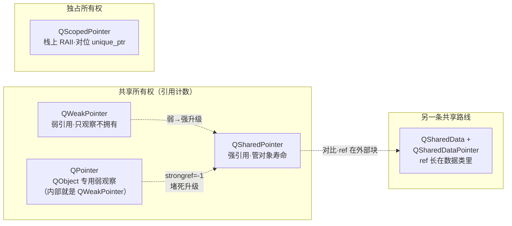

# Qt 智能指针家族源码拆解

## 前言：std 三件套都在了，Qt 自己这套智能指针图的是什么

C++11 把 `std::shared_ptr`、`std::unique_ptr` 和 `std::weak_ptr` 三件套交到咱们手里之后，Qt 自己家里的那套 `QSharedPointer`、`QScopedPointer`、`QWeakPointer` 和 `QPointer`，看着就像多余的。不少朋友下意识的想法是，既然 std 都齐了，Qt 这套是不是该退休了。笔者刚翻这块源码的时候也是这个念头，翻完才发现事情没那么简单。这套指针里头藏着 std 没有的设计：把对象的寿命和引用计数块自己的寿命，交给了两个计数分头去管。

笔者当年有几个答不上来的问题。`QWeakPointer` 凭什么拦不住对象的析构？它明明也指向那个对象啊。`QSharedPointer` 拷来拷去的，多线程下凭什么是安全的？还有那个只认 `QObject` 的 `QPointer`，它为什么一辈子都升不成 `QSharedPointer`？咱们要问的就是，源码里的哪一行把升级的路堵上了。

这几个问题恰好都落在双计数的主轴上。入门篇的 [6.内存管理](../../beginner/01-qtbase/06-memory-management-beginner.md) 讲过这些指针怎么用、什么时候该用哪个，进阶篇的 [6.内存管理进阶](../../advanced/01-qtbase/06-memory-management-advanced.md) 讲了所有权模型和常见失误。本篇咱们要捅到源码层：打开 `qsharedpointer_impl.h`，看看 `ExternalRefCountData` 双计数块长什么样，`QWeakPointer` 怎么做到只看不动，`QPointer` 又是怎么被一行 `-1` 哨兵固定在只能跟踪的位置上的。

边界咱们也交代清楚。对象树的所有权（`setParent`、`deleteChildren`、`deleteLater`、线程亲和性这些）是 [21.对象树源码](./21-object-tree-ownership-expert.md) 的主场，本篇就不重复了。笔者只在讲 `QPointer` 为什么专挑 `QObject` 的时候，点一下它借了 `QObjectPrivate` 的 `sharedRefcount` 字段，对象树本身咱们不展开。还有 `QSharedData` 那套 ref 直接长在数据类里的做法，咱们在 [19.COW 隐式共享](./19-cow-implicit-sharing-expert.md) 里拆过它怎么配合 `QSharedDataPointer` 做 COW，本篇只拿它和 `QSharedPointer` 做个对偶的对比，不重复 detach 的细节。

## 环境说明

本篇的源码引用都基于 `qt_src/qt6.9.1`，行号会随着 Qt 版本的升级漂移，您对照阅读时要是发现行号对不上，拿函数名或字段名去对应的文件里搜一下就能定位。涉及的关键文件，咱们按出场顺序列在下面：

| 文件 | 角色 |
|---|---|
| `qtbase/src/corelib/tools/qsharedpointer.h` | 公共入口头：编译时只包含 qsharedpointer_impl.h，留下的简化声明给 qdoc 用 |
| `qtbase/src/corelib/tools/qsharedpointer_impl.h` | 实现核心：ExternalRefCountData 双计数、deref、internalSet、QWeakPointer 类、QEnableSharedFromThis |
| `qtbase/src/corelib/kernel/qpointer.h` | QPointer Qt6 实现（委托 QWeakPointer） |
| `qtbase/src/corelib/tools/qsharedpointer.cpp` | getAndRef（QObject 跟踪路径）、checkQObjectShared（6.9.1 无调用点）、class doc |
| `qtbase/src/corelib/tools/qscopedpointer.h` | QScopedPointer/QScopedArrayPointer + deprecated 标记 |
| `qtbase/src/corelib/tools/qshareddata.h` | QSharedData/QSharedDataPointer/QExplicitlySharedDataPointer（对比路线） |

本篇跟前几篇走了一样的路子，不配 example 的工程，对照 `qt_src` 翻代码就是最好的实验，动手验证的练习咱们放在文末的练习项目里。

## 核心概念讲解

咱们动手翻源码以前，把家族的全景对一遍。Qt 这套指针的名字有四个，按怎么管理对象寿命来分，其实能分得很清楚：



`QSharedPointer` 是管死活的强引用。`QWeakPointer` 是只看不动的弱引用。`QPointer` 是 `QObject` 专用的弱观察者，内部就是 `QWeakPointer` 的薄封装。`QScopedPointer` 是栈上独占的 RAII，对位的是 `std::unique_ptr`。`QSharedData` 走的则是另一套设计，ref 是直接长在数据类里的，和 `QSharedPointer` 把 ref 放在外部数据块上的做法正好相反。`QSharedPointer`、`QWeakPointer` 和 `QPointer` 的根子，全压在一个叫 `ExternalRefCountData` 的结构上，咱们就从它开始拆。

### 双计数的地基：ExternalRefCountData

咱们要翻的实现，不在您 `#include <QSharedPointer>` 带进来的公共头里。`qsharedpointer.h` 在编译的时候只做一件事，就是把 `qsharedpointer_impl.h` 整个包含了进来（`qt_src/qt6.9.1/qtbase/src/corelib/tools/qsharedpointer.h:12`），它自己文件里留下的那些简化类声明，是摆给 qdoc 生成文档用的。`QSharedPointer` 和 `QWeakPointer` 的内部都只持有一个 `d` 指针，指向的是同一个结构。咱们看它的声明（`qt_src/qt6.9.1/qtbase/src/corelib/tools/qsharedpointer_impl.h:108-113`）：

```cpp
    struct ExternalRefCountData
    {
        typedef void (*DestroyerFn)(ExternalRefCountData *);
        QBasicAtomicInt weakref;
        QBasicAtomicInt strongref;
        DestroyerFn destroyer;
```

咱们要找的关键字眼是 `weakref` 和 `strongref`，两个计数的类型都是 `QBasicAtomicInt`。源码注释给这个结构起了个绕口但精准的名字，说它是一个自己也被引用计数管着的 reference-counted reference counter，咱们可以理解成，一个被引用计数管着的引用计数器。`strongref` 是内层的计数，管的是被托管对象还活着吗。`weakref` 是外层的计数，管的是这个 refcount 块本身还活着吗。两个寿命就此分了家。

咱们为什么要拆？因为 `QWeakPointer` 的存在。一个弱引用还在的时候，它得能去查对象死了没，这个查询的动作要访问 refcount 块。要是对象一死 refcount 块也跟着没了，弱引用就抓瞎了。所以 Qt 把两件事的生死拆给了两个计数：对象的死活由 strongref 归零来定，refcount 块得等所有弱引用都放手了才轮到。这样的拆分，就是整个家族能成立的地基。

这个块造出来的时候，两个计数从几起算？咱们拿构造函数对答案，起点给的都是 1（`qt_src/qt6.9.1/qtbase/src/corelib/tools/qsharedpointer_impl.h:115-120`）：

```cpp
        inline ExternalRefCountData(DestroyerFn d)
            : destroyer(d)
        {
            strongref.storeRelaxed(1);
            weakref.storeRelaxed(1);
        }
```

咱们起手看的 `strongref`，它的 1 好理解，头一个 `QSharedPointer` 持有的就是它。`weakref` 给的也是 1，这是给 refcount 块自己兜的底，强引用还在的这段时间里，这个块身上至少记着一个兜底的 weakref，所以不会被提前 delete。两个计数用的都是 `QBasicAtomicInt`，也就是平台原生的原子操作，x86 上靠的是 `lock` 前缀、ARM 上是 ldrex/strex 那一路的指令，这就是 `QSharedPointer` 跨线程拷贝安全的底层。

这里笔者要专门点一下，免得咱们和别的计数搞混。Qt 里有好几套引用计数的实现：`QArrayData`（QString/QList 的 COW 头部）走的是 `QtPrivate::RefCount`，那套有 `ref==-1` 表示静态对象的短路语义。`QSharedData`（用户自定义共享类的基类）用裸 `QAtomicInt`、初值是 0。而 `QSharedPointer` 这套直接用的是 `QBasicAtomicInt`，中间没有 `RefCount` 的那层包装。三套各管各的，咱们别把它们搅在一起。

### 对象怎么死、块怎么死：deref 的两段 if

双计数的意义，到析构的时候才真正显出来。咱们看 `QSharedPointer` 的 `deref`（`qt_src/qt6.9.1/qtbase/src/corelib/tools/qsharedpointer_impl.h:511-519`）：

```cpp
    static void deref(Data *dd) noexcept
    {
        if (!dd) return;
        if (!dd->strongref.deref()) {
            dd->destroy();
        }
        if (!dd->weakref.deref())
            delete dd;
    }
```

deref 里的两段 if，笔者头一回读的时候来回看了三遍才咂摸出味道，它们是整个机制的精髓所在。前一段 if 管的是 strongref：减完要是归零了，就调 `dd->destroy()` 去处理托管的对象。注意这里只销毁了对象，refcount 块本身是不动的。后一段 if 管的是 weakref：减完要是归零了，refcount 块自己这时才被 `delete dd` 释放了。

咱们要问顺序为什么是这样。因为一个 `QSharedPointer` 析构的时候，它既是一个要减 strongref 的强引用，也是那个兜底 weakref 的持有者（要减 weakref）。strongref 归零只说明对象该死了，但 refcount 块可能还被别的 `QWeakPointer` 指着，那些弱引用还得靠这个块去查对象的死活。所以块必须比对象活得久，得等最后一个弱引用也放手了（weakref 归零），块才能放心地 delete。

`destroy()` 本身是很简单的一行，咱们要找的销毁动作，就是去调存好的那个函数指针（`qt_src/qt6.9.1/qtbase/src/corelib/tools/qsharedpointer_impl.h:124`）：

```cpp
        void destroy() { destroyer(this); }
```

咱们看到的就一行。这里没有复活的机制，也没有 in-place 的重用，strongref 一旦归了零，对象就是不可逆地死了。析构函数里头还有两个给这个顺序兜底的断言（`qt_src/qt6.9.1/qtbase/src/corelib/tools/qsharedpointer_impl.h:122`）：

```cpp
        ~ExternalRefCountData() { Q_ASSERT(!weakref.loadRelaxed()); Q_ASSERT(strongref.loadRelaxed() <= 0); }
```

照断言的要求，refcount 块被 delete 的时候，`weakref` 必须已经归了零，`strongref` 也必须是不大于 0 的。笔者把它们当成开发期写给源码作者自己看的提醒，确认的就是对象比块死得早的顺序没有被哪段代码破坏掉。

用户的自定义 deleter，在咱们看来也顺理成章地落在这个结构上。基类里只存一个 `destroyer` 的函数指针，用户真正传进来的 deleter（比如关文件描述符，而不是删掉对象的写法）通过一个子类附加进去（`qt_src/qt6.9.1/qtbase/src/corelib/tools/qsharedpointer_impl.h:178-208`）：

```cpp
    template <class T, typename Deleter>
    struct ExternalRefCountWithCustomDeleter: public ExternalRefCountData
    {
        CustomDeleter<T, Deleter> extra;
        ...
        static inline Self *create(T *ptr, Deleter userDeleter, DestroyerFn actualDeleter)
        {
            Self *d = static_cast<Self *>(::operator new(sizeof(Self)));
            new (&d->extra) CustomDeleter<T, Deleter>(ptr, userDeleter);
            new (d) BaseClass(actualDeleter);
            return d;
        }
```

基类的 `destroyer` 指向一个静态函数，那个静态函数再把 `this` 向下转型成子类、调用户存的 deleter。子类多出来的 `extra` 成员（装着用户 deleter 和被管指针）紧贴在 refcount 块的后面，用 `::operator new(sizeof(Self))` 一次分配就搞定了，sizeof 会随 Deleter 的类型变化。咱们看下来，这套设计让自定义的 deleter 不占基类的空间，没配 deleter 的 `QSharedPointer` 用纯 `ExternalRefCountData` 就够，一个字的浪费都没有。

### QWeakPointer 只动 weakref，所以拦不住析构

有了双计数的地基，`QWeakPointer` 怎么做到只看不动，就一目了然了。咱们看它的拷贝和析构（`qt_src/qt6.9.1/qtbase/src/corelib/tools/qsharedpointer_impl.h:618-622`）：

```cpp
    inline ~QWeakPointer() { if (d && !d->weakref.deref()) delete d; }
    ...
    QWeakPointer(const QWeakPointer &other) noexcept : d(other.d), value(other.value)
    { if (d) d->weakref.ref(); }
```

咱们对照着看，拷贝的时候只调 `weakref.ref()`，析构的时候也只调 `weakref.deref()`，`strongref` 的计数是一个字都不碰。这就是不拦析构的全部秘密：弱引用的增减完全不影响对象的寿命计数，对象该死的时候（最后一个强引用放手）照样死，弱引用是拦不住的。

那弱引用想用这个对象怎么办？咱们替它想一步：它得升级成强引用才有使用的资格，而这中间有个原子的竞态，升级的当口，对象可能正好被别人析构了。Qt 的做法是一段 CAS 循环（`qt_src/qt6.9.1/qtbase/src/corelib/tools/qsharedpointer_impl.h:560-575`），CAS 的全称是 compare-and-swap，咱们管它叫比较并交换：

```cpp
        if (o) {
            // increase the strongref, but never up from zero
            // or less (-1 is used by QWeakPointer on untracked QObject)
            int tmp = o->strongref.loadRelaxed();
            while (tmp > 0) {
                if (o->strongref.testAndSetRelaxed(tmp, tmp + 1))
                    break;
                tmp = o->strongref.loadRelaxed();
            }
            if (tmp > 0)
                o->weakref.ref();
            else
                o = nullptr;
        }
```

咱们把这段代码的来路说清楚，它的位置在 `internalSet` 里，由拿 weak 构造 shared 的路径触发的（`toStrongRef`/`lock` 本体只是一行委托，真正干活的其实是这里）。它一进来读的就是 `strongref`，只要读到的值还大于 0，咱们就见它拿 CAS 试着加 1，要是失败了（被别的线程改了），它的应对是重读一遍、接着再试。一旦读出来的 `strongref` 不大于 0，说明对象已经死了或者正在死，循环到这里就退出了，`tmp` 保持在不大于 0 的状态，代码就把 `o` 置成了 `nullptr`，升级也就失败了，返回的是一个空的 `QSharedPointer`。

注释里写的那句 never up from zero or less，咱们要把它记下来，另一行注释提到的 -1，用在 untracked QObject 的身上，咱们要找的哨兵就是它。这个 -1 是当哨兵用的，笔者讲 `QPointer` 的时候要专门把它拎出来，它正是 `QPointer` 永远升不成 `QSharedPointer` 的根子。

### sharedFromThis：对象自己怎么拿到指向自己的 shared

对象有时候想在自家的成员函数里，拿到一个指向自己的 `QSharedPointer`。最省事的写法笔者也写过，写的就是 `QSharedPointer<MyClass>(this)`，这会重新建一个新的 refcount 块，双计数就这么被搞乱了，最后对象被 delete 了两次。std 那边有现成的 `enable_shared_from_this` 管这件事，Qt 也有对位的 `QEnableSharedFromThis`（`qt_src/qt6.9.1/qtbase/src/corelib/tools/qsharedpointer_impl.h:810-831`）：

```cpp
template <class T>
class QEnableSharedFromThis
{
public:
    inline QSharedPointer<T> sharedFromThis() { return QSharedPointer<T>(weakPointer); }
    inline QSharedPointer<const T> sharedFromThis() const { return QSharedPointer<const T>(weakPointer); }

private:
    template <class X> friend class QSharedPointer;
    template <class X>
    inline void initializeFromSharedPointer(const QSharedPointer<X> &ptr) const
    {
        weakPointer = ptr;
    }

    mutable QWeakPointer<T> weakPointer;
};
```

机制是这样的：咱们的类一继承 `QEnableSharedFromThis`，里头就藏了一个 `mutable QWeakPointer<T> weakPointer` 成员。当这个对象头一回被 `QSharedPointer` 接管的时候，`QSharedPointer` 的构造会调 `enableSharedFromThis`，把那个 weak 成员回填成指向自己的弱引用。之后对象在自家成员函数里调的 `sharedFromThis()`，走的就是咱们熟悉的、QWeakPointer 一节那套从 weak 升 strong 的路，拿到的是一个合法的、和外部那个 shared 共享同一套 refcount 块的 `QSharedPointer`，第二套的计数是造不出来的。

### QPointer：被 -1 挡在升级门外的 QObject 弱观察者

`QPointer` 是这套家族里最特殊的一个。它能指向的类型只有 `QObject` 和它的子类，用途也是窄的，就是替咱们看住一个 `QObject`，对象被 delete 了之后，`QPointer` 是能知道的（`isNull()` 返回 true），帮咱们避开悬空指针。它最反直觉的一点是永远没法升级成 `QSharedPointer`，咱们连试都不用去试。

它在 Qt 6 里长什么样？网上有个流传挺广的说法，讲 Qt 6 把 `QPointer` 重写成了完全独立的实现，这个说法其实是片面的。拿三个年代的 `qpointer.h` 对照一下就清楚了，6.9.1 的在咱们本地 `qt_src` 里，5.0 和 5.15 的得去 code.qt.io 调，v5.0.0 和 v5.15.0 两个 tag 的原文都在。Qt 5.0 的实现里，它靠的是一个 `QPointerBase` 基类，私藏了 `QWeakPointer<QObject>` 成员，5.15 里已经是直接持有 `QWeakPointer` 成员的独立模板类，Qt 6 延续的就是这个形态（`qt_src/qt6.9.1/qtbase/src/corelib/kernel/qpointer.h:17-37`）：

```cpp
template <class T>
class QPointer
{
    ...
    using QObjectType =
        typename std::conditional<std::is_const<T>::value, const QObject, QObject>::type;
    QWeakPointer<QObjectType> wp;
public:
    ...
    inline QPointer(T *p) : wp(p, true) { }
```

类型层面它是独立的模板类，早就不做 typedef 了，但咱们一眼能看到的唯一数据成员，还是那个熟悉的 `QWeakPointer<QObjectType> wp`。`data()`、`isNull()`、`clear()` 的活儿全都委派给它。所以 Qt 6 的 `QPointer` 本质上还是 `QWeakPointer` 的薄封装，独立出来的只是类型系统这一层，实现层面是一直没变过的。

那 `QPointer` 跟踪 `QObject` 的机制，和普通 `QWeakPointer` 跟踪一个 `QSharedPointer` 管的对象，差的就是一个 `-1` 哨兵。咱们看 `getAndRef`，这是 `QWeakPointer` 接管 `QObject` 时走的特殊路径（`qt_src/qt6.9.1/qtbase/src/corelib/tools/qsharedpointer.cpp:1542-1543`）：

```cpp
    x->strongref.storeRelaxed(-1);
    x->weakref.storeRelaxed(2);  // the QWeakPointer that called us plus the QObject itself
```

`QPointer` 经 `QWeakPointer` 头一回盯上 `QObject` 的时候，会在 `QObjectPrivate` 的 `sharedRefcount` 字段上挂一个 refcount 块。但这个块的 `strongref` 被设成了 `-1`，给的不是 1。源码的 doc 注释咱们读起来很直白，设成 -1 的意思是 indicating that the QObject is not shared，这个对象是不被 `QSharedPointer` 共享管理的，`QWeakPointer` 在这里干的只有一件事，判断的就是这个 `QObject` 还活着没。

`weakref` 给的则是 2，咱们数一数这个块身上的持有者，数出来的正好是两方：一方是刚创建它的 `QWeakPointer`，另一方是 `QObject` 自己（`QObject` 析构的时候会去减这个 weakref，好让块知道对象没了）。

咱们现在把 QWeakPointer 一节里那段 CAS 升级循环和这个 `-1` 接到一起，您就明白 `QPointer` 为什么永远升不成 `QSharedPointer` 了。升级的前提是 `strongref` 大于 0，可这个块的 `strongref` 偏偏是 `-1`，循环是压根进不去的，代码走了 `else`，直接把 `o` 置了空。源码里还留了个 `checkQObjectShared`，它的函数体自带一条拒绝用的 `qWarning`（`qt_src/qt6.9.1/qtbase/src/corelib/tools/qsharedpointer.cpp:1521-1525`）：

```cpp
void QtSharedPointer::ExternalRefCountData::checkQObjectShared(const QObject *)
{
    if (strongref.loadRelaxed() < 0)
        qWarning("QSharedPointer: cannot create a QSharedPointer from a QObject-tracking QWeakPointer");
}
```

照函数体写的逻辑，`strongref` 小于 0 的时候它就该 `qWarning`。但这个函数在 6.9.1 的整棵源码树里没有一处调用，咱们 grep 全树只找到定义和两处声明，`toStrongRef` 的升级走的是 `internalSet` 那段 CAS，进不去的话就静默返回空，一条警告也是刷不出来的。真正拦下升级的是 `tmp > 0` 那个判定。所以 `QPointer` 的定位被这一行 `-1` 彻底固定下来了：它的本分是观察，拥有是轮不到它的。您要真想用引用计数管 `QObject` 的寿命，接管的活得从头就交给 `QSharedPointer`，半路从 `QPointer` 升级的路是没有的。

### QScopedPointer：栈上的独占 RAII

咱们讲完了共享的那一半，独占这边就简单多了。`QScopedPointer` 是栈上的 RAII，它没有引用计数的负担，析构的时候调一个 Cleanup（`qt_src/qt6.9.1/qtbase/src/corelib/tools/qscopedpointer.h:69-188`）：

```cpp
template <typename T, typename Cleanup = QScopedPointerDeleter<T> >
class QScopedPointer
{
public:
    ...
    explicit QScopedPointer(T *p = nullptr) noexcept : d(p)
    {
    }

    inline ~QScopedPointer()
    {
        T *oldD = this->d;
        Cleanup::cleanup(oldD);
    }
    ...
    Q_DISABLE_COPY_MOVE(QScopedPointer)
};
```

咱们看它的家底，全部的家当就一个指针，析构的时候调 `Cleanup::cleanup`，默认的 `QScopedPointerDeleter` 干的就是 `delete`。`Q_DISABLE_COPY_MOVE` 把拷贝和移动全禁了，独占的所有权就是这么保证的，这也是它对位 `std::unique_ptr` 的地方。要管数组怎么办？有 `QScopedArrayPointer` 的特化，默认的 Cleanup 换成了 `delete[]`，另外还加了 `operator[]` 的下标访问（`qt_src/qt6.9.1/qtbase/src/corelib/tools/qscopedpointer.h:207-213`）：

```cpp
    T &operator[](qsizetype i)
    {
        return this->d[i];
    }
```

对位的就是 `std::unique_ptr<T[]>`。这套设计没什么花活，咱们看它就是教科书式的 RAII。不过 Qt 6 对 `QScopedPointer` 的官方态度变了，咱们放到风险一节专门说。

### QSharedData：ref 长在数据类里的另一路

最后咱们看看 Qt 还有另一条共享的路线。`QSharedPointer` 的特点是 ref 放在外部数据块（`ExternalRefCountData`）上，对象本身是不知道自己被共享的。`QSharedData` 走的这边正好反过来，ref 是直接长在数据类里的（`qt_src/qt6.9.1/qtbase/src/corelib/tools/qshareddata.h:19-25`）：

```cpp
class QSharedData
{
public:
    mutable QAtomicInt ref;

    QSharedData() noexcept : ref(0) { }
    QSharedData(const QSharedData &) noexcept : ref(0) { }
```

数据类继承了 `QSharedData`，就白得了一个 `mutable QAtomicInt ref` 成员（初值 0）。然后咱们用 `QSharedDataPointer<T>` 去持有它，那个指针在非 const 访问的时候会自动 detach（写时复制 COW），咱们在 [19.COW 篇](./19-cow-implicit-sharing-expert.md) 里拆过这套。另有一个 `QExplicitlySharedDataPointer` 的变体，区别是它不做自动的 detach，只在您显式调 `detach()` 时才复制（显式共享）。

两边的对偶关系，笔者觉得是这套源码里最值得收进笔记的一处。`QSharedPointer` 是外部 refcount 块的做法，对象自己是不知情的，适合管任意类型、任意来源的对象。`QSharedData` 是内部 ref 的做法，要对象主动地配合，适合您自己设计的数据类、要配合 COW 用的场合。前者是灵活的，后者省了一个块的开销，连额外 malloc refcount 块的步骤都省了。Qt 自己的 `QString`、`QList` 走的是更底层的 `QArrayData`（也是内部 ref 的思路），用户自定义的共享类才用 `QSharedData`。

## 风险与故障预防

第一类风险是拿了 `QWeakPointer` 或 `QPointer` 之后，想升级成强引用用时忘了判空。从 weak 升 strong 走的是 `internalSet` 里那段 CAS 循环，对象已经析构的时候 `strongref` 不大于 0，循环是进不去的，到手的就是一个空的 `QSharedPointer`。有些代码写成了 `auto sp = wp.toStrongRef(); sp->doSomething();`，中间漏了判空，要是对象正好在这当口死了，到手的 `sp` 是空的，`->doSomething()` 就直接 segfault 了。这样的 bug 极难复现，竞态的窗口很小，咱们 profile 和调试都难抓。根子就在那段 CAS 循环里：它保证的只是升级成功时对象活着这一件事，别的它是管不了的。后果是偶发的空指针解引用崩溃。解法咱们定死：`toStrongRef`/`lock` 的返回必须判空，照 `if (auto sp = wp.lock()) { sp->doSomething(); }` 的样子写才安全。

第二类风险是拿 `QPointer` 想升级成 `QSharedPointer` 来管 `QObject` 的寿命。`QPointer` 一节那个 `-1` 哨兵把升级的路堵上了，`getAndRef` 设的是 `strongref=-1`，`internalSet` 的 `tmp > 0` 守卫进不去，`toStrongRef` 到手的就是一个静默的空。有些朋友写出了 `QSharedPointer<QObject>(ptr.data())` 一类的代码，编译期是能过的，运行期也是一声不吭的，可这一下等于拿裸指针另起了一套新的计数，对象寿命的管理当场就乱套了。后果是 `QObject` 的所有权搅成两套（`QPointer` 跟踪加手动 delete 或对象树），double-free 或 use-after-free 都是可能的。解法是把边界划清：`QObject` 的寿命要么交给对象树管（`setParent` 的细节见 [21.对象树源码](./21-object-tree-ownership-expert.md)），咱们拿 `QPointer` 只做观察，要么一开始就用 `QSharedPointer` 接管（但这跟对象树互斥、只能二选一）。指望 `QPointer` 半路升级是不行的。

第三类的风险是循环引用。咱们设想两个对象互相用 `QSharedPointer` 指着对方，A 持 B 的 shared、B 持 A 的 shared，两个对象的 strongref 就永远不低于 1（互相兜着），结果谁都不死，内存就泄漏了。这是 `std::shared_ptr` 时代的老问题，`QSharedPointer` 也是一模一样的。咱们回到双计数一节讲的强引用计数上。不归零的 strongref 会拖着对象不让它析构。后果是看着正常的代码，长时间跑下来的内存只涨不跌。咱们的解法是环里头至少有一方换用 `QWeakPointer` 打破对称，比如父持子的 shared、子持父的 weak，父放了手，子的 strongref 就能归零、连带释放。判断哪里该用 weak 也不难：所有权的方向用 shared（强），观察和回查的方向用 weak。

第四类风险是咱们在 Qt 6 里还用 `QScopedPointer` 的 `take()` 或 `swap()`，结果编译警告刷屏。Qt 6.1 起 `take()` 被标了 deprecated，6.2 起 `swap()` 也标了（`qt_src/qt6.9.1/qtbase/src/corelib/tools/qscopedpointer.h:128-135`）：

```cpp
#if QT_DEPRECATED_SINCE(6, 1)
    QT_DEPRECATED_VERSION_X_6_1("Use std::unique_ptr instead, and call release().")
    T *take() noexcept
```

咱们要注意，被 deprecated 的只有 `take()` 和 `swap()` 两个成员，整个 `QScopedPointer` 类倒是没有被废的。咱们新建 `QScopedPointer`、调它的 `data()` 或 `reset()`，警告是不会有的，这个类本身还是一等公民的待遇。但既然 Qt 官方都明说推 `std::unique_ptr` 了，咱们的新代码就用 `std::unique_ptr`，要转移所有权的时候调 `release()`（对位的就是 `take()`）。`QSharedPointer` 那边是没有被 deprecated 的，共享指针咱们该用还用。

## 练习项目

本篇和 [01 QObject 元对象系统](./01-qobject-meta-system-expert.md) 一样走纯源码拆解的路子，练习就走验证的路，四道题咱们都只给方向和验证的手段，完整的工程留给您自己搭。

头一道题咱们把薄壳量出来。您写一个只打印 `sizeof` 的小程序，量一量 64 位下 `QSharedPointer<QObject>`、`QWeakPointer<QObject>`、`QPointer<QObject>` 和 `std::shared_ptr<QObject>` 各占的字节数。对照双计数一节的声明，前三个活儿靠的都是一个 `d` 指针加一个对象指针，该都是两个指针宽的样子。`std::shared_ptr` 量出来是什么样就是什么样，它的控制块布局是另一套实现的事，咱们只拿它当参照。

第二道题亲眼看一次升级的成与败。您拿一个 `QSharedPointer` 管住对象，拷出来的 `QWeakPointer` 放在手边，在 shared 还活着的当口调 `toStrongRef()`，得到的指针应该能正常解引用。然后您把 shared reset 掉，咱们再调一次 `toStrongRef()`，这回拿到的应该是个空对象。您要想再狠一点，咱们就给 `QSharedPointer` 配一个带计数的自定义 deleter，验证的就是从头到尾析构只发生一次，咱们的 CAS 升级没有偷偷造出第二套计数。

第三道题验证 `QPointer` 的定位。您 `new` 一个不带 parent 的 `QObject`，咱们用 `QPointer` 盯着它，打印 `isNull()` 的返回。然后您把对象 delete 掉再打印一次，返回的值应该翻成 true。接着您再用 `QWeakPointer<QObject>` 直接接管一个裸的 `QObject*`（走的就是 getAndRef 的路），咱们对它调 `toStrongRef()`，这回到手的是一个空的 `QSharedPointer`，输出里连一条警告都是没有的，拦下升级的就是 `internalSet` 里 `tmp > 0` 那道判定。咱们把两下对照起来，QPointer 一节那个 -1 哨兵的作用就落到您手上了。

第四道题咱们回源码里做核对。您到 `qt_src/qt6.9.1` 里搜 `sharedRefcount`，看它在 `qobject.cpp` 的哪些位置被增减，验证咱们说的对象析构时会去减 weakref 这件事。再打开 `qsharedpointer.cpp` 把 `checkQObjectShared` 和 `getAndRef` 的两段完整读一遍，对照 QPointer 一节引用的行号，看看 -1 和 2 两个初值的注释原文是什么。您最后把 `checkQObjectShared` 放到全树里再搜一遍，除了定义和声明，是找不到调用它的地方的。您要是都对上了，本篇的断言也就落了地。

## 官方文档参考链接

[Qt 文档 · QSharedPointer](https://doc.qt.io/qt-6.9/qsharedpointer.html)——官方的类参考，咱们查线程安全的保证和 std::shared_ptr 兼容 API 时以它为准，本篇的基线是 6.9.1，线上页面是跟着小版本滚动的。

[Qt 文档 · QWeakPointer](https://doc.qt.io/qt-6.9/qweakpointer.html)——官方的类参考，咱们查弱引用的语义和 toStrongRef、lock 的说法时认它。

[Qt 文档 · QScopedPointer](https://doc.qt.io/qt-6.9/qscopedpointer.html)——官方的类参考，咱们查 Qt 6 对部分成员的 deprecated 标注时以它为准。

[Qt 文档 · QPointer](https://doc.qt.io/qt-6.9/qpointer.html)——官方的类参考，咱们查 QObject 专用弱观察指针的语义时认它。

[Qt 文档 · QSharedData](https://doc.qt.io/qt-6.9/qshareddata.html)——官方的基类参考，咱们查 ref 长在数据类里的共享路线时认它。

---

走到了这里，Qt 智能指针家族咱们就从源码层面拆完了。笔者拆完最大的感受是，这套设计的灵魂全在那个 `ExternalRefCountData` 上：把对象的寿命和 refcount 块自己的寿命，分头交给了 `strongref` 和 `weakref` 两个计数，剩下的事都是从这套双计数推出来的。`QWeakPointer` 动的只有 `weakref`，对象的死活一个字都不碰，析构自然是拦不住的。`toStrongRef` 拿 CAS 在 `strongref` 大于 0 的窗口里升级，失败了就老老实实返回空。自定义的 deleter 由子类附加在 refcount 块的尾巴上，`QEnableSharedFromThis` 则靠回填的 weak 成员，避开了裸 this 再造第二套计数的风险。

而 `QPointer` 那个 `strongref = -1` 哨兵，更是把只能观察、不能拥有的设计意图，用一行源码确定下来了，您想升级，CAS 循环是根本进不去的。独占那边的 `QScopedPointer` 是朴素的栈上 RAII，对位的是 `std::unique_ptr`，Qt 6 也大方地承认该让位给 std 了。和 `QSharedData` 那套 ref 长在数据里的内部计数路线对比一下，您就能看出 Qt 在外部 refcount 块和内部 ref 之间，是按对象能不能自己配合来选的：任意的对象用 `QSharedPointer`，自家的 COW 数据类用 `QSharedData`。

您要是想把本篇的行号证据拿来一一核对，它们已经按源码机制归好了类，统一收在 [code-index · Qt 智能指针家族](../code-index/qtbase/qsharedpointer-family.md) 的索引里（`QSharedData` 的对比路线另有 [QSharedData 专文](../code-index/qtbase/qshareddata.md) 详录），您带着行号直接去 `qt_src/qt6.9.1` 翻原文就行。
