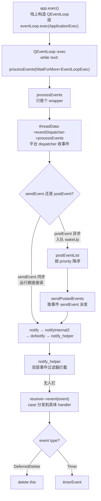

# 事件循环源码拆解

## 前言：为什么事件循环是 Qt 的心脏

每个 Qt 程序的 `main` 函数最后一行都是 `return app.exec();`。咱们把这一行调下去，程序就活了——窗口能响应点击，定时器到了点会触发，网络数据到了能被处理，`emit` 出去的跨线程信号能被接收。可 `exec()` 到底在干嘛？为什么一句 `quit()` 就能让它返回？为什么 `deleteLater` 不当场 `delete`，而要等到所谓的稍后？为什么装一个事件过滤器，就能拦下别人对象的事件？笔者头一回读 Qt 源码的时候，这几个问题在笔者脑子里搅成了一团，愣是没找到一个能一口气答全的地方。

这些问题的答案最后都落在了事件循环上。入门篇的 [7 事件系统](../../beginner/01-qtbase/07-event-system-beginner.md) 教过咱们怎么用 `QEvent`、怎么重写 `event()`、怎么装 `eventFilter`，`QTimer` 的用法则在入门篇的 [11 定时器](../../beginner/01-qtbase/11-timer-beginner.md) 一章，这些都还停在知其然的层面。进阶篇的 [事件系统](../../advanced/01-qtbase/07-event-system-advanced.md) 讲了自定义事件类型、事件过滤器的进阶用法，还有跨线程事件的投递与压缩。本篇要补的是知其所以然：咱们把 `exec()` 打开，看清楚那个让整个程序跑起来的 `while` 循环长什么样，事件是怎么从被产生走到被 `event()` 处理的，咱们也该看清 `sendEvent` 和 `postEvent` 两条路在源码里到底差在哪。

本篇承接的是 [信号槽底层——activate 调用链](./02-signal-slot-internals-expert.md)。02 那篇咱们看到跨线程 `QueuedConnection` 最终调 `QCoreApplication::postEvent(receiver, ev)` 投递出一个 `QMetaCallEvent`，那这个事件投递到哪去了？谁取它？谁来执行它？答案就在本篇的事件循环和它的分发链路里。信号槽一篇讲的是事件的产生端，本篇讲的是事件的处理端。咱们同样承接 [QObject 元对象系统](./01-qobject-meta-system-expert.md)，那篇拆的是 `qt_metacall` 的元调用分发，本篇要拆的 `QObject::event()` 是另一条分发路径，也是事件分发最终的落点，它的 case 分发咱们就在本篇里自己拆。

边界咱们交代清楚：本篇聚焦的是事件循环的主干，覆盖 `exec` 的循环结构，`processEvents` 到平台 dispatcher 的转发，`notify`/`sendEvent`/`postEvent` 的分发双路，`DeferredDelete` 的全链路，`timerEvent` 的入口，事件过滤器的拦截。平台 dispatcher 的具体实现，UNIX 上的 `QEventDispatcherUNIX`、Windows 上的 `QEventDispatcherWin32` 怎么跟操作系统要事件、怎么注册系统级定时器，咱们不展开，那是平台后端的事，本篇的边界就画在 `QAbstractEventDispatcher` 这层抽象上。`postEvent` 的 priority 排序规则咱们会讲到（文档明文），但 `QPostEventList::addEvent` 内部的排序算法不下钻。

## 环境说明

本篇的源码引用都基于 `qt_src/qt6.9.1`，行号可能随 Qt 版本的升级而漂移，您对照阅读时拿函数名定位就行。涉及的关键文件按出场顺序列在下面：

| 文件 | 角色 |
|---|---|
| `qt_src/qt6.9.1/qtbase/src/corelib/kernel/qcoreapplication.cpp` | exec / notify / sendEvent / postEvent / sendPostedEvents / notify_helper / execCleanup |
| `qt_src/qt6.9.1/qtbase/src/corelib/kernel/qeventloop.cpp` | QEventLoop::exec 的 while 心脏 / exit / processEvents |
| `qt_src/qt6.9.1/qtbase/src/corelib/kernel/qeventloop.h` | ProcessEventsFlags（ApplicationExec / EventLoopExec 标记） |
| `qt_src/qt6.9.1/qtbase/src/corelib/kernel/qabstracteventdispatcher.h` | QAbstractEventDispatcher 纯虚接口（平台抽象层） |
| `qt_src/qt6.9.1/qtbase/src/corelib/kernel/qcoreevent.h` | DeferredDelete = 52 事件类型常量 |
| `qt_src/qt6.9.1/qtbase/src/corelib/kernel/qobject.cpp` | QObject::event 的 case 分发 / installEventFilter |

本篇无配套 example 的原因也交代一下：事件循环的分发路径是 Qt 运行期的内部机制，没有任何合理的 demo 能演示它，对照 `qt_src` 翻源码就是最好的实验，动手验证的练习咱们放在文末的练习项目里。

## 核心概念讲解

咱们在动手翻源码以前把整条主干对一遍。事件循环是一条从循环骨架走到事件交付的单向链路，中间经过平台抽象层的转发，末端分成同步与异步的分发双路：



咱们从源头的 `app.exec()` 讲起。

### exec 的心脏：一个 while 循环

咱们看 `QCoreApplication::exec()`（`qt_src/qt6.9.1/qtbase/src/corelib/kernel/qcoreapplication.cpp:1430-1455`），这个没几行的函数把活儿都交给了栈上构造的一个 `QEventLoop`：

```cpp
int QCoreApplication::exec()
{
    if (!QCoreApplicationPrivate::checkInstance("exec"))
        return -1;
    // ...
    threadData->quitNow = false;
    QEventLoop eventLoop;
    self->d_func()->in_exec = true;
    self->d_func()->aboutToQuitEmitted = false;
    int returnCode = eventLoop.exec(QEventLoop::ApplicationExec);
    threadData->quitNow = false;

    if (self)
        self->d_func()->execCleanup();

    return returnCode;
}
```

咱们注意 `QEventLoop eventLoop;` 是栈上构造的——每条线程（至少主线程）都有一个属于自己的 `QEventLoop`，它的生命周期和这次 `exec` 调用绑定在一起。`exec` 传了一个 `QEventLoop::ApplicationExec` 标记进去，标明当前跑的是主应用循环，区别于普通的嵌套循环。这个标记跟着 flags 传进了 `processEvents`，咱们紧接着讲循环体就能看到那一步，那里显式拼上去的另一个标记是 `EventLoopExec`。拿到 `eventLoop.exec` 的返回值后，它还调了 `execCleanup()` 兜底，这是 `deleteLater` 的最后兑现机会，咱们讲到删除链路的时候再展开。

真正的循环体在 `QEventLoop::exec` 里就两行（`qt_src/qt6.9.1/qtbase/src/corelib/kernel/qeventloop.cpp:185-186`），可整个 Qt 程序的心脏正是它——笔者头一回看到的时候愣了一下，折腾了大半年的事件循环，根上居然就是一个再朴素不过的 while：

```cpp
    while (!d->exit.loadAcquire())
        processEvents(flags | WaitForMoreEvents | EventLoopExec);
```

循环条件读的是 `d->exit` 标志的原子值，只要 `exit` 还没被置位的这段时间里，咱们就见它一遍又一遍地调 `processEvents`。`processEvents` 的 flags 里拼了 `WaitForMoreEvents`（没事件的时候就阻塞等，省得空转烧 CPU）和 `EventLoopExec`（说明此刻正在 `exec` 的循环里）。整个 Qt 程序活着的根基，就是这个 `while` 在一圈圈地转，每一圈处理的都是一批事件，没事件的时候就阻塞等待，直到有人把 `exit` 标志给置起来了，循环才算停了。

循环读 `exit` 标志用的是 `loadAcquire()`，和 `exit()` 方法里的 `storeRelease()` 配成一对 acquire-release 序，保证 `exit()` 写入的返回码等数据，在循环条件读到 `exit=true` 的那一刻，对当前线程就全部可见了，退出机制一节咱们细看。

### 退出机制：exit 写标志，interrupt 负责叫醒

`QCoreApplication::quit()` 本质上调的是 `QEventLoop::exit`。咱们看它怎么让上面那个 `while` 停下来（`qt_src/qt6.9.1/qtbase/src/corelib/kernel/qeventloop.cpp:253-262`）：

```cpp
void QEventLoop::exit(int returnCode)
{
    // ...
    d->returnCode.storeRelaxed(returnCode);
    d->exit.storeRelease(true);
    threadData->eventDispatcher.loadRelaxed()->interrupt();
}
```

这三步咱们挨个看。头一步的 `returnCode.storeRelaxed` 存返回码，relaxed 在这里就够用了，因为 `exit` 的 release 会兜底同步。第二步的 `exit.storeRelease(true)` 把退出标志置起来，下一圈的 `loadAcquire()` 就能读到 true，循环也就到此为止了。第三步的 `dispatcher->interrupt()` 最容易被漏看，笔者头一回读的时候就把这一脚放过去了，当时以为置了标志循环自己就会停。

漏看它的代价是这样的：如果此刻的 `processEvents` 正阻塞在 `WaitForMoreEvents` 里，没事件来的时候就睡着，光置 `exit` 标志是没有用的，循环条件的检查要等下一圈才发生，而下一圈永远不会来，因为线程阻塞住了。在咱们看来，`interrupt()` 的作用就是把睡着的 `processEvents` 踹醒，让它立即回到循环条件的那一头，循环这才能回头去检查它的 `exit` 标志，这最后的一脚，是退出机制里最要紧的动作。

### processEvents 与平台 dispatcher：抽象层

`QEventLoop::processEvents` 自己是几乎不干活的，咱们看它的函数体（`qt_src/qt6.9.1/qtbase/src/corelib/kernel/qeventloop.cpp:94-104`），它就是个纯粹的转发器：

```cpp
bool QEventLoop::processEvents(ProcessEventsFlags flags)
{
    Q_D(QEventLoop);
    auto threadData = d->threadData.loadRelaxed();
    if (!threadData->hasEventDispatcher())
        return false;
    return threadData->eventDispatcher.loadRelaxed()->processEvents(flags);
}
```

咱们在源码的注释里能读到直说的一句 This function is simply a wrapper，它检查的是当前线程有没有 event dispatcher，没有的话就直接返回 false，有的话就把 flags 原样转发给 `dispatcher->processEvents`。真正从操作系统收事件的活儿，全压在那个 dispatcher 的身上。

咱们接着看 dispatcher 的基类，它是个纯虚的抽象类 `QAbstractEventDispatcher`，平台相关的操作全被它声明成了纯虚（`qt_src/qt6.9.1/qtbase/src/corelib/kernel/qabstracteventdispatcher.h:44-74`）：

```cpp
    virtual bool processEvents(QEventLoop::ProcessEventsFlags flags) = 0;
    // ...
    virtual void registerTimer(int timerId, qint64 interval, Qt::TimerType timerType, QObject *object) = 0;
    virtual bool unregisterTimer(int timerId) = 0;
    // ...
    virtual void wakeUp() = 0;
    virtual void interrupt() = 0;
```

`processEvents`、`registerTimer`、`unregisterTimer`、`wakeUp`、`interrupt` 在咱们眼里全是 `= 0`，连一份默认的实现都没有。具体要怎么跟窗口系统要事件、怎么注册系统的定时器，这些活儿由各平台的子类来实现，UNIX 的 `QEventDispatcherUNIX` 走 `select`/`poll`，Windows 的走 `PeekMessage`/`MsgWaitForMultipleObjects`，macOS 的走 CFRunLoop。本篇的讲解就到这个抽象层为止，咱们要理解的是 dispatcher 负责收事件并交给 `QCoreApplication` 分发的职责划分，平台后端的实现是另一回事。

咱们在类文档里能读到这个职责划分的原话（`qt_src/qt6.9.1/qtbase/src/corelib/kernel/qabstracteventdispatcher.cpp:121-124`）：

```cpp
    An event dispatcher receives events from the window system and other
    sources. It then sends them to the QCoreApplication or QApplication
    instance for processing and delivery.
```

dispatcher 是收事件的，`QCoreApplication` 是分发事件的。分发这一侧怎么把事件送进每个对象的 `event()` 里，咱们下一节进去看。

### 分发总入口：notify 与同线程规则

事件收到了，要送到具体对象的 `event()` 里去，这个分发的总入口是 `notify`，咱们看文档的原话（`qt_src/qt6.9.1/qtbase/src/corelib/kernel/qcoreapplication.cpp:1124-1128`）：

```cpp
  Sends \a event to \a receiver: \a {receiver}->event(\a event).
  Returns the value that is returned from the receiver's event
  handler. Note that this function is called for all events sent to
  any object in any thread.
```

`notify(receiver, event)` 的职责就是把 `event` 送给 `receiver->event()`。不管是哪个线程里的对象、哪种类型的事件，所有事件的分发最终都要过这里，咱们后面会反复回到它。

咱们更常用的是 `sendEvent`（`qt_src/qt6.9.1/qtbase/src/corelib/kernel/qcoreapplication.cpp:1525-1547`），它走的是同步直发：

```cpp
    \fn bool QCoreApplication::sendEvent(QObject *receiver, QEvent *event)

    Sends event \a event directly to receiver \a receiver, using the
    notify() function. Returns the value that was returned from the
    event handler.

    The event is \e not deleted when the event has been sent.
// ...
bool QCoreApplication::sendEvent(QObject *receiver, QEvent *event)
{
    // ...
    event->m_spont = false;
    return notifyInternal2(receiver, event);
}
```

咱们看文档里的两句原话。头一句 directly 说的是同步直发：调下去当场就执行了 `receiver->event()`，事件是不进队列的。另一句 The event is not deleted 讲的是事件的生命周期，`sendEvent` 是不删事件的，事件的生死归调用者管，这一点和 `postEvent` 的做法正好相反，异步投递一节咱们对照着看。实现里把 `m_spont` 置了 false，标记它不是来自窗口系统的自发事件，然后就调了 `notifyInternal2`。

咱们接着看 `notifyInternal2`，它强制了一条重要的规则，那就是同线程的规则（`qt_src/qt6.9.1/qtbase/src/corelib/kernel/qcoreapplication.cpp:1080-1106`）：

```cpp
    // Qt enforces the rule that events can only be sent to objects in
    // the current thread, so receiver->d_func()->threadData is
    // equivalent to QThreadData::current(), just without the function
    // call overhead.
    // ...
    if (!selfRequired)
        return doNotify(receiver, event);
    // ...
    return qApp->notify(receiver, event);
```

注释里逐字写着的原文是 `Qt enforces the rule that events can only be sent to objects in the current thread`，事件只能发给当前线程里的对象。这就是 `sendEvent` 不能跨线程用的原因：它走的是 `notify` 的同步直发，而 `notify` 要求的正是 receiver 待在当前线程。跨线程发事件就得走 `postEvent` 的异步路，让接收线程自己的事件循环去处理，异步投递一节咱们看它怎么走。

### 异步投递：postEvent 入队与 sendPostedEvents 派发

咱们接着看 `postEvent`，它是 `sendEvent` 的姐妹，路数却是完全不同的（`qt_src/qt6.9.1/qtbase/src/corelib/kernel/qcoreapplication.cpp:1622-1664`），它走的是异步入队：

```cpp
void QCoreApplication::postEvent(QObject *receiver, QEvent *event, int priority)
{
    // ...
    std::unique_ptr<QEvent> eventDeleter(event);
    // ...
    data->postEventList.addEvent(QPostEvent(receiver, event, priority));
    Q_UNUSED(eventDeleter.release());
    event->m_posted = true;
    receiver->d_func()->postedEvents.fetchAndAddRelease(1);
    data->canWait = false;
    locker.unlock();

    QAbstractEventDispatcher* dispatcher = data->eventDispatcher.loadAcquire();
    if (dispatcher)
        dispatcher->wakeUp();
}
```

`postEvent` 干的活儿咱们挨个数。头一件是它拿 `std::unique_ptr` 持住了 event，防的是后续抛异常时的事件泄漏。第二件发生在 `addEvent` 成功了之后，`release()` 把所有权转交给了事件队列，从此事件的生命周期归队列管，这一点和 `sendEvent` 的不删正好相反。第三件置的是 `m_posted = true` 标记，再给 receiver 的 `postedEvents` 计数加一（析构清理的时候这个计数有用），接着它把 `canWait` 置成了 false，告诉循环眼下的它别睡着空等，队列里是有活干的。最后它调的是 `dispatcher->wakeUp()`，和退出机制里的 `interrupt` 一个道理：dispatcher 正阻塞在 `WaitForMoreEvents` 的时候，`wakeUp` 就是来踹醒它的，让它赶紧处理新投递的事件。笔者觉得 `wakeUp` 和 `interrupt` 得凑在一起读才完整，投递和退出是事件循环里仅有的两个主动叫醒 dispatcher 的场景，其它时候 dispatcher 都是自己阻塞着等事件的。

队列里的事件按 `priority` 排序，咱们看规则的原文（`qt_src/qt6.9.1/qtbase/src/corelib/kernel/qcoreapplication.cpp:1611-1616`）：

```cpp
    Events are sorted in descending \a priority order, i.e. events
    with a high \a priority are queued before events with a lower \a
    priority. The \a priority can be any integer value, i.e. between
    INT_MAX and INT_MIN, inclusive; see Qt::EventPriority for more
    details. Events with equal \a priority will be processed in the
    order posted.
```

排序的规则说直白点：`priority` 大的事件排在 `priority` 小的前面。`priority` 本身可以取 `INT_MIN` 到 `INT_MAX` 的任意整数。`priority` 相同的事件按投递的次序排队，早进队的就早出队。咱们只引用这个排序规则，`QPostEventList::addEvent` 内部用什么算法维持顺序，不在本篇的范围里。

队列里的事件最终由 `sendPostedEvents` 派发，咱们把它取事件的代码贴出来（`qt_src/qt6.9.1/qtbase/src/corelib/kernel/qcoreapplication.cpp:1860-1879`）：

```cpp
        pe.event->m_posted = false;
        QEvent *e = pe.event;
        QObject * r = pe.receiver;

        r->d_func()->postedEvents.fetchAndSubAcquire(1);
        // ...
        const std::unique_ptr<QEvent> event_deleter(e); // will delete the event (with the mutex unlocked)

        // after all that work, it's time to deliver the event.
        QCoreApplication::sendEvent(r, e);
```

咱们看 `sendPostedEvents` 的派发动作：它把事件从队列里取了出来，把它的 `m_posted` 标志清掉，receiver 的 `postedEvents` 计数减一，然后用 `unique_ptr event_deleter(e)` 接管事件的所有权。注释里的 will delete the event 说的是派发完的自动删除，这正是 `postEvent` 投递的事件用完即删的归宿。最后它调的是 `sendEvent(r, e)`，您注意看，异步投递的事件，真正派发的那一刻走的是同步的 `sendEvent`。两条看似分岔的路，到最后一公里干活的是同一个函数，真的就是殊途同归，都汇合到分发入口的 `notify`。笔者没料到的就是这一点，异步做的只是入队加等待循环，真到了派发的那一刻就是同步。

### DeferredDelete 全链路：deleteLater 怎么兑现

`QObject::deleteLater` 是咱们用得最多的事件循环相关 API，它那个稍后删除到底是怎么兑现的？咱们把整条事件链路走一遍，从事件类型的常量看起（`qt_src/qt6.9.1/qtbase/src/corelib/kernel/qcoreevent.h:104`）：

```cpp
        DeferredDelete = 52,                    // deferred delete event
```

`DeferredDelete` 排的是 52 号事件类型，咱们接着看 `deleteLater()` 做的事：本质就是把一个 `DeferredDelete` 事件 `postEvent` 到对象自己的队列里，投递的时候还附带记录了当时的循环层级 `loopLevel` 和 `scopeLevel`，拿来做时机判定的依据。这个事件被派发到 `QObject::event` 的时候，对应的 case 是极简单的（`qt_src/qt6.9.1/qtbase/src/corelib/kernel/qobject.cpp:1415-1417`）：

```cpp
    case QEvent::DeferredDelete:
        delete this;
        break;
```

咱们看到的就一行 `delete this`。`deleteLater` 说的稍后，指的就是当前事件处理完、回到事件循环、轮到这个 `DeferredDelete` 事件被派发的那一刻，届时的 `delete this` 触发析构。笔者一开始还嫌这名字起得太玄乎，笔者看到这行 `delete this` 才恍然大悟，稍后就是字面意思的等到这一圈事件循环。它之所以不做当场 `delete`，是因为 `deleteLater` 往往是在事件处理过程中被调用的，比如在自己的事件处理器里，此时对象的栈帧还活着，当场 `delete` 会析构一个还在使用中的对象，`DeferredDelete` 把删除推迟到了一个安全的时机。

但这个安全时机的判定在咱们看来没那么简单，还牵涉嵌套的事件循环。轮到 `sendPostedEvents` 派发 `DeferredDelete` 事件的时候，它要检查的是时机合不合适（`qt_src/qt6.9.1/qtbase/src/corelib/kernel/qcoreapplication.cpp:1824-1857`）：

```cpp
        if (pe.event->type() == QEvent::DeferredDelete) {
            // ...
            const int eventLoopLevel = static_cast<QDeferredDeleteEvent *>(pe.event)->loopLevel();
            const int eventScopeLevel = static_cast<QDeferredDeleteEvent *>(pe.event)->scopeLevel();
            // ...
            const bool allowDeferredDelete =
                (eventLoopLevel + eventScopeLevel > data->loopLevel + data->scopeLevel
                 || (postedBeforeOutermostLoop && data->loopLevel > 0)
                 || (event_type == QEvent::DeferredDelete
                     && eventLoopLevel + eventScopeLevel == data->loopLevel + data->scopeLevel));
            if (!allowDeferredDelete) {
                // ... // re-post the event so it isn't lost
                data->postEventList.addEvent(pe_copy);
                continue;
            }
        }
```

咱们把两边一比就明白了：这段代码比较投递时记录的 `loopLevel`/`scopeLevel` 和当前的 `data->loopLevel`/`scopeLevel`，判断的就是现在删是不是安全。要紧的在末尾，如果判定的结果是还不能删（`!allowDeferredDelete`），事件是不会丢失的，而是被拿 `pe_copy` 重新 `addEvent` 投回了队列，等下一圈的事件循环再试。这就保证了 `deleteLater` 的对象最终一定会被删，只是要等嵌套循环的层级退回到合适的位置。

判定式里还有一条 `postedBeforeOutermostLoop` 的分支，管的是另一种场合：事件在最外层的循环开始以前就投递出去了（投递时 `loopLevel` 记的是 0），往后任何一圈循环冲刷队列的时候都许删。这样的边角咱们本篇不展开，认得它管的场合就行。

咱们最后再看一道兜底的 `execCleanup`（`qt_src/qt6.9.1/qtbase/src/corelib/kernel/qcoreapplication.cpp:1464-1468`）：

```cpp
void QCoreApplicationPrivate::execCleanup()
{
    threadData.loadRelaxed()->quitNow = false;
    in_exec = false;
    QCoreApplication::sendPostedEvents(nullptr, QEvent::DeferredDelete);
}
```

主循环的 `exec` 返回之后，程序马上要退出了，`execCleanup` 显式地调了 `sendPostedEvents(nullptr, DeferredDelete)`，把所有还没处理的 `DeferredDelete` 事件强制清一遍。这是最后的机会，保证 `deleteLater` 的对象在应用退出以前都兑现了删除，不会给咱们留一地悬垂指针。

### timerEvent 的入口：event 里的 Timer case

事件链路走到 `event` 的 case 分发这一步，咱们顺路把定时器事件的入口也看一眼。`QTimer` 触发的时候，dispatcher 注册的系统定时器到了时间，产生的就是一个派发到 `QObject::event` 的 `QEvent::Timer` 事件，咱们看的入口就是下面这个 case（`qt_src/qt6.9.1/qtbase/src/corelib/kernel/qobject.cpp:1402-1407`）：

```cpp
bool QObject::event(QEvent *e)
{
    switch (e->type()) {
    case QEvent::Timer:
        timerEvent((QTimerEvent *)e);
        break;
```

`event` 收到的是 `Timer` 类型，转手调的就是虚函数 `timerEvent`。`QObject` 默认的 `timerEvent` 是空实现，您不重写就什么都收不到，这也是咱们用定时器必须重写 `timerEvent` 的原因，或者改用 `QTimer` 的 `timeout` 信号。咱们在这里只证实了 Timer 事件到 `timerEvent` 调用的这一环，dispatcher 注册系统定时器的那一侧（平台抽象层一节的 `registerTimer` 纯虚）属于平台后端，不在本篇的范围里。

### 事件过滤器：notify_helper 的双层拦截

最后一节咱们讲事件过滤器，它是事件到达 `receiver->event()` 之前的拦截机制。拦截的地点在 `notify_helper` 里，而且它一共有两层，咱们一层一层看（`qt_src/qt6.9.1/qtbase/src/corelib/kernel/qcoreapplication.cpp:1255-1279`）：

```cpp
bool QCoreApplicationPrivate::notify_helper(QObject *receiver, QEvent * event)
{
    // ...
    // send to all application event filters (only does anything in the main thread)
    if (QThread::isMainThread()
            && QCoreApplication::self
            && QCoreApplication::self->d_func()->sendThroughApplicationEventFilters(receiver, event)) {
        filtered = true;
        return filtered;
    }
    // send to all receiver event filters
    if (sendThroughObjectEventFilters(receiver, event)) {
        filtered = true;
        return filtered;
    }

    // deliver the event
    consumed = receiver->event(event);
    return consumed;
}
```

咱们看 `notify_helper`，它是 `notify` 实际干活的内部函数。它依次试的是两道过滤器，头一道是应用级的过滤器（`sendThroughApplicationEventFilters`，只在主线程的时候生效，拦的是给 `qApp` 装的过滤器），第二道是对象级的过滤器（`sendThroughObjectEventFilters`，拦的是给具体 receiver 装的）。任何一道返回 true 的话就算拦截成功，事件是到不了 `receiver->event()` 的。两道都不拦的时候，才会轮到真正的 `receiver->event(event)` 交付。

对象级的那道过滤器，咱们接着看它的遍历部分（`qt_src/qt6.9.1/qtbase/src/corelib/kernel/qcoreapplication.cpp:1232-1248`）：

```cpp
bool QCoreApplicationPrivate::sendThroughObjectEventFilters(QObject *receiver, QEvent *event)
{
    if (receiver != qApp && receiver->d_func()->extraData) {
        for (qsizetype i = 0; i < receiver->d_func()->extraData->eventFilters.size(); ++i) {
            QObject *obj = receiver->d_func()->extraData->eventFilters.at(i);
            // ...
            if (obj->eventFilter(receiver, event))
                return true;
        }
    }
    return false;
}
```

这段代码遍历的是 receiver 的 `eventFilters` 列表，对每个过滤器对象调它的 `eventFilter(receiver, event)` 虚函数，咱们重写 `eventFilter` 的时候，实际被触发的就是这个地方。谁返回了 true，谁就拦下了事件。

过滤器是怎么装上去的，咱们看 `installEventFilter`（`qt_src/qt6.9.1/qtbase/src/corelib/kernel/qobject.cpp:2350-2366`）：

```cpp
void QObject::installEventFilter(QObject *obj)
{
    Q_D(QObject);
    if (!obj)
        return;
    if (d->threadData.loadRelaxed() != obj->d_func()->threadData.loadRelaxed()) {
        qWarning("QObject::installEventFilter(): Cannot filter events for objects in a different thread.");
        return;
    }
    // ...
    d->extraData->eventFilters.removeIf(isNullOrEquals(obj));
    d->extraData->eventFilters.prepend(obj);
}
```

咱们在 `installEventFilter` 里能看到两处要留意的地方。头一处是同线程的校验，过滤器和被过滤对象得是同一条线程里的，否则一句 `qWarning` 就把安装拒绝了，风险一节的第三类说的就是它。第二处留给了 `prepend`，新过滤器是头插进列表头部的。结合 `sendThroughObjectEventFilters` 从头遍历的顺序，这意味着后装的过滤器反而排在调用序列的最前面。您装了三个过滤器 A、B、C，调用顺序就成了 C、B、A，这一点和直觉是相反的，多过滤器的场景您要当心顺序。

## 风险与故障预防

第一类风险是在跨线程的场合用 `sendEvent` 发事件。分发总入口一节咱们看过 `notifyInternal2` 的源码，注释引文的后半句 `events can only be sent to objects in the current thread`（`qcoreapplication.cpp:1080-1106`）就是同线程规则的出处，`notify` 强制的正是它。您要是在 worker 线程里写 `QCoreApplication::sendEvent(mainWindow, event)`，`mainWindow` 的家在主线程，就违反了同线程规则。落到的后果是未定义的行为，Qt 会有断言或警告一类的反应，但事件不会正确地送达，严重的时候直接崩溃。原因就在于 `sendEvent` 走的是同步直发，它要在当前线程的调用栈里直接执行 `receiver->event()`，跨线程意味着去碰另一个线程的对象，而那个对象可能正在自己的线程里被使用着，这超出了同步直发能安全处理的范围。咱们的解法是跨线程一律用 `postEvent`（或者 `QueuedConnection` 的信号槽，它的内部就是 `postEvent`），让接收线程自己的事件循环在安全的时机处理，`sendEvent` 咱们只把它放在同一条线程里用。

第二类风险是咱们误以为 `deleteLater` 会立即删除。DeferredDelete 一节把整条链路看清楚了，`deleteLater` 做的只是把一个 `DeferredDelete` 事件投进队列，真正的 `delete this` 要等事件循环派发到它的那一刻才发生。而且当时嵌套循环的层级不满足（`allowDeferredDelete` 为 false），事件就被重新投了回去，删除推迟到了更晚。咱们把后果掰成两面看：您调了 `deleteLater` 之后，指针在当前这一圈事件处理结束以前还是有效的，这是它好的一面，让您能安全地从自己的事件处理器里调它。可您要是指望指针立即失效，拿它去判断 `if (obj)` 的真假，或者在 `deleteLater` 之后马上又通过别的路径访问这个对象，指望就会落了空，对象可能还好好地活着，也可能下一圈就没了。解法是把 `deleteLater` 的语义记牢，它说的是当前事件处理完毕、回到循环的时候删除，调过它以后咱们就别再持有、使用该指针。需要确定时机的删除，就去配合对象树（parent 管理）或者显式的 `delete`。

第三类风险出在 `installEventFilter` 跨线程装过滤器的场合，而且是静默的失败。事件过滤器一节的源码里，`installEventFilter` 的开头就检查 `threadData`，过滤器和被过滤对象不同线程的话，它就 `qWarning` 一句然后 `return` 了事，过滤器是根本没装上的。后果是您的过滤器对象从来没被调用过，事件从它面前漏过去了，程序却对咱们一条报错都不给，除非您开着 warning 输出，您才能看到那句 qWarning。这样的 bug 极其隐蔽，您以为装上了过滤器，事件却照常到了 receiver 手里。原因就在于事件过滤走的是 `eventFilter` 虚函数的同步调用（就是在 `notify_helper` 里当场调的），跨线程调用一个对象的虚函数不安全，Qt 干脆把它禁止了。咱们的解法就是把过滤器和被过滤对象挪进同一条线程。您确实需要跨线程拦截事件的话，咱们就得换个路子，比如在源线程的那一侧把事件拦下来，改用 `postEvent` 的投递把事件送过去。

## 练习项目

本篇跟 [06 智能指针家族](./06-memory-model-expert.md) 走的是一样的路子，练习就走验证的路，三道题都只给方向和验证的手段，完整的工程留给您自己搭。

头一道题验证过滤器的调用顺序。您给一个 QObject 依次装三个过滤器 A、B、C，每个 `eventFilter` 里打了日志就返回 false，然后您给这个对象 `sendEvent` 一个普通事件，看日志的顺序是不是 C、B、A。对照过滤器一节的 `prepend` 头插和从头遍历，最后装的排在了调用序列的最前面。

第二道题亲手摸一次 `deleteLater` 的时机。您在一个按钮的点击槽里对某个 widget 调 `deleteLater()`，紧接着咱们判一下指针，能看到对象在这一圈的事件处理里还活着。等控制权回到了事件循环之后再访问它，对象就已经没了。您要还想狠一点，咱们就把实验做进嵌套循环里：还是在点击槽里，调了 `deleteLater()` 之后马上 `exec()` 一个嵌套的 `QEventLoop`，让它在嵌套循环里处理了几圈事件，看对象是不是熬过了整个嵌套循环，等到层级退回、点击槽也走完了才没的。您把方向倒过来再做一遍，看到的现象也反过来：进了嵌套循环再调 `deleteLater()`，删除在嵌套循环内部就兑现了，不用等到层级退回的那一步。两个方向都验过了，再回去对照 DeferredDelete 一节的时机判定。

第三道题咱们回源码里做核对。您打开 `qt_src/qt6.9.1` 的 `qeventloop.cpp`，把 `exec` 的 while 和 `exit` 的三步对着读一遍，行号对不上的话就拿函数名搜。再去 `qcoreapplication.cpp` 的 `sendPostedEvents`，把 `DeferredDelete` 时机判定的分支完整读一遍，看看重新入队用的是不是 `pe_copy`。两处都对上了，本篇的断言也就落了地。

## 官方文档参考链接

[Qt 文档 · QCoreApplication](https://doc.qt.io/qt-6/qcoreapplication.html)——官方的类参考，exec、quit 的说法，sendEvent、postEvent、sendPostedEvents 的语义，咱们都上它这里查。

[Qt 文档 · QEventLoop](https://doc.qt.io/qt-6/qeventloop.html)——官方的类参考，exec、exit、processEvents 的行为咱们在这里查，ProcessEventsFlags 的标记也在这一页。

[Qt 文档 · QAbstractEventDispatcher](https://doc.qt.io/qt-6/qabstracteventdispatcher.html)——官方的类参考，咱们查平台事件收发的接口层时认它，收发相关的纯虚约定也以它为准。

[Qt 文档 · Events and Event Delivery](https://doc.qt.io/qt-6/eventsandfilters.html)——事件系统的总览，咱们查 sendEvent 和 postEvent 的区别，还有事件过滤器机制的时候认它。

---

走到了这里，Qt 事件循环的整条主干咱们就从源码层面走通了。咱们从 `app.exec()` 栈上构造的那个 `QEventLoop` 出发，看到让整个程序活着的，靠的就是一个 `while (!exit)` 反复地调 `processEvents`。咱们也看清了 `processEvents` 只是个转发器，真正收事件的是平台 dispatcher，那个抽象基类的接口全是纯虚函数。顺着 `notify` 进了分发链，咱们分清了 `sendEvent` 的同步直发（受同线程规则的约束）和 `postEvent` 的异步入队（按 `priority` 从大到小地排，最终也汇合到了 `sendEvent`）两条路。`deleteLater` 的 `DeferredDelete` 全链路咱们也追完了，从投递、时机判定、`delete this` 一直到 `execCleanup` 的兜底。最后拆的是 `timerEvent` 的入口和事件过滤器的双层拦截。笔者自己的体感是，事件循环平时在咱们手里像个黑盒，可一旦咱们把 `while`、`interrupt`、`wakeUp` 三个动词连起来看，整条链就透了。对象树的拆解，咱们留给 [21 对象树源码](./21-object-tree-ownership-expert.md)，`setParent`、析构级联删子、`deleteLater` 在对象树里的角色，都是那一篇要拆的内容。

本篇的所有行号证据，都已经按源码的机制归好类收在 [code-index · qtbase](../code-index/qtbase/) 下面，三份索引各自对应一块：循环骨架和退出机制看 [event-loop-exec](../code-index/qtbase/event-loop-exec.md) 的索引，dispatcher 抽象和分发双路看 [event-dispatch](../code-index/qtbase/event-dispatch.md) 的，DeferredDelete、定时器和过滤器的部分，看 [deferred-delete-and-filters](../code-index/qtbase/deferred-delete-and-filters.md) 的。您带着行号直接去 `qt_src/qt6.9.1` 翻原文，就能核对上了。
