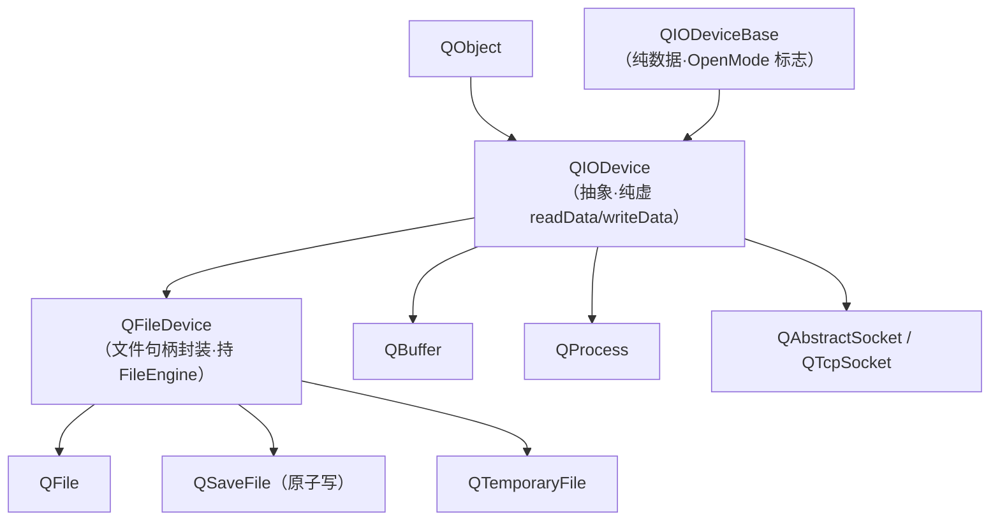

# QIODevice 与 QFile 源码拆解

## 前言：所有 IO 类的祖宗，到底管了什么

写 Qt 的人多多少少都碰过 `QFile`。您要是翻开 `qiodevice.h` 看一眼，看到的 `QFile` 就只是冰山的一角——它上头还有个 `QFileDevice`，再往上的一层才是 `QIODevice`。而 `QIODevice` 是 Qt 里一切沾着数据流边的类的祖宗：咱们日常用的 `QFile`、`QBuffer`、`QProcess`、`QAbstractSocket`、`QTcpSocket`，全是它的子类。

笔者当年翻源码的时候，卡住的问题有这么几个。`readData` 的函数体，我在 `QIODevice` 头文件里翻烂了都没找到，它到底有没有默认实现？`QFile` 会不会像 C 语言的 `FILE*` 那样，直接封装一个文件描述符？剩下的疑问是 `readyRead` 信号，发射它的到底是 `QIODevice` 自己吗？

咱们前面攒的这几个问题，恰好落在 QIODevice 设计的三条主轴上，一条是抽象基类划给子类的虚函数分工，一条是文件类的继承与封装层次，还有一条是异步 IO 的信号驱动。入门篇的 [8.文件与 IO](../../beginner/01-qtbase/08-file-io-beginner.md) 教了 `QFile` 怎么读写和 `QTextStream` 文本流，进阶篇的 [8.文件 IO 进阶](../../advanced/01-qtbase/08-file-io-advanced.md) 讲的是 `QDataStream` 序列化这些用法。本篇咱们要往源码里捅：打开 `qiodevice.cpp`，看看 `read`/`write` 怎么在 `readData`/`writeData` 这对纯虚函数上搭起来，随机设备和顺序设备怎么分叉，缓冲区怎么工作，再顺着继承链看 `QFile` 怎么经一层 `QAbstractFileEngine` 落到平台的 `open`/`CreateFile` 上。

边界咱们也交代清楚。`QTextStream`、`QDataStream` 是建在 `QIODevice` 之上的序列化框架，咱们本篇点到即止，不展开它们的编码细节。同样继承 `QIODevice` 的还有 `QBuffer`、`QProcess`、`QAbstractSocket`，但咱们只拿它们说明 QIODevice 的通用性，这些子类咱们不拆——它们各有各的归属，网络的归网络模块，进程的归进程篇。

## 环境说明

本篇的源码引用都基于 `qt_src/qt6.9.1`，行号会随 Qt 版本升级而漂移，您对照阅读时要是发现行号对不上，您拿函数名或字段名去定位最稳。涉及的关键文件，咱们按出场顺序列在下面：

| 文件 | 角色 |
|---|---|
| `qtbase/src/corelib/io/qiodevice.h` / `qiodevicebase.h` | QIODevice 公共声明 + OpenMode 标志（拆到 QIODeviceBase） |
| `qtbase/src/corelib/io/qiodevice.cpp` | QIODevice 实现：read/write/seek/pos/close |
| `qtbase/src/corelib/io/qfiledevice.h` / `.cpp` / `_p.h` | QFileDevice：文件句柄封装层（持 FileEngine） |
| `qtbase/src/corelib/io/qiodevice_p.h` | QIODevicePrivate：QRingBuffer 缓冲、chunkSize |
| `qtbase/src/corelib/io/qfile.h` / `.cpp` | QFile：继承 QFileDevice |
| `qtbase/src/corelib/io/qfsfileengine_unix.cpp` / `_win.cpp` | 平台 native：open / CreateFile |
| `qtbase/src/corelib/io/qsavefile.h` / `.cpp` | QSaveFile：原子写 |

本篇跟前几篇走的是一样的路子，不配 example 的工程。纯源码拆解的文章，对照 `qt_src` 翻代码就是最好的实验，动手验证的题目咱们放在文末的练习项目里。

## 核心概念讲解

咱们趁源码还没翻开，把 QIODevice 的家族关系对一遍。继承层次咱们画在下面，您一眼能看清谁继承谁、`QFile` 站在哪一层：



`QIODevice` 双重继承的是 `QObject`（管信号槽）和 `QIODeviceBase`（管 OpenMode 标志）。咱们顺着继承链往下走，文件类的中间层是 `QFileDevice`，从它身上分出的是 `QFile`、`QSaveFile`、`QTemporaryFile`。直接继承 `QIODevice` 的还有 `QBuffer`、`QProcess` 和各种 Socket。咱们这一篇就顺着继承链，从顶上的 `QIODevice` 抽象层一路拆到 `QFile` 的平台调用。

### 双继承与 OpenMode：QIODevice 站在哪

咱们从 `QIODevice` 自己继承谁看起（`qt_src/qt6.9.1/qtbase/src/corelib/io/qiodevice.h:30-37`）：

```cpp
class Q_CORE_EXPORT QIODevice
#ifndef QT_NO_QOBJECT
    : public QObject,
#else
    :
#endif
      public QIODeviceBase
```

它的基类有两个。基类里的头一个是 `QObject`，它让所有 IO 类有了信号槽的能力，`readyRead` 这样的信号才发得出来，不过这个继承被 `QT_NO_QOBJECT` 包着，极简配置下您是能把它裁掉的。另一边的 `QIODeviceBase`，是 Qt 6 专门拆出来的（`qt_src/qt6.9.1/qtbase/src/corelib/io/qiodevicebase.h:16-28`）：

```cpp
    enum OpenModeFlag {
        NotOpen = 0x0000,
        ReadOnly = 0x0001,
        WriteOnly = 0x0002,
        ReadWrite = ReadOnly | WriteOnly,
        Append = 0x0004,
        Truncate = 0x0008,
        Text = 0x0010,
        Unbuffered = 0x0020,
        NewOnly = 0x0040,
        ExistingOnly = 0x0080
    };
    Q_DECLARE_FLAGS(OpenMode, OpenModeFlag)
```

十个标志位咱们都认得，读写占了头两位，`Append` 和 `Truncate` 管的是打开方式，`Text` 和 `Unbuffered` 管的也是行为，`NewOnly` 和 `ExistingOnly` 是 Qt 5.11 加的。您留意 `ReadWrite`，它没有自己独占的一位，是拿 `ReadOnly | WriteOnly` 位运算组合出来的，算出来的值是 0x3。为什么要单独拆一个 `QIODeviceBase` 非模板基类出来？因为 `OpenMode` 这个类型得被 `QFileInfo` 这样不依赖 `QIODevice` 完整定义的地方用到，单独拆出来能斩断头文件的循环依赖。`QIODeviceBase` 的析构还是 `protected` 的，您没法独立实例化它——它纯粹是个标志容器。

### 双模式：随机访问和顺序访问怎么分叉

`QIODevice` 把天下的设备分成两种：能 `seek` 的随机访问设备（普通文件），和不能 `seek` 的顺序设备（管道、socket、串口）。咱们区分它们靠的就是一个虚函数（`qt_src/qt6.9.1/qtbase/src/corelib/io/qiodevice.cpp:493-496`）：

```cpp
bool QIODevice::isSequential() const
{
    return false;
}
```

基类默认返回的是 `false`，等于假定您手上的是可以 `seek` 的随机设备。顺序设备的子类得 override 它返回 `true`。这里笔者要专门提醒一个容易想岔的点：`QFileDevice` 就 override 了这个函数，它把判定委托给了 `fileEngine->isSequential()`——所以普通磁盘文件返回 `false`，但它背后挂着的要是管道或者特殊文件，它就返回 `true` 了。千万别把 `QFileDevice` 记成永远的随机设备，只在普通文件的场景下成立。

`isSequential` 的返回值，直接决定 `seek` 让不让您调（`qt_src/qt6.9.1/qtbase/src/corelib/io/qiodevice.cpp:857-870`）：

```cpp
bool QIODevice::seek(qint64 pos)
{
    Q_D(QIODevice);
    if (d->isSequential()) {
        checkWarnMessage(this, "seek", "Cannot call seek on a sequential device");
        return false;
    }
    if (d->openMode == NotOpen) {
        checkWarnMessage(this, "seek", "The device is not open");
        return false;
    }
    if (pos < 0) {
        qWarning("QIODevice::seek: Invalid pos: %lld", pos);
        return false;
    }
```

咱们把三道守卫一道道过。您在顺序设备上调 `seek`，它直接回您 `false`，还附带一句 `checkWarnMessage` 的警告，不让您进。设备没打开？回的也是 `false`。位置传了负数？返回的照样是 `false`。三道守卫都过了，才轮到 `d->devicePos` 的更新和 `seekBuffer` 的调用（把内部缓冲区清掉或截断）。双模式分叉的路口就设在头一道守卫上。

### readData 与 writeData：子类必须实现的两个纯虚函数

现在咱们到本篇最核心的一对了。`readData` 和 `writeData` 在 `QIODevice` 的头文件里长这样（`qt_src/qt6.9.1/qtbase/src/corelib/io/qiodevice.h:132`）：

```cpp
    virtual qint64 readData(char *data, qint64 maxlen) = 0;
```

咱们翻遍 `qiodevice.cpp` 全文，也找不到 `QIODevice::readData` 的函数体，能找到的只有 `/*! \fn ... */` 的文档注释。它被声明成了纯虚，`QIODevice` 于是成了抽象类，您没法 `new QIODevice()`，不实现 `readData` 的子类也出不了实例。`writeData` 的待遇一模一样，同样也是纯虚的声明（`qt_src/qt6.9.1/qtbase/src/corelib/io/qiodevice.h:135`）：

```cpp
    virtual qint64 writeData(const char *data, qint64 len) = 0;
```

笔者要专门纠正一个流传挺广的说法。有些老资料讲的是 `QIODevice::readData` 默认返回 -1 表示出错，那是 Qt 4/5 时代的旧行为，Qt 6.9.1 里它就是纯虚的，默认的实现是没有的。子类（比如 `QFileDevice::readData`、在 `qt_src/qt6.9.1/qtbase/src/corelib/io/qfiledevice.cpp:462`）才是干活的真身。这对纯虚函数划定的，就是 `QIODevice` 和子类之间的分工：您要当一种 IO 设备，就得告诉它怎么读一块、怎么写一块，剩下的缓冲、循环、状态管理，都由基类统一打理了。

咱们看，公共的 `read` 在这个分工上搭了一层薄壳（`qt_src/qt6.9.1/qtbase/src/corelib/io/qiodevice.cpp:996-1029`）：

```cpp
qint64 QIODevice::read(char *data, qint64 maxSize)
{
    Q_D(QIODevice);
    ...
    CHECK_READABLE(read, qint64(-1));
    const bool sequential = d->isSequential();
    // Short-cut for getChar(), unless we need to keep the data in the buffer.
    if (maxSize == 1 && !(sequential && d->transactionStarted)) {
        int chint;
        while ((chint = d->buffer.getChar()) != -1) {
            ...
            *data = c;
            ...
            return qint64(1);
        }
    }
    CHECK_MAXLEN(read, qint64(-1));
    const qint64 readBytes = d->read(data, maxSize);
    return readBytes;
}
```

`CHECK_READABLE` 确认的是设备可读，`CHECK_MAXLEN` 确认的是长度合法。中间那段 `maxSize == 1` 的快捷路径是给 `getChar()` 用的，不过您注意，缓冲区空了的时候，它会调 `readData(data, 0)` 预读 0 字节去触发子类的填缓冲，这并不是对 `readData` 的绕过。真正干活的还是最后那行 `d->read(data, maxSize)`，那行调用的逻辑住在 `QIODevicePrivate::read` 里，咱们下一节拆。

`write` 的公共壳比 `read` 还薄，咱们对照着看一眼（`qt_src/qt6.9.1/qtbase/src/corelib/io/qiodevice.cpp:1763-1829`）。守卫查的是可写和长度，随机设备的位置也对齐好了，中间干活的就一行 `writeData(data, maxSize)`（Windows 上开了 `Text` 模式才会多一段按块转 `\r\n` 的分支），数据直接交给了子类，写完了再把 `pos` 和 `devicePos` 往前挪。跟读侧不一样的地方在缓冲：基类这层自己不做写缓冲，缓冲挪到了文件子类身上。`QFileDevice::writeData`（`qt_src/qt6.9.1/qtbase/src/corelib/io/qfiledevice.cpp:547-575`）把小块的写攒进了 `d->writeBuffer`，走缓冲的时候，攒着的数据快溢出 16KB（`QFILE_WRITEBUFFER_SIZE` 定义在 `qt_src/qt6.9.1/qtbase/src/corelib/io/qfiledevice.cpp:15-16`）就调 `flush()` 把缓冲写到引擎上，开了 `Unbuffered`、或者单次要写的超过 16KB，则绕开了缓冲直接写引擎。

### 缓冲的两条路：大块直读和填充 ring

咱们在 `QIODevicePrivate` 里能找到一组环形缓冲区（`qt_src/qt6.9.1/qtbase/src/corelib/io/qiodevice_p.h:105-116`）：

```cpp
    QRingBufferRef buffer;
    QRingBufferRef writeBuffer;
    ...
    int readBufferChunkSize = QIODEVICE_BUFFERSIZE;
    int writeBufferChunkSize = 0;
    QVarLengthArray<QRingBuffer, 2> readBuffers;
    QVarLengthArray<QRingBuffer, 1> writeBuffers;
```

这里有个咱们容易看走眼的地方。`buffer` 和 `writeBuffer` 的类型是 `QRingBufferRef`，名字给人的感觉是它拥有一个 `QRingBuffer`，其实它里头持的裸指针 `m_buf` 只是个引用。真正的 `QRingBuffer` 对象归下面那个 `QVarLengthArray<QRingBuffer, 2> readBuffers` 所有，栈上预分配了两个槽，支持的才是多通道读。多通道读说的是一台设备可以挂几个读通道，`currentReadChannel` 记录着当前活跃的是哪一个，典型的用法是 `QProcess` 把子进程的标准输出和标准错误分成两个通道，切换靠的是 `QIODevice` 的公共接口 `setCurrentReadChannel`（`qt_src/qt6.9.1/qtbase/src/corelib/io/qiodevice.h:61`）。切换的时候，挂上去的目标就是 `buffer.m_buf` 这个字段，`QIODevicePrivate` 的实现把 `m_buf` 指到 `readBuffers[channel]` 上（`qt_src/qt6.9.1/qtbase/src/corelib/io/qiodevice_p.h:147-151`）。所以 `buffer` 是个视图，展示的是当前活跃通道而非所有权。`readBufferChunkSize` 默认取的 `QIODEVICE_BUFFERSIZE`（`qt_src/qt6.9.1/qtbase/src/corelib/io/qiodevice_p.h:30-31`）：

```cpp
#ifndef QIODEVICE_BUFFERSIZE
#define QIODEVICE_BUFFERSIZE 16384
```

宏给出的值是 16384，折成的是 16KB 的大小。这个数字就是 `read` 走哪条路的分界线，咱们看 `QIODevicePrivate::read` 的核心（`qt_src/qt6.9.1/qtbase/src/corelib/io/qiodevice.cpp:1082-1116`）：

```cpp
        const bool buffered = (readBufferChunkSize != 0 && (openMode & QIODevice::Unbuffered) == 0);
        ...
        if ((!buffered || maxSize >= readBufferChunkSize) && !keepDataInBuffer) {
            // Read big chunk directly to output buffer
            readFromDevice = q->readData(data, maxSize);
        } else {
            // fill QIODevice buffer by single read
            readFromDevice = q->readData(buffer.reserve(bytesToBuffer), bytesToBuffer);
        }
```

两条路是这样分的。您一次要读的字节数 `maxSize` 大于等于 16KB（或者开了 `Unbuffered`），代码就直接调了 `readData`，把数据读进您给的缓冲区，绕过了 ring，一次了事，省的是一次拷贝。您要读的少于 16KB，走的就是另一条路：代码拿 `bytesToBuffer` 向 `readData` 最多要 16KB（取的是 ring 的 chunkSize 上限），设备单次真给的可能比要的少，跟在后面的 `buffer.chop` 把没填上的预留裁掉，您要的那点再从 ring 里切出来。下次您再读，数据是直接从 ring 里拿的，命中了就不用再调 `readData`——这是给频繁小读（比如逐字节解析）省系统调用用的。

这整套动作的外面还泡着一个 `forever` 循环，咱们跟着转一圈：一圈下来凑不够 `maxSize`，就又回到圈顶接着凑了，ring 里的数据拿完了还不够，就再往下面的设备要，凑够了，或者某次 `readData` 返回的比请求的短（代码拿它当设备到头的标记），这个圈才算走到了头。

这个分叉也解释了 `Unbuffered` 标志到底干了什么：它把 `buffered` 压成了 `false`，所有的读都走的是直读的路子。听起来更快？笔者当初也是这么觉得的，翻完源码咱们才看清，事情真不一定——频繁小读的时候，`Unbuffered` 会让每次 read 都调一次 `readData`（背后是一次实打实的系统调用 `read`），性能反而崩。`Unbuffered` 只在大块顺序读、而且您自己管缓冲的场景才划算。

### readLine 与 Text 模式：出口处收掉 \r\n

咱们看 `readLine`，它是 `read` 头顶上的便利函数，按 `\n` 一行一行地切（`qt_src/qt6.9.1/qtbase/src/corelib/io/qiodevice.cpp:1387-1394`）。它的做法是从 buffer 里 peek 出 `\n`、省掉 `readData` 的调用：

```cpp
    if (readSoFar) {
        if (data[readSoFar - 1] == '\n') {
            if (openMode & QIODevice::Text) {
                // QRingBuffer::readLine() isn't Text aware.
                if (readSoFar > 1 && data[readSoFar - 2] == '\r') {
                    --readSoFar;
                    data[readSoFar - 1] = '\n';
                }
            }
            ...
            return readSoFar;
        }
    }
```

`Text` 模式的处理放在 `readLine` 的出口——Windows 风格的 `\r\n`，在这里被收成了 `\n`。咱们要是发现 buffer 里没有 `\n` 怎么办？回退到的是 `readLineData`（`qt_src/qt6.9.1/qtbase/src/corelib/io/qiodevice.cpp:1630-1636`）：

```cpp
    while (readSoFar < maxSize && (lastReadReturn = read(&c, 1)) == 1) {
        *data++ = c;
        ++readSoFar;
        if (c == '\n')
            break;
    }
```

这是默认的实现，逐字节 `read` 找 `\n` 的写法性能很差，每个字节的读取都要在循环里转一圈。所以像 `QFileDevice` 这样的子类会 override `readLineData` 做优化：一次读一大块，再在内存里仔细地找 `\n`。这也是为什么您读大文本文件的时候，该用 `QFileDevice` 的 `readLine` 而不是自己拿 `getChar` 拼一行。

### readyRead 与 bytesWritten：声明在基类，发射在子类

`QIODevice` 声明了三个核心信号：`readyRead`、`bytesWritten`、`aboutToClose`。但您要是拿 `emit readyRead` 当关键字去 grep `qiodevice.cpp`，能命中的只有写给子类作者看的文档注释，正文代码里一处 `QIODevice` 自己的发射都没有。笔者头一回查到这里的时候愣了一下，`QIODevice` 自己是从来不发射 `readyRead` 和 `bytesWritten` 的（`qt_src/qt6.9.1/qtbase/src/corelib/io/qiodevice.h:117-122`）：

```cpp
Q_SIGNALS:
    void readyRead();
    void channelReadyRead(int channel);
    void bytesWritten(qint64 bytes);
    void channelBytesWritten(int channel, qint64 bytes);
    void aboutToClose();
```

`readyRead` 报告的是“有新数据可读了”，`bytesWritten` 报告的是“数据已经写出去了”。发射的一方是子类，咱们拿 `QAbstractSocket` 当最典型的例子：它在操作系统通知 socket 有数据到达的回调里，自己把 `readyRead()` 发了出来。`QIODevice` 做的只是声明，什么时候发、由谁发全交给了子类，它自己是不插手的。顺序设备的数据到达是异步的，上层是靠信号被叫醒过来读的。

咱们到了 `aboutToClose` 这儿，规则就变了，它是 `QIODevice` 自己在 `close()` 里发射的（`qt_src/qt6.9.1/qtbase/src/corelib/io/qiodevice.cpp:787-807`）：

```cpp
void QIODevice::close()
{
    Q_D(QIODevice);
    if (d->openMode == NotOpen)
        return;
    ...
    emit aboutToClose();
    d->openMode = NotOpen;
    d->pos = 0;
    ...
    // Do not clear write buffers to allow delayed close in sockets
    d->writeChannelCount = 0;
}
```

咱们翻遍 `qiodevice.cpp`，这是 `QIODevice` 唯一自己主动发射的信号。发信号的时机是讲究的——赶在 `openMode` 改成 `NotOpen` 之前发，订阅者赶在设备真正关闭前还能做最后的操作（比如 flush 一下）。注释里明说的 write buffers 不清空，是给 socket 的 delayed close 留的尾巴。

### QFile 到平台调用：中间隔着 FileEngine

抽象层讲完了，咱们顺着继承链下到文件类，继承的关系一共三层（`qt_src/qt6.9.1/qtbase/src/corelib/io/qfile.h:92`、`qt_src/qt6.9.1/qtbase/src/corelib/io/qfiledevice.h:31`）：

```cpp
class Q_CORE_EXPORT QFile : public QFileDevice
```

```cpp
class Q_CORE_EXPORT QFileDevice : public QIODevice
```

`QFileDevice` 是 Qt 5.0 拆出来的中间层，它把文件句柄的封装从 `QFile` 里独立出来，`QTemporaryFile`、`QSaveFile` 就都能共享这一套了。那文件句柄在这层里长什么样？大家的直觉是它里头藏的肯定是个 `int fd` 或 `FILE* fh`。笔者翻开源码看到的还真没有（`qt_src/qt6.9.1/qtbase/src/corelib/io/qfiledevice_p.h:58`）：

```cpp
    mutable std::unique_ptr<QAbstractFileEngine> fileEngine;
    mutable qint64 cachedSize;
    QFileDevice::FileHandleFlags handleFlags;
    QFileDevice::FileError error;
    bool lastWasWrite;
```

`QFileDevicePrivate` 持有的是一个 `std::unique_ptr<QAbstractFileEngine> fileEngine`——一个文件引擎指针，不是裸的 fd 或 FILE*。真正的 fd 藏在更深一层的 `QFSFileEnginePrivate` 里，Unix 那边存的是 `int fd`，Windows 那边存的是 `HANDLE fileHandle`。这就是 Qt 的 FileEngine 抽象层：`QFile` 不直接碰平台文件句柄而是经 `QAbstractFileEngine` 这个接口走，背后挂着的可以是普通文件引擎（`QFSFileEngine`），也可以是资源引擎、远程引擎这些别的实现。您要是带着 `QFile` 等于 `FILE*` 封装的老印象来理解 Qt 6，那就错了。

那 `QFile::open` 真正怎么落到平台调用上？咱们分三层往下看（`qt_src/qt6.9.1/qtbase/src/corelib/io/qfile.cpp:945-948`）：

```cpp
    // QIODevice provides the buffering, so there's no need to request it from the file engine.
    if (d->engine()->open(mode | QIODevice::Unbuffered)) {
        QIODevice::open(mode);
```

`QFile::open` 传给引擎的模式被强行加上了 `Unbuffered`，理由写在注释里：缓冲是 `QIODevice` 那一层的事（咱们讲缓冲的时候看过），引擎管的是裸 IO。Unix 这边的引擎最后落到的是底层 `open`（`qt_src/qt6.9.1/qtbase/src/corelib/io/qfsfileengine_unix.cpp:88-95`）：

```cpp
    Q_ASSERT_X(openMode & QIODevice::Unbuffered, "QFSFileEngine::open",
               "QFSFileEngine no longer supports buffered mode; upper layer must buffer");
    if (openMode & QIODevice::Unbuffered) {
        int flags = openModeToOpenFlags(openMode);
        do {
            fd = QT_OPEN(fileEntry.nativeFilePath().constData(), flags, mode);
        } while (fd == -1 && errno == EINTR);
```

咱们连起来读，`Q_ASSERT_X` 的态度是明摆着的——`QFSFileEngine` 不再支持 buffered 模式，缓冲的活必须交回上层。`QT_OPEN` 是 Qt 自己的宏，在 Unix 上它展开成 POSIX 的 `open()`，拿到的是 fd，不是 C 标准库的 `fopen()`。Windows 那边对应的是 `CreateFile`，拿到的句柄是 `HANDLE`。`openModeToOpenFlags` 负责把 `QIODevice::OpenMode` 的位标志，映射成 POSIX 的 `O_RDONLY`/`O_RDWR`/`O_CREAT`/`O_TRUNC`/`O_EXCL` 这一批。`QT_OPEN` 外面还套了层 `do...while`，被信号打断的 `open` 会由这层循环重试，不会就这么半途作废。

### QSaveFile：原子写的四件套

最后咱们看 `QSaveFile`。它的用途是“安全地写一个文件”——写到一半断了，留下的原文件得是完好的，写完了要原子地替换。支撑这套机制的是四件东西。

咱们从 `open` 说起，它默认创建的是一个临时文件（`QTemporaryFileEngine`、权限 0600、防第三方窥探），写操作都落到临时文件上去了，原文件是碰都不碰的。第二件是拿 override 过的 `writeData` 捕获写错误（`qt_src/qt6.9.1/qtbase/src/corelib/io/qsavefile.cpp:362-371`）：

```cpp
qint64 QSaveFile::writeData(const char *data, qint64 len)
{
    Q_D(QSaveFile);
    if (d->writeError != QFileDevice::NoError)
        return -1;
    const qint64 ret = QFileDevice::writeData(data, len);
    if (d->error != QFileDevice::NoError)
        d->writeError = d->error;
    return ret;
}
```

哪次写失败了（`d->error != NoError`），错误就被存进了 `d->writeError`，之后所有的 `write` 都直接返回 -1——不让您在一坨坏数据上接着写。第三件下的是狠手，笔者头一回看到这段的时候乐了：`close` 在这里被私有化了，函数体里写的只有一句 `qFatal`（`qt_src/qt6.9.1/qtbase/src/corelib/io/qsavefile.cpp:272-274`）：

```cpp
void QSaveFile::close()
{
    qFatal("QSaveFile::close called");
}
```

`QSaveFile` 的 `close` 是 `private` 的，外部是调不到的。要是不小心在子类里调到了，等着它的就是 `qFatal` 把程序干掉——强制您走 `commit`，不给半途 `close` 了事的机会。第四件是 `commit` 的原子替换流程（`qt_src/qt6.9.1/qtbase/src/corelib/io/qsavefile.cpp:298-322`）：

```cpp
    QFileDevice::close(); // calls flush()
    const auto &fe = d->fileEngine;
    fe->syncToDisk();
    ...
    if (d->useTemporaryFile) {
        if (d->error != QFileDevice::NoError) { fe->remove(); return false; }
        // atomically replace old file with new file
        if (!fe->renameOverwrite(d->finalFileName)) {
            d->setError(fe->error(), fe->errorString());
            fe->remove();
            return false;
        }
    }
```

`QFileDevice::close()` 把缓冲 flush 掉了，再往下的 `syncToDisk` 调的是 `fsync`，为的就是把数据真正写到磁盘上。咱们接着检查的则是有没有错，没错的话就走 `renameOverwrite`——原子地把临时文件 rename 成目标文件名，对外的效果是旧文件瞬间就成了新文件，中间的状态外人是看不到的。而要是检查出了错，删除临时文件的活交给 `fe->remove()`，原文件是纹丝不动的。

## 风险与故障预防

有一类故障进场的时候不声不响，顺序设备上调了 `seek`，表面上什么事都没有，后面 `read` 出来的数据却全错位，有些朋友到这一步还在怀疑 Qt 的 socket 有 bug。其实 `seek` 的头一道守卫查的就是 `isSequential`，顺序设备（socket、管道、还有背后是特殊文件的某些 `QFileDevice`）调 `seek`，回的是 `false`，外加一句 `checkWarnMessage` 的警告，不过这个 `false` 经常没人接。根子在双模式的分叉上：顺序设备的数据是流式到达的，没有第 N 字节的概念，您 `seek` 要去的那个位置根本就不存在。后果是静默失败——`seek` 返回了 `false`，程序却接着跑了，留给您的就是数据错乱或者读到末尾。动手以前判一下 `isSequential()` 的返回，顺序设备走的路是 `waitForReadyRead`/`readyRead` 信号驱动，或者用 transactions（`startTransaction`/`commit`/`rollback`）管理协议解析的回退。留意这里的 `commit` 跟 `QSaveFile::commit` 重名了，管的却是两回事，事务三件套是给顺序设备上的协议解析记回退点用的，写文件的原子替换不归它管。

有的朋友以为 `QFile` 里头直接封装的是 `FILE*` 或 `fd`，转而绕开 Qt 自己拿句柄操作，这么干是要出事的。咱们拆 FileEngine 的时候看过，Qt 6 的 `QFileDevicePrivate` 持的是 `QAbstractFileEngine` 而不是裸 fd——fd 藏在 `QFSFileEnginePrivate` 里。您要是照某些老教程教的来，`file.handle()` 拿了 fd 自己 `write` 一段再回头让 `QFile` 接着写，`QFileDevice` 缓存的 `pos`/`cachedSize` 和真实 fd 偏移就对不上了，后面 `QFile` 的读写全错位，甚至写到错误的位置把文件弄坏。最终的后果是数据损坏，外加极难定位的偏移 bug。解法是把路线选死：要么完全走 Qt 的 `QFile` API（`read`/`write`/`seek`），要么完全由您自己拿 fd 管，调了 `handle()` 之后不要再让 `QFile` 碰这个文件，咱们别混着来。真需要外部 fd 的时候，您用 `QFile::open(int fd, OpenMode)` 这个重载，把所有权明确地交给 Qt。

您在 `QSaveFile` 上写了句 `if (error) saveFile.close();` 想中途放弃，程序当场就挂了——`qFatal` 默认 `abort` 的效果，也是不少人头一回见识 `qFatal` 的地方。`QSaveFile::close` 是 `private` 加 `qFatal` 的组合，外部是调不到的，要是不小心在子类里调到了，等着它的就是进程被带走。这个设计是故意的：`QSaveFile` 的语义就是要么 `commit` 成功、要么 `cancelWriting` 丢弃，没有半路 `close` 的选项，硬闯的后果就是程序崩溃。您把两条路分清楚就行，写完了且没问题就 `commit()`，走的是原子替换。写到一半发现了问题想放弃，就调 `cancelWriting()` 再让对象析构（检测到错误的 `commit()` 也会自动 `remove` 掉临时文件）。

`Unbuffered` 这名字给人的感觉就是提速开关，冲着更快去开它的人不少，实际的代价却常常反过来。开了它，所有的读都走直读用户缓冲的路子，每一次 `read` 都会实打实地调一次 `readData`，背后付的是一次系统调用。大块顺序读的时候，它确实省了一次内存拷贝，速度快了那么一点。但您要是逐字节或者小段地读，比如在 `!atEnd()` 的循环里一次 `read` 一个字节，`Unbuffered` 会让每个字节的读取都触发一次 `read` 系统调用，性能反而比走缓冲慢几十倍。根子就是 16KB chunk 的设计——默认走缓冲的时候，小读走的还是填满 ring 的路，后续命中了 buffer 就不再调 `readData` 了。后果是小读场景的性能断崖式下降。除非您确定是大块顺序读、而且自己管缓冲，否则别开 `Unbuffered`——默认的缓冲策略已经是 Qt 调优过的。

## 练习项目

本篇和前几篇一样走的是纯源码拆解的路子，练习就走验证的路。四道题咱们都只给方向和验证的手段，完整的工程留给您自己搭。

头一道题咱们来把 16KB 的分界线量出来。您写一个 `QIODevice` 的子类，`readData` 和 `writeData` 都是纯虚的，不给实现就实例化不了，正好亲手验证一遍抽象类的约束。`readData` 的函数体里您加上计数和打印，垫在底下的数据源随便选，内存里放一份 `QByteArray` 就够了。然后您分别 `read(1)`、`read(100)`、`read(20000)` 各来一次，看 `readData` 被调了几回、每回要了多少字节。小读走的是填充 ring 的路、大块走的是直读的路，两条分叉就落在您手上了。您再开 `Unbuffered` 把实验重复一遍，计数的变化会把咱们讲缓冲时的说法验证个正着。

第二道题咱们亲眼看一次顺序设备的判定。您在 Linux 下用 `mkfifo` 造一个命名管道，咱们拿 `QFile` 去打开它（另一头您记得备个写端，比如您在后台跑一句 `echo hi > 管道名`，不然 `open` 会一直在那儿等您）。打开之后您打印 `isSequential()` 的返回，返回的应该是 `true`，您再调 `seek(0)`，这回应该吃到的是 `false` 加一条警告。对照组咱们拿同一个 `QFile` 打开普通磁盘文件，返回的是 `false`，`seek` 也是正常的。`QFileDevice` 把判定委托给 fileEngine 的做法，就这样被您摸到了。

第三道题咱们把 `QSaveFile` 的原子替换走一遍。您拿 `QSaveFile` 往一个已有内容的文件上写新内容，实验咱们分两轮做。一轮走正常的 `commit()`，完了检查目标文件已经是新内容，目录里也没有临时文件的残留。另一轮写到一半咱们调 `cancelWriting()`，目标文件里应该是原封不动的旧内容。胆子大的话，您还可以在包含头文件前来一把 `#define private public` 的把戏，硬调一次那个 private 的 `close()`，亲眼看 `qFatal` 把进程带走的报错——这一手只配进实验代码，别让它溜进正式的工程。

第四道题咱们回源码里做核对。您到 `qt_src/qt6.9.1` 里 grep `emit readyRead`，`qiodevice.cpp` 命中的那几行全是写给子类作者看的文档注释，真正动手发射的，是 `qabstractsocket.cpp`、`qprocess.cpp` 这些子类的实现文件。您再到 `qfsfileengine_unix.cpp` 里找 `openModeToOpenFlags` 的函数体，核对 `Append`、`Truncate`、`NewOnly` 分别映射到 `O_APPEND`、`O_TRUNC`、`O_EXCL` 的哪一条。都对上了，本篇的断言也就落了地。

## 官方文档参考链接

[Qt 文档 · QIODevice](https://doc.qt.io/qt-6.9/qiodevice.html)——官方的类参考，咱们查 read/write/seek 的语义和信号的发射职责时以它为准，本篇的基线是 6.9.1，线上页面是跟着小版本滚动的。

[Qt 文档 · QFile](https://doc.qt.io/qt-6.9/qfile.html)——官方的类参考，咱们查文件读写入口和 `open(int fd, ...)` 重载的所有权说明时认它。

[Qt 文档 · QFileDevice](https://doc.qt.io/qt-6.9/qfiledevice.html)——官方的类参考，咱们查文件句柄封装层和 `handle()` 的边界时认它。

[Qt 文档 · QSaveFile](https://doc.qt.io/qt-6.9/qsavefile.html)——官方的类参考，咱们查原子写的 `commit` 与 `cancelWriting` 语义时认它。

---

走到了这里，QIODevice 的这一整套，咱们就从源码层面拆完了。笔者拆完最大的感受是，这套设计的精妙全在分工上：抽象基类划清框架，子类只填最核心的那块。`readData`/`writeData` 这对纯虚函数交给子类的，只有怎么跟底层设备要一块数据这个最小的职责，剩下的缓冲管理（QRingBuffer 加 16KB chunk 的两条路）、`read` 的循环凑数、`seek` 的双模式守卫、`readLine` 的按行切、信号的声明，全由 `QIODevice` 统一接管了。

咱们顺着继承链往下看 `QFile`：它经 `QFileDevice` 落到的是 `QAbstractFileEngine`，Qt 6 的文件类不直接封装 fd，中间隔着的是一层引擎抽象，引擎背后才是 Unix 的 `open()` 或 Windows 的 `CreateFile`。`QSaveFile` 用的是临时文件、`syncToDisk` 加 `renameOverwrite` 这一套，外加一个 `qFatal` 的 `close`，把原子写的活干得既安全又强硬。这套机制当然不是孤岛，`QTextStream`、`QDataStream` 都建在 `QIODevice` 的基础上，网络模块的 socket 也继承它。后面拆进程的 `QProcess`、网络的 `QTcpSocket`，咱们都会回头来翻这一篇。

您要是想把本篇的行号证据拿来一一核对，它们已按源码机制归好了类，统一收在 [code-index · QIODevice 与 QFile/QSaveFile](../code-index/qtbase/qiodevice-fileio.md) 的索引里，您带着行号直接去 `qt_src/qt6.9.1` 翻原文就行。
