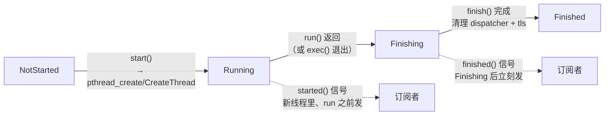

# QThread 源码拆解

## 前言：QThread 不是线程本身

初学 Qt 多线程的时候，咱们十有八九在 `QThread` 上栽过跟头，笔者当年也不例外。最常见的写法是继承 `QThread`、重写 `run()`，然后把耗时逻辑的信号槽连到这个子类上，结果却发现槽函数压根没在新线程里跑，或者程序莫名其妙地崩在对象的析构上。这些遭遇咱们追到根上，都是同一个误解闹的，把 `QThread` 当成了线程本身，而它其实是个管理者。

笔者当年就被几个问题问住过。`QThread` 实例自己住在哪个线程？`run()` 和 `exec()` 到底是个什么关系，为什么重写了 `run()` 却不调 `exec()`，线程里就没有事件循环？大家常用的 `started` 和 `finished`，又是在哪个线程、哪个时机发出来的？`terminate()` 又凭什么被文档说得那么狠？

这几个问题落在 `QThread` 设计的三条主轴上，身份上它管理的是 `QObject` 而非线程本身，分工上 `run` 是留给咱们重写的虚函数、`exec` 是事件循环，时间线上就是从 `start()` 到 `finished()` 的全过程。入门篇的 [多线程基础](../../beginner/01-qtbase/09-multithreading-beginner.md) 教了咱们 `QThread` 怎么用，您常用的 `moveToThread`、worker 模式都是在那儿学的，进阶篇的 [多线程进阶：线程池、并发与锁](../../advanced/01-qtbase/09-qthread-advanced.md) 讲的则是线程池、`QtConcurrent`、读写锁这一层。这一回咱们往源码里走，把 `qthread.cpp` 和 `qthread_unix.cpp`/`qthread_win.cpp` 打开了，看看 `QThread` 是怎么经平台 API 把真线程拉起来的，`run()` 默认干了什么，`QThreadData` 这个每线程一份的身份包装了什么，信号又在什么时机飞出来的。

边界咱们划清楚。`QThreadPool`、`QtConcurrent`、`QFuture` 这些是建在 `QThread` 之上的线程池和异步调度层，本篇就不展开了，它们是另一个主题的事。`QObject` 的线程亲和性（`thread()`/`moveToThread`）的完整规则，咱们在 [对象树所有权](./21-object-tree-ownership-expert.md) 一篇里讲过 `moveToThread` 的那组守卫，本篇只从 `QThread` 的视角补一条根源，也就是 `QObject` 构造的时候是怎么绑上 `threadData` 的。事件循环 `QEventLoop` 的内部机制是 [事件循环源码拆解](./07-event-loop-internals-expert.md) 一篇的主场，本篇只看 `QThread::exec` 是怎么把它启动起来的。`QThreadStorage<T>` 和 `moveToThread()` 的连接类型升级，咱们这一篇也放不下，眼下还没有哪一篇接得了它们，等有了落点咱们再回头补上。

## 环境说明

本篇的源码引用都基于 `qt_src/qt6.9.1`，行号是会随 Qt 版本漂移的，您对照阅读的时候拿函数名定位最稳。`QThread` 的实现分成公共部分和平台部分，涉及的关键文件列在下面：

| 文件 | 角色 |
|---|---|
| `qtbase/src/corelib/thread/qthread.h` | QThread 公共声明（Priority 枚举、create 模板） |
| `qtbase/src/corelib/thread/qthread.cpp` | 公共实现：run/exec/start/quit/wait/requestInterruption |
| `qtbase/src/corelib/thread/qthread_p.h` | QThreadPrivate + QThreadData（线程身份包） |
| `qtbase/src/corelib/thread/qthread_unix.cpp` | Unix：pthread_create/start 入口/terminate/wait |
| `qtbase/src/corelib/thread/qthread_win.cpp` | Win：CreateThread/start 入口/terminate/wait |
| `qtbase/src/corelib/kernel/qobject.cpp` | QObject 构造绑 threadData（线程亲和根源） |

本篇没有配套的 example，它是纯源码的拆解，您对照着 `qt_src` 翻代码，就是最好的实验。

## 核心概念讲解

咱们在翻源码以前，把 `QThread` 的 lifecycle 状态机和信号时机对一遍。它能帮您看清从 `start()` 到 `finished()` 中间都发生了什么：



`QThread` 的 `threadState` 一共走了四个状态，咱们顺着图看，它从 `NotStarted` 起步跑进了 `Running`，而 `run()` 一返回就进 `Finishing` 收尾，最后停在 `Finished` 上就不动了。`started()` 是在进入 `Running`、调 `run()` 之前发的，`finished()` 在进入 `Finishing` 的时候发，咱们这一篇就顺着这个时间线往下拆。

### 管理者身份：QThread 继承自 QObject

一切的根子在这行声明上，笔者把它亮出来（`qt_src/qt6.9.1/qtbase/src/corelib/thread/qthread.h:27-29`）：

```cpp
class Q_CORE_EXPORT QThread : public QObject
{
    Q_OBJECT
```

`QThread` 是公开继承自 `QObject` 的，您随手 `new` 一个 `QThread`，到手的其实就是一个功能齐全的 `QObject`，元对象、信号槽都是现成的，而且还能收事件，只是它的亲和性还留在创建它的老地方（通常是主线程），它管理的那个线程是另一回事。源码里的类文档把这一点说得很直白，`QThread` 实例住在实例化它的旧线程里，不在调用 `run()` 的那个新线程里。这个区分是咱们后面所有理解的根。

一个 `QObject` 生下来的时候住在哪个线程，源码层面是怎么定的？咱们看 `QObject` 构造函数里的三行（`qt_src/qt6.9.1/qtbase/src/corelib/kernel/qobject.cpp:953-955`）：

```cpp
    auto threadData = (parent && !parent->thread()) ? parent->d_func()->threadData.loadRelaxed() : QThreadData::current();
    threadData->ref();
    d->threadData.storeRelaxed(threadData);
```

咱们看主路，`QObject` 构造的时候，默认取的是 `QThreadData::current()`，也就是当前线程自己的身份包，把它绑到对象的 `d->threadData` 上。所以在哪个线程 `new` 这个 `QObject`，它就归哪个线程管了。唯一的例外是那个三目判断，对象有 `parent`、而且 `parent` 自己没有线程亲和性的时候（`!parent->thread()`，发生在 `parent` 所在的 `QThread` 正在析构的边角场景），它就继承 `parent` 的 `threadData`。绑定了以后，`thread()` 读的就是 `threadData` 里存的那个 `thread` 指针（`qt_src/qt6.9.1/qtbase/src/corelib/kernel/qobject.cpp:1610-1613`）：

```cpp
QThread *QObject::thread() const
{
    return d_func()->threadData.loadRelaxed()->thread.loadAcquire();
}
```

咱们把这一绑一读放在一起看，线程亲和性的根源就是它了。`moveToThread` 事后改的就是这个 `threadData` 指针（它的那组守卫拦的是带 `parent` 的对象和 widget，咱们在 [对象树所有权](./21-object-tree-ownership-expert.md) 一篇拆过）。把这层根源看明白了，您就懂得为什么在 `QThread` 子类的构造函数里 `connect` 信号到自己的槽会落空，因为构造函数是在创建 `QThread` 实例的那个线程（主线程）里跑的，那时候 `this` 的 `threadData` 绑的是主线程，槽函数自然也就跟着在主线程里跑了，跟新线程是一点关系都没有的。

### run 与 exec：一个虚函数，一个事件循环

咱们接着看真正在新线程里执行的那个入口 `run()`（`qt_src/qt6.9.1/qtbase/src/corelib/thread/qthread.cpp:778-781`）：

```cpp
void QThread::run()
{
    (void) exec();
}
```

函数体就这么一行，您没看错。`run()` 是个 `protected virtual` 的函数，默认实现调了 `exec()`，`(void)` 是把 `exec()` 的返回码显式丢掉。这里就是 `QThread` 两种用法的分水岭，您要是不重写 `run()`（或者重写了但调了 `exec()`），新线程就有了事件循环，收到了事件能处理，跨线程信号槽的 queued 连接也跑得起来。您要是重写了 `run()` 干自己的活又不调 `exec()`，线程就是个裸干活的线程，也就没了事件循环，跨线程的 queued 槽函数根本不会被调到。

咱们再看 `exec()`，它干的活是开事件循环（`qt_src/qt6.9.1/qtbase/src/corelib/thread/qthread.cpp:658-664`）：

```cpp
    QEventLoop eventLoop;
    int returnCode = eventLoop.exec();
    // ...
    return returnCode;
```

它在栈上构造了一个 `QEventLoop`，调它的 `exec()` 进入循环（循环的内部咱们在 [事件循环源码拆解](./07-event-loop-internals-expert.md) 一篇拆过），返回码原样带了回去。笔者头一回读这里的时候还纳闷，`exec()` 居然不是 `virtual` 的，您没法重写它，要改行为就只能重写 `run()` 了。它进循环以前还查了一个 `d->exited` 标志，要是之前 `exit()` 过、返回码还没被消费掉的话，这次的 `exec()` 就直接把旧的返回码带回去，循环是不进的。

### start 的平台入口：pthread_create 与 CreateThread

`run()` 说的是在新线程里跑什么，那个新线程又是怎么被创建出来的，就是 `start()` 干的活了，这一步咱们得看平台的 API。Unix 那边用的是 `pthread_create`（`qt_src/qt6.9.1/qtbase/src/corelib/thread/qthread_unix.cpp:847`）：

```cpp
    int code = pthread_create(&threadId, &attr, QThreadPrivate::start, this);
```

Windows 那边咱们看到的是 `CreateThread`（`qt_src/qt6.9.1/qtbase/src/corelib/thread/qthread_win.cpp:358-360`）：

```cpp
    d->handle = CreateThread(nullptr, d->stackSize,
                             reinterpret_cast<LPTHREAD_START_ROUTINE>(QThreadPrivate::start),
                             this, CREATE_SUSPENDED, nullptr);
```

两个平台咱们对照着看，都把线程入口设成了 `QThreadPrivate::start`，把 `this` 指针当参数传了进去。Unix 用的是 `pthread_create`，Windows 用的则是 `CreateThread`，还多带了一个 `CREATE_SUSPENDED`，线程是挂着创建的，等调度档位设好了再 `ResumeThread` 唤醒，免得新线程以默认档位抢占低档位的父线程。

线程跑起来了以后，咱们迎来的就是 `QThreadPrivate::start` 这个平台入口，Unix 版的流程长这样（`qt_src/qt6.9.1/qtbase/src/corelib/thread/qthread_unix.cpp:382-441`）：

```cpp
void *QThreadPrivate::start(void *arg)
{
    ...
    set_thread_data(data);
    pthread_cleanup_push([](void *arg) { static_cast<QThread *>(arg)->d_func()->finish(); }, arg);
    ...
    data->ensureEventDispatcher();
    data->eventDispatcher.loadRelaxed()->startingUp();
    ...
    emit thr->started(QThread::QPrivateSignal());
    ...
    thr->run();
    ...
    pthread_cleanup_pop(1);
    return nullptr;
}
```

咱们顺着读。开头的 `set_thread_data(data)` 把新线程的 `QThreadData`（下一节细讲）装进了线程局部存储，`QThread::currentThread()` 能查到靠的就是它。跟着 `pthread_cleanup_push` 注册了一个清理函数，注册的内容调的就是 `finish()`，这一手是很要紧的，哪怕线程被 `pthread_cancel` 取消了，`finish()` 照样会被调到的，该发的信号还得发。再往下的一步是 `ensureEventDispatcher` 创建事件分发器，跟着的 `startingUp()` 通知它开工。然后 `emit thr->started()` 把 `started` 信号发了出去，咱们留意，这个发射是在新线程里、`run()` 以前发生的。到了最后才是 `thr->run()`，您重写的也好、默认的也好，全都在这里跑的。`run()` 返回了之后，`pthread_cleanup_pop(1)` 触发刚才注册的清理，`finish()` 就被调到了。

Windows 版（`qthread_win.cpp:143-191`）的流程基本一致，它和 Unix 的区别是没有 `pthread_cleanup_push` 那一套，`run()` 返回以后它显式调了 `thr->d_func()->finish()`。咱们对照两个平台都能看到，`started` 信号都在 `run()` 以前就发了，这意味着您用 `QueuedConnection` 把 `started` 连到主线程的槽时，槽收到信号的时候 `run()` 可能已经开跑了，中间是有时间差的。

### QThreadData：每个线程一份的身份包

上一节 `set_thread_data` 装进局部存储的那个 `QThreadData`，是每条线程各一份的身份包。笔者头一回翻到这组字段的时候才反应过来，一条线程在 Qt 眼里背了这么多的东西。咱们看它的字段（`qt_src/qt6.9.1/qtbase/src/corelib/thread/qthread_p.h:354-370`）：

```cpp
    QStack<QEventLoop *> eventLoops;
    QPostEventList postEventList;
    QAtomicPointer<QThread> thread;
    QAtomicPointer<void> threadId;
    QAtomicPointer<QAbstractEventDispatcher> eventDispatcher;
    QList<void *> tls;
    ...
    bool quitNow = false;
    bool canWait = true;
    bool isAdopted = false;
```

这就是一条线程在 Qt 这边的身份信息，咱们挑要紧的认几个，剩下的您对照 `qthread_p.h` 自己去认。它的 `eventLoops` 是个栈，原因是 `exec()` 可以一层套一层地嵌套，栈上压着的正是每一层 `QEventLoop*`，`quit`/`exit` 的时候要逐个叫停。`postEventList` 是待处理事件的队列，`postEvent` 投递来的事件排在这儿，排序按的是 `priority`。`thread` 指向管理着该线程的 `QThread` 对象。`eventDispatcher` 是线程自己的事件分发器。`isAdopted` 区分线程是 Qt 自己创建的，还是外部创建、被 Qt 收养的（主线程就是被收养的）。

那 `QThread::currentThread()` 怎么找到当前线程的 `QThread`？咱们看它的实现（`qt_src/qt6.9.1/qtbase/src/corelib/thread/qthread.cpp:387-392`）：

```cpp
QThread *QThread::currentThread()
{
    QThreadData *data = QThreadData::current();
    Q_ASSERT(data != nullptr);
    return data->thread.loadAcquire();
}
```

`QThreadData::current()` 查的是线程局部存储（thread-local），查到了就直接返回。查不到的话，说明来的是条 Qt 没管过的外部线程，它就调 `createCurrentThreadData()` 临时造了一份，还 new 了一个 `QAdoptedThread` 把它包起来。所以哪怕您在一条完全没碰过 Qt 的外部线程里调 `QThread::currentThread()`，也能拿到一个合法的 `QThread*`，只不过它是个收养来的线程、一个临时的对象。

### 退出与中断：quit/exit 和协作式的 requestInterruption

要让一条带事件循环的 `QThread` 退出，咱们用的是 `quit()`，或者等价的 `exit(retcode)`（`qt_src/qt6.9.1/qtbase/src/corelib/thread/qthread.cpp:741-752`）：

```cpp
void QThread::exit(int returnCode)
{
    Q_D(QThread);
    QMutexLocker locker(&d->mutex);
    d->exited = true;
    d->returnCode = returnCode;
    d->data->quitNow = true;
    for (int i = 0; i < d->data->eventLoops.size(); ++i) {
        QEventLoop *eventLoop = d->data->eventLoops.at(i);
        eventLoop->exit(returnCode);
    }
}
```

它置了 `d->exited=true` 标记退出请求，把 `returnCode` 存了下来，又置了 `data->quitNow=true`，然后把 `eventLoops` 栈遍历了一遍，把里面的每一层 `QEventLoop` 挨个 `exit()` 一遍。为什么要遍历？因为 `exec()` 是可以嵌套的，栈上可能压了好几个事件循环，得一个一个地叫停。这里咱们要看清一件事，`quit`/`exit` 并不真的停线程，它们只是让所有 `exec()` 的循环退出来，您要是重写了 `run()` 干自己的活、没调 `exec()`，那 `quit`/`exit` 对您就完全无效。

那要停一条裸干活的线程，咱们怎么办？现代的、安全的做法是 `requestInterruption()`（`qt_src/qt6.9.1/qtbase/src/corelib/thread/qthread.cpp:1275-1286`）：

```cpp
void QThread::requestInterruption()
{
    Q_D(QThread);
    if (d->threadId() == QCoreApplicationPrivate::theMainThreadId.loadAcquire()) {
        qWarning("QThread::requestInterruption has no effect on the main thread");
        return;
    }
    QMutexLocker locker(&d->mutex);
    if (d->threadState != QThreadPrivate::Running)
        return;
    d->interruptionRequested.store(true, std::memory_order_relaxed);
}
```

它干的事只有一件，把 `d->interruptionRequested` 这个 `std::atomic<bool>` 原子地置成 `true`。它是不碰线程调度的，挂起、杀掉这些事它是一件都不做的，就是个请求标记罢了。您想让它停，得自己在 `run()` 里 `poll` `isInterruptionRequested()` 的标志，查到了就优雅地退出来。这样的路数叫协作式中断，文档用的词是 advisory。

这里笔者要补一个底层细节。开头的那道 `if` 守卫，判定的是主线程，而这个主线程不是很多人以为的 GUI 主线程。`theMainThreadId` 是 `QCoreApplication` 创建时所在的线程，哪怕您写个没有 GUI 的控制台程序，只要 `QCoreApplication` 在某个线程里 `new` 出来了，那个线程就是主线程了，调 `requestInterruption` 照样会被拒的。后面的一道守卫，`threadState` 不是 `Running` 的话它就直接返回，线程没跑起来的时候，标志自然也就不会置上了。

### terminate 的危险，与 wait 的等待

`terminate()` 走的是另一个极端，它是强制把线程干掉的。笔者每次翻到这段文档都要多看两眼，Qt 对它的措辞是相当狠的（`qt_src/qt6.9.1/qtbase/src/corelib/thread/qthread.cpp:904-909`）：

```cpp
\warning This function is dangerous and its use is discouraged.
The thread can be terminated at any point in its code path.
Threads can be terminated while modifying data. There is no
chance for the thread to clean up after itself, unlock any held
mutexes, etc.
```

危险在哪？线程可能在任意的代码点上被杀，可能正改着一半的数据，可能手里的互斥锁还没放。被杀以后它是没机会清理、也没机会解锁的，留下的是个烂摊子，数据改了一半，锁被永久地持有着，别的线程再来等这把锁就死锁了。所以除非万不得已，咱们就别用它了。两个平台的实现也不一样，Unix 用的是 `pthread_cancel`（`qt_src/qt6.9.1/qtbase/src/corelib/thread/qthread_unix.cpp:878-881`）：

```cpp
    if (d->terminated) // don't try again, avoids killing the wrong thread on threadId reuse (ABA)
        return;

    d->terminated = true;
```

咱们留意 `d->terminated` 这个标志和那行注释，它防的是 ABA 问题。线程 ID 是会被复用的，它要是已经结束了、ID 被分给了新线程，您再 `terminate` 一次就会误杀新线程。所以终止过一次就置上 `d->terminated=true`，也就不再试第二次了。咱们在 `qthread_unix.cpp` 里还能看到，Android 上的 `terminate` 整个是空实现，`#if !defined(Q_OS_ANDROID)` 包着的正是它的函数体。Windows 那边用的是 `TerminateThread` 来硬杀，杀完了还得手动调 `d->finish(false)`（`qt_src/qt6.9.1/qtbase/src/corelib/thread/qthread_win.cpp:426-427`）：

```cpp
    TerminateThread(d->handle, 0);
    d->finish(false);
```

线程已经被硬杀了，自己是走不到 `finish()` 那一步的，收尾流程就得 Qt 替它模拟一遍了。这里还有个连带的事，`terminate()` 是从外部线程调的，`finished()` 信号从哪个线程发出来就变得不确定了，文档里还专门写了条 `\note`，用 `terminate()` 终止的线程，`finished` 信号的发送线程是 undefined。您要是把 `finished` 连到 `deleteLater` 上去清理对象，雷也就埋在这个不确定性上了。

要等一条线程结束的话，咱们用的是 `wait()`（`qt_src/qt6.9.1/qtbase/src/corelib/thread/qthread.cpp:950-962`）：

```cpp
bool QThread::wait(QDeadlineTimer deadline)
{
    Q_D(QThread);
    QMutexLocker locker(&d->mutex);

    if (d->threadState == QThreadPrivate::NotStarted || d->threadState == QThreadPrivate::Finished)
        return true;
    if (isCurrentThread()) {
        qWarning("QThread::wait: Thread tried to wait on itself");
        return false;
    }
    return d->wait(locker, deadline);
}
```

咱们把三种情况分开看。线程还没 `start`、或者已经 `Finished` 的话，它就直接给您返回 `true` 了，等一个已经结束的线程等于立刻等到。自己等自己的话，那等的就是一场死锁，所以 `qWarning` 把它拒了，返回的是 `false`。剩下的情况交给 `d->wait`，底层 Unix 用的是 `pthread_timedjoin_np`/`pthread_clockjoin_np`，Windows 用的是 `WaitForSingleObject(handle, remainingTime)`，都是平台原生的 join。

### finished 的收尾，与调度档位

`run()` 返回了之后（或者 `exec()` 退出了之后），线程就进 `finish()` 收尾了，咱们看这一步最要紧的 `finished` 信号的发射时机（`qt_src/qt6.9.1/qtbase/src/corelib/thread/qthread_unix.cpp:458-461`）：

```cpp
        d->threadState = QThreadPrivate::Finishing;
        locker.unlock();
        emit thr->finished(QThread::QPrivateSignal());
        QCoreApplication::sendPostedEvents(nullptr, QEvent::DeferredDelete);
```

它把 `threadState` 置成了 `Finishing`，跟着解了锁就 `emit finished`。这个时机是特意卡好的，事件循环已经停了，文档是专门提醒过这件事的，`finished` 发射的时候事件循环已经不转了，线程也不会再处理任何事件了，唯一的例外是 `DeferredDelete`。所以 `finish()` 在 `emit finished` 之后紧跟着手动调了 `sendPostedEvents(nullptr, DeferredDelete)`，那些之前 `deleteLater` 过、还没来得及析构的对象，就这样赶在事件循环彻底死掉以前被清掉了。咱们爱把 `finished` 信号连到 `QObject::deleteLater` 上清理线程里的对象，靠的正是这个专门留出来的例外。

调度档位这块咱们也看一眼，`QThread` 在头文件里给了八档枚举（`qt_src/qt6.9.1/qtbase/src/corelib/thread/qthread.h:40-51`）：

```cpp
    enum Priority {
        IdlePriority,

        LowestPriority,
        LowPriority,
        NormalPriority,
        HighPriority,
        HighestPriority,

        TimeCriticalPriority,

        InheritPriority
    };
```

其中七个是真实的档位，外加的那个 `InheritPriority` 只是个占位。`setPriority` 立了两道守卫，咱们看代码（`qt_src/qt6.9.1/qtbase/src/corelib/thread/qthread.cpp:804-813`）：

```cpp
    if (priority == QThread::InheritPriority) {
        qWarning("QThread::setPriority: Argument cannot be InheritPriority");
        return;
    }
    ...
    if (d->threadState != QThreadPrivate::Running) {
        qWarning("QThread::setPriority: Cannot set priority, thread is not running");
        return;
    }
```

您把 `InheritPriority` 传进去是会被直接拒绝的，那是 `start()` 的参数语义（继承创建线程的档位），运行中是改不了的。线程没在 `Running` 的话也不行，得 `start` 了之后才能调 `setPriority`。底层 Unix 用的是 `pthread_setschedparam`，把 Qt 的枚举映射成 OS 的调度档位，Windows 那边用的是 `SetThreadPriority` 配 `THREAD_PRIORITY_*` 常量。

### QThread::create：不写子类也能跑 lambda

上一节咱们收在调度档位上，到手的路子还都是继承子类、重写 `run`。可有的活儿就几行，也值得专门写一个类吗？Qt 5.10 给 `QThread` 加了 `QThread::create`，走的就是轻路。笔者觉得这是整个 `QThread` 里最讨人喜欢的 API，它解决的是那个很朴素的需求，我就想在新线程里跑个 lambda，而不是专门写个子类（`qt_src/qt6.9.1/qtbase/src/corelib/thread/qthread.h:131-144`）：

```cpp
QThread *QThread::create(Function &&f, Args &&... args)
{
    using DecayedFunction = typename std::decay<Function>::type;
    auto threadFunction =
        [f = static_cast<DecayedFunction>(std::forward<Function>(f))](auto &&... largs) mutable -> void
        {
            (void)std::invoke(std::move(f), std::forward<decltype(largs)>(largs)...);
        };

    return createThreadImpl(std::async(std::launch::deferred,
                                       std::move(threadFunction),
                                       std::forward<Args>(args)...));
}
```

这套机制挺巧的。它把您传进来的 lambda 和参数用 `std::async(std::launch::deferred, ...)` 包成了一个 `std::future<void>`，咱们留意 `deferred` 这个策略，它的意思是现在并不执行，等有人调 `.get()` 的时候才跑。然后这个 future 就被交给了 `createThreadImpl`，后者 new 了一个内部类 `QThreadCreateThread` 把它持有（`qt_src/qt6.9.1/qtbase/src/corelib/thread/qthread.cpp:1363-1366`）：

```cpp
    void run() override
    {
        m_future.get();
    }
```

这个子类的 `run()` 就一行，`m_future.get()`。`get()` 被调的那一刻，那个 deferred 的 async 就真正执行了，您的 lambda 也就在新线程里跑起来了。这个设计还有个贴心的地方，`QThreadCreateThread` 的析构函数替您把 `requestInterruption`、`quit`、`wait` 一气做完了（`qt_src/qt6.9.1/qtbase/src/corelib/thread/qthread.cpp:1355-1360`）：

```cpp
    ~QThreadCreateThread()
    {
        requestInterruption();
        quit();
        wait();
    }
```

所以 `create` 出来的 `QThread`，哪怕当时的线程还没有停下来，您直接析构也是安全的，它会等线程优雅地停下来再析构。声明上的 `[[nodiscard]]` 是怕您 `QThread::create(...)` 写完不看返回值，线程对象就泄漏了。唯一要留意的是，`create` 出来的线程只能 `start` 一次，`future.get()` 是只能调一次的，再 `start` 一次就是未定义行为了。

## 风险与故障预防

头一类风险是把 `QThread` 实例当成了住在新线程里的对象。最常见的踩法是在子类构造函数里写 `connect(this, &MyThread::someSignal, this, &MyThread::onSomeSlot)`，指望的是槽在新线程里跑。管理者身份一节咱们看过，`QThread` 实例的 `threadData` 绑的是创建它的那个线程（通常是主线程），构造函数又正是在那个线程里跑的，`this` 对它自己的 `connect` 等价于直接连接，槽自然就在主线程里跑了，往根上追就是 `QObject` 构造时绑 `threadData` 的那段逻辑。后果是您以为挪到子线程的耗时逻辑其实堵在主线程里，界面该卡的时候还是卡。咱们的解法有两条路，要么走的是 worker 模式，把干活的对象 `moveToThread(&thread)`，`QThread` 只管跑它的事件循环，`run` 是不用重写的。要么用 QThread::create 一节的 lambda 路子，把要干的活儿直接写进 lambda 里就是了，`QThread` 实例的亲和性问题也就绕开了。

第二类风险的症状更迷惑人，跨线程的信号槽怎么都不触发，根子却出在您重写的 `run()` 上，您重写了它干自己的活，却偏偏不调 `exec()`。run 与 exec 一节咱们讲过，`run()` 默认调的是 `exec()`，事件循环就是这么开的，跨线程的 queued 连接靠的是目标线程的事件循环来 dispatch，事件循环没有了，投递过去的 `QMetaCallEvent` 就堆在 QThreadData 一节讲过的 `postEventList` 里没人处理，槽函数就永远跑不起来了。更麻烦的是它坏得不声不响，您只会当是自己的 `connect` 写失败了。救的法子有两类，一类是在 `run()` 的末尾调 `exec()`（或者直接 `QThread::exec()`），事件循环也就转起来了，另一类是您已经见过的 worker 模式，您把 worker 对象 `moveToThread` 到线程上，`QThread` 不重写 `run`、用的是默认的 `exec`，事件循环默认就有了。

第三类风险的代价最贵，偏偏它看着最省事，拿 `terminate()` 当正常的停线程手段，一调线程就没了。terminate 的危险一节咱们读过它的 `\warning`，线程可能在任意的代码点上被杀，正在改的数据改了一半，持有的锁也没有解锁。杀完了，数据状态是坏的，别的线程等那把锁能等到死锁，堆内存因为析构没跑而泄漏，这样的 bug 又极难复现、也极难定位。正路是退出与中断一节讲的协作式中断，您调 `requestInterruption()` 置上标志、再在 `run()` 里自己 `poll` `isInterruptionRequested()`，把活儿设计成能在任意循环点检查中断标志、然后优雅退出的样子，比指望 `terminate` 安全得多了。

第四类风险是 `QThread::create` 出来的线程忘了 `start`，或者 `start` 了不止一次。QThread::create 一节咱们看过，`create` 返回的 `QThread*` 只是创建了对象、把 lambda 包进了 future，线程其实并没跑，必须显式地 `start()` 才会真正拉起来。光是创建了却不 `start`，析构的时候 `~QThreadCreateThread` 会去 `wait()` 一个从没启动的线程，虽然有 `NotStarted` 的守卫不会卡死，但您的活儿根本没跑。而且 `start` 了两次也不行，`future.get()` 是只能调一次的，第二次 `start` 就是未定义行为了。解法倒是很朴素，`create` 出来了就立刻 `start`，而且只 `start` 这一次，要复用的话就重新 `create` 一个。

## 练习项目

本篇跟 [事件循环源码拆解](./07-event-loop-internals-expert.md) 走的是一样的路子，练习走的也是验证的路子，三道题都只给方向和验证的手段，完整的工程留给您自己搭。

头一道题验证 `started` 的发射时机与线程。您写一个最简单的 `QThread` 子类，重写它的 `run()`，在 `run()` 的入口打印 `QThread::currentThread()`，再把 `started` 用 `Qt::DirectConnection` 连到自己的一个槽上，槽里的打印也来一次 `QThread::currentThread()`，跑起来对照两行的输出。直连的槽是在发射者所在的线程里当场执行的，`started` 又是新线程里、`run()` 以前发的，所以槽的输出出现在 `run()` 入口以前，start 的平台入口一节讲的正是这个次序。这回两行打印出来的是同一个线程指针，两行相同恰恰是咱们要的反证，它证明槽真的跑在了新线程里。接着您把 `started` 用 `QueuedConnection` 连到一个主线程亲和的对象上，槽改在主线程里跑了，两行指针这才不一样了。至于槽的输出和 `run()` 的输出哪个更早，就看主线程的事件循环什么时候转起来了，这中间是实打实的竞态，start 的平台入口一节说的那个时间差就是它。

第二道题验证的是 `quit` 对裸干活线程无效、协作式中断有效。您写两个重写了 `run()` 的线程，头一个的 `run()` 里是个无限循环，您对它调 `quit()`，但是线程根本停不下来，要观察的就是这个停不下来的现象。第二个同样跑的是循环，但是循环条件里查 `isInterruptionRequested()`，主线程调了一次 `requestInterruption()`，看它是不是干净地退出了。对照退出与中断一节的 `exit()` 实现，您就能把两套机制在源码层面分清楚。

第三道题咱们回源码里做核对。您打开 `qt_src/qt6.9.1`，把 `qthread_unix.cpp` 里 `QThreadPrivate::start` 的流程对着本篇的行号读一遍，确认 `set_thread_data`、`pthread_cleanup_push`、`emit started`、`thr->run()` 这几步的次序。再去 `qthread_p.h` 把 `QThreadData` 的字段对一遍，看看 `eventLoops`、`postEventList`、`isAdopted` 是不是都在咱们说过的位置上。两处都对上了，本篇的断言也就落了地。

## 官方文档参考链接

[Qt 文档 · QThread](https://doc.qt.io/qt-6/qthread.html)——官方的类参考，run、exec、start、wait 的行为，线程亲和性的说法，咱们都上它这里查。

[Qt 文档 · Qt 多线程总览](https://doc.qt.io/qt-6/threads.html)——官方的多线程入口页，线程相关的类有哪些、同步原语和 `QObject` 的线程规则去哪儿读，咱们在这里找。

---

走到了这里，`QThread` 的源码咱们就算拆完了。笔者拆完最大的感受是，这套设计处处在提醒咱们，`QThread` 是管事的管理者，而不是线程本身。咱们知道它自己是个 `QObject`，家安在创建它的那个线程里。它管理的新线程，靠 `start()` 经平台 API 拉起来的，入口是咱们说过的 `QThreadPrivate::start`，入口里装好了 `QThreadData`、起好了事件分发器、发完了 `started`，然后才轮到您重写的或者默认的 `run()`，它默认开的是 `exec()`，事件循环转起来了，跨线程信号槽这才有了落点。退出这块分了三条路子，`quit`/`exit` 让事件循环退出来（只对有 `exec` 的线程有效），`requestInterruption` 置协作式标志、让 `run` 自己优雅地退，`terminate` 走的是强杀的路子，它是危险的那个，文档是把它骂得最狠的。`finished` 信号是卡在 `Finishing` 状态发射的，还特意给 `DeferredDelete` 留了例外，让 `deleteLater` 的清理能在事件循环死后跑。`QThread::create` 用 `std::async(deferred)` 把 lambda 包了起来，简单的场景从此不用写子类，析构还自带了安全收尾。这套机制和 [对象树所有权](./21-object-tree-ownership-expert.md) 的线程亲和性、[事件循环源码拆解](./07-event-loop-internals-expert.md) 的 `QEventLoop` 紧紧咬在一起，往后拆网络模块的 socket，咱们还会回头用到这一篇的东西。

如果您想把本篇的行号证据拿来一一核对，它们已经按源码机制归类收在 [code-index · QThread 源码](../code-index/qtbase/qthread-internals.md) 下面了（`QObject` 线程亲和的 `moveToThread` 另见 [对象树线程亲和](../code-index/qtbase/object-tree-thread-affinity.md)，事件循环的另见 [事件循环执行](../code-index/qtbase/event-loop-exec.md)），您带着行号直接去 `qt_src/qt6.9.1` 翻原文就行。
