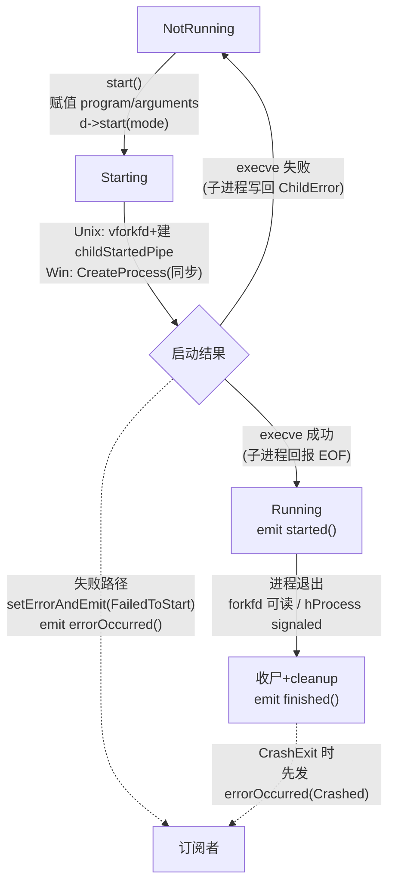

# QProcess 源码拆解

## 前言：子进程是怎么变成流设备的

咱们要调外部程序的时候，`QProcess` 是 Qt 给的标准答案。入门的用法谁都熟，一句 `start("ls", {"-l"})` 调了下去，`readAllStandardOutput()` 就把输出捞了回来。不过只要往深里多踩两脚，一堆答不上来的问题就冒出来了。

笔者把当年自己被问住的那几个问题摆出来。`QProcess` 的声明里写着它继承自 `QIODevice`，可一个跑着的程序，咱们凭啥能把它当文件来 `read`/`write`？Unix 上启动子进程这件事，老教材说 Qt 用的是 `fork`+`exec`，又有博客信誓旦旦讲 Qt6 改用了 `posix_spawn`，到底哪个是真的？子进程死了，父进程是怎么知道的，是不是装了一个全局 `SIGCHLD` 处理器？还有个气人的 `terminate()`，您在 Windows 上调一个 console 程序，它怎么就纹丝不动呢？最后这个问题最折磨人，有人写了一行 `connect(proc, SIGNAL(error()), ...)`，编译能通过的，运行起来就是收不到的，这凭的是啥？

咱们把这些问题归到 `QProcess` 设计的几条主轴上：身份（继承 `QIODevice` 以后读与写的语义不对称）、状态机（`NotRunning`/`Starting`/`Running` 三态怎么转）、平台分叉（Unix 走 `vforkfd`、Windows 走 `CreateProcessW`，两套几乎平行的实现）、以及死亡收割（`forkfd` 把进程死亡事件化，把 `SIGCHLD` 绕开了）。

入门篇的进程章节教了咱们 `QProcess` 怎么调起来收输出，进阶篇补了 `ChannelMode` 和 waitForFinished 的死锁陷阱。本篇咱们往源码里走。咱们打开 `qprocess.cpp` 和 `qprocess_unix.cpp`/`qprocess_win.cpp`，看看 `start()` 到底替咱们干了什么，子进程是怎么被 `fork` 出来的，死亡通知又是怎么飞回来的。

边界咱们划清楚。`QProcess` 继承的 `QIODevice` 基类那一套（`readData`/`writeData` 纯虚、`QRingBuffer` 缓冲），咱们在 [QIODevice 与 QFile 源码拆解](./08-file-io-iodevice-expert.md) 里拆过，本篇补的只有一条，`QProcess` 是怎么实现这俩虚函数的，为什么长得不对称。`QSocketNotifier`/`QWinEventNotifier` 是怎么挂进事件循环的，按章节的规划它归事件循环深度源码那篇专文，也就是目录里的第 20 篇，那一篇咱们还没写成，咱们在这里只点到为止。

## 环境说明

本篇的源码引用都基于 `qt_src/qt6.9.1`，行号是会随 Qt 版本漂移的，您对照阅读的时候拿函数名定位最稳。`QProcess` 的实现和 `QThread` 一样，分成了公共部分和平台部分，涉及的关键文件咱们列在下面：

| 文件 | 角色 |
|---|---|
| `qtbase/src/corelib/io/qprocess.h` | QProcess 公共声明（枚举 + 公开 API） |
| `qtbase/src/corelib/io/qprocess.cpp` | 跨平台实现：start/状态机/信号发射/waitFor 族 |
| `qtbase/src/corelib/io/qprocess_p.h` | QProcessPrivate + Channel 结构 |
| `qtbase/src/corelib/io/qprocess_unix.cpp` | Unix：vforkfd/管道 dup2/收割 |
| `qtbase/src/corelib/io/qprocess_win.cpp` | Win：CreateProcessW/EnumWindows 终止 |
| `qtbase/src/3rdparty/forkfd/forkfd.h` | forkfd 库（vforkfd/forkfd_wait/forkfd_info） |

本篇没有配套的 example，原因和前几篇是一样的，它是纯源码的拆解，您对照着 `qt_src` 翻代码，就是最好的实验。

## 核心概念讲解

源码里的东西咱们马上就翻，翻以前咱们把 `QProcess` 的状态机和启动链路对一遍。下图能帮您看清从 `start()` 到 `finished()` 中间发生了什么：



`QProcess` 的 `processState` 从 `NotRunning` 起步，咱们一调 `start()`，状态就进了 `Starting`，确认了 `execve` 成功以后切到 `Running`，进程死亡了再退回 `NotRunning`。`started()` 是在确认 `execve` 成功以后才发的，`finished()` 是带着退出码和退出状态发的，失败的路径上咱们还会看见一个 `errorOccurred()` 插进来。咱们这一篇就顺着这个时间线一路往下拆。

### 继承 QIODevice：读与写为何不对称

一切的根子在这行声明上，笔者把它亮出来（`qt_src/qt6.9.1/qtbase/src/corelib/io/qprocess.h:81`）：

```cpp
class Q_CORE_EXPORT QProcess : public QIODevice
{
    Q_OBJECT
```

继承了 `QIODevice`，意味着 `read()`/`write()`/`waitForReadyRead()` 这些 IO 接口的语义直接复用，Qt 把跑着的子进程抽象成流设备，根基也就打在这里了。但这个抽象是不对称的，子进程的 stdin 咱们往里写，stdout/stderr 咱们从里读，所以 `QProcess` 实现的 `readData` 和 `writeData` 长得完全不一样。

咱们看跨平台的 `readData`（`qt_src/qt6.9.1/qtbase/src/corelib/io/qprocess.cpp:2124-2132`）：

```cpp
qint64 QProcess::readData(char *data, qint64 maxlen)
{
    Q_D(QProcess);
    Q_UNUSED(data);
    if (!maxlen)
        return 0;
    if (d->processState == QProcess::NotRunning)
        return -1;              // EOF
    return 0;
}
```

奇怪的就在这里，它根本就没读过管道里的数据。进程死了它就返 `-1` 报 EOF，其余的情况就返 `0`，返 0 的意思是这次没读到，请您去查 `QIODevice` 的 `readBuffer`。真正的管道读取发生在 `QProcessPrivate::tryReadFromChannel`，它把数据填进了 `readBuffer`，而 `QIODevice::read` 再从缓冲区往外拿。

那 `writeData` 呢？您在 `qprocess.cpp` 里找不到跨平台的 `writeData` 实现，因为它是平台相关的，Unix 上是直接 `::write` 往管道里写的，Windows 上用的是 `QWindowsPipeWriter`。这就是不对称的根源，读是能统一的，都是往 `readBuffer` 里塞进去的，写就各走各的路了，两个平台的管道写法不一样。

还有一个容易看漏的点，咱们注意 `QProcess` 同时发两套读信号，下面是 `tryReadFromChannel` 内的节选（`qt_src/qt6.9.1/qtbase/src/corelib/io/qprocess.cpp:1123-1188`）：

```cpp
if (currentReadChannel == channelIdx) {
    didRead = true;
    if (!emittedReadyRead) {
        QScopedValueRollback<bool> guard(emittedReadyRead, true);
        emit q->readyRead();
    }
}
emit q->channelReadyRead(int(channelIdx));
if (channelIdx == QProcess::StandardOutput)
    emit q->readyReadStandardOutput(QProcess::QPrivateSignal());
else
    emit q->readyReadStandardError(QProcess::QPrivateSignal());
```

一套是 `QIODevice` 继承来的 `readyRead`，只在当前读通道等于本通道的时候才发。另一套是 `QProcess` 专属的 `readyReadStandardOutput`/`readyReadStandardError`，它不管当前的通道，哪一路来了都发。这就是为什么您 `setReadChannel(StandardError)` 切去读 stderr 的时候，stdout 的数据照样能被 `readyReadStandardOutput` 通知到，而 `readyRead` 这会儿是哑的。那个 `emittedReadyRead` 回滚标志防的是重入，免得一次 readable 触发嵌套的 `readyRead`。

### 三态状态机，以及 protected 的 setProcessState

`QProcess` 给进程只设了三个状态，咱们看声明（`qt_src/qt6.9.1/qtbase/src/corelib/io/qprocess.h:95-99`）：

```cpp
enum ProcessState {
    NotRunning,
    Starting,
    Running
};
```

咱们把三个状态挨个认一下。`Starting` 表示的是已经调了 `fork`/`CreateProcess`，但是还没确认子进程 `execve` 成功，中间是有个窗口期的。`Running` 表示的是子进程已经换装成目标程序了。这个区分是要紧的，进程 fork 了不等于程序就跑起来了。

接下来的这一层限制，笔者当年就栽过跟头。有人想在外部手动地拨状态，写出了 `proc->setProcessState(QProcess::Running)` 这样的调用。您去看头文件（`qt_src/qt6.9.1/qtbase/src/corelib/io/qprocess.h:261-262`）：

```cpp
protected:
    void setProcessState(ProcessState state);
```

它是 `protected` 的，咱们外部的用户代码是压根调不到它的。状态只能由 `QProcess` 内部的 `start`/`_q_startupNotification`/`finished` 驱动。子类倒是可以碰它，不过子类化 `QProcess` 在 Qt6 里已经是被劝退的用法了，组合是优于继承的。

咱们再往下看一层，`setProcessState` 内部长什么样？它的朴素让人意外（`qt_src/qt6.9.1/qtbase/src/corelib/io/qprocess.cpp:2103-2109`）：

```cpp
void QProcess::setProcessState(ProcessState state)
{
    Q_D(QProcess);
    if (d->processState == state)
        return;
    d->processState = state;
    emit stateChanged(state, QPrivateSignal());
}
```

您看，这里头没有任何的业务校验，就是纯粹的状态写入加信号广播。真正的切态逻辑，全都被塞进了 `startProcess`、`_q_startupNotification`、`_q_processDied` 这几个函数里，`setProcessState` 不过是个传声筒。

### start 的完整调用链

咱们顺着 `start()` 往下追。它的入口在这里（`qt_src/qt6.9.1/qtbase/src/corelib/io/qprocess.cpp:2212-2228`）：

```cpp
void QProcess::start(const QString &program, const QStringList &arguments, OpenMode mode)
{
    Q_D(QProcess);
    if (d->processState != NotRunning) {
        qWarning("QProcess::start: Process is already running");
        return;
    }
    if (program.isEmpty()) {
        d->setErrorAndEmit(QProcess::FailedToStart, tr("No program defined"));
        return;
    }
    d->program = program;
    d->arguments = arguments;
    d->start(mode);
}
```

`start(program, args, mode)` 这个重载看着像干活的样子，其实只做了三件事。它查的是进程是不是已经在跑，是的话打一行 warning 就返回。再查的是 `program` 是不是空串，空的话它就报 `FailedToStart` 了。然后它给 `d->program`/`d->arguments` 赋了值，转手就调了 `d->start(mode)`。真正干活的在私有类的 `start` 末尾，咱们接着看（`qt_src/qt6.9.1/qtbase/src/corelib/io/qprocess.cpp:2387-2424`）：

```cpp
void QProcessPrivate::start(QIODevice::OpenMode mode)
{
    Q_Q(QProcess);
    // ...
    q->QIODevice::open(mode);

    if (q->isReadable() && processChannelMode != QProcess::MergedChannels)
        setReadChannelCount(2);

    stdinChannel.closed = false;
    stdoutChannel.closed = false;
    stderrChannel.closed = false;

    exitCode = 0;
    exitStatus = QProcess::NormalExit;
    processError = QProcess::UnknownError;
    errorString.clear();
    startProcess();
}
```

这段是跨平台的预处理，咱们顺着念。它上来就调了 `QIODevice::open`，读通道的个数是按 `channelMode` 定的（`MergedChannels` 的时候只有一个读通道，因为 stderr 被并进 stdout 了），再把 `exitCode`/`exitStatus`/`processError`/`errorString` 全部重置了一遍，末尾调了一下 `startProcess()`，这一调就分派到 `qprocess_unix.cpp` 或者 `qprocess_win.cpp` 去了。

启动结果是怎么报回来的呢？枢纽是 `_q_startupNotification` 这个私有槽，咱们看它的实现（`qt_src/qt6.9.1/qtbase/src/corelib/io/qprocess.cpp:1270-1291`）：

```cpp
bool QProcessPrivate::_q_startupNotification()
{
    Q_Q(QProcess);
    QString errorMessage;
    if (processStarted(&errorMessage)) {
        q->setProcessState(QProcess::Running);
        emit q->started(QProcess::QPrivateSignal());
        return true;
    }
    q->setProcessState(QProcess::NotRunning);
    setErrorAndEmit(QProcess::FailedToStart, errorMessage);
#ifdef Q_OS_UNIX
    waitForDeadChild();
#endif
    cleanup();
    return false;
}
```

成功了就切到 `Running`，把 `started` 发了出去。失败了就切回 `NotRunning`，而错误走的是 `setErrorAndEmit(FailedToStart)`，Unix 上还得 `waitForDeadChild` 把那个已经 fork 出来但 `execve` 失败的中间子进程收掉，不然它就成了僵尸。成功与否在 Unix 上是怎么判定的？这一步的设计相当巧妙，咱们下一节细看。

### Unix 进程创建：是 vforkfd，不是 posix_spawn

重头戏来了，这是本篇最大的一个纠偏。网上到处流传 Qt6 改用 `posix_spawn` 优化进程启动的说法，笔者把 `qprocess_unix.cpp` 从头到尾翻了一遍，可以负责任地告诉您：一个字都是没有的。`posix_spawn` 这个词咱们在三个实现文件里 grep 了个遍，一处都没有见着的。

Qt6 真正用的是 forkfd 库的 `vforkfd`，咱们看 `startChild`（`qt_src/qt6.9.1/qtbase/src/corelib/io/qprocess_unix.cpp:331-335`）：

```cpp
int startChild(pid_t *pid)
{
    int ffdflags = FFD_CLOEXEC | (isUsingVfork ? 0 : FFD_USE_FORK);
    return ::vforkfd(ffdflags, pid, &QChildProcess::startProcess, this);
}
```

咱们头一回见 `vforkfd`，它是 Qt 自带的 forkfd 库（`src/3rdparty/forkfd/`）提供的接口。它的设计思想是把创建子进程和监听子进程死亡统一成一个文件描述符，返回的 `forkfd` 在子进程死亡的时候会变成可读，Linux 上底层用的是 `pidfd_open` 系统调用。而 `FFD_CLOEXEC` 让这个 fd 默认是 close-on-exec 的。

您注意 `isUsingVfork ? 0 : FFD_USE_FORK` 这一段，vfork 不是无条件的。运行时的抉择在 `globalUsingVfork`，咱们读一遍（`qt_src/qt6.9.1/qtbase/src/corelib/io/qprocess_unix.cpp:641-667`）：

```cpp
inline bool globalUsingVfork() noexcept
{
#if defined(__SANITIZE_ADDRESS__) || __has_feature(address_sanitizer)
    // ASan writes to global memory, so we mustn't use vfork().
    return false;
#endif
    // ... TSan 同理 ...
#if defined(Q_OS_LINUX) && !QT_CONFIG(forkfd_pidfd)
    return false;
#endif
#if defined(Q_OS_DARWIN)
    // Using vfork() for startDetached() is causing problems.
    return false;
#endif
    return __interceptor_vfork == nullptr;
}
```

咱们数一数，有五类环境会自动地禁用 vfork，退而用 fork。开了 ASan 的算一类，vfork 是共享地址空间的，ASan 一写全局内存就把父进程污染了。开了 TSan 的同理。Linux 上编译时把 `forkfd_pidfd` 关了的也算。macOS 算另一类了，Darwin 上的 startDetached 出过问题。还有运行时检测到链接了 libasan/libtsan 的（`__interceptor_vfork == nullptr` 那一行）。剩下的环境，多半是 Linux 且 pidfd 启用的场合，走 vfork 就省下了 fork 复制地址空间的开销。

子进程这一侧的换装逻辑在 `QChildProcess::startProcess`，咱们跟着走一遍（`qt_src/qt6.9.1/qtbase/src/corelib/io/qprocess_unix.cpp:928-972`）：

```cpp
void QChildProcess::startProcess() const noexcept
{
    d->commitChannels();
    qt_safe_close(d->childStartedPipe[0]);
    if (workingDirectory >= 0 && fchdir(workingDirectory) == -1)
        failChildProcess(d, "fchdir", errno);
    // ... 组装 argv/envp ...
    if (!envp.pointers)
        qt_safe_execv(argv[0], argv);
    else
        qt_safe_execve(argv[0], argv, envp);
    failChildProcess(d, "execve", errno);
}
```

子进程要干的是五件事。头一件事交给了 `commitChannels`，它把管道都 dup2 到了 STDIN/STDOUT/STDERR 上，后面的管道与 ChannelMode 一节咱们细讲。然后它关掉了 `childStartedPipe` 的读端，`fchdir` 到预打开的工作目录 fd 上。接下来的一步，选的是 `qt_safe_execv` 或者 `qt_safe_execve`，看的就是设没设环境。任何一步失败了，走的就是 `failChildProcess`。`qt_safe_execve` 是 Qt 包了一层 EINTR 重试的 `execve`（`qt_src/qt6.9.1/qtbase/src/corelib/kernel/qcore_unix_p.h:381-385`），成功了它就不返回，失败了才会落到 `failChildProcess`。

这里有个设计精妙的地方，笔者头一回看的时候愣了一下：子进程是怎么告诉父进程的，它的 `execve` 成功了？答案靠 `childStartedPipe` 这个管道的沉默。咱们看失败路径（`qt_src/qt6.9.1/qtbase/src/corelib/io/qprocess_unix.cpp:802-816`）：

```cpp
Q_NORETURN void
failChildProcess(const QProcessPrivate *d, const char *description, int code) noexcept
{
    ChildError error = {};
    error.code = code;
    qstrncpy(error.function, description, sizeof(error.function));
    qt_safe_write(d->childStartedPipe[1], &error, sizeof(error));
    _exit(-1);
}
```

失败的时候它往 `childStartedPipe[1]` 写了一个 `ChildError` 结构体，结构体里装着的是函数名和 errno，然后就 `_exit(-1)` 了。那成功呢？成功的时候就什么都不写。`execve` 成功以后子进程的镜像已经被目标程序替换，`childStartedPipe[1]` 这个 fd 因为 `FFD_CLOEXEC` 在 execve 的时候自动关闭，父进程去读 `childStartedPipe[0]` 的时候，读到的就是 EOF（ret==0）。EOF 就是成功的信号，有数据就说明失败了。父进程这一侧的判定，咱们对着看（`qt_src/qt6.9.1/qtbase/src/corelib/io/qprocess_unix.cpp:974-1004`）：

```cpp
bool QProcessPrivate::processStarted(QString *errorMessage)
{
    Q_Q(QProcess);
    ChildError buf;
    ssize_t ret = qt_safe_read(childStartedPipe[0], &buf, sizeof(buf));
    // ...
    if (ret <= 0) {  // process successfully started
        if (stateNotifier) {
            QObject::connect(stateNotifier, SIGNAL(activated(QSocketDescriptor)),
                             q, SLOT(_q_processDied()));
            stateNotifier->setSocket(forkfd);
            stateNotifier->setEnabled(true);
        }
        // ...
        return true;
    }
```

`ret <= 0` 的时候（EOF 或者暂无数据），就算它是成功了。成功以后它干了一件要紧的事，它把 `stateNotifier` 从监听 `childStartedPipe` 切到了监听 `forkfd` 上，也就是把等启动结果换成了等进程死亡。一个 notifier 干的是两个阶段的活，换监听对象靠的是 `setSocket`，这个复用笔者觉得很漂亮。

为什么子进程失败的时候要用 `_exit`，而不是 `return` 或者 `exit`？咱们把 vfork 的处境摆出来，vfork 出来的子进程和父进程共享地址空间和栈，`return` 一弹栈就把父进程破坏了，`exit` 还会去跑 atexit 的析构，在 vfork 的上下文里这是未定义行为。只有 `_exit` 直接进内核终止才是安全的，这也是 Qt 在能用 vfork 的环境里小心伺候的地方。

### Windows 进程创建：CreateProcess 加一个 native 后门

Windows 这边是另一套平行的实现。它和 Unix 最大的区别，是 `CreateProcessW` 这个调用是同步的，返回了就知道成败，不像 Unix 那样要靠 `childStartedPipe` 异步地回报。咱们看 `startProcess`（`qt_src/qt6.9.1/qtbase/src/corelib/io/qprocess_win.cpp:531-604`）：

```cpp
void QProcessPrivate::startProcess()
{
    Q_Q(QProcess);
    pid = new PROCESS_INFORMATION;
    memset(pid, 0, sizeof(PROCESS_INFORMATION));
    q->setProcessState(QProcess::Starting);
    if (!openChannels()) { /* ... */ cleanup(); return; }
    QString args = qt_create_commandline(program, arguments, nativeArguments);
    // ...
    DWORD dwCreationFlags = (GetConsoleWindow() ? 0 : CREATE_NO_WINDOW);
    dwCreationFlags |= CREATE_UNICODE_ENVIRONMENT;
    STARTUPINFOW startupInfo = createStartupInfo();
    // ...
    QProcess::CreateProcessArguments cpargs = {
        nullptr, reinterpret_cast<wchar_t *>(args.data_ptr().data()),
        nullptr, nullptr, true, dwCreationFlags,
        environment.inheritsFromParent() ? nullptr : envlist.data(),
        /* currentDirectory */, &startupInfo, pid
    };

    if (!callCreateProcess(&cpargs)) {
        QString errorString = QProcess::tr("Process failed to start: %1").arg(qt_error_string());
        cleanup();
        setErrorAndEmit(QProcess::FailedToStart, errorString);
        return;
    }
    // ...
    q->setProcessState(QProcess::Running);
    // ...
    if (threadData.loadRelaxed()->hasEventDispatcher()) {
        processFinishedNotifier = new QWinEventNotifier(pid->hProcess, q);
        QObject::connect(processFinishedNotifier, SIGNAL(activated(HANDLE)), q, SLOT(_q_processDied()));
        processFinishedNotifier->setEnabled(true);
    }
    _q_startupNotification();
}
```

几个值得拎出来的细节，咱们一个个看。头一个细节是 `dwCreationFlags` 里的东西，里头的 `GetConsoleWindow() ? 0 : CREATE_NO_WINDOW` 说的是，父进程没有控制台（典型的 GUI 程序）的时候，就给子进程加上了 `CREATE_NO_WINDOW`，免得启动 console 子进程的时候弹了个黑框出来。带上了 `CREATE_UNICODE_ENVIRONMENT`，是因为环境块是用宽字符传的。`bInheritHandles=true`（cpargs 里那个 `true`）是必须的，不然管道句柄就继承不进子进程了。成功了它就立刻调 `setProcessState(Running)`，而 `QWinEventNotifier` 监听的正是 `pid->hProcess`，这就是 Windows 版的进程死亡事件化，内核对象 signaled 的时候触发 `activated`，对应 Unix 那边的 `forkfd` notifier。

您注意，真正调 `CreateProcessW` 的地方不在上面这段的开头，而在 `callCreateProcess` 内部。`callCreateProcess` 里藏着 Windows 用户的官方后门，咱们看代码（`qt_src/qt6.9.1/qtbase/src/corelib/io/qprocess_win.cpp:507-515`）：

```cpp
bool QProcessPrivate::callCreateProcess(QProcess::CreateProcessArguments *cpargs)
{
    if (modifyCreateProcessArgs)
        modifyCreateProcessArgs(cpargs);
    bool success = CreateProcess(cpargs->applicationName, cpargs->arguments,
                                 cpargs->processAttributes, cpargs->threadAttributes,
                                 cpargs->inheritHandles, cpargs->flags, cpargs->environment,
                                 cpargs->currentDirectory, cpargs->startupInfo,
                                 cpargs->processInformation);
```

`createProcessArgumentsModifier` 让您在真正调 `CreateProcessW` 以前改 `STARTUPINFO`、`dwCreationFlags`、环境块这些全部参数。Qt 给 Windows 用户留了这么一个逃生口，`QProcess` 的抽象不够用、需要直接动 native API 的时候，您从这里钩进去。

这里笔者要纠正一个常见误解，`createProcessArgumentsModifier` 不是跨平台的。头文件咱们看一眼（`qt_src/qt6.9.1/qtbase/src/corelib/io/qprocess.h:160-207`）：

```cpp
#if defined(Q_OS_WIN) || defined(Q_QDOC)
    QString nativeArguments() const;
    void setNativeArguments(const QString &arguments);
    struct CreateProcessArguments { /* ... */ };
    typedef std::function<void(CreateProcessArguments *)> CreateProcessArgumentModifier;
    CreateProcessArgumentModifier createProcessArgumentsModifier() const;
    void setCreateProcessArgumentsModifier(CreateProcessArgumentModifier modifier);
#endif // Q_OS_WIN || Q_QDOC
#if defined(Q_OS_UNIX) || defined(Q_QDOC)
    std::function<void(void)> childProcessModifier() const;
    void setChildProcessModifier(const std::function<void(void)> &modifier);
    // ... UnixProcessFlag ...
#endif
```

它是被 `#if defined(Q_OS_WIN) || defined(Q_QDOC)` 包着的。`Q_QDOC` 是生成文档时定义的宏，所以您在 Qt 官方文档里看这个 API 像是跨平台存在的，但是在非 Windows 平台上，编译期它是根本不存在的。Unix 上的对等物是 `childProcessModifier`，一个在子进程 fork 以后、execve 以前调用的 `std::function<void()>`。Qt6 还添了一组较新的 `UnixProcessParameters`/`UnixProcessFlag`（`qt_src/qt6.9.1/qtbase/src/corelib/io/qprocess.h:185-206`），那是给子进程预备的一组开关，管的同样是 fork 以后、execve 以前那段环境，重置信号处理器、关掉多余的文件描述符、开新会话、要不要用 vfork，咱们要哪个就从这组旗标里挑哪个。

Qt5 老 API 怎么迁移的，这里咱们也看一下。Qt5 里是有一个 `setupChildProcess()` 虚函数的，您重写它来改子进程环境。Qt6 把它改成了一个故意没法构造返回类型的 deprecated 桩，您看（`qt_src/qt6.9.1/qtbase/src/corelib/io/qprocess.h:272-279`）：

```cpp
#if QT_VERSION < QT_VERSION_CHECK(7,0,0)
    // ### Qt7: Remove this struct and the virtual function; they're here only
    // to cause build errors in Qt 5 code that wasn't updated to Qt 6's
    // setChildProcessModifier()
    struct Use_setChildProcessModifier_Instead {};
    QT_DEPRECATED_X("Use setChildProcessModifier() instead")
    virtual Use_setChildProcessModifier_Instead setupChildProcess();
#endif
```

任何 `override` 这个老虚函数的代码都会编译失败，因为返回类型 `Use_setChildProcessModifier_Instead` 是构造不出来的，Qt 用这一手逼您迁移到 `setChildProcessModifier`，到了 Qt7 它会被彻底删掉。这类故意制造编译错误来逼迁移的手法，Qt 在跨大版本的时候经常用。

### 管道与 ChannelMode 五态

咱们回头补 `commitChannels` 的细节，就是 Unix 进程创建一节里子进程换装时调的那个，`ChannelMode` 真正生效的地方就在这里。

`ChannelMode` 的值有五个，咱们看枚举（`qt_src/qt6.9.1/qtbase/src/corelib/io/qprocess.h:108-115`）：

```cpp
enum ProcessChannelMode {
    SeparateChannels,
    MergedChannels,
    ForwardedChannels,
    ForwardedOutputChannel,
    ForwardedErrorChannel
};
```

默认的是 `SeparateChannels`，stdout/stderr 各走各的管。`MergedChannels` 把 stderr 并进了 stdout。`ForwardedChannels` 把两个都直接转发到父进程的 stdout/stderr，管道是根本不建的。剩下的两个只转发其中的一路。咱们拿 Unix 的实现来对照。

`MergedChannels` 在 Unix 上怎么实现？咱们要的做法很简单，子进程里把 STDOUT 再 dup2 一份到 STDERR 上就完了。咱们看 Unix 的实现（`qt_src/qt6.9.1/qtbase/src/corelib/io/qprocess_unix.cpp:583-599`）：

```cpp
void QProcessPrivate::commitChannels() const
{
    if (stdinChannel.pipe[0] != INVALID_Q_PIPE)
        qt_safe_dup2(stdinChannel.pipe[0], STDIN_FILENO, 0);
    if (stdoutChannel.pipe[1] != INVALID_Q_PIPE)
        qt_safe_dup2(stdoutChannel.pipe[1], STDOUT_FILENO, 0);
    if (stderrChannel.pipe[1] != INVALID_Q_PIPE) {
        qt_safe_dup2(stderrChannel.pipe[1], STDERR_FILENO, 0);
    } else {
        // merge stdout and stderr if asked to
        if (processChannelMode == QProcess::MergedChannels)
            qt_safe_dup2(STDOUT_FILENO, STDERR_FILENO, 0);
    }
}
```

逻辑是这样的，咱们顺着念，它把各自的管道挨个 dup2 到了标准 fd 上。stderr 没建管的时候（`MergedChannels` 的模式下 Qt 压根不给 stderr 建管，所以 `pipe[1] == INVALID_Q_PIPE`），而模式正是 `MergedChannels` 的话，它就把 STDOUT 再 dup2 到了 STDERR 上，stderr 写的东西全进了 stdout 那根管。经典的 dup2 重定向。

Windows 上走的不是 dup2，它在构造 `STARTUPINFOW` 的时候把 `hStdError` 直接填成了 `hStdOutput` 的同一个句柄，咱们看 Windows 的写法，下面是 `createStartupInfo` 里的节选（`qt_src/qt6.9.1/qtbase/src/corelib/io/qprocess_win.cpp:485-505`）：

```cpp
Q_PIPE stderrPipe = stderrChannel.pipe[1];
if (stderrPipe == INVALID_Q_PIPE) {
    stderrPipe = (processChannelMode == QProcess::MergedChannels)
                 ? stdoutPipe
                 : GetStdHandle(STD_ERROR_HANDLE);
}

return STARTUPINFOW{
    sizeof(STARTUPINFOW), 0, 0, 0,
    (ulong)CW_USEDEFAULT, (ulong)CW_USEDEFAULT,
    (ulong)CW_USEDEFAULT, (ulong)CW_USEDEFAULT,
    0, 0, 0,
    STARTF_USESTDHANDLES,
    0, 0, 0,
    stdinPipe, stdoutPipe, stderrPipe
};
```

同一个 `stdoutPipe` 喂给了 `hStdOutput` 和 `hStdError`，效果是一样的，咱们对照着看。`dwFlags` 里的 `STARTF_USESTDHANDLES` 必须有，不然 `hStdInput`、`hStdOutput`、`hStdError` 这组句柄是一个都不生效的。

最后提醒一个时序上的陷阱，`setProcessChannelMode` 这个 setter 是没有半点副作用的，咱们看函数体（`qt_src/qt6.9.1/qtbase/src/corelib/io/qprocess.cpp:1359-1361`）：

```cpp
void QProcess::setProcessChannelMode(ProcessChannelMode mode)
{
    Q_D(QProcess);
    d->processChannelMode = mode;
}
```

它改的只是 `d->processChannelMode` 这么一个标志。按 mode 决定建不建管、怎么 dup2 的活，是在 `startProcess`、`openChannels`、`commitChannels` 一层一层里干的。所以进程已经 `Running` 以后您再调 `setProcessChannelMode`，什么都不会发生的，文档的原话是 `This mode will be used the next time start() is called`。而这一步只能在 `start()` 以前做，这一点笔者单独拎到风险与故障预防一节里讲。

### 死亡收割：forkfd 把进程死亡事件化

子进程死了，父进程是怎么知道的？这是本篇第二个大的纠偏点，咱们把它弄个水落石出。

老教材和不少博客会告诉您，Qt 装了一个全局 `SIGCHLD` 处理器，还配了一个 `QProcessManager` 单例，把 `waitpid` 的结果路由回正确的 `QProcess`。这套说法在 Qt4 和早期 Qt5 是对的，Qt6 不是了。

笔者在 `qt_src` 里 grep 了整个 `qtbase/src`，`QProcessManager` 这个类是一次也没命中的。Qt6 既没有全局的 `SIGCHLD` 处理器，也没有所谓的 `QProcessManager` 单例，它靠 forkfd 把子进程死亡包装成一个可读的文件描述符，和 Unix 进程创建一节里启动时拿到的那个 `forkfd` 是同一个东西。Linux 上底层用的是 `pidfd_open` 系统调用，进程死亡的时候内核把这个 fd 标记成可读。

咱们看 Unix 的收割实现（`qt_src/qt6.9.1/qtbase/src/corelib/io/qprocess_unix.cpp:1293-1310`）：

```cpp
void QProcessPrivate::waitForDeadChild()
{
    Q_ASSERT(forkfd != -1);
    forkfd_info info = {};
    int ret;
    QT_EINTR_LOOP(ret, forkfd_wait(forkfd, &info, nullptr));

    exitCode = info.status;
    exitStatus = info.code == CLD_EXITED ? QProcess::NormalExit : QProcess::CrashExit;

    delete stateNotifier;
    stateNotifier = nullptr;

    QT_EINTR_LOOP(ret, forkfd_close(forkfd));
    forkfd = -1; // Child is dead, don't try to kill it anymore
}
```

`forkfd_wait` 是阻塞着等子进程死亡的，异步路径下其实根本不调它，真正触发它的是 `QSocketNotifier`，监听到了 `forkfd` 可读，`_q_processDied` 才被调到了，然后才走到了这里。结果填进 `forkfd_info` 这个小结构体，咱们看声明（`qt_src/qt6.9.1/qtbase/src/3rdparty/forkfd/forkfd.h:50-53`）：

```cpp
struct forkfd_info {
    int32_t code;
    int32_t status;
};
```

`code` 是 `CLD_EXITED`/`CLD_KILLED`/`CLD_DUMPED` 这类 `waitid` 风格的值，`status` 装的是退出码或者信号号。CrashExit 的判定依据咱们认一下，凭的就是 `code`，等于 `CLD_EXITED` 的时候是正常退出，否则就是被信号干掉的崩溃。

这套设计好在哪儿？笔者给您捋一下老 `SIGCHLD` 方案的麻烦。信号是进程级的，一个 `SIGCHLD` 处理器要服务的可是所有 `QProcess` 实例，您得自己维护 pid 到 QProcess 的映射，还得在信号处理器这样的异步上下文里小心再小心，能用的函数得是 async-signal-safe 的。forkfd 把每个子进程的死亡都变成独立的 fd 事件，挂进 Qt 的事件循环（`QSocketNotifier`）就完事了，多个 `QProcess` 实例是天然隔离的，也就不需要什么全局的协调了。Qt6 的这次替换，架构上是干净的。

Windows 这边的对应物是 `QWinEventNotifier` 监听 `hProcess`，Windows 进程创建一节已经贴过了。不过 Windows 的退出码判定，咱们得承认它比 Unix 玄学得多（`qt_src/qt6.9.1/qtbase/src/corelib/io/qprocess_win.cpp:796-808`）：

```cpp
void QProcessPrivate::findExitCode()
{
    DWORD theExitCode;
    Q_ASSERT(pid);
    if (GetExitCodeProcess(pid->hProcess, &theExitCode)) {
        exitCode = theExitCode;
        if (exitCode == KillProcessExitCode
                || (theExitCode >= 0x80000000 && theExitCode < 0xD0000000))
            exitStatus = QProcess::CrashExit;
        else
            exitStatus = QProcess::NormalExit;
    }
}
```

Windows 没有 Unix 那套正常退出和被信号杀死的明确区分，只能从退出码里猜了。判定靠的是两条规则，咱们一条条看。头一条说的是退出码正好等于 `KillProcessExitCode`，它就算 CrashExit 了。另一条说的是退出码落在了 `0x80000000` 到 `0xD0000000` 这个 NT 异常 STATUS 的范围里（`0xC0000005` 是 ACCESS_VIOLATION，也就是段错误了），咱们也把它判成 CrashExit。上面那段源码的 if，拿的就是这俩条件的或。

那个 `KillProcessExitCode` 是 Qt 自己定的魔数，咱们看它的定义（`qt_src/qt6.9.1/qtbase/src/corelib/io/qprocess_win.cpp:31`）：

```cpp
constexpr UINT KillProcessExitCode = 0xf291;
```

为什么要这个魔数呢？Qt 的 `kill()` 走 `TerminateProcess`，总得传一个退出码吧，Qt 选了 `0xf291` 这个普通程序几乎不可能正常返回的值。`findExitCode` 看到 `0xf291` 就知道这是咱们自己 kill 的，就判它 CrashExit 了。用魔数做标记这样的小技巧，笔者觉得挺巧妙。

### terminate 和 kill：跨平台语义严重不对称

`terminate()` 和 `kill()` 是咱们常用的俩 API，在 Unix 上它们的语义是清晰的，到了 Windows 上能让您大吃一惊。咱们看 Unix 的（`qt_src/qt6.9.1/qtbase/src/corelib/io/qprocess_unix.cpp:1121-1137`）：

```cpp
void QProcessPrivate::terminateProcess()
{
    if (pid > 0)
        ::kill(pid, SIGTERM);
}

void QProcessPrivate::killProcess()
{
    if (pid > 0)
        ::kill(pid, SIGKILL);
}
```

`terminate` 发的是 `SIGTERM`，信号是可以被捕获、被忽略的，给程序一个优雅退出的机会。`kill` 发的是 `SIGKILL`，它是拦不下来的，内核直接就把它终结了。两个走的都是 `::kill()` 系统调用，不同的只是信号，和咱们平时的直觉是一致的，咱们这么读下来它是顺的。

Windows 这边就魔幻了。很多教材告诉您 Windows 上 terminate 也调 `TerminateProcess`，这是错的，咱们看实现（`qt_src/qt6.9.1/qtbase/src/corelib/io/qprocess_win.cpp:631-653`）：

```cpp
static BOOL QT_WIN_CALLBACK qt_terminateApp(HWND hwnd, LPARAM procId)
{
    // ... 过滤出属于目标 pid 的窗口 ...
    if (...) {
        PostMessage(hwnd, WM_CLOSE, 0, 0);
    }
    return TRUE;
}

void QProcessPrivate::terminateProcess()
{
    if (pid) {
        EnumWindows(qt_terminateApp, (LPARAM)pid->dwProcessId);
        PostThreadMessage(pid->dwThreadId, WM_CLOSE, 0, 0);
    }
}

void QProcessPrivate::killProcess()
{
    if (pid)
        TerminateProcess(pid->hProcess, KillProcessExitCode);
}
```

Windows 的 `terminate()` 做了两件事，它拿 `EnumWindows` 枚举出所有的顶层窗口，过滤出属于目标进程的，挨个地 `PostMessage(WM_CLOSE)`，再给主线程发了一条 `PostThreadMessage(WM_CLOSE)`。这是 Windows 上软终止的标准做法，对 GUI 程序是有效的，能让它的关闭流程走一遍，弹一个是否保存之类的对话框。但对没有消息循环的 console 程序，`WM_CLOSE` 消息发出去是没人取的，进程就纹丝不动了。这样的处境里您只能上 `kill()`，它才是硬碰硬的 `TerminateProcess`。

这个不对称笔者专门拎到风险与故障预防一节里讲，它是跨平台代码里最隐蔽的问题之一。

### errorOccurred、waitFor 超时与 finished 的时序

错误体系咱们从枚举看起（`qt_src/qt6.9.1/qtbase/src/corelib/io/qprocess.h:85-92`）：

```cpp
enum ProcessError {
    FailedToStart,
    Crashed,
    Timedout,
    ReadError,
    WriteError,
    UnknownError
};
```

这些值咱们挨个认一下。`FailedToStart` 指的是 execve/CreateProcess 的失败，`Crashed` 指的是进程跑起来以后被信号或者异常干掉，`Timedout` 指的是 waitFor 族的超时，`ReadError`/`WriteError` 指的是管道 IO 出了错，`UnknownError` 是初始的默认值。

接下来的这个问题，笔者在前言里提过。有人写了一行 `connect(proc, SIGNAL(error()), ...)`，信号呢是死活收不到的。原因啊就明摆在头文件里，您看（`qt_src/qt6.9.1/qtbase/src/corelib/io/qprocess.h:217`）：

```cpp
    QProcess::ProcessError error() const;
```

`error()` 是个返回 `ProcessError` 的普通函数，而不是什么信号。Qt6 的 `Q_SIGNALS` 区段里拢共就六个信号，咱们数一数（`qt_src/qt6.9.1/qtbase/src/corelib/io/qprocess.h:252-259`）：

```cpp
Q_SIGNALS:
    void started(QPrivateSignal);
    void finished(int exitCode, QProcess::ExitStatus exitStatus = NormalExit);
    void errorOccurred(QProcess::ProcessError error);
    void stateChanged(QProcess::ProcessState state, QPrivateSignal);

    void readyReadStandardOutput(QPrivateSignal);
    void readyReadStandardError(QPrivateSignal);
```

头四个管的是启动、结束、错误和状态切换，末尾的 `readyReadStandardOutput`/`readyReadStandardError` 就是继承 QIODevice 一节讲的 QProcess 专属读信号，咱们在前文见过它们发射的那几行。错误信号的名字叫 `errorOccurred`，从 Qt 5.6 起取代了老的 `error()` 信号，老信号在 Qt6 里已经被移除了。老代码里 `connect(..., SIGNAL(error()), ...)` 用的是旧式字符串连接，编译期是查不出信号不存在的，运行时就静默失败了，您还纳闷为什么收不到。风险与故障预防一节咱们还会回来说它。

`errorOccurred` 唯一的运行时发射点是 `setErrorAndEmit`，咱们看它的实现（`qt_src/qt6.9.1/qtbase/src/corelib/io/qprocess.cpp:1023-1028`）：

```cpp
void QProcessPrivate::setErrorAndEmit(QProcess::ProcessError error, const QString &description)
{
    Q_Q(QProcess);
    Q_ASSERT(error != QProcess::UnknownError);
    setError(error, description);
    emit q->errorOccurred(QProcess::ProcessError(processError));
}
```

您注意，它分的是两步，`setError` 改的只是状态和 `errorString`，信号是不发的，而 `emit errorOccurred` 才把信号发了出去。这个拆分是有讲究的，`waitFor` 族超时走的是同步路径，只调了一个 `setError(Timedout)`，信号同样是不发的，同步等待里发信号是没有什么意义的，而调用方要看结果，返回值和 `error()` 函数就够了。只有异步的路径，启动失败了、进程崩溃了、管道出错了，才走的是 `setErrorAndEmit`。

说到 `waitFor` 族了，默认超时是另一个容易栽跟头的地方，咱们看声明（`qt_src/qt6.9.1/qtbase/src/corelib/io/qprocess.h:222-225`）：

```cpp
    bool waitForStarted(int msecs = 30000);
    bool waitForReadyRead(int msecs = 30000) override;
    bool waitForBytesWritten(int msecs = 30000) override;
    bool waitForFinished(int msecs = 30000);
```

四个 `waitFor` 的默认值都是 `30000` 毫秒，而不是 `-1` 那样的无限等。您跑一个大任务，`waitForFinished()` 您不传参，30 秒以后它返回的就是 `false` 了，进程其实是活着的，您却以为等完了。要无限等的话就得显式传 `-1`。不过 `close()` 内部用的就是 `-1`（`qt_src/qt6.9.1/qtbase/src/corelib/io/qprocess.cpp:1873-1882`）：

```cpp
void QProcess::close()
{
    Q_D(QProcess);
    emit aboutToClose();
    while (waitForBytesWritten(-1))
        ;
    kill();
    waitForFinished(-1);
    d->setWriteChannelCount(0);
    QIODevice::close();
}
```

咱们把 `close()` 的路数看全，它会把待写的数据全部刷完（`waitForBytesWritten(-1)` 是无限等的），再 `kill()` 了它，再 `waitForFinished(-1)` 无限等地等进程死透。`close()` 返回的时候进程必死，它本身就是一条实打实的死等路径。

最后咱们看进程死亡的完整时序。退出通知到达的时候，它把管道里的余数给抽干了，咱们看 `_q_processDied`（`qt_src/qt6.9.1/qtbase/src/corelib/io/qprocess.cpp:1210-1231`）：

```cpp
void QProcessPrivate::_q_processDied()
{
    // in case there is data in the pipeline and this slot by chance
    // got called before the read notifications, call these functions
    // so the data is made available before we announce death.
#ifdef Q_OS_WIN
    drainOutputPipes();
#else
    _q_canReadStandardOutput();
    _q_canReadStandardError();
#endif
    // Slots connected to signals emitted by the functions called above
    // might call waitFor*(), which would synchronously reap the process.
    // So check the state to avoid trying to reap a second time.
    if (processState != QProcess::NotRunning)
        processFinished();
}
```

注意源码里的注释，进程死亡通知和管道有数据可读的通知，到达顺序是没有保证的。死亡的通知要是提前到了，这里的动作是主动调一次 `_q_canReadStandardOutput`/`_q_canReadStandardError`，把管道里的余数读出来，对应的 `readyReadStandardOutput`/`readyReadStandardError` 也跟着发，而 `processFinished` 是在这以后才走的。进程死以前最后一批输出就不会因为死亡通知抢在前面而丢掉，从咱们读代码的视角看，在 `finished()` 以前是一定拿得到全部数据的。

死后的收尾是 `processFinished`，咱们把顺序读出来（`qt_src/qt6.9.1/qtbase/src/corelib/io/qprocess.cpp:1236-1265`）：

```cpp
void QProcessPrivate::processFinished()
{
    Q_Q(QProcess);
#ifdef Q_OS_UNIX
    waitForDeadChild();
#else
    findExitCode();
#endif
    cleanup();
    if (exitStatus == QProcess::CrashExit)
        setErrorAndEmit(QProcess::Crashed);
    emit q->readChannelFinished();
    emit q->finished(exitCode, QProcess::ExitStatus(exitStatus));
}
```

顺序咱们直接念出来，平台收尸（Unix 的 `waitForDeadChild`，Windows 的 `findExitCode`），`cleanup` 关掉了管道，是 `CrashExit` 的时候才 `setErrorAndEmit(Crashed)`，跟着发了 `readChannelFinished`，最后才发了 `finished`。这里的时序要点在崩溃退出上，`errorOccurred(Crashed)` 会赶在 `finished` 以前就发出来了。两个信号您都连了槽的话，别在 `errorOccurred` 的槽里假设 `finished` 已经发过。

### startDetached 的另一条路，以及一个源码彩蛋

收束以前咱们补两个零散的点，都是挺有意思的。

`startDetached` 是个静态的方法，启动出来的是一个甩手进程，父进程（Qt 程序）不收它的尸，也不等它结束了才走。咱们看它的 Unix 实现，和普通 `start` 走的是完全不同的代码路径（`qt_src/qt6.9.1/qtbase/src/corelib/io/qprocess_unix.cpp:1318-1354`）：

```cpp
bool QProcessPrivate::startDetached(qint64 *pid)
{
    // ...
    childStartedPipe[1] = startedPipe[1];   // for failChildProcess()
    pid_t childPid = childProcess.doFork([&] {
        ::setsid();
        qt_safe_close(startedPipe[0]);
        qt_safe_close(pidPipe[0]);
        pid_t doubleForkPid;
        if (childProcess.startChild(&doubleForkPid) == -1)
            failChildProcess(this, "fork", errno);
        qt_safe_write(pidPipe[1], &doubleForkPid, sizeof(pid_t));
        return 0;
    });
    // ...
```

咱们回到 detached 的实现，它是不用 forkfd 的，因为父进程是不收尸的，改走经典的 daemon double-fork。第一次 fork 了以后 `setsid`，脱离了控制终端，自己成了新会话的首领，再第二次 fork 出真正的目标进程，中间的那个子进程立刻就退出了，孙进程就被 init 收养了。这样启动的进程脱离了 Qt 程序的生命周期，Qt 程序退出了，它照常跑它的。detached 的真正含义就在这里。

那个 `doFork` 模板咱们看一眼（`qt_src/qt6.9.1/qtbase/src/corelib/io/qprocess_unix.cpp:318-329`）：

```cpp
template <typename Lambda> int doFork(Lambda &&childLambda)
{
    pid_t pid;
    if (isUsingVfork) {
        QT_IGNORE_DEPRECATIONS(pid = vfork();)
    } else {
        pid = fork();
    }
    if (pid == 0)
        _exit(childLambda());
    return pid;
}
```

咱们看它的分支，`isUsingVfork` 为真的时候调的是 `vfork`（`QT_IGNORE_DEPRECATIONS` 抑制编译器对 vfork 的弃用警告），否则的话走 `fork`。子进程统一走 `_exit(childLambda())` 而不是 `return`，理由还是 Unix 进程创建一节讲的那个，vfork 之下 `return` 会把父进程的栈弹坏。

收尾给您看个源码彩蛋，您也放松一下。`setProgram`/`setArguments` 是俩二段式的 setter，运行当中调是会被拒的（`qt_src/qt6.9.1/qtbase/src/corelib/io/qprocess.cpp:2532-2539`）：

```cpp
void QProcess::setArguments(const QStringList &arguments)
{
    Q_D(QProcess);
    if (d->processState != NotRunning) {
        qWarning("QProcess::setProgram: Process is already running");
        return;
    }
    d->arguments = arguments;
}
```

您仔细看那个 warning 的文案，这是 `setArguments` 的函数体，warning 里写的却是 `QProcess::setProgram`。copy-paste 留下的小笔误，从某个 Qt 版本一直留到了 6.9.1。倒是无伤大雅的，但您要是 grep 日志找 `setArguments` 相关的警告，会是找不到的，而要搜的得是 `setProgram`。笔者翻到这一行的时候笑了一下，Qt 这样的工业级代码库也免不了这样的小笔误。

## 风险与故障预防

本篇的风险都从源码里来，笔者自己也栽过其中几个，这里咱们一个个把后果和解法交代清楚。

头一类的风险出在运行中调 `setProcessChannelMode`。它的后果是静默的，错误是不报的，warning 是一句也没有的，但是它要到下一次 `start()` 才生效。您要是以为中途切 `MergedChannels` 能把已经分开的 stdout/stderr 合并起来，那调了也是白调，管道在 `startProcess` 的时候就建好了，运行当中是没法重建的。解法是没有捷径的，`start()` 以前就把模式设好了，运行中非要改的话，就只能 kill 掉当前的进程，重新 start 一回了。

第二类的风险出在 Windows，`terminate()` 在那儿对 console 程序是不起作用的。您对一个没有消息循环的 Windows console 程序调 `terminate()`，它是纹丝不动的，`WM_CLOSE` 消息发出去是没人取的。您以为发了终止请求、它总能优雅退出吧，结果它一直占着资源，直到您超时了或者手动 `kill()` 为止。根因在 terminate 和 kill 一节讲过了，Windows 的 `terminate()` 走 `EnumWindows` 加 `PostMessage(WM_CLOSE)`，它依赖的是目标有窗口和消息循环，Unix 上发 `SIGTERM` 是没有这个问题的。跨平台代码里您确定要终止（不是优雅请求）的话，干脆就 `kill()` 了。想要优雅终止的话，就得对 Windows console 程序 terminate 无效的这件事有预期，超时兜底是要加的，到点了就转 `kill()`。

第三类的风险是 `waitFor` 族的默认超时。`waitForFinished()` 您不传参，30 秒以后它返回的就是 `false` 了，进程其实是活着的。您按返回值判断进程结束的话，就会误以为任务完成了，其实它还在后台跑。根因是 waitFor 超时一节贴过的声明，四个 `waitFor` 默认的都是 `msecs = 30000`。跑长任务的时候就显式传 `waitForFinished(-1)`，或者按业务设个合理的上限并处理超时，查过了 `state()` 再决定要不要 kill，默认值是别去依赖的。

第四类的风险是 Qt4/Qt5 的老错误信号迁移。老代码里的 `connect(proc, SIGNAL(error()), this, SLOT(...))` 搬到 Qt6 以后，编译是能过的，旧式字符串连接是不查信号存在性的，运行时就静默了，任何的错误通知都收不到。程序启动失败了您都不知道，因为 `errorOccurred` 是没人连的。根因在 errorOccurred 一节咱们讲过，Qt6 的 `error()` 是返回 `ProcessError` 的函数，信号的名字叫 `errorOccurred`，它是 Qt 5.6 引入的，老的 `error()` 信号已经删了。迁移到新式的写法 `connect(proc, &QProcess::errorOccurred, this, &MyClass::onError)` 上面，编译期就能把问题查出来了。读错误码的老函数 `proc->error()` 在 Qt6 还在，是不冲突的，冲突的只是那个同名的老信号。

## 练习项目

本篇和前几篇一样走的是纯源码拆解的路子，练习走的也是验证的路子，四道题给的都是方向和验证的手段，完整的工程留给您自己搭。

头一道题把 `waitForFinished` 的默认超时量出来。您写个小程序，`start("sleep", {"30"})` 起一个睡 30 秒的进程，跟着调不带参数的 `waitForFinished()`，把调用前后的时间戳打出来。您会看到它 30 秒上下就返回了 `false`，然后查它的 `state()`，进程还好好地待在 `Running` 里。您再起一个进程，这一回传的是 `waitForFinished(-1)`，等它真的返回了 `true`，前后两组的数据一对比，默认 30000ms 这件事就落到您手上了，出处就是 waitFor 超时一节讲的。

第二道题验证的是 `MergedChannels` 的合并方向。您找一个往 stdout 和 stderr 都写东西的小程序，自己写一个也是行的，两行的 printf 就够了。启动的时候用上 `MergedChannels`，槽只连了一个 `readyReadStandardOutput`，您会看到两个流的内容都从 stdout 这根管里出来了。对照组用默认的 `SeparateChannels` 再跑一遍，`readyReadStandardError` 这才各自报了各自的。源码里的核对也别落下，您到 `qt_src/qt6.9.1` 把 `qprocess_unix.cpp` 的 `commitChannels`（583-599 行）对一遍，看 `qt_safe_dup2(STDOUT_FILENO, STDERR_FILENO, 0)` 是不是就落在 stderr 没建管的分支上。

第三道题在 Unix 上把 `terminate` 和 `kill` 的软硬差别演一遍。您写一个信号处理程序把它自己的 `SIGTERM` 设成忽略（`signal(SIGTERM, SIG_IGN)` 一行的事），用 `QProcess` 启动了它，调了一次 `terminate()`，您会看到进程纹丝不动。而换了 `kill()` 以后，进程立刻就没了。terminate 和 kill 一节讲的 `SIGTERM` 可拦截、`SIGKILL` 不可拦截，就这样被您亲手对出来了。

第四道题咱们回源码里做核对。您到 `qt_src/qt6.9.1` 里要对的是三件事。头一件咱们 grep `posix_spawn`，三个 `qprocess` 实现文件里应该是零命中的。再一件咱们看 `qprocess.cpp` 的 `setArguments`（2532-2539 行），确认 warning 文案写的是 `setProgram`。还有一件咱们数 `qprocess_unix.cpp` 的 `globalUsingVfork`（641-667 行），它有五类环境是直接返回 `false` 的。三处都是对上的，本篇的断言也就落了地。

## 官方文档参考链接

[Qt 文档 · QProcess](https://doc.qt.io/qt-6/qprocess.html)——官方的类参考，公开 API、枚举和信号的总览咱们上这里查。

[QProcess::start](https://doc.qt.io/qt-6/qprocess.html#start)——start 重载族与 OpenMode 的说明，咱们在这一页查。

[QProcess::errorOccurred](https://doc.qt.io/qt-6/qprocess.html#errorOccurred)——官方的页面在这里，取代老 error() 信号（since 5.6）的说明咱们上这里查。

[QProcess::waitForFinished](https://doc.qt.io/qt-6/qprocess.html#waitForFinished)——30 秒的默认超时，说明咱们在这一页查。

[QProcess::setProcessChannelMode](https://doc.qt.io/qt-6/qprocess.html#setProcessChannelMode)——五态的模式，下次 start 了才生效，规则咱们在这一页查。

[QProcess::setChildProcessModifier](https://doc.qt.io/qt-6/qprocess.html#setChildProcessModifier)——Unix 侧的修饰器，取代 setupChildProcess 的说明咱们在这一页查。

---

走到了这里，`QProcess` 的源码咱们就算拆完了。笔者拆完最大的感受是，Qt 把平台差异藏在了统一的 IO 抽象后面，您写 `read`/`write`，底下的 Unix 走 `vforkfd` 加管道 dup2，Windows 这边走的则是 `CreateProcessW` 加句柄继承，两套的实现几乎是平行的。不过统一的抽象不等于语义一致，`terminate()` 在两个平台上给的就是两码事，CrashExit 的判定各走各的路，`waitFor` 的默认超时和 `close()` 的死等也不一样。读懂了源码，您就知道这套抽象会在哪儿漏底，写跨平台代码的时候，也就知道哪些地方是得自己补判断的。

这套机制和 [QIODevice 与 QFile 源码拆解](./08-file-io-iodevice-expert.md) 的 IO 基类与缓冲是紧紧咬在一起的，`QProcess` 的管道读写追到根都是那一篇讲过的东西。至于 `QSocketNotifier` 怎么挂进事件循环的那一半，目录里把它排给了第 20 篇的事件循环深度源码，那一篇咱们还没写成，写成以后咱们再回头对。往后拆网络模块的 `QTcpSocket`，咱们还会回到这一篇来对进程侧的行为。

您要是想把本篇的行号证据拿来一一核对，它们已经按源码机制归类收在 [code-index · QProcess 源码](../code-index/qtbase/qprocess.md) 下面了，您带着行号直接去 `qt_src/qt6.9.1` 翻原文就行。
