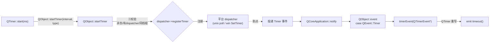

# QTimer 源码拆解

## 前言：定时器到底是谁在计时

咱们写 Qt 的时候，`QTimer` 是用得最多的类之一，拖动画的、轮询状态的、把事情延迟着做的，用的都是它。不过您要是停下来想一想，咱们调下 `QTimer::start(1000)` 以后，这一秒到底是谁在数的？是 `QTimer` 自己开了个计时线程在数，还是操作系统的硬件中断把它叫起来的？这几个问题，写了好几年 Qt 的朋友多数也是当场答不上来的。

笔者把当年自己被问住的那几个问题摆出来。`QTimer` 自己有没有计时的能力？`timeout()` 信号是由谁、在什么时机发出来的？咱们翻文档的时候还会遇见个 `Qt::TimerType`，`CoarseTimer` 和 `PreciseTimer` 的精度到底差在哪里？还有 `QBasicTimer` 的事，它的轻又是轻在哪里，您想过吗？

这几个问题其实都归结到 `QTimer` 设计的同一条主轴上：它根本不是自己计时的，它是个基于事件循环的软件定时器。入门篇的 [定时器](../../beginner/01-qtbase/11-timer-beginner.md) 教了咱们 `QTimer` 怎么用，进阶篇的 [定时器进阶](../../advanced/01-qtbase/11-qtimer-advanced.md) 讲了精度、单次触发这些用法。本篇咱们要往源码里走，咱们打开 `qtimer.cpp` 和 `qobject.cpp`，看看 `QTimer::start` 怎么经 `QObject::startTimer` 把活儿交给线程的事件 dispatcher，dispatcher 到点怎么把 `Timer` 事件发出来，`QTimer` 又怎么在自己的 `timerEvent` 里把它转成 `timeout` 信号。整条链咱们顺着走下来，您会发现 `QTimer` 自己是一行计时逻辑都没有的。

边界咱们也划清楚。事件 dispatcher（`QAbstractEventDispatcher`）在各平台的具体实现，[事件循环源码拆解](./07-event-loop-internals-expert.md) 也是把边界画在抽象层的，平台底下具体拿什么机制计时，咱们两篇都不往下钻，本篇咱们讲到 dispatcher 注册这一层为止。`QChronoTimer` 是 Qt6 新增的 chrono 变体，算是 `QTimer` 的近亲，咱们也不单独展开。

## 环境说明

本篇的源码引用都基于 `qt_src/qt6.9.1`，行号是会随 Qt 版本漂移的，您对照阅读的时候拿函数名定位最稳。涉及的关键文件咱们列在下面：

| 文件 | 角色 |
|---|---|
| `qtbase/src/corelib/kernel/qtimer.h` / `qtimer.cpp` | QTimer 公共声明与实现（start/timerEvent/singleShot） |
| `qtbase/src/corelib/kernel/qtimer_p.h` | QTimerPrivate（single/inter 等 bindable 属性） |
| `qtbase/src/corelib/kernel/qbasictimer.h` / `.cpp` | QBasicTimer 轻量替代 |
| `qtbase/src/corelib/kernel/qobject.cpp` | startTimer/killTimer/event case Timer/timerEvent |
| `qtbase/src/corelib/kernel/qabstracteventdispatcher.h` | registerTimer/unregisterTimer 签名 |
| `qtbase/src/corelib/kernel/qsingleshottimer_p.h` / `.cpp` | singleShot 内部用的私有类 |
| `qtbase/src/corelib/kernel/qcoreevent.h` | QEvent 事件类型枚举（`Timer = 1` 的定义所在） |
| `qtbase/src/corelib/global/qnamespace.h` | Qt::TimerType / Qt::TimerId 枚举 |

本篇没有配套的 example，原因和前几篇是一样的，它是纯源码的拆解，您对照着 `qt_src` 翻代码，就是最好的实验。

## 核心概念讲解

源码里的东西咱们马上就翻，翻以前咱们把从 `start` 到 `timeout` 的整条链路对一遍。下图能帮您看清 `QTimer` 在整条链里到底干了什么：



左边的半程是注册：咱们调下的 `QTimer::start` 转手就交给了 `QObject::startTimer`，它校验完了，把定时器注册到了当前线程的 dispatcher 上。右边的半程是派发，dispatcher 到点投递的是个 `Timer` 事件，事件循环把它送进了 `QObject::event` 里，`event` 再转给底下的 `timerEvent` 虚函数，`QTimer` 重写的那个 `timerEvent` 就是在这一步发出的 `timeout` 信号。咱们这一篇就顺着整条链一路拆下去。

### 软件定时器的地基，QTimer 自己不计时

一切的根子，是笔者翻开源码看到的第一眼，`QTimer` 的继承关系（`qt_src/qt6.9.1/qtbase/src/corelib/kernel/qtimer.h:19-21`）：

```cpp
class Q_CORE_EXPORT QTimer : public QObject
{
    Q_OBJECT
```

它继承的是 `QObject`，这不是什么凑巧的事，软件定时器的地基就打在这里，挂线程、收事件、发信号这三样本领都是 `QObject` 给的。`QTimer` 对外的唯一输出是那个 `timeout` 信号（`qt_src/qt6.9.1/qtbase/src/corelib/kernel/qtimer.h:114-115`），咱们接着看：

```cpp
Q_SIGNALS:
    void timeout(QPrivateSignal);
```

那个 `QPrivateSignal` 是 Qt 内部的标记，用户代码想直接 `emit timeout()` 是过不了编译的，不过咱们拿它 `connect` 完全不受影响。

那 `QObject` 收到 Timer 事件以后会怎样呢？咱们看 `QObject` 自己的 `timerEvent` 默认实现（`qt_src/qt6.9.1/qtbase/src/corelib/kernel/qobject.cpp:1482-1484`）：

```cpp
void QObject::timerEvent(QTimerEvent *)
{
}
```

是空的。一个普通的 `QObject`，哪怕您给它 `startTimer` 注册了定时器，Timer 事件来了也会被这个空函数拦下来，基类是什么都不干的。这也正是 `QTimer` 存在的意义：它替您把 `timerEvent` 重写了，转成了好用的 `timeout` 信号。您要是不嫌麻烦，不用 `QTimer` 也是可以的，自己继承 `QObject`、调 `startTimer`、重写 `timerEvent` 这一套全做下来的话，效果是一样的，麻烦的只是这套手工活。`QTimer` 就是替咱们把这层麻烦包起来的那个类。

### start 的注册链，把活儿交给 dispatcher

无参版的 `QTimer::start()` 读的是 `d->inter` 属性，咱们看它的实现，它内部干的头一件事就是调 `QObject::startTimer`（`qt_src/qt6.9.1/qtbase/src/corelib/kernel/qtimer.cpp:209-220`）：

```cpp
void QTimer::start()
{
    Q_D(QTimer);
    if (d->isActive()) // stop running timer
        stop();

    Qt::TimerId newId{ QObject::startTimer(d->inter * 1ms, d->type) }; // overflow impossible
    if (newId > Qt::TimerId::Invalid) {
        d->id = newId;
        d->isActiveData.notify();
    }
}
```

咱们注意 `d->inter` 和 `d->type` 都是属性：前者是毫秒的间隔，后者装的是 TimerType，两样都是 `setInterval`/`setTimerType` 设进去的，至于 `start` 本身是不接 TimerType 参数的，读的也就是它们俩。timer 已经在跑的话它会 stop 掉再启，这也意味着每次 `start` 拿到的都是一个新的 `id`。真正干活的在 `QObject::startTimer` 里（`qt_src/qt6.9.1/qtbase/src/corelib/kernel/qobject.cpp:1886-1912`）：

```cpp
int QObject::startTimer(std::chrono::nanoseconds interval, Qt::TimerType timerType)
{
    Q_D(QObject);

    using namespace std::chrono_literals;

    if (Q_UNLIKELY(interval < 0ns)) {
        qWarning("QObject::startTimer: Timers cannot have negative intervals");
        return 0;
    }

    auto thisThreadData = d->threadData.loadRelaxed();
    if (Q_UNLIKELY(!thisThreadData->hasEventDispatcher())) {
        qWarning("QObject::startTimer: Timers can only be used with threads started with QThread");
        return 0;
    }
    if (Q_UNLIKELY(thread() != QThread::currentThread())) {
        qWarning("QObject::startTimer: Timers cannot be started from another thread");
        return 0;
    }

    auto dispatcher = thisThreadData->eventDispatcher.loadRelaxed();
    Qt::TimerId timerId = dispatcher->registerTimer(interval, timerType, this);
    d->ensureExtraData();
    d->extraData->runningTimers.append(timerId);
    return int(timerId);
}
```

咱们刚才说 `QTimer` 是软件定时器，这段代码就是最硬的证据了，咱们逐句看。开头它做了三道校验，头一道说的是 `interval` 不能是负的。第二道查的是当前线程有没有事件 dispatcher，没有事件循环的裸线程是挂不住定时器的，所以拒绝。第三道要求在对象自己所属的线程里调，跨线程的 `start` 也是拒绝的。三道都过了，它才从当前线程的 `threadData` 里取出 `eventDispatcher`，调它的 `registerTimer`，这个 dispatcher 就是事件循环背后那个平台特定的派发器。`QObject` 这边做的只是把返回的 `timerId` 记到 `extraData->runningTimers` 列表里，为的是后面的 `killTimer` 好找。

到了这一步，`QTimer` 的活儿其实就干完了。真正到点叫醒咱们的是 dispatcher，它在内部维护着一张按到期时间排序的定时器表，事件循环每次阻塞等待的时候（unix 上等的是 `qt_safe_poll`，它包的就是 `poll`/`select` 这一类轮询，咱们能在 `qt_src/qt6.9.1/qtbase/src/corelib/kernel/qeventdispatcher_unix.cpp:459` 翻到这个调用，windows 上等的是消息循环），它就挑最早到期的那个等，等到了就把一个 `Timer` 事件投递出来。`QTimer` 是完全不参与计时的，笔者头一回意识到这一点的时候，连定时器这个名字都怀疑起来了。

查询接口也印证了这一点。`interval()` 读的是本地的属性 `d->inter`，也就是您设进去的那个数，而 `remainingTime()` 就得去问 dispatcher 了（`qt_src/qt6.9.1/qtbase/src/corelib/kernel/qtimer.cpp:661-671`）：

```cpp
int QTimer::remainingTime() const
{
    Q_D(const QTimer);
    if (d->isActive()) {
        using namespace std::chrono;
        auto remaining = QAbstractEventDispatcher::instance()->remainingTime(d->id);
        return ceil<milliseconds>(remaining).count();
    }

    return -1;
}
```

您要是问它还剩多久，`QTimer` 自己是根本不知道的，它得调 `dispatcher->remainingTime(d->id)` 去问 dispatcher 才知道的。这又一次向咱们证明了，它没有自己的时间内核。

### 到点派发，从 Timer 事件到 timeout 信号

dispatcher 到点投递出来的 `Timer` 事件，经事件循环就送到了 `QObject::event`。`event` 是个事件分发的枢纽，咱们看它的开头，排在第一个的就是 Timer（`qt_src/qt6.9.1/qtbase/src/corelib/kernel/qobject.cpp:1402-1407`）：

```cpp
bool QObject::event(QEvent *e)
{
    switch (e->type()) {
    case QEvent::Timer:
        timerEvent((QTimerEvent *)e);
        break;
```

咱们看 `Timer = 1` 的定义（`qt_src/qt6.9.1/qtbase/src/corelib/kernel/qcoreevent.h:63`），它在事件类型枚举里排的是第二个，比 `None = 0` 只靠后一位而已。`event` 干的转手活是把 `QEvent*` 强转成 `QTimerEvent*`，跟着调的就是虚函数 `timerEvent`。对普通的 `QObject`，调到的是咱们在软件定时器的地基一节看过的那个空函数，对 `QTimer` 来说调到的就是它重写的版本了（`qt_src/qt6.9.1/qtbase/src/corelib/kernel/qtimer.cpp:279-287`）：

```cpp
void QTimer::timerEvent(QTimerEvent *e)
{
    Q_D(QTimer);
    if (e->id() == d->id) {
        if (d->single)
            stop();
        emit timeout(QPrivateSignal());
    }
}
```

`QTimer` 全部的行为要害，笔者觉得就落在这 9 行上。它拿 `e->id() == d->id` 做了核对，一个 `QObject` 是可以挂多个 timer 的（`startTimer` 能调多次，调一次它就给一个新的 id），靠 id 才能分清这个事件是不是自己的那个。核对上了以后，要是它走的是 single 模式，它就把自个儿 stop 掉了（下一节细讲），跟着就 `emit timeout()` 了。咱们注意这里的顺序，single 模式下 stop 是排在 emit 前面的，这就保证了槽函数里查 `isActive()` 的时候，得到的已经是 `false` 了。这个细节是有人栽过跟头的：他在 timeout 槽里写 `if (timer.isActive())`，心里期望 single shot 触发的时候还是 active 的，其实到了槽里早就是 `false` 了。

### 单次与重复，single 是个属性

`QTimer` 默认是周期触发的，每过 `interval` 这么久它就来一次，单次触发靠的是 `setSingleShot`（`qt_src/qt6.9.1/qtbase/src/corelib/kernel/qtimer.cpp:580-583`），咱们看：

```cpp
void QTimer::setSingleShot(bool singleShot)
{
    d_func()->single = singleShot;
}
```

`single` 落在 `QTimerPrivate` 里是个 bindable 的属性，咱们看它的声明（`qt_src/qt6.9.1/qtbase/src/corelib/kernel/qtimer_p.h:65`）：

```cpp
Q_OBJECT_BINDABLE_PROPERTY_WITH_ARGS(QTimerPrivate, bool, single, false)
```

它的默认值是 `false`，也就是周期触发的意思。`setSingleShot` 做的只是设这个标志，真正的单次逻辑在到点派发一节讲过的 `timerEvent` 里，就是 `if (d->single) stop()` 的那一下，触发过一次就停了。所以咱们看，单次和周期在注册、派发上走的是完全一样的链路，唯一的区别就是 `timerEvent` 里那一次 `stop`。

### TimerType 三档，精度与省唤醒的交换

`Qt::TimerType` 是很多人忽略了的，但它直接影响的恰恰是定时的精度。咱们看它的真名（`qt_src/qt6.9.1/qtbase/src/corelib/global/qnamespace.h:1684-1688`）：

```cpp
enum TimerType {
    PreciseTimer,
    CoarseTimer,
    VeryCoarseTimer
};
```

枚举给的三档是 `PreciseTimer`、`CoarseTimer`、`VeryCoarseTimer`，名字咱们就对齐了。笔者在这里要专门纠正一个流传挺广的误记：网上有些资料写的是 `StCoarseTimer`，这个标识符在 Qt 6.9.1 的整个源码树里是 grep 不到的，咱们全库搜它是零命中的，第三档的名字就叫 `VeryCoarseTimer`。三档的差别到底在哪里，`qtimer.cpp` 的文档注释写得是很清楚的（`qt_src/qt6.9.1/qtbase/src/corelib/kernel/qtimer.cpp:87-98`）：

```cpp
The accuracy also depends on the \l{Qt::TimerType}{timer type}. For
Qt::PreciseTimer, QTimer will try to keep the accuracy at 1 millisecond.
Precise timers will also never time out earlier than expected.

For Qt::CoarseTimer and Qt::VeryCoarseTimer types, QTimer may wake up
earlier than expected, within the margins for those types: 5% of the
interval for Qt::CoarseTimer and 500 ms for Qt::VeryCoarseTimer.

All timer types may time out later than expected if the system is busy or
unable to provide the requested accuracy. In such a case of timeout
overrun, Qt will emit timeout() only once, even if multiple timeouts have
expired, and then will resume the original interval.
```

咱们把官方原文翻译过来。`PreciseTimer`：力求 1 毫秒的精度，而且绝不提前到期（不过系统繁忙的时候仍是可能延后的）。`CoarseTimer` 的做法是可能提前到期，容差是间隔的 5%，比如 1000ms 的 timer，它是可能 950ms 就响的。`VeryCoarseTimer`：容差是固定的 500ms，不管您的间隔有多大。

为什么允许提前呢？这是省电、省唤醒的设计。操作系统的定时唤醒是有开销的，频繁地唤醒 CPU 是很费电的。`CoarseTimer`/`VeryCoarseTimer` 允许把多个定时器的唤醒点对齐到同一次 OS 唤醒上，醒的次数就少了，代价是精度降了下来。不过咱们要知道，这个对齐到 OS 唤醒点的做法，是 platform dispatcher 实现层的细节，`qtimer.cpp` 的文档只做了暗示（给了 5%/500ms 的容差允许提前），算法是没有明写的。`QTimer` 默认用的就是 `CoarseTimer`（默认值写在 `qtimer_p.h` 的 `type` 属性上），绝大多数场景 5% 的容差是够用的，省下来的唤醒是值得的。

还有个细节咱们要知道，三档都是可能晚到的，而且系统繁忙、一次 overrun 掉多个周期的时候（比如 1000ms 的 timer，系统卡了 2.5 秒），Qt 是不会把堆积的 timeout 补发的，补的只有一次，然后恢复原来的间隔。这是为了避免 overrun 以后槽函数被连着调上一长串。

### stop 与 killTimer，注销的那条链

停定时器走的是 `QTimer::stop` 再到 `QObject::killTimer`。咱们看 `stop`（`qt_src/qt6.9.1/qtbase/src/corelib/kernel/qtimer.cpp:265-273`）：

```cpp
void QTimer::stop()
{
    Q_D(QTimer);
    if (d->isActive()) {
        QObject::killTimer(d->id);
        d->id = Qt::TimerId::Invalid;
        d->isActiveData.notify();
    }
}
```

`QObject::killTimer` 干的是注销的活儿，咱们接着看（`qt_src/qt6.9.1/qtbase/src/corelib/kernel/qobject.cpp:1932-1958`）：

```cpp
void QObject::killTimer(Qt::TimerId id)
{
    Q_D(QObject);
    if (Q_UNLIKELY(thread() != QThread::currentThread())) {
        qWarning("QObject::killTimer: Timers cannot be stopped from another thread");
        return;
    }
    if (id > Qt::TimerId::Invalid) {
        int at = d->extraData ? d->extraData->runningTimers.indexOf(id) : -1;
        if (at == -1) {
            // timer isn't owned by this object
            qWarning("QObject::killTimer(): Error: timer id %d is not valid for object ...");
            return;
        }
        auto thisThreadData = d->threadData.loadRelaxed();
        if (thisThreadData->hasEventDispatcher())
            thisThreadData->eventDispatcher.loadRelaxed()->unregisterTimer(id);
        d->extraData->runningTimers.remove(at);
        QAbstractEventDispatcherPrivate::releaseTimerId(id);
    }
}
```

这里和 `startTimer` 的区别，笔者头一回读这俩函数的时候差点把它们当成一样的。`startTimer` 那边干的是真三道校验（非负、有 dispatcher、同线程），`killTimer` 实质上干的是两道校验外加一个守卫。头一道查的是调用是不是从对象自己的线程来的，跨线程是拒绝的。另一道查的是这个 id 在不在本对象的 `runningTimers` 表里，它在 `indexOf` 里找不到的，就说明这个 id 是不归这个对象管的，同样也是拒绝的。`id > Invalid` 那一下是个守卫而已。校验都过了，它才调 `dispatcher->unregisterTimer(id)` 把定时器真真正正地从 dispatcher 上摘下来，再把 `runningTimers` 表里的记录移走、把 id 归还回去。表内合法性这道校验是要紧的，它保证了您只能 kill 自己拥有的 timer。

### QBasicTimer 与 singleShot，绕开 QTimer 的两条路

最后咱们看两个常被混淆的东西。头一个登场的是 `QBasicTimer`。很多人以为它比 `QTimer` 轻是因为少继承了一个 `QObject`，这话只说中了一半。看它的声明（`qt_src/qt6.9.1/qtbase/src/corelib/kernel/qbasictimer.h:17-24`）：

```cpp
class Q_CORE_EXPORT QBasicTimer
{
    Qt::TimerId m_id;
    Q_DISABLE_COPY(QBasicTimer)

public:
    // use the same duration type
    using Duration = QAbstractEventDispatcher::Duration;
```

它确实不继承 `QObject`（`class QBasicTimer { ... }` 是没有基类的），身上只持了一个 `m_id`。不过它“轻”的真正原因，是笔者翻到 start 的实现才看明白的，在于它注册定时器的方式，`QBasicTimer::start` 是直接调 dispatcher 的（`qt_src/qt6.9.1/qtbase/src/corelib/kernel/qbasictimer.cpp:194-197`）：

```cpp
    stop();
    if (obj)
        m_id = eventDispatcher->registerTimer(duration, timerType, obj);
```

这一行咱们要注意，它是绕过 `QObject::startTimer` 做的注册，它自己从 `QAbstractEventDispatcher::instance()` 里把 dispatcher 取出来的，直接就 `registerTimer` 了。这意味着它是不进 `QObject` 的 `runningTimers` 簿记的，`QObject::startTimer` 里的 append 动作，在它的路径上是没有的。所以 `QBasicTimer` 自带的 `stop()` 也是直接 `dispatcher->unregisterTimer(m_id)` 的，靠的不是 `QObject::killTimer`，因为 `killTimer` 是拿 `runningTimers` 表找 id 的，而 `QBasicTimer` 的 id 根本就不在簿记表里。它走的正是这么一条 fast/low-level 的路径，文档的原话是 `This is a fast, lightweight, and low-level class used by Qt internally`，Qt 内部自己用的就是它。代价是它没有信号、没有属性、也不能被对象树管理的，收 timer 事件得靠您传进去的那个目标 `QObject` 自己重写的 `timerEvent`。

接着咱们说 `QTimer::singleShot`。很多人以为它内部走的是 `new QTimer`、设 `singleShot=true`、connect、start 这么一套，还真不是的，咱们看实现（`qt_src/qt6.9.1/qtbase/src/corelib/kernel/qtimer.cpp:318-352`）：

```cpp
void QTimer::singleShotImpl(std::chrono::nanoseconds ns, Qt::TimerType timerType,
                            const QObject *receiver,
                            QtPrivate::QSlotObjectBase *slotObj)
{
    if (ns == 0ns) {
        ...
        QMetaObject::invokeMethodImpl(const_cast<QObject *>(receiver), slotObj,
                Qt::QueuedConnection, ...);
        ...
        return;
    }
    (void) new QSingleShotTimer(ns, timerType, receiver, slotObj);
}
```

路数其实有两条。`ns == 0`（立即执行）走的是 fast path，timer 是一个都不创建的，直接 `QMetaObject::invokeMethod` 拿 `QueuedConnection` 把槽投递到接收线程的事件队列里，比走 timer 是更高效的。`ns > 0` 的时候才轮到 `new QSingleShotTimer(...)`。咱们要注意这个 `QSingleShotTimer` 是个私有类，公开 API 里是没有它的，它继承的是 `QObject`，内部持的是一个 `QBasicTimer` 成员而不是 `QTimer`（`qt_src/qt6.9.1/qtbase/src/corelib/kernel/qsingleshottimer_p.h:32-36`）：

```cpp
class Q_AUTOTEST_EXPORT QSingleShotTimer : public QObject
{
    Q_OBJECT

    QBasicTimer timer;
```

它的活儿是这样的：拿它手里的 `QBasicTimer` 把定时器启动起来，把 `timeout` 连到您传的 receiver 的槽上，到点了在自己的 `timerFinished` 里发信号，末了再自毁掉（`qt_src/qt6.9.1/qtbase/src/corelib/kernel/qsingleshottimer.cpp:60-64`）：

```cpp
void QSingleShotTimer::timerFinished()
{
    Q_EMIT timeout();
    delete this;
}
```

`delete this`，自己把自己销毁了。所以您调 `QTimer::singleShot(...)` 是完全不用管它的生命周期的，它自己都安排好了。真实的链路是 `QTimer::singleShot` 进了 `QSingleShotTimer`（私有），下一程 `QBasicTimer` 是它手里的，最外的一层才是 dispatcher，一层一层地套下去，不过每一层都有它自己的道理。

## 风险与故障预防

本篇的风险都是从源码里来的，这里咱们一个个把后果和解法交代清楚。

头一类的风险是迷信 `QTimer` 精确。TimerType 三档一节咱们看过，默认的 `CoarseTimer` 容差是间隔的 5%，1000ms 的 timer 是可能 950ms 就响的。绝大多数 UI 场景这是无所谓的，不过您要是拿它做需要毫秒级精度的活儿（串口通信的超时判断、精确节拍的音乐与动画同步都是这一类），5% 的提前量就会让逻辑乱掉。它的根子在容差设计上，`CoarseTimer` 为了省唤醒是主动牺牲了精度的。积累下来的偏差会让业务逻辑跑偏，而且是难复现的，它依赖系统的调度。解法是高精度场景显式地 `setTimerType(Qt::PreciseTimer)`，它保证的是不提前，系统繁忙的时候仍可能延后，绝不会早响就是了。

第二类的风险是在没有事件循环的线程里用 `QTimer`。start 的注册链一节贴过的 `QObject::startTimer`，它的第二道校验查的就是当前线程有没有 dispatcher。一个没跑 `exec()` 的裸 `QThread`（您重写 `run` 干活、没调 `exec`），它的 `threadData` 里是没有 eventDispatcher 的，`startTimer` 直接给您 `qWarning` 一句、返回一个 0，timer 是压根没注册上的。根子在前面拆第二道校验的时候就交代了，软件定时器没有事件循环是无处可挂的。它带来的后果是 `timeout` 永远不会触发，您还当 `start` 成功了，其实是静默失败的，只给了一句 qWarning。解法是让跑活的线程真的有事件循环，一条路是走 worker 模式的，您把对象 `moveToThread` 过去，`QThread` 用默认的 `run` 调 `exec`。另一条路是不用 `QTimer` 的，改拿 `QDeadlineTimer`/`std::chrono` 在 `run` 里自己 sleep 也就是了。

第三类的风险是跨线程 `start`/`stop`。start 的注册链一节的第三道校验、stop 与 killTimer 一节的第一道校验，卡的都是这个，`startTimer`/`killTimer` 必须从对象自己所属的线程调，跨线程是直接拒绝的。咱们有的人图省事，在主线程里就调起了 `worker->timer.start()`（worker 是在别的线程里的），心里是以为 Qt 会帮忙转发的，其实是直接 `qWarning` 拒绝的。根子是 timer 的注册依赖当前线程的 dispatcher，跨线程调用要是注册到了错误的 dispatcher 上就乱套了。后果还是一样的，timer 是压根没注册成功的，又是静默的失败。解法是拿 `QMetaObject::invokeMethod` 把 `start`/`stop` 的调用投递到对象所在的线程去（`QueuedConnection`），让它在正确的线程里执行。

第四类的风险出在 `singleShot` 的用法误解上。QBasicTimer 与 singleShot 一节咱们看过，`QTimer::singleShot` 内部是 `new QSingleShotTimer` 而且自毁的，生命周期它是完全自己管的。不过有些代码是自己 `new QTimer` 来做 single shot，然后在 `timeout` 的槽里 `deleteLater`，而且 connect 还接得不对，结果要么是 double free，要么是 timer 没及时删、内存漏了。根子是没意识到 `QTimer::singleShot` 这个静态方法已经把这一切都封装好了。解法是现成的，一次性触发的场景就直接用 `QTimer::singleShot(interval, receiver, slot)`，自己别去写 new 的代码。要重复触发的场景，才轮到咱们自己 `new QTimer`，把生命周期挂在所属的对象上，析构的时候 `stop` 加 `delete`。

## 练习项目

本篇和前几篇一样走的是纯源码拆解的路子，练习走的也是验证的路子，四道题给的都是方向和验证的手段，完整的工程留给您自己搭。

头一道题把 `CoarseTimer` 的 5% 提前量量出来。您写个小程序，`start(1000)` 用默认的 TimerType 跑起来，每收到一次 `timeout` 您就把时间戳记下来，攒上几十个样本也就够了。您会看到有一批样本是落在 950ms 附近的，这就是提前到期了。对照组您显式 `setTimerType(Qt::PreciseTimer)` 再跑一遍，提前的样本是会消失的（系统繁忙时的延后仍然可能有，这一点您也要预期到）。

第二道题验证裸线程里的 `QTimer` 是不起作用的。您起一个 `QThread`，重写 `run` 来干活的，但 `exec` 这一步是不调的，再把一个 `QTimer` 所在的对象 `moveToThread` 过去以后 `start()`。您会看到控制台上 `Timers can only be used with threads started with QThread` 那句 qWarning，`timeout` 槽是一次都不进来的。对照组换成 worker 模式（`QThread` 用默认的 `run`），这时 `start` 得拿 `QMetaObject::invokeMethod` 把调用投到对象所在的线程去调，`timeout` 就正常来了。

第三道题把跨线程 `start` 的拒绝演一遍。worker 是在子线程里的，您在主线程直接调 `worker->timer.start()`，您抓一下控制台，`Timers cannot be started from another thread` 是会出现的，timer 实际是没注册上的。再改用 `QMetaObject::invokeMethod` 把调用投递到 worker 所在的线程，timer 就正常转起来了。

第四道题咱们回源码里做核对。您到 `qt_src/qt6.9.1` 里要对的是四件事。头一件咱们 grep `StCoarseTimer`，全库是零命中的。再一件咱们看 `singleShotImpl`（318-352 行），确认 `ns == 0ns` 的分支是不创建任何 timer 的。还有一件咱们看 `qsingleshottimer_p.h`（32-36 行），确认它持的成员是 `QBasicTimer` 而不是 `QTimer`。最后咱们看 `timerFinished`（60-64 行），确认它末尾是 `delete this` 的。四处都是对上的，本篇的断言也就落了地。

## 官方文档参考链接

[Qt 文档 · QTimer](https://doc.qt.io/qt-6/qtimer.html)——QTimer 的类参考，start/timeout/singleShot 的说明咱们上这一页查。

[QBasicTimer 文档](https://doc.qt.io/qt-6/qbasictimer.html)——轻量的定时器参考，它的边界咱们在这一页查。

[TimerType 文档](https://doc.qt.io/qt-6/qt.html#TimerType-enum)——枚举的精度语义，三档的说明咱们在这一页查。

[Qt 文档 · Timers](https://doc.qt.io/qt-6/timers.html)——Qt 定时器的总览，TimerType 选型与精度权衡的说明咱们在这一页查。

---

走到了这里，`QTimer` 的源码咱们就算拆完了。笔者拆完最大的感受是，这个类薄得是超出预期的，它自己是一行计时逻辑都没有的。`start` 把活儿交给的是 `QObject::startTimer`，`startTimer` 过了三道校验，把它注册到了线程的 dispatcher 上，真正的到点叫醒，靠的全是 dispatcher 在事件循环里挑最早到期的定时器等。dispatcher 投递的 `Timer` 事件经 `QObject::event` 转给 `timerEvent` 虚函数，`QTimer` 重写的 `timerEvent` 就是在这一步发的 `timeout` 信号。精度上 `TimerType` 三档（`PreciseTimer`/`CoarseTimer`/`VeryCoarseTimer`）是拿精度换省电的，`CoarseTimer` 默认的容差是 5%。`QBasicTimer` 是绕开 `QObject::startTimer` 直接走 dispatcher 的 fast/low-level 路径，`QTimer::singleShot` 内部套的是个 `QSingleShotTimer` 私有类（持的是 `QBasicTimer`，还会自毁的）。

这套机制和 [事件循环源码拆解](./07-event-loop-internals-expert.md) 的 dispatcher 是紧紧咬在一起的，跟 [QObject 元对象系统源码拆解](./01-qobject-meta-system-expert.md) 的 metacall 元调用分发也是咬在一起的，`timeout` 发出以后信号到槽的那一次调用走的就是它。往后咱们拆动画框架的定时驱动、网络模块的超时机制，都会回到这一篇来对定时器侧的行为。

您要是想把本篇的行号证据拿来一一核对，它们已经按源码机制归类收在 [code-index · QTimer](../code-index/qtbase/qtimer.md) 下面了（dispatcher 的 registerTimer/unregisterTimer 另见 [事件分发](../code-index/qtbase/event-dispatch.md)），您带着行号直接去 `qt_src/qt6.9.1` 翻原文就行。
