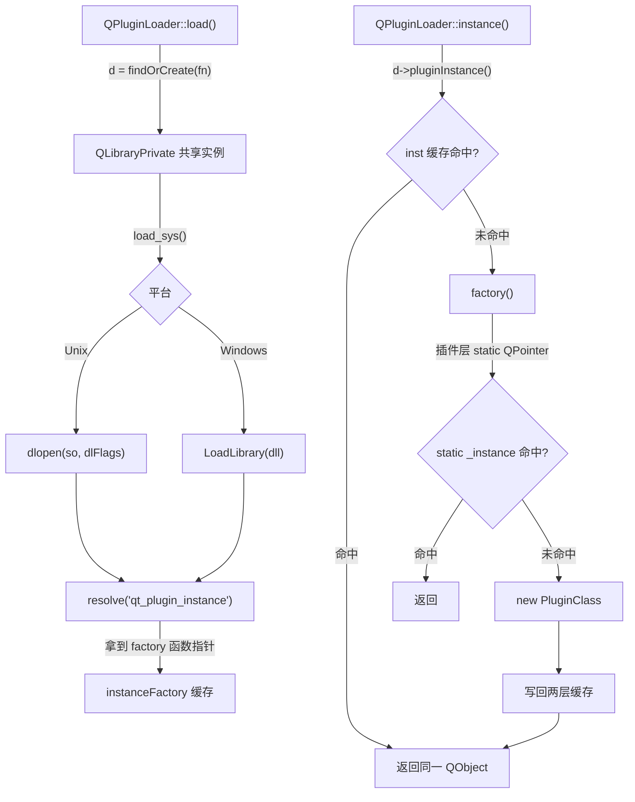

# QPluginLoader 源码拆解

## 前言：插件加载上最容易想当然的几个问题

Qt 的插件系统，入门用法是不复杂的：咱们写一个继承 `QObject` 的接口实现类，把 `Q_OBJECT` 和 `Q_PLUGIN_METADATA` 两个宏拍了上去，编成了 so/dll，运行时咱们拿 `QPluginLoader::instance()` 取出来，`qobject_cast` 成了接口就能用。不过真往源码里走，有几个问题是能把写了几年 Qt 的人问住的。

笔者把当年自己答不上来的问题摆出来。`QPluginLoader` 继承的是 `QObject`，那它跟 `QLibrary` 的关系到底是什么，是不是父子？您把 `instance()` 调上两次，拿到的是同一个对象，还是两个新对象？教材都说插件的 metadata 是 JSON，可您拿十六进制工具打开 so 去看，怎么都不像 JSON 文本的样子？还有个最隐蔽的：`QPluginLoader` 加载插件的时候，校验不校验它声明的 IID？那 `unload()` 呢，您调了它，那个 so 真的从进程地址空间里卸掉了吗？

这些问题笔者给您归成了几类：身份上它持的是 `QLibraryPrivate` 而非公开的 `QLibrary`，单例上 `instance()` 走的是双层缓存，元数据编码上 Qt6 用的已经是 CBOR 了，校验分了层、iid 的检查只归 `QFactoryLoader` 管，卸载上默认的 `PreventUnloadHint` 让它几乎从不真卸载。

入门篇的 [插件系统](../../beginner/01-qtbase/12-plugin-beginner.md) 教了 `QPluginLoader` 怎么用，进阶篇的 [插件系统进阶](../../advanced/01-qtbase/12-plugin-advanced.md) 补了 `Q_PLUGIN_METADATA` 和接口设计。本篇咱们要往源码里走：咱们把 `qpluginloader.cpp`、`qfactoryloader.cpp` 和 `qlibrary.cpp` 三个文件翻开来，看看插件是怎么被 `dlopen` 出来的，`instance()` 的缓存是怎么做的，metadata 又是怎么在不加载插件的情况下读到的。

边界咱们也划清楚。`Q_PLUGIN_METADATA` 这个宏本身是零展开的，真正生成插件导出代码的是 moc，moc 的完整流程（ClassDef IR、generateCode 四段）是 [MOC 编译器原理](./17-moc-compiler-expert.md) 的主场，本篇只看 moc 给插件生成的两枚 C 导出函数，看它们长什么样，又是怎么被加载器 `resolve` 到的。`QLibrary`（通用的动态库加载，非插件）的符号 `resolve`、版本后缀搜索，咱们也不展开，只借用 `QPluginLoader` 复用 `QLibraryPrivate` 的这一层。具体插件系统（图片格式插件、SQL 驱动、QPA 平台插件）是 `QFactoryLoader` 的使用方，本篇就都不碰了。

## 环境说明

本篇的源码引用都基于 `qt_src/qt6.9.1`，行号是会随 Qt 版本漂移的，您对照阅读的时候拿函数名去定位，这是最稳的办法。插件加载涉及的关键文件，咱们列在下面：

| 文件 | 角色 |
|---|---|
| `qtbase/src/corelib/plugin/qpluginloader.h` | QPluginLoader 公共声明 |
| `qtbase/src/corelib/plugin/qpluginloader.cpp` | QPluginLoader 实现：instance/metaData/load/unload |
| `qtbase/src/corelib/plugin/qplugin.h` | Q_PLUGIN_METADATA / Q_IMPORT_PLUGIN / Q_PLUGIN_INSTANCE 宏 + 导出宏 |
| `qtbase/src/corelib/plugin/qplugin_p.h` | QtPluginMetaDataKeys 枚举 |
| `qtbase/src/corelib/plugin/qfactoryloader.cpp` | QFactoryLoader：按 iid 扫目录、建 keyMap |
| `qtbase/src/corelib/plugin/qlibrary.cpp` | QLibraryPrivate：pluginInstance/loadPlugin/unload/findPatternUnloaded |
| `qtbase/src/corelib/plugin/qlibrary_p.h` | QLibraryPrivate + 双计数器 + inst 缓存字段 |
| `qtbase/src/corelib/plugin/qlibrary_unix.cpp` | Unix：dlopen + RTLD_NODELETE |
| `qtbase/src/corelib/plugin/qlibrary_win.cpp` | Win：LoadLibrary + GetModuleHandleEx PIN |

本篇没有配套的 example，原因和前几篇是一样的，它是纯源码的拆解，您对照着 `qt_src` 翻代码，就是最好的实验。

## 核心概念讲解

源码咱们马上就翻，翻以前把插件从 `QPluginLoader::load()` 到 `instance()` 返回的完整链路对一遍。下图能帮您看清中间都发生了什么：



图上的前半程是加载：咱们调下的 `QPluginLoader::load()` 走系统级的 `dlopen`/`LoadLibrary` 把库挂进了地址空间，`resolve` 拿到的是插件导出的工厂函数。`instance()` 那一半走的是两层缓存（`QLibraryPrivate::inst` 加上插件层的 `static QPointer`），返回的都是同一个单例。咱们这一篇就顺着它一路拆下去。

### 身份问题，QPluginLoader 持的是 QLibraryPrivate

咱们从声明看起，笔者把头一张底牌亮出来（`qt_src/qt6.9.1/qtbase/src/corelib/plugin/qpluginloader.h:20-22`）：

```cpp
class Q_CORE_EXPORT QPluginLoader : public QObject
{
    Q_OBJECT
```

咱们看得到，它继承的是 `QObject` 而不是 `QLibrary`，这俩是平级的兄弟，`QLibrary` 自己也是继承 `QObject` 的。那 `QPluginLoader` 的加载能力是从哪儿来的？答案是它直接持有了 `QLibrary` 背后的那个内部实现类（`qt_src/qt6.9.1/qtbase/src/corelib/plugin/qpluginloader.h:17,48-51`）：

```cpp
class QLibraryPrivate;

class Q_CORE_EXPORT QPluginLoader : public QObject
{
    ...
private:
    QLibraryPrivate *d;
    bool did_load;
```

`d` 的类型咱们要注意，是 `QLibraryPrivate`（私有的实现类），不是公开的 `QLibrary` 类。有个流传挺广的说法，讲的是“QPluginLoader 封装了 QLibrary”，这话是不准确的。它封装的其实是 `QLibrary` 的 pimpl 内部对象，跟 `QLibrary` 公开类共用的是同一层实现。这个 `d` 指针是怎么来的（`qt_src/qt6.9.1/qtbase/src/corelib/plugin/qpluginloader.cpp:307-309`）：

```cpp
    d = QLibraryPrivate::findOrCreate(fn, QString(), lh);
    if (!fn.isEmpty())
        d->updatePluginState();
```

`QLibraryPrivate::findOrCreate` 是这里的关键入口，它从一个全局的 `QLibraryStore` 里按文件名查共享实例。这意味着咱们要是让两个 `QPluginLoader`（或者一个 `QPluginLoader` 加一个 `QLibrary`）设同一个文件名，底层拿到的是同一个 `QLibraryPrivate`，后面要讲的引用计数就是建立在这个共享上的。

真正的系统级 `dlopen` 也不在 `qpluginloader.cpp` 里，咱们跟着调用链往下走，落到的是 `qlibrary_unix.cpp`（`qt_src/qt6.9.1/qtbase/src/corelib/plugin/qlibrary_unix.cpp:199`）：

```cpp
            hnd = dlopen(QFile::encodeName(attempt), dlFlags);
```

Windows 那一头咱们也能对上，对应的是 `qt_src/qt6.9.1/qtbase/src/corelib/plugin/qlibrary_win.cpp:58` 的 `LoadLibrary`。链条的起点是 `QPluginLoader`，中间经了 `QLibraryPrivate::loadPlugin` 和 `load`，跟着进了 `load_sys`，末了才落进 `dlopen`/`LoadLibrary`。`load_sys` 在 Unix 和 Windows 两端是同一抽象的两种实现，`QPluginLoader` 本身是平台无关的。

### instance() 的双层单例，不是每次 new

这是本篇的头一个大纠偏点，笔者得把它摆在亮的地方。不少教材暗示 `instance()` 每次返回的都是新对象，源码里的答案是完全相反的。

咱们从 `QPluginLoader::instance` 这层看起（`qt_src/qt6.9.1/qtbase/src/corelib/plugin/qpluginloader.cpp:139-144`）：

```cpp
QObject *QPluginLoader::instance()
{
    if (!isLoaded() && !load())
        return nullptr;
    return d->pluginInstance();
}
```

它自己是不 new 对象的，咱们看到的只有两步，确保加载了，剩下的活儿都转给了 `d->pluginInstance()`。缓存的逻辑全部在 `QLibraryPrivate::pluginInstance` 里（`qt_src/qt6.9.1/qtbase/src/corelib/plugin/qlibrary.cpp:499-524`）：

```cpp
QObject *QLibraryPrivate::pluginInstance()
{
    // first, check if the instance is cached and hasn't been deleted
    QObject *obj = [&](){ QMutexLocker locker(&mutex); return inst.data(); }();
    if (obj)
        return obj;

    // We need to call the plugin's factory function. Is that cached?
    // skip increasing the reference count (why? -Thiago)
    QtPluginInstanceFunction factory = instanceFactory.loadAcquire();
    if (!factory)
        factory = loadPlugin();

    if (!factory)
        return nullptr;

    obj = factory();

    // cache again
    QMutexLocker locker(&mutex);
    if (inst)
        obj = inst;
    else
        inst = obj;
    return obj;
}
```

咱们把它的路数归成三步。头一步查的是 `inst` 缓存，命中就直接返回了。没命中的话，工厂函数 `instanceFactory` 是它去取的，这一层自己也是带缓存的，跟着调 `factory()` 生成了对象，末了写回 `inst`。真正的机关在 `inst` 这个字段的类型上（`qt_src/qt6.9.1/qtbase/src/corelib/plugin/qlibrary_p.h:96`）：

```cpp
    QMutex mutex;
    QPointer<QObject> inst;         // used by QFactoryLoader
    QPluginParsedMetaData metaData;
```

`QPointer<QObject>`，弱引用的语义。`QPluginLoader::instance()` 的[官方文档页](https://doc.qt.io/qt-6/qpluginloader.html#instance)里，您能读到这么一句话，`If the root component object was destroyed, calling this function creates a new instance`，说的就是这回事：对象被外部 `delete` 掉了，`QPointer` 自动就把它置空了，下次再调 `instance()` 的时候，`inst.data()` 取回来是空的，就轮到它重走 `factory()` 新建一个了。对象活着的时候，`instance()` 返回的就一直是同一个指针。

工厂函数指针 `instanceFactory` 也是缓存起来的，免得咱们每次都去 `resolve` 符号（`qt_src/qt6.9.1/qtbase/src/corelib/plugin/qlibrary.cpp:581-599`）：

```cpp
QtPluginInstanceFunction QLibraryPrivate::loadPlugin()
{
    if (auto ptr = instanceFactory.loadAcquire()) {
        libraryUnloadCount.ref();
        return ptr;
    }
    if (pluginState == IsNotAPlugin)
        return nullptr;
    if (load()) {
        auto ptr = reinterpret_cast<QtPluginInstanceFunction>(resolve("qt_plugin_instance"));
        instanceFactory.storeRelease(ptr); // two threads may store the same value
        if (Q_LIKELY(ptr))
            return ptr;
        errorString = QLibrary::tr("Could not resolve 'qt_plugin_instance' function");
    }
    ...
}
```

头一回加载的时候，`resolve("qt_plugin_instance")` 拿到的是 C 函数指针，存进了原子的 `instanceFactory`，之后咱们再调就直接复用了。旁边那句注释 `// two threads may store the same value` 讲的就是这是无锁的双检：两个线程同时 `resolve`、同时 `store` 也是没关系的，存的是同一个值。

`resolve` 的符号名是固定的 `qt_plugin_instance`，`extern "C"` 的导出没有 name mangling，这也是插件能跨编译器加载的根本原因：MSVC 编出来的插件，咱们用 GCC 的程序也能 `resolve` 到这个符号（前提是两边的 ABI 兼容）。

还没完的是，咱们把 `qt_plugin_instance` 函数自己的实现翻出来，moc 用 `Q_PLUGIN_INSTANCE` 宏又埋了一层缓存（`qt_src/qt6.9.1/qtbase/src/corelib/plugin/qplugin.h:212-220`）：

```cpp
#define Q_PLUGIN_INSTANCE(IMPLEMENTATION) \
        { \
            static QT_PREPEND_NAMESPACE(QPointer)<QT_PREPEND_NAMESPACE(QObject)> _instance; \
            if (!_instance) {    \
                QT_PLUGIN_RESOURCE_INIT \
                _instance = new IMPLEMENTATION; \
            } \
            return _instance; \
        }
```

`static QPointer<QObject> _instance`，函数静态变量级的缓存。执行 `new IMPLEMENTATION` 的时机只有头一回（或者对象死了以后）。叠上了 `QLibraryPrivate::inst` 那一层，咱们就可以说 `instance()` 是个双层单例了。这两层缓存笔者头一回看的时候也愣了一下，不过仔细想想是合理的：外层的 `inst` 是加载器视角的单例，多个 `QPluginLoader`、`QFactoryLoader` 拿到的是同一个。内层的 `_instance` 是插件 DLL 视角的单例，就算经历了卸载重载，只要 DLL 的静态变量还在，逻辑上也是连续的。

### Q_PLUGIN_METADATA 是零展开，干活的是 moc

`Q_PLUGIN_METADATA(IID "..." FILE "...")` 这个宏到底生成什么，咱们到定义处一看，它自己什么都不生成（`qt_src/qt6.9.1/qtbase/src/corelib/kernel/qtmetamacros.h:56`）：

```cpp
#define Q_PLUGIN_METADATA(x) QT_ANNOTATE_CLASS(qt_plugin_metadata, x)
```

`QT_ANNOTATE_CLASS` 的默认定义展开出来是空的，咱们把定义行引出来看（`qt_src/qt6.9.1/qtbase/src/corelib/kernel/qtmetamacros.h:20-22`）：

```cpp
#ifndef QT_ANNOTATE_CLASS
# define QT_ANNOTATE_CLASS(type, ...)
#endif
```

紧挨着定义的那两行注释咱们也读一下，写明的是这一组宏留给理解 Qt 的工具自己定义，工具定义了就能从宏里拿走信息。没人定义它的时候，`Q_PLUGIN_METADATA` 是个不折不扣的空操作，它全部的作用是打标记给 moc 看，真正生成导出代码的是 moc。

moc 看到了这个标记以后，就调 `parsePluginData` 把三个键解析了出来（`qt_src/qt6.9.1/qtbase/src/tools/moc/moc.cpp:1537-1599` 节选），咱们看：

```cpp
void Moc::parsePluginData(ClassDef *def)
{
    next(LPAREN);
    QByteArray metaData;
    while (test(IDENTIFIER)) {
        QByteArray l = lexem();
        if (l == "IID") {
            next(STRING_LITERAL);
            def->pluginData.iid = unquotedLexem();
        } else if (l == "URI") {
            next(STRING_LITERAL);
            def->pluginData.uri = unquotedLexem();
        } else if (l == "FILE") {
            next(STRING_LITERAL);
            QByteArray metaDataFile = unquotedLexem();
            ...
            metaData = file.readAll();
        }
    }
    if (!metaData.isEmpty()) {
        def->pluginData.metaData = QJsonDocument::fromJson(metaData);
        ...
```

三键的语法是 `Q_PLUGIN_METADATA(IID "..." FILE "...json" URI "...")`。要紧的是 `FILE`，它指向的那个 JSON 文件，moc 在编译期就把它读进来了，解析成了 `QJsonDocument`，嵌进了 `ClassDef`。这也是 metadata 能在不加载插件的情况下读到的根本原因：JSON 文件您在编译期就交出去了，moc 把它烧进了插件的二进制文件，运行的时候不用 `dlopen` 也能拿到。

数据到了 moc 手上，出来的就是两枚 `extern "C"` 的导出函数，咱们看（`qt_src/qt6.9.1/qtbase/src/corelib/plugin/qplugin.h:240-254`）：

```cpp
#  define QT_MOC_EXPORT_PLUGIN_COMMON(PLUGINCLASS, MANGLEDNAME)                                 \
    extern "C" Q_DECL_EXPORT QT_PREPEND_NAMESPACE(QObject) *qt_plugin_instance()                \
    Q_PLUGIN_INSTANCE(PLUGINCLASS)                                                              \
    /**/

#  define QT_MOC_EXPORT_PLUGIN(PLUGINCLASS, PLUGINCLASSNAME)      \
            extern "C" Q_DECL_EXPORT \
            QPluginMetaData qt_plugin_query_metadata() \
            { return { qt_pluginMetaData_##PLUGINCLASSNAME, sizeof qt_pluginMetaData_##PLUGINCLASSNAME }; } \
            QT_MOC_EXPORT_PLUGIN_COMMON(PLUGINCLASS, PLUGINCLASSNAME)

#  define QT_MOC_EXPORT_PLUGIN_V2(PLUGINCLASS, MANGLEDNAME, MD)                                 \
    extern "C" Q_DECL_EXPORT QT_PREPEND_NAMESPACE(QPluginMetaData) qt_plugin_query_metadata_v2()\
    { static constexpr QT_PLUGIN_METADATAV2_SECTION QPluginMetaDataV2<MD> md{}; return md; }    \
    QT_MOC_EXPORT_PLUGIN_COMMON(PLUGINCLASS, MANGLEDNAME)
```

咱们看明白了，这两枚函数就是插件对外的全部 C 接口了：`qt_plugin_query_metadata_v2` 返回的是元数据结构（一个指向字节流的指针加一个 size），另一枚 `qt_plugin_instance` 干的是创建根对象的活儿，调的就是 `Q_PLUGIN_INSTANCE`。咱们把清单对一遍，`QT_MOC_EXPORT_PLUGIN` 和 `QT_MOC_EXPORT_PLUGIN_V2` 是两代导出的宏，moc 把两代的调用都写进生成的代码，实际构建的时候靠 `#ifdef QT_MOC_EXPORT_PLUGIN_V2` 二选一（生成器侧见 `qt_src/qt6.9.1/qtbase/src/tools/moc/generator.cpp:1461-1479`），落到一个插件身上的导出就是这两枚。两个函数都标了 `extern "C" Q_DECL_EXPORT`，身上是没有 name mangling 的。双层单例一节里那个 `resolve("qt_plugin_instance")` 找的就是第二枚函数。

### Qt6 的元数据是 CBOR，不是 JSON

重头戏来了。本篇最大的一个纠偏点就在这儿，也是 Qt5 到 Qt6 在插件系统上最根本的变化，咱们把它当成正餐。

教材和不少博客都告诉您，插件的元数据是 JSON。这话在 Qt5 是对的，到了 Qt6 就不对了。咱们看 moc 生成元数据的代码（`qt_src/qt6.9.1/qtbase/src/tools/moc/generator.cpp:1408-1434` 节选）：

```cpp
void Generator::generatePluginMetaData()
{
    if (cdef->pluginData.iid.isEmpty())
        return;

    auto outputCborData = [this]() {
        CborDevice dev(out);
        CborEncoder enc;
        cbor_encoder_init_writer(&enc, CborDevice::callback, &dev);

        CborEncoder map;
        cbor_encoder_create_map(&enc, &map, CborIndefiniteLength);

        dev.nextItem("\"IID\"");
        cbor_encode_int(&map, int(QtPluginMetaDataKeys::IID));
        cbor_encode_text_string(&map, cdef->pluginData.iid.constData(), cdef->pluginData.iid.size());

        dev.nextItem("\"className\"");
        cbor_encode_int(&map, int(QtPluginMetaDataKeys::ClassName));
        cbor_encode_text_string(&map, cdef->classname.constData(), cdef->classname.size());

        QJsonObject o = cdef->pluginData.metaData.object();
        if (!o.isEmpty()) {
            dev.nextItem("\"MetaData\"");
            cbor_encode_int(&map, int(QtPluginMetaDataKeys::MetaData));
            jsonObjectToCbor(&map, o);
        }
```

咱们看上面代码里的 `cbor_encoder_init_writer`、`cbor_encode_int`、`cbor_encode_text_string`，全是 CBOR 的编码 API。键的部分是整数枚举（`QtPluginMetaDataKeys::IID` 这一类的），值的部分是字符串或者 map。Qt6 的插件元数据，原始编码已经是 CBOR 二进制了，不是 JSON 文本了。Qt5 那会儿是带 `QTMETADATA !` 前缀的纯 JSON 文本，Qt6 整个换成了 CBOR，换来的是更紧凑的体积，解析速度也上来了。

那 JSON 在 Qt6 哪儿还有呢？只剩两头的边界了：一头是用户的输入（`FILE` 指向的那个 JSON 文件，零展开一节里 moc 读进来的就是它），另一头是对外的 API（`QPluginLoader::metaData()` 返回 `QJsonObject` 给您用）。中间的存储和传输，就全是 CBOR 了。

`metaData()` 这个对外 API 是怎么把 CBOR 转回 JSON 的，咱们往下看（`qt_src/qt6.9.1/qtbase/src/corelib/plugin/qpluginloader.cpp:156-161`）：

```cpp
QJsonObject QPluginLoader::metaData() const
{
    if (!d)
        return QJsonObject();
    return d->metaData.toJson();
}
```

`d->metaData` 的类型是 `QPluginParsedMetaData`，内部存的就是 `QCborMap`。`toJson()` 在 `qfactoryloader.cpp` 里做整数键到字符串键的转换（IID、ClassName、MetaData、URI、version 这些枚举值，换成人能读的字符串）。所以您从 `metaData()` 拿到的 `QJsonObject`，是导出时的转换产物，不是原始的存储。

`qt_plugin_query_metadata` 返回的原始结构是个极简的 POD，咱们看末尾的字段（`qt_src/qt6.9.1/qtbase/src/corelib/plugin/qplugin.h:37-105`）：

```cpp
struct QPluginMetaData {
    ...
    const void *data;
    size_t size;
};
typedef QPluginMetaData (*QtPluginMetaDataFunction)();
```

末尾就 `const void *data`、`size_t size` 这样的两个字段，咱们看它们指向的东西，是一段字节流（Header 加 CBOR 的 payload）。整个 `QPluginMetaData` 结构跨了 37 到 105 行，中间嵌的是 MagicString、Header、ElfNoteHeader 这类子结构，末尾的字段描述的就是元数据的缓冲区。

### iid 校验的分工，QPluginLoader 一概不查

这个风险笔者要专门拎出来讲。不少人以为 `QPluginLoader` 加载插件的时候，会校验一下这个插件的 IID 跟自己要的接口匹配不匹配，源码里的答案是不校验的。

笔者 grep 了整个 `qpluginloader.cpp`，`iid` 这个词是零命中的。`QPluginLoader` 拿到文件名就去 `load` 了，IID 是啥它都不看的，`instance()` 返回的就是插件的根 `QObject`，是不是您想要的接口，由您 `qobject_cast` 说了算。IID 的校验是 `QFactoryLoader` 体系才有的（`qt_src/qt6.9.1/qtbase/src/corelib/plugin/qfactoryloader.cpp:337-345`）：

```cpp
        QString iid = library->metaData.value(QtPluginMetaDataKeys::IID).toString();
        if (iid == QLatin1StringView(this->iid.constData(), this->iid.size())) {
            QCborMap object = library->metaData.value(QtPluginMetaDataKeys::MetaData).toMap();
            metaDataOk = true;

            const QCborArray k = object.value("Keys"_L1).toArray();
            for (QCborValueConstRef v : k)
                keys += cs ? v.toString() : v.toString().toLower();
        }
```

咱们看这段：`QFactoryLoader` 扫目录的时候，对每个候选插件读的是 metaData 里的 IID 字段，跟构造时传进来的 `this->iid` 做比对，匹配上了才往下走。两者的分工是这样的：`QPluginLoader` 面对的场景是“我知道文件路径，直接加载它”，`QFactoryLoader` 面对的场景是“给我一个 iid 和一个目录，帮我把这一类插件都找出来”。前者是用不着 IID 的，后者是靠 IID 过滤的。

这里还有个值得一看的性能优化。iid 的比对并不是把整个 metadata 解析出来再比，它用的是 CBOR 的流式扫描，咱们只读 IID 的那一段就知道了（`qt_src/qt6.9.1/qtbase/src/corelib/plugin/qfactoryloader.cpp:61-86`）：

```cpp
struct QFactoryLoaderIidSearch
{
    QLatin1StringView iid;
    bool matchesIid = false;
    ...
    IterationResult::Result operator()(QtPluginMetaDataKeys key, QCborStreamReader &reader)
    {
        if (key != QtPluginMetaDataKeys::IID)
            return skip(reader);
        matchesIid = (reader.readAllString() == iid);
        return IterationResult::FinishedSearch;
    }
    ...
};
```

这个 visitor 遍历的是 CBOR 流，咱们跟着它走一遍，遇到不是 IID 的键就直接 `skip(reader)` 跳过去了，遇到 IID 的键就做比对，跟着 `FinishedSearch` 退出了。“读 metadata 不加载插件”的性能链上，要紧的一环就是它。目录里的几十个 so 扫下来，一个 `dlopen` 都不用做的，每个都只把 CBOR 流读到 IID 字段就停了。

### 不 dlopen 也能读 metadata

上一节讲了“不加载插件读 metadata”，咱们把这机制的根子挖出来。

`QPluginLoader::metaData()` 在您没调 `load()` 的情况下也能拿到元数据，靠的是 Qt 不 `dlopen`、直接 `mmap` 文件扫描元数据段（`qt_src/qt6.9.1/qtbase/src/corelib/plugin/qlibrary.cpp:214-278` 节选）：

```cpp
static QLibraryScanResult findPatternUnloaded(const QString &library, QLibraryPrivate *lib)
{
    QFile file(library);
    if (!file.open(QIODevice::ReadOnly)) {
        ...
    }
    ...
    qsizetype fdlen = qMin(file.size(), MaxMemoryMapSize);
    const char *filedata = reinterpret_cast<char *>(file.map(0, fdlen));
    ...
    QString errMsg = library;
    QLibraryScanResult r = qt_find_pattern(filedata, fdlen, &errMsg);
    if (r.length) {
        ...
        if (!lib->metaData.parse(QByteArrayView(filedata + r.pos, r.length))) {
            errMsg = lib->metaData.errorString();
            ...
        } else {
            ...
            return r;
        }
    }
```

`QFile::map` 把文件 mmap 进了内存（没有 `dlopen`），咱们接着看，`qt_find_pattern` 用平台相关的 parser 在字节流里定位 metadata：ELF 上找的是 `.note.qt.metadata` 这个 note 段，Mach-O 上找的是 `__TEXT,qtmetadata` section，PE 上找的是 `.qtmetadata` 段。找到了就调 `metaData.parse()` 去解析 CBOR。

这机制的价值在哪儿呢？咱们摆一下场景：`QFactoryLoader` 要扫的插件目录里，候选的 so 可能有几十个，要是每个候选都 `dlopen` 一遍的话，启动就慢下来了。有了 `findPatternUnloaded`，事情就不一样了，扫描全程是零 `dlopen` 的，只有真正要 `instance()` 的那一刻才 `dlopen`。这是 Qt 插件系统启动性能上的一个关键设计。

### QFactoryLoader，扫描、缓存与择优

`QFactoryLoader` 是 Qt 内部用的，图片格式、SQL 驱动、QPA 平台插件靠的都是它，咱们调图像解码、开数据库连接的时候走的就是它。它构造的时候就立刻扫目录（`qt_src/qt6.9.1/qtbase/src/corelib/plugin/qfactoryloader.cpp:450-476` 节选）：

```cpp
QFactoryLoader::QFactoryLoader(const char *iid,
                               const QString &suffix,
                               Qt::CaseSensitivity cs)
    : QObject(*new QFactoryLoaderPrivate)
{
    Q_ASSERT_X(suffix.startsWith(u'/'), "QFactoryLoader",
               "For historical reasons, the suffix must start with '/' (and it can't be empty)");

    moveToThread(QCoreApplicationPrivate::mainThread());
    Q_D(QFactoryLoader);
    d->iid = iid;
    ...
    QMutexLocker locker(&qt_factoryloader_global->mutex);
    update();
    qt_factoryloader_global->loaders.append(this);
```

咱们注意那个 `Q_ASSERT_X`，`suffix` 是必须以 `/` 开头的（比如 `/imageformats`、`/sqldrivers` 这类子目录），这么做是历史遗留的原因，断言里是写明了的。构造函数备好了 `iid` 和 `suffix`，随即 `update()` 把所有 `libraryPaths` 拼上 `suffix` 的目录都扫一遍。`libraryPaths` 说的是 `QCoreApplication::libraryPaths()` 给出的插件搜索路径列表，`QT_PLUGIN_PATH` 环境变量里的路径和编译期定下的路径都在里头。扫完了，`QFactoryLoader` 把自己注册进全局的 `qt_factoryloader_global->loaders`。

缓存是分三层的，搁在 d-ptr 里的是三样数据结构（`qt_src/qt6.9.1/qtbase/src/corelib/plugin/qfactoryloader.cpp:262-264`），咱们一样一样认。`loadedPaths` 记的是扫过的路径，为的是去重。`libraries` 收留的是匹配上的 `QLibraryPrivate`。`keyMap` 按键给插件建好了索引。这三样是目录扫描那一侧的缓存，跟 instance() 的双层单例是两码事，咱们别把它们混了，那两层存的是创建出来的根对象，这三样存的是路径、库和键。扫描的逻辑占了 `293-393` 行。扫描逻辑里有个要紧的操作，匹配的插件一旦被它收下，立刻就打上了 `PreventUnloadHint`（`qt_src/qt6.9.1/qtbase/src/corelib/plugin/qfactoryloader.cpp:388-392`）：

```cpp
        if (keyUsageCount || keys.isEmpty()) {
            library->setLoadHints(QLibrary::PreventUnloadHint); // once loaded, don't unload
            QMutexLocker locker(&mutex);
            libraries.push_back(std::move(library));
        }
```

注释 `// once loaded, don't unload` 写得是很直白的：`QFactoryLoader` 管的插件，咱们一旦加载了，它就永远不卸载了。为的是安全，这些插件通常是 Qt 自己的扩展（图片编解码、数据库驱动），卸载它们的风险大于收益。

同一个 key 冲突的时候怎么择优呢？这是个反直觉的设计，咱们看源码（`qt_src/qt6.9.1/qtbase/src/corelib/plugin/qfactoryloader.cpp:362-387` 节选）：

```cpp
                int existingVersion = existingLibrary->metaData.value(QtPluginMetaDataKeys::QtVersion).toInteger();
                if (existingVersion == QtVersionNoPatch)
                    continue; // Prefer exact Qt version match
                if (existingVersion < QtVersionNoPatch && thisVersion > QtVersionNoPatch)
                    continue; // Better too old than too new
                if (existingVersion < QtVersionNoPatch && thisVersion < existingVersion)
                    continue; // Otherwise prefer newest
```

三条规则咱们捋一下。头一条是精确 Qt 版本匹配的胜出，注释 `// Prefer exact Qt version match` 讲的就是它。再一条说的是宁可太老也不要太新，注释 `Better too old than too new` 交代的就是这个。最后一条是取较新的那个。“宁可老”这一点是反直觉的，为什么宁可老的呢？新的插件可能用了老 Qt 没有的 API，一跑就崩了。老的插件用的 API，新的 Qt 大概率还留着（Qt 保的是 ABI 向后兼容），所以老插件反而更安全。这个设计选择笔者觉得挺有讲究。

### 版本兼容，minor 允许插件老不允许插件新

刚才的择优规则里有一条“宁可老”，加载时候的版本检查也是同一个思路。咱们看 `updatePluginState`（`qt_src/qt6.9.1/qtbase/src/corelib/plugin/qlibrary.cpp:782-802` 节选）：

```cpp
    uint qt_version = uint(metaData.value(QtPluginMetaDataKeys::QtVersion).toInteger());
    bool debug = metaData.value(QtPluginMetaDataKeys::IsDebug).toBool();
    if ((qt_version & 0x00ff00) > (QT_VERSION & 0x00ff00) || (qt_version & 0xff0000) != (QT_VERSION & 0xff0000)) {
        ...
        errorString = QLibrary::tr("The plugin '%1' uses incompatible Qt library. (%2.%3.%4) [%5]")
            .arg(fileName,
                 QString::number((qt_version & 0xff0000) >> 16),
                 QString::number((qt_version & 0xff00) >> 8),
                 QString::number(qt_version & 0xff),
                 debug ? "debug"_L1 : "release"_L1);
    } else if (PluginMustMatchQtDebug && debug != QtBuildIsDebug) {
        ...
    } else {
        pluginState = IsAPlugin;
    }
```

位掩码的规则是这样的：`0xff0000` 管的是 major，`0x00ff00` 管的是 minor，低字节管的是 patch。条件咱们挨个看。

- minor 的检查用的是 `>` 而不是 `!=`，`(qt_version & 0x00ff00) > (QT_VERSION & 0x00ff00)` 是拒绝的条件，插件 minor 比运行时的大才拒。插件 minor 小于运行时是放行的，老插件跑新 Qt，靠的就是 ABI 向后兼容。
- major 的检查用的是 `!=`，`(qt_version & 0xff0000) != (QT_VERSION & 0xff0000)` 要求严格相等，大一点小一点都不行。
- patch 是压根不查的，patch 版本期内 ABI 是稳定的。

咱们回头看那段条件就知道，major 严格相等只是其中的一半，minor 同样是有约束的，插件可以是老的，不能是新的。这一点您写跨版本插件的时候心里要有数：拿老版本的 Qt 编出来的插件，跑新版运行时是没有问题的，倒过来试的话，用新版 Qt 编的插件去跑老版运行时，是会被拒的。

debug/release 配置的检查是平台相关的，咱们看它的定义（`qt_src/qt6.9.1/qtbase/src/corelib/plugin/qlibrary.cpp:44-49`）：

```cpp
static constexpr bool PluginMustMatchQtDebug =
        QOperatingSystemVersion::currentType() == QOperatingSystemVersion::Windows
#if defined(Q_CC_MINGW)
        && QT_CONFIG(debug_and_release)
#endif
        ;
```

`PluginMustMatchQtDebug` 的取值是平台相关的，它在 Windows 上才是 true（非 MinGW 的时候，或者 MinGW 且开了 `debug_and_release`）。Unix 平台上它是 false 的，debug 和 release 的插件咱们可以混着用。这是 Windows 平台的硬约束，源码里就是这么写死的。

### 静态插件，连导出符号都不是一套

静态插件（`Q_IMPORT_PLUGIN`）和动态插件（`QPluginLoader`）走的是完全不同的代码路径，咱们把两边的宏都展开就能看到，连导出的符号名都是不一样的。

咱们看 `Q_IMPORT_PLUGIN` 宏的展开（`qt_src/qt6.9.1/qtbase/src/corelib/plugin/qplugin.h:194-202`）：

```cpp
#define Q_IMPORT_PLUGIN(PLUGIN) \
        extern const QT_PREPEND_NAMESPACE(QStaticPlugin) qt_static_plugin_##PLUGIN(); \
        class Static##PLUGIN##PluginInstance{ \
        public: \
                Static##PLUGIN##PluginInstance() { \
                    qRegisterStaticPluginFunction(qt_static_plugin_##PLUGIN()); \
                } \
        }; \
       static Static##PLUGIN##PluginInstance static##PLUGIN##Instance;
```

展开出来的是三样东西，咱们一样一样看。一样是 `extern` 的声明，`qt_static_plugin_##PLUGIN()`，它是 moc 在静态插件的模式下生成的。另一样是内部的类，构造函数调的是 `qRegisterStaticPluginFunction`。还有一样是文件级的 `static` 实例。那个 `static` 实例在 `main` 之前就被构造了，自动把插件注册进全局的 `staticPluginList`。

静态插件的 moc 导出符号，和动态插件是不一样的，咱们对比着看（`qt_src/qt6.9.1/qtbase/src/corelib/plugin/qplugin.h:222-228`）：

```cpp
#if defined(QT_STATICPLUGIN)
#  define QT_MOC_EXPORT_PLUGIN_COMMON(PLUGINCLASS, MANGLEDNAME)                                 \
    static QT_PREPEND_NAMESPACE(QObject) *qt_plugin_instance_##MANGLEDNAME()                    \
    Q_PLUGIN_INSTANCE(PLUGINCLASS)                                                              \
    const QT_PREPEND_NAMESPACE(QStaticPlugin) qt_static_plugin_##MANGLEDNAME()                  \
    { return { qt_plugin_instance_##MANGLEDNAME, qt_plugin_query_metadata_##MANGLEDNAME}; }     \
```

几个差别咱们一个个看。头一处是函数名带了 `##MANGLEDNAME` 的后缀（不是动态插件的裸名 `qt_plugin_instance`），为的是多个静态插件同在一个程序里的时候符号不冲突。第二处是这些函数是 `static` 的，而不导出。静态插件本来就是链进来的，`dlopen` 是用不上的，靠的是 `Q_IMPORT_PLUGIN` 显式的引用。第三处是返回的 `QStaticPlugin` 结构里装了两个指针，一个是 instance 函数的入口，一个是 query_metadata 函数的入口。动态插件那边（零展开一节贴过）是 `extern "C" Q_DECL_EXPORT` 的裸名 `qt_plugin_instance`，咱们取它靠的是 `resolve`。俩的命名风格、可见性是完全不同的。

静态插件您不用 `QPluginLoader` 的实例去取，有专门的静态方法（`qt_src/qt6.9.1/qtbase/src/corelib/plugin/qpluginloader.cpp:402-412`）：

```cpp
QObjectList QPluginLoader::staticInstances()
{
    QObjectList instances;
    if (staticPluginList.exists()) {
        const StaticPluginList &plugins = *staticPluginList;
        instances.reserve(plugins.size());
        for (QStaticPlugin plugin : plugins)
            instances += plugin.instance();
    }
    return instances;
}
```

`QPluginLoader::staticInstances()` 是静态调的，咱们不用实例就能调它，遍历全局的 `staticPluginList`，取每个的 `instance()`。`QFactoryLoader` 那边取对象靠的是按下标取插件的 `instance(int index)`（`qt_src/qt6.9.1/qtbase/src/corelib/plugin/qfactoryloader.cpp:555-590`），下标在动态插件里数完了，剩下的接着往静态插件上数。下标是一套统一连续的编号，动态的耗尽了自然就轮到静态的，所以使用方不用关心一个插件到底是静态的还是动态的。

### unload 的默认行为，Qt 5.7 之后几乎不真卸载

本篇的最后一个大纠偏点在这儿，也是最容易让人栽跟头的地方。您调 `unload()` 的时候，so 就真的从地址空间卸掉了吗？默认的情况下它是不真卸的。

根子在 `QPluginLoader` 构造时的默认 LoadHints，咱们看（`qt_src/qt6.9.1/qtbase/src/corelib/plugin/qpluginloader.cpp:77,102`）：

```cpp
static constexpr QLibrary::LoadHints defaultLoadHints = QLibrary::PreventUnloadHint;
...
QPluginLoader::QPluginLoader(const QString &fileName, QObject *parent)
    : QObject(parent), d(nullptr), did_load(false)
{
    setFileName(fileName);
    setLoadHints(defaultLoadHints);
}
```

`defaultLoadHints` 的值是 `PreventUnloadHint`，这个默认值是 Qt 5.7 引入的，`QPluginLoader` 从那一版起就带着它了。它在平台层的效果是这样的：Unix 上映射到 `dlopen` 的 `RTLD_NODELETE` flag（`qlibrary_unix.cpp:130-134`），Windows 上用的则是 `GetModuleHandleEx(GET_MODULE_HANDLE_EX_FLAG_PIN)`，把模块留在了进程里不放（`qt_src/qt6.9.1/qtbase/src/corelib/plugin/qlibrary_win.cpp:86-94`）。结果是您就算调了 `unload()`，库也永远不会真正地从地址空间里移除，`dlclose`/`FreeLibrary` 成了空操作。这是为了防住“静态变量被重置”“残留指针”这一类的崩溃。

您想真卸载的话，这个 hint 就必须显式地清掉了：

```cpp
QPluginLoader loader(path);
loader.setLoadHints(QLibrary::LoadHints());  // 清掉 PreventUnloadHint
loader.load();
```

不过就算这样，`unload` 面前还有一道引用计数的关卡。`QLibraryPrivate` 维护的是两个计数器，咱们认识一下（`qt_src/qt6.9.1/qtbase/src/corelib/plugin/qlibrary_p.h:115-118`）：

```cpp
    /// counts how many QLibrary or QPluginLoader are attached to us, plus 1 if it's loaded
    QAtomicInt libraryRefCount;
    /// counts how many times load() or loadPlugin() were called
    QAtomicInt libraryUnloadCount;
```

`libraryRefCount` 跟踪的是多少个 `QLibrary`/`QPluginLoader` 持有这个对象，`libraryUnloadCount` 跟踪的是 `load` 被调了多少次。卸载的前提是 `libraryUnloadCount` 归零，咱们看它怎么把的关（`qt_src/qt6.9.1/qtbase/src/corelib/plugin/qlibrary.cpp:554-574` 节选）：

```cpp
bool QLibraryPrivate::unload(UnloadFlag flag)
{
    if (!pHnd.loadRelaxed())
        return false;
    if (libraryUnloadCount.loadRelaxed() > 0 && !libraryUnloadCount.deref()) { // only unload if ALL QLibrary instance wanted to
        QMutexLocker locker(&mutex);
        delete inst.data();
        if (flag == NoUnloadSys || unload_sys()) {
            ...
            libraryRefCount.deref();
            pHnd.storeRelaxed(nullptr);
            instanceFactory.storeRelaxed(nullptr);
            return true;
        }
    }

    return false;
}
```

注释 `// only unload if ALL QLibrary instance wanted to` 讲的是多次 `load` 必须配上多次 `unload`，咱们把次数配平了，卸载才会真正地发生。卸载前它还干了一件事，`delete inst.data()` 把根对象强制销毁了（和双层单例一节的 `inst` 缓存是对得上的）。macOS 还有个特例：传 `NoUnloadSys` 的时候不调 `unload_sys`，因为 macOS 是根本不能真卸载动态库的（`dyld` 的限制）。

更让人意外的是 `QPluginLoader` 析构的时候，咱们看它做了什么（`qt_src/qt6.9.1/qtbase/src/corelib/plugin/qpluginloader.cpp:113-117`）：

```cpp
QPluginLoader::~QPluginLoader()
{
    if (d)
        d->release();
}
```

析构只调了 `release()`（减的是 `libraryRefCount`），`unload` 是不调的。配上默认的 `PreventUnloadHint`，实际的生产代码里，`QPluginLoader` 加载的插件几乎是从不真正卸载的，真到卸载的那一天，进程已经退出了。您要是写的是“热重载插件”的逻辑，就得格外地小心了，默认配置下的“卸载重载”，拿到的还是同一个库的同一份静态状态。

## 风险与故障预防

本篇讲的风险都是从源码里能直接对上号的，笔者自己也真栽过，这里咱们把后果和解法一个个交代清楚。

头一类的风险是把 `instance()` 当成了新对象工厂。您调两次 `instance()`，想拿两个独立的对象做隔离测试，实际拿到的是同一个指针。在一个对象上改的状态，另一个对象上也是看得见的，因为它俩根本就是同一段内存里的同一个对象。根因是双层单例一节讲的那两层缓存，`inst` 命中了就直接返回，插件层的 `static QPointer` 又兜了一层。后果是您的隔离测试全部失效，测试的结果还可能互相污染。正确的做法是认清一个事实，插件根对象是进程级的单例，要多个独立的实例，就在插件接口里提供 `createXxx()` 这样的工厂方法，每次返回新的对象，别指望 `QPluginLoader::instance()` 给您 new 新的根对象。

第二类是默认的 `PreventUnloadHint` 让 `unload` 变成了假动作。您写“卸载插件、重新加载、刷新状态”这样的逻辑，调了 `unload()` 再 `load()`，发现插件的全局/静态变量还是上一次的值，状态是压根没重置的。或者您以为卸载能省内存，实际的库还留在地址空间里，内存是一分都没有省的。根因是 unload 的默认行为一节讲的 `PreventUnloadHint`，`RTLD_NODELETE`/`GET_MODULE_HANDLE_EX_FLAG_PIN` 让 `dlclose`/`FreeLibrary` 成了空操作。正确的姿势是构造以后 `setLoadHints(QLibrary::LoadHints())` 清掉 hint 再 `load`。不过就算这样，多 loader 共享同一个 `QLibraryPrivate`、引用计数没归零、macOS 的系统限制，也都可能让真卸载落了空。热重载这样的场景，Qt 的插件系统本来就不是为它设计的，咱们要慎用。

第三类是 IID 不匹配的时候不报错。您把 A 接口的插件当成 B 接口来加载的话，`load()` 返回的是 true，`instance()` 也是非空的，`qobject_cast<BInterface>()` 给您的是 nullptr，可全程是没有任何报错的。您 debug 上半天也不知道哪儿不对。根因是 IID 校验的分工一节讲的：`QPluginLoader` 给了文件名就 `load`，IID 是不校验的，IID 的校验是 `QFactoryLoader` 的事，`QPluginLoader` 只管把根 `QObject` 给您，类型对不对要您自己 `qobject_cast`。正确的做法是加载以后必须检查 `qobject_cast` 的返回值，别只看 `instance()` 非空就放了心。要按 IID 批量加载的话，用的就是 `QFactoryLoader`，它虽然是私有的 API，Qt 自己的模块也都是这么用的。

第四类是漏了 `Q_OBJECT` 的静默失效。您写了个插件类，拍了 `Q_PLUGIN_METADATA(IID ...)`，忘了 `Q_OBJECT`。编译是能过的（`Q_PLUGIN_METADATA` 是零展开），链接也是过得去的，so 也生成了。运行的时候 `QPluginLoader::load()` 返回的是 true，但 `metaData()` 是空的，`instance()` 返回的是 nullptr，没有任何错误信息告诉您问题在哪儿。根因是 moc 的处理逻辑（`qt_src/qt6.9.1/qtbase/src/tools/moc/moc.cpp:1050-1056`）：

```cpp
            if (!def.hasQObject && !def.hasQGadget && def.signalList.isEmpty() && def.slotList.isEmpty()
                && def.propertyList.isEmpty() && def.enumDeclarations.isEmpty())
                continue; // no meta object code required
            ...
            if (!def.hasQObject && !def.hasQGadget)
                error("Class declaration lacks Q_OBJECT macro.");
```

`continue` 那一行的意思是，类上既没有 `Q_OBJECT`/`Q_GADGET` 的话，又没有 signals/slots/properties/enums 的话，moc 就把整个类跳过去了，任何元对象代码都是不生成的，插件元数据的导出也在内。这是静默的失效，比报错了还难受，因为您根本不知道发生了什么。下面那个 `error` 分支管的是另一类情况，类上有 signals/slots 却缺了 `Q_OBJECT`，对纯插件类它是不触发的。

正确的做法是两个宏都拍上，插件类里的 `Q_OBJECT` 和 `Q_PLUGIN_METADATA` 是一个都不能少的，咱们写插件类的时候要记牢这一点。插件加载的行为要是诡异（`load` 成功了但 instance/metadata 是空的），头一个要排查的就是 `Q_OBJECT` 漏没漏。

## 练习项目

本篇和前几篇是一样的，走的是纯源码拆解的路子，练习也就走验证的路子，四道题给的是方向和验证的手段，完整的工程留给您自己搭。

头一道题把 `instance()` 的双层单例量出来。您找个现成的插件（Qt 自带的 imageformats 里就有现成的），加载用的是 `QPluginLoader`，`instance()` 您调上两次，两次的指针拿来比一比，您会看到是同一个。跟着把根对象 `delete` 掉了，再调一遍 `instance()` 的时候，新对象又回来了，这正是 `QPointer` 置空重建的语义。拿双层单例一节的内容来对照，两层缓存各自的效应您都能对上。

第二道题验证的是不 `load` 也能读 `metaData()`，二进制的真面目也一起看。您构造一个 `QPluginLoader`，什么都不调的情况下，把 `metaData()` 直接打印出来就是了，元数据是照样拿得到的。您再拿十六进制工具打开那个 so，JSON 的花括号和 IID 这样的字符串键是找不到的，能看到的只是 CBOR 的字节流（IID 的字符串值本身倒是明文的）。对照元数据编码和免加载读 metadata 的机制，这两件事您就都眼见为实了。

第三道题演的是 IID 不校验这件事。您拿一个 A 接口的插件，当成 B 接口来加载的话，`load()` 返回的是 true，`instance()` 也是非空的，`qobject_cast<BInterface>()` 给您的是 nullptr，全程是没有任何报错的。`errorString()` 您也可以查一下，它是空的。解法在风险一节讲了，`qobject_cast` 的返回值检查上，偷懒是要不得的。

第四道题咱们回源码里做核对，要对的四件事都在前文的行号里。头一件核对的是 `iid` 在 `qpluginloader.cpp` 里的命中数，命中的条数是零。再一件核对的是 `qpluginloader.cpp:77` 的 `defaultLoadHints`，它的值就是 `PreventUnloadHint`。还有一件核对的是 `qlibrary_unix.cpp:130-134`，`PreventUnloadHint` 在那儿映射成了 `RTLD_NODELETE`。最后一件核对的是 `qlibrary_p.h:115-118` 的两个计数器，定义和本篇讲的是一致的。四处都对上了，本篇的断言也就落了地。

## 官方文档参考链接

[QPluginLoader 文档](https://doc.qt.io/qt-6/qpluginloader.html)——公开 API 的总览，本篇出现的公共接口咱们都能在这一页查到。

[QPluginLoader::instance 文档](https://doc.qt.io/qt-6/qpluginloader.html#instance)——单例语义的说明，对象销毁以后重建的那句话，咱们在这里能读到原文。

[QPluginLoader::metaData 文档](https://doc.qt.io/qt-6/qpluginloader.html#metaData)——返回 `QJsonObject` 的对外接口，内部的 CBOR 编码咱们在源码一节看过。

[QPluginLoader::loadHints 文档](https://doc.qt.io/qt-6/qpluginloader.html#loadHints)——`PreventUnloadHint` 是它的默认值，咱们在这一页核对。

[How to Create Qt Plugins](https://doc.qt.io/qt-6/plugins-howto.html)——官方的插件指南，`Q_PLUGIN_METADATA` 宏与接口设计咱们在这一页查。

---

插件系统的设计思路，是把跨编译器的二进制发现和加载藏进一套 `QObject` 单例的抽象后头。您 `instance()` 拿到的那个 `QObject`，背后有 `dlopen` 的活儿，有 `resolve` 的活儿，有双层的 `QPointer` 缓存，有 CBOR 的元数据解析，还有引用计数的把关，这一整套的机制都在后头撑着。99% 的场景下这套抽象都工作得很好，您写接口、拍宏、加载、`qobject_cast`，一气呵成地就跑通了。可那 1% 的故障（单例的状态污染、unload 没真卸、IID 不报错、`Q_OBJECT` 的静默失效），就得靠懂源码的人才能定位了。这一篇读完了以后，插件的行为要是再诡异起来，您该知道往哪儿查了。

再往源码的深处走，[MOC 编译器原理](./17-moc-compiler-expert.md) 拆的是 moc 自己的通用流水线，runMoc 三段式入口、ClassDef 中间表示、generateCode 的四段输出与运行期对接都在那一篇，咱们这一篇跟它是上下游的关系。

您要是想把本篇的行号证据拿来一一核对，它们已经按源码机制归类收在 [code-index · QPluginLoader 与 QFactoryLoader 源码](../code-index/qtbase/qpluginloader.md) 下面了，您带着行号直接去 `qt_src/qt6.9.1` 翻原文就行。
