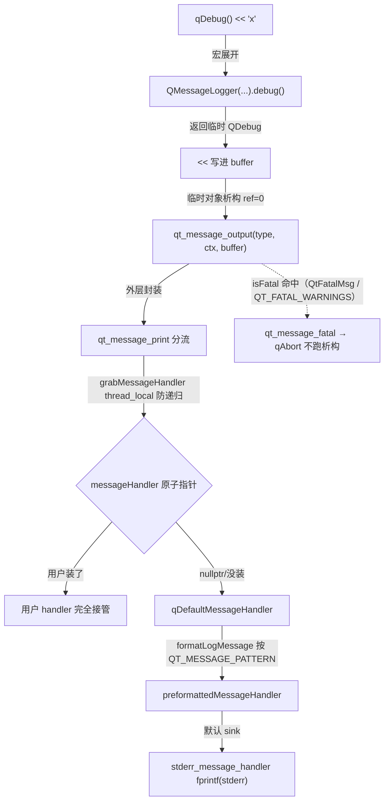

# qDebug 与 QLoggingCategory 源码拆解

## 前言：日志系统里几个想当然

Qt 的日志，入门咱们都会写，`qDebug() << "x"`、`qWarning() << "y"` 一打就出来了，编译是能过的，输出也是有的，您就当会用了。不过您往深里多问一句，这套东西就开始晃了。

笔者把当年自己答不上来的几个摆出来。您天天用的 `qDebug` 到底是函数还是宏？printf 风格的 `qDebug("x=%d", n)` 和流式的 `qDebug() << "x=" << n`，底下是怎么统一的呢？release 构建里的日志还带不带源码文件名和行号？好些人是以为带的，其实那可不一定。`qFatal` 调了之后，程序是 `exit()` 退出的还是 `abort()` 崩掉的，您那些全局析构还跑不跑？拿 `qInstallMessageHandler` 装上去的 handler，是包在默认输出外面的一层，还是直接把默认输出换掉了？最隐蔽的是 `QLoggingCategory` 的 debug 级别，您猜它默认是开着的还是关着的？

这些问题落在 Qt 日志系统的几根主轴上。宏展开的这一根，说的是 `qDebug` 其实是个宏，它展开的是 `QMessageLogger` 的成员函数指针取址。消息分发的这一根，真正分流的是 `qt_message_print`，`qt_message_output` 是带 fatal 检测的外层。输出接管的这一根，`qInstallMessageHandler` 是原子替换的，不搞什么 wrap 的。category 过滤的这一根，构造的时候默认全开，`defaultCategoryFilter` 才把 `qt.*` 关掉的。上下文丢失的这一根，release 默认丢的就是 file/line/function。这几根轴咱们一根一根地过。

入门篇的 [日志](../../beginner/01-qtbase/14-logging-beginner.md) 讲了 qDebug 和 QLoggingCategory 的用法，进阶篇的 [日志进阶](../../advanced/01-qtbase/14-logging-advanced.md) 补了自定义 handler 和分类的规则，本篇咱们往源码里走。要重点打开的是 `qlogging.h`、`qlogging.cpp` 和 `qloggingcategory.cpp` 这几个，咱们要看的是宏怎么展开、消息怎么流到 stderr，还有 category 的默认开关到底是啥。

边界咱们也划清楚。QDebug 流式的 `operator<<` 对各种类型（QString、QByteArray、容器）的格式化特化，本篇只讲到析构时输出 buffer 的机制层面，每个类型的 `<<` 重载咱们不展开。系统日志的 sink（macOS 的 AppleUnifiedLogger、Windows 的 Event Log、Android 的 Log）咱们只提一句，它们可能在半路就把消息接走了，各平台 sink 的实现不展开。具体的业务 category，`qt.network`、`qt.qml` 这些 Qt 内部分类不在本篇的范围里，咱们讲的是框架机制。

## 环境说明

本篇的源码引用都基于 `qt_src/qt6.9.1`，行号是会随 Qt 版本漂移的，您对照着读的时候，拿函数名去定位是最稳的办法，日志系统的关键文件咱们列在下面：

| 文件 | 角色 |
|---|---|
| `qtbase/src/corelib/global/qlogging.h` | qDebug/qWarning/qCritical/qFatal 宏 + QtMsgType + QMessageLogContext + qInstallMessageHandler 声明 |
| `qtbase/src/corelib/global/qlogging.cpp` | qt_message_print/qt_message_output/qDefaultMessageHandler/isFatal/qAbort 调用 + QMessagePattern |
| `qtbase/src/corelib/global/qassert.cpp` | qAbort 实现（Windows fastfail / 其他 std::abort） |
| `qtbase/src/corelib/io/qdebug.h` / `qdebug.cpp` | QDebug 流式 RAII |
| `qtbase/src/corelib/io/qloggingcategory.h` / `qloggingcategory.cpp` | QLoggingCategory + qCDebug 宏 + Q_LOGGING_CATEGORY |
| `qtbase/src/corelib/io/qloggingregistry.cpp` / `qloggingregistry_p.h` | defaultCategoryFilter + 4 套规则集 |

本篇没有配套的 example，原因和前几篇是一样的，它是纯源码的拆解，您对照着 `qt_src` 翻代码，这就是最好的实验了。

## 核心概念讲解

咱们动笔讲源码以前，把一条日志从 `qDebug() << "x"` 走到 stderr 的完整链路对一遍，下图能帮您看清中间都发生了什么：



整条链路是这样走的：`qDebug` 宏展开成 `QMessageLogger` 临时对象的成员函数指针取址，流式的 `<<` 把字符写进 buffer，临时对象析构的时候调的是 `qt_message_output`。在这里真正分流的是 `qt_message_print`，去的要么是用户 handler，要么是默认 handler，末了落到的是 stderr。fatal 消息走的则是 `qAbort` 的路子，咱们这一篇就顺着它往下拆。

### qDebug 是宏，展开成成员函数指针取址

头一个大的纠偏就落在 `qDebug` 身上：您平常是把它当函数用的，其实它是宏，宏定义的证据在 `qt_src/qt6.9.1/qtbase/src/corelib/global/qlogging.h:165-169`：

```cpp
#define qDebug QMessageLogger(QT_MESSAGELOG_FILE, QT_MESSAGELOG_LINE, QT_MESSAGELOG_FUNC).debug
#define qInfo QMessageLogger(QT_MESSAGELOG_FILE, QT_MESSAGELOG_LINE, QT_MESSAGELOG_FUNC).info
#define qWarning QMessageLogger(QT_MESSAGELOG_FILE, QT_MESSAGELOG_LINE, QT_MESSAGELOG_FUNC).warning
#define qCritical QMessageLogger(QT_MESSAGELOG_FILE, QT_MESSAGELOG_LINE, QT_MESSAGELOG_FUNC).critical
#define qFatal QMessageLogger(QT_MESSAGELOG_FILE, QT_MESSAGELOG_LINE, QT_MESSAGELOG_FUNC).fatal
```

您注意末尾的 `.debug`，它是没有括号的，取的是成员函数指针，而不是在调用函数。整个宏展开出来是这么回事：构造一个 `QMessageLogger` 的临时对象，取它的 `.debug` 成员函数指针。

那 printf 风格的调用是怎么一回事呢？您写 `qDebug("x=%d", n)`，宏展开以后变成的是 `QMessageLogger(...).debug("x=%d", n)`，`.debug` 这个成员函数指针后头跟的是参数列表，按 C++ 的语法，它等价的就是 `(QMessageLogger(...).debug)("x=%d", n)` 这一句，调的就是这个成员函数指针。所以两种风格底下是统一的，都落在 `QMessageLogger` 的身上，printf 风格调的是 `debug(const char *, ...)`，流式风格调的是无参的 `debug()`，它返回的是一个 `QDebug`。

`QMessageLogger` 构造的时候，把 `QT_MESSAGELOG_FILE`/`QT_MESSAGELOG_LINE`/`QT_MESSAGELOG_FUNC` 存进了上下文，这几个宏展开成的是什么，决定了您在 release 里还能不能看到源码的位置，这一层咱们放到 QMessageLogContext 一节细讲。临时对象要等整条表达式结束了才析构，这是后头 RAII 的根基。

您要是想把这几个宏整个关掉，有一组降级的开关可用，定义了它们就全变成空操作了，它的证据在 `qt_src/qt6.9.1/qtbase/src/corelib/global/qlogging.h:171-184`：

```cpp
#define QT_NO_QDEBUG_MACRO while (false) QMessageLogger().noDebug

#if defined(QT_NO_DEBUG_OUTPUT)
#  undef qDebug
#  define qDebug QT_NO_QDEBUG_MACRO
#endif
#if defined(QT_NO_INFO_OUTPUT)
#  undef qInfo
#  define qInfo QT_NO_QDEBUG_MACRO
#endif
#if defined(QT_NO_WARNING_OUTPUT)
#  undef qWarning
#  define qWarning QT_NO_QDEBUG_MACRO
#endif
```

您把 `QT_NO_DEBUG_OUTPUT` 这一类定义了以后，`qDebug` 就退化成 `while(false) QMessageLogger().noDebug` 了。循环体一次都不会跑的，这是 `while(false)` 给的保证，可 `qDebug() << "x"` 这样的流式写法还是能编译通过，`noDebug` 返回的是一个空壳。而 `qCritical` 和 `qFatal` 是没有对应降级开关的，它们是永远启用的，理由其实也简单，critical 跟 fatal 通常是不该被静音的。

还有个反直觉的点您可能没留意，`QtMsgType` 的枚举值是不按严重性大小排的，它的证据在 `qt_src/qt6.9.1/qtbase/src/corelib/global/qlogging.h:29-39`：

```cpp
enum QtMsgType {
    QtDebugMsg,
    QT7_ONLY(QtInfoMsg,)
    QtWarningMsg,
    QtCriticalMsg,
    QtFatalMsg,
    QT6_ONLY(QtInfoMsg,)
#if QT_DEPRECATED_SINCE(6, 7)
    QtSystemMsg Q_DECL_ENUMERATOR_DEPRECATED_X("Use QtCriticalMsg instead.") = QtCriticalMsg
#endif
};
```

到了 Qt6 里，`QtInfoMsg` 的数值排在 `QtFatalMsg` 的后头（`QT6_ONLY(QtInfoMsg,)` 在枚举的末尾，`QtSystemMsg` 前头的那个逗号是宏展开带出来的，您翻源码原文是看不到它的），所以它并不是按 `debug`、`info`、`warning`、`critical`、`fatal` 一路递增的。`defaultCategoryFilter` 的注释里也明写着 `numeric values are not in severity order`（`qt_src/qt6.9.1/qtbase/src/corelib/io/qloggingregistry.cpp:442-443`）。所以 `msgType >= QtWarningMsg` 这样的数值比较，您可别拿它判断严重程度，info 的数值比谁都大，全都会被当成严重的级别放过去的。

### 消息分发：qt_message_print 才是真正分流点

一条消息打 `QMessageLogger` 出来了以后，是怎么走到 stderr 的呢？这里头有个常见的误会，好些人把 `qt_message_output` 当成了最终的 stderr 出口，笔者当年也是这么以为的，翻开源码才发现不是的。

咱们看 `qt_message_output` 的样子，它的证据在 `qt_src/qt6.9.1/qtbase/src/corelib/global/qlogging.cpp:2155-2161`：

```cpp
void qt_message_output(QtMsgType msgType, const QMessageLogContext &context, const QString &message)
{
    QInternalMessageLogContext ctx(context);
    qt_message_print(msgType, ctx, message);
    if (isFatal(msgType))
        qt_message_fatal(msgType, ctx, message);
}
```

它只是个外层的封装，您看它里头调了 `qt_message_print` 去分流，跟着又查了 `isFatal`，该 abort 的就 abort。真正干活的是 `qt_message_print`，它的证据在 `qt_src/qt6.9.1/qtbase/src/corelib/global/qlogging.cpp:2096-2119`：

```cpp
static void qt_message_print(QtMsgType msgType, const QMessageLogContext &context, const QString &message)
{
    Q_TRACE(qt_message_print, msgType, context.category, context.function, context.file, context.line, message);

    // qDebug, qWarning, ... macros do not check whether category is enabled
    if (msgType != QtFatalMsg && isDefaultCategory(context.category)) {
        if (QLoggingCategory *defaultCategory = QLoggingCategory::defaultCategory()) {
            if (!defaultCategory->isEnabled(msgType))
                return;
        }
    }

    // prevent recursion in case the message handler generates messages
    // itself, e.g. by using Qt API
    if (grabMessageHandler()) {
        const auto ungrab = qScopeGuard([]{ ungrabMessageHandler(); });
        auto msgHandler = messageHandler.loadAcquire();
        (msgHandler ? msgHandler : qDefaultMessageHandler)(msgType, context, message);
    } else {
        stderr_message_handler(msgType, context, message);
    }
}
```

这一段的信息量不小，笔者一段一段地给您过。头一段是 default category 的过滤，`qDebug` 宏本身是不查 category 开关的（`qCDebug` 是查了的，宏里就带了判断的），所以源码在这里补了一道，消息要是归了 default category，而 default category 恰好把这个级别关了，那就直接 return 了，什么都不输出的。第二段是递归的保护，`grabMessageHandler()` 用的是 thread_local 的标志位，防的是 handler 内部又调 `qDebug` 造成的无限递归，真递归进来的时候它返回 false，日志就绕开 handler 直接走 `stderr_message_handler` 了。第三段才是 handler 的分流，`messageHandler` 指针是原子读出来的，不是空的就调它，为空的就调 `qDefaultMessageHandler` 了。

`grabMessageHandler` 的 thread_local 实现在 `qt_src/qt6.9.1/qtbase/src/corelib/global/qlogging.cpp:2077-2089`，咱们看一眼：

```cpp
Q_CONSTINIT static thread_local bool msgHandlerGrabbed = false;

static bool grabMessageHandler()
{
    if (msgHandlerGrabbed)
        return false;
    msgHandlerGrabbed = true;
    return true;
}

static void ungrabMessageHandler()
{
    msgHandlerGrabbed = false;
}
```

每个线程都有自己的一份 `msgHandlerGrabbed` 标志。同一个线程里 handler 内部又产生了日志，`grabMessageHandler` 一看标志已经立着了就返回 false，递归的日志就直接进 stderr 了，不会重入您的 handler。handler 里再怎么调 `qDebug` 都打不爆栈的，靠的就是它，不过您也要意识到另一面，handler 内部的日志是绕过了您自己的 handler 逻辑的，这正是风险一节里 handler 要简洁那一项的根源。

落到 stderr 的最后一跳是 `stderr_message_handler`，咱们把它的证据摆在 `qt_src/qt6.9.1/qtbase/src/corelib/global/qlogging.cpp:1993-2005`：

```cpp
static void stderr_message_handler(QtMsgType type, const QMessageLogContext &context,
                                   const QString &formattedMessage)
{
    Q_UNUSED(type);
    Q_UNUSED(context);
    if (formattedMessage.isNull())
        return;
    fprintf(stderr, "%s\n", formattedMessage.toLocal8Bit().constData());
    fflush(stderr);
}
```

做法是简单直接的，`fprintf(stderr, ...)` 加 `fflush` 就完事了。不过平台差异您要留心，macOS/iOS 走的是 AppleUnifiedLogger，Windows 走的是 win_message_handler，QNX 走的则是 slog2，这些系统自己的 sink 可能在 `qDefaultMessageHandler` 那一层就把消息截走了，不一定真落到 stderr 的。

### qFatal 走 qAbort，不跑析构

第二个大纠偏点轮到的是 `qFatal`。它调完了以后，程序是以什么方式退掉的呢？笔者当年以为是 `exit()`，翻开了源码一看，走的是 `abort()`。

咱们看 `isFatal`，它的证据在 `qt_src/qt6.9.1/qtbase/src/corelib/global/qlogging.cpp:203-219`：

```cpp
static bool isFatal(QtMsgType msgType)
{
    if (msgType == QtFatalMsg)
        return true;

    if (msgType == QtCriticalMsg) {
        static QAtomicInt fatalCriticals = checked_var_value("QT_FATAL_CRITICALS");
        return is_fatal_count_down(fatalCriticals);
    }

    if (msgType == QtWarningMsg || msgType == QtCriticalMsg) {
        static QAtomicInt fatalWarnings = checked_var_value("QT_FATAL_WARNINGS");
        return is_fatal_count_down(fatalWarnings);
    }

    return false;
}
```

`QtFatalMsg` 是永远算 fatal 的。`QtCriticalMsg` 的生杀是 `QT_FATAL_CRITICALS` 这个环境变量说了算的，其实是个倒数计数器，您设成 1，头一条 critical 就会 abort 的，设成 5 的话就攒到第 5 条。`QtWarningMsg` 是同理的，归 `QT_FATAL_WARNINGS` 管的。这俩开关在 CI 里是常用的，设个 `QT_FATAL_WARNINGS=1` 的话，任何 qWarning 都直接崩了，开发者就得把 warning 都修干净了。

fatal 判定命中了以后，调的是 `qt_message_fatal`，关键行的证据在 `qt_src/qt6.9.1/qtbase/src/corelib/global/qlogging.cpp:2121-2150`，咱们节选：

```cpp
template <typename String>
static void qt_message_fatal(QtMsgType, const QMessageLogContext &context, String &&message)
{
#if defined(Q_CC_MSVC_ONLY) && defined(QT_DEBUG) && defined(_DEBUG) && defined(_CRT_ERROR)
    ...  // MSVC debug 弹窗分支，让用户连调试器
#endif
    if constexpr (std::is_class_v<String> && !std::is_const_v<String>)
        message.clear();
    else
        Q_UNUSED(message);
    qAbort();
}
```

末了它调的是 `qAbort()`，它的实现在 `qt_src/qt6.9.1/qtbase/src/corelib/global/qassert.cpp:24-51` 里，咱们节选主干：

```cpp
Q_NORETURN void qAbort()
{
    // Windows 路径：优先 fastfail，TerminateProcess 兜底
    // 其他平台：std::abort()
}
```

您看 Windows 这边，MSVC 走的是 `__fastfail(FAST_FAIL_FATAL_APP_EXIT)`，MinGW 走的是 `RaiseFailFastException`，这俩路都会生成 Windows 错误报告（WER）的崩溃转储，再往后还留着 `TerminateProcess(GetCurrentProcess(), STATUS_FATAL_APP_EXIT)` 来兜底的。其余的平台走的是 `std::abort()`，给进程发的是 SIGABRT。

要紧的地方您得看这儿，这俩路径都不跑全局析构的。`std::abort()` 不调 atexit 注册的函数，静态对象的析构也不跑，而 `TerminateProcess` 是把进程整个杀掉的。所以 `qFatal` 一走，QObject 的对象树没人清理，`QCoreApplication::aboutToQuit` 信号也发不出来了，析构函数是一个都轮不上的。这跟 `exit()` 是两码事的，`exit()` 会把 atexit 和静态析构老老实实跑完的。您的清理逻辑要是写在析构里（刷盘、保存状态这些），`qFatal` 的路子是不会给您机会的，这一点您得有预期的。

### qInstallMessageHandler：直接替换，不 wrap

第三个大纠偏点轮到的是 `qInstallMessageHandler`。它装上去的 handler，是包在默认输出外面的一层，还是直接把默认输出给换掉了？笔者见过不少教程讲的是包了一层，函数本体的证据就摆在下面的 `qt_src/qt6.9.1/qtbase/src/corelib/global/qlogging.cpp:2357-2364` 里：

```cpp
QtMessageHandler qInstallMessageHandler(QtMessageHandler h)
{
    const auto old = messageHandler.fetchAndStoreOrdered(h);
    if (old)
        return old;
    else
        return qDefaultMessageHandler;
}
```

里头调用的 `fetchAndStoreOrdered(h)` 是个原子操作，它把 `messageHandler` 这个全局指针直接换成您传的 `h`，旧值作为返回值交回来了，这里头是没有任何 wrap 层的。这也就是说您的 handler 一装上，输出就完全归它管了，`qDefaultMessageHandler` 不会再被调的，除非您自己在 handler 里手动去调它。

返回的是上一个 handler。您要是从来没装过，拿到的就是 `qDefaultMessageHandler`，而不是 nullptr，装过的话，拿到的就是您上回装的那个。这个返回值是留给您做链式调用和恢复用的，想 wrap 的话，您自己把返回值存好，在新 handler 里由您决定要不要调它。

您想把默认的行为装回去的话，传 nullptr 就行了：

```cpp
qInstallMessageHandler(nullptr);
```

您传 nullptr 的话，`qInstallMessageHandler` 内部走的就是 `fetchAndStoreOrdered(nullptr)` 这一句，全局指针就被清空了，回头 `qt_message_print` 里那句 `msgHandler ? msgHandler : qDefaultMessageHandler` 一看指针是空的，就回退到 `qDefaultMessageHandler` 了。所以传 nullptr 恢复是安全的，而不是什么未定义行为。

您再看 `messageHandler` 这个全局指针，它本身是个原子的，它的证据在 `qt_src/qt6.9.1/qtbase/src/corelib/global/qlogging.cpp:1748`：

```cpp
Q_CONSTINIT static QBasicAtomicPointer<void (QtMsgType, const QMessageLogContext &, const QString &)> messageHandler = Q_BASIC_ATOMIC_INITIALIZER(nullptr);
```

它的初始值是 nullptr，语义就是用默认的。多线程里一边 qDebug 一边 qInstallMessageHandler 是安全的，安装是原子的读改写，读取是原子的 load。不过您 handler 内部的同步得自己做，因为 handler 是在产生消息的那个线程里被调的，而不一定是主线程。

### QMessageLogContext：release 默认丢源码位置

第四个大纠偏点就落在 `QMessageLogContext` 上了。日志里能不能看到消息是来自哪个文件、第几行的？笔者起初以为 release 也是带的，结果日志一看就傻眼了，这件事是取决于编译开关的，默认的 release 是看不到的。

它是个 POD 这没错了，字段的证据在 `qt_src/qt6.9.1/qtbase/src/corelib/global/qlogging.h:42-62`，咱们节选：

```cpp
class QMessageLogContext
{
    ...
    int version = CurrentVersion;
    int line = 0;
    const char *file = nullptr;
    const char *function = nullptr;
    const char *category = nullptr;
    ...
};
```

咱们把它的字段摆出来一共是五个，就是 `version`、`line`、`file`、`function`、`category` 了。前四个字段能不能填上值的事，就看编译开关了，它的证据在 `qt_src/qt6.9.1/qtbase/src/corelib/global/qlogging.h:147-163`：

```cpp
#if !defined(QT_MESSAGELOGCONTEXT) && !defined(QT_NO_MESSAGELOGCONTEXT)
#  if defined(QT_NO_DEBUG)
#    define QT_NO_MESSAGELOGCONTEXT
#  else
#    define QT_MESSAGELOGCONTEXT
#  endif
#endif

#ifdef QT_MESSAGELOGCONTEXT
  #define QT_MESSAGELOG_FILE static_cast<const char *>(__FILE__)
  #define QT_MESSAGELOG_LINE __LINE__
  #define QT_MESSAGELOG_FUNC static_cast<const char *>(Q_FUNC_INFO)
#else
  #define QT_MESSAGELOG_FILE nullptr
  #define QT_MESSAGELOG_LINE 0
  #define QT_MESSAGELOG_FUNC nullptr
#endif
```

这里的逻辑咱们理一下。默认的情况下，您既没显式定义 `QT_MESSAGELOGCONTEXT` 也没定义过 `QT_NO_MESSAGELOGCONTEXT`，那就由 `QT_NO_DEBUG` 说了算了，release 构建就会自动把 `QT_NO_MESSAGELOGCONTEXT` 定义出来了，于是 `QT_MESSAGELOG_FILE/LINE/FUNC` 三个全成了 nullptr 和 0。也就是说默认 release 构建的日志，文件名、行号、函数名全是空的，您在日志里是看不到源码位置的。

想保留的话，您得在编译时定义 `QT_MESSAGELOGCONTEXT`。注意这是编译时的事，不是运行时的事，这几个宏决定的是 `__FILE__`、`__LINE__` 这些值有没有被填进 `QMessageLogger` 的构造参数。release 默认把它关了，为的是省二进制的体积，每条日志都带源码字符串的话，体积是挺可观的。

您再看 category 字段，它不受这套开关的影响，来自 `QMessageLogger` 的构造参数，缺省的名字是 `qtDefaultCategoryName`，它的值就是 “default”。

### QDebug 流式：RAII，析构输出

`qDebug() << "x"` 这样的流式写法，底下站着的是 `QDebug` 类，它内里有个 `Stream` 的结构，字段的证据在 `qt_src/qt6.9.1/qtbase/src/corelib/io/qdebug.h:53-79`，咱们节选核心：

```cpp
struct Stream {
    explicit Stream(QtMsgType t)
        : ts(&buffer, WriteOnly),
          type(t),
          message_output(true)
    {}
    QTextStream ts;
    QString buffer;
    int ref = 1;
    QtMsgType type = QtDebugMsg;
    bool space = true;
    bool noQuotes = false;
    bool message_output = false;
    int verbosity = DefaultVerbosity;
    QMessageLogContext context;
} *stream;
```

咱们把字段过一遍，`QTextStream ts` 是把字符写进 `buffer` 的，引用计数是 `ref` 在管的，拷贝共享靠的就是它，`message_output` 是输出与否的开关，`context` 存的是源码的上下文。`qDebug() << "x"` 展开成的是 `QMessageLogger(...).debug()`（无参版），返回的是一个临时的 `QDebug` 对象，所有的 `<<` 都通过 `QTextStream` 写进 `buffer`，真正的输出要等到临时对象析构，析构的证据在 `qt_src/qt6.9.1/qtbase/src/corelib/io/qdebug.cpp:155-168`：

```cpp
QDebug::~QDebug()
{
    if (stream && !--stream->ref) {
        if (stream->space && stream->buffer.endsWith(u' '))
            stream->buffer.chop(1);
        if (stream->message_output) {
            QInternalMessageLogContext ctxt(stream->context);
            qt_message_output(stream->type,
                              ctxt,
                              stream->buffer);
        }
        delete stream;
    }
}
```

您看析构的时候，`ref` 减掉了一，减到了 0 才真正干活。头一件事是把 buffer 末尾的空格砍掉，`space()` 在每个 `<<` 后头都塞了一个空格的，末尾那个是多余的。跟着查的是 `message_output`，它是 true 才调 `qt_message_output` 的。

`message_output` 这个开关的用处这就来了。`QMessageLogger::debug(cat)` 是带 category 的版本，category 要是把 debug 关了，它就把 `message_output` 置成 false 了，它的证据在 `qt_src/qt6.9.1/qtbase/src/corelib/global/qlogging.cpp:494-505`，咱们节选：

```cpp
QDebug QMessageLogger::debug(const QLoggingCategory &cat) const
{
    QDebug dbg = QDebug(QtDebugMsg);
    if (!cat.isDebugEnabled())
        dbg.stream->message_output = false;
    ...
    return dbg;
}
```

这样 `<<` 链还是照常编译执行的，buffer 该写还是写了，可析构的时候一看开关是 false，就不输出了，整条日志就这么被静默吞掉了。这是 `qCDebug` 流式版本关了零开销的实现之一，另一层是宏级的编译期短路，咱们放到末尾的 qCDebug 一节细讲。

### QLoggingCategory 默认全开，是 filter 关掉了 qt.*

本篇最反直觉的一个点在这里。好些人以为 `QLoggingCategory` 的 debug 级别默认是关着的，毕竟生产环境不该刷 debug 日志嘛。笔者翻源码看到的答案正相反，构造的时候默认是全开的。

咱们看构造函数，它的证据在 `qt_src/qt6.9.1/qtbase/src/corelib/io/qloggingcategory.cpp:172-185`：

```cpp
QLoggingCategory::QLoggingCategory(const char *category, QtMsgType enableForLevel)
    : d(nullptr),
      name(nullptr)
{
    enabled.storeRelaxed(0x01010101);   // enabledDebug = enabledWarning = enabledCritical = true;

    if (category)
        name = category;
    else
        name = qtDefaultCategoryName;

    if (QLoggingRegistry *reg = QLoggingRegistry::instance())
        reg->registerCategory(this, enableForLevel);
}
```

咱们看构造函数的头一行，写的是 `enabled.storeRelaxed(0x01010101)`，把一个 int 存成了 `0x01010101`。这个 int 和四个原子 bool 是共享同一块内存的，`QLoggingCategory` 的私有部分是个 union，一边摆的是四个 `QBasicAtomicInteger<bool>`，一边装的是整个 int，这样的布局头文件里写着呢（`qt_src/qt6.9.1/qtbase/src/corelib/io/qloggingcategory.h:43-53`）。`0x01010101` 是四个字节拼的，每个字节里的值都是 `0x01`，最低的位置全是 1，按小端一个字节对一个 bool 地解下来，四个 bool 全是 true 的，debug、warning、critical、info 就都开着了。

您再注意源码里那行注释，它只列了三个名字，`enabledInfo` 是漏掉的。可代码里的 `0x01010101` 是实打实把 info 也开了的，第 4 个字节同样是 `0x01` 的。这是注释和行为对不上的一处小笔误，笔者翻到这儿的时候愣了一下，实际的行为就是四个全开。

构造完立刻调的是 `registerCategory`，跟着调的就是 `defaultCategoryFilter`，默认值就是它给覆盖的，它的证据在 `qt_src/qt6.9.1/qtbase/src/corelib/io/qloggingregistry.cpp:436-489`，咱们节选：

```cpp
void QLoggingRegistry::defaultCategoryFilter(QLoggingCategory *cat)
{
    const QLoggingRegistry *reg = QLoggingRegistry::instance();
    QtMsgType enableForLevel = reg->categories.value(cat);

    // NB: note that the numeric values of the Qt*Msg constants are
    //     not in severity order.
    bool debug = (enableForLevel == QtDebugMsg);
    bool info = debug || (enableForLevel == QtInfoMsg);
    bool warning = info || (enableForLevel == QtWarningMsg);
    bool critical = warning || (enableForLevel == QtCriticalMsg);

    // hard-wired implementation of
    //   qt.*.debug=false
    //   qt.debug=false
    if (const char *categoryName = cat->categoryName()) {
        if (strcmp(categoryName, "qt") == 0) {
            debug = false;
        } else if (strncmp(categoryName, "qt.", 3) == 0) {
            auto it = reg->qtCategoryEnvironmentOverrides.find(categoryName);
            if (it == reg->qtCategoryEnvironmentOverrides.end())
                debug = false;
            else
                debug = qEnvironmentVariableIntValue(it->second);
        }
    }
    ...
    cat->setEnabled(QtDebugMsg, debug);
    ...
}
```

咱们分三步看。头一步是拿 `enableForLevel`（默认为 `QtDebugMsg`）来算起始值的，默认的 debug 是 true，往下的 info、warning、critical 也都是 true，全开的。第二步是硬编码的，名字恰好是 `"qt"`、或者以 `"qt."` 打头的 category，debug 直接就被关掉了，您注意这是源码里硬编码的，不是哪条 .ini 规则给的。`qt.*` 这一类倒是有回旋的余地，环境变量是可以把它改回来的，`qtCategoryEnvironmentOverrides` 存的就是这个映射。第三步是四套规则集依次地覆盖，咱们放到规则系统一节细讲。

所以用户自定义的 category（不带 `qt.` 前缀的），debug 默认就是全开的。您写一个 `QLoggingCategory("myapp.network")`，它的 debug 默认是开的，`qCDebug(myapp_network)` 是会真的往外输出的。好些人拿着 debug 默认是关的这个印象，放心大胆地到处 qCDebug，结果生产环境里日志全被刷爆了，这就是根子了。想把它们关掉的话，就得显式地设规则了。

### 规则系统：4 源加载，4 通配模式

`defaultCategoryFilter` 第三步那四套规则集是从哪来的？笔者一开始以为是单一的 ini 文件，翻源码才发现 `initializeRules` 自动加载了四个来源，它的证据在 `qt_src/qt6.9.1/qtbase/src/corelib/io/qloggingregistry.cpp:278-326`，咱们节选：

```cpp
void QLoggingRegistry::initializeRules()
{
    QList<QLoggingRule> er, qr, cr;
    // ① QT_LOGGING_CONF env（指向 .ini 文件）
    if (QString rulesFilePath = qEnvironmentVariable("QT_LOGGING_CONF"); !rulesFilePath.isEmpty())
        er = loadRulesFromFile(rulesFilePath);

    // ② QT_LOGGING_RULES env（分号串，转 \n 复用 parser）
    const QByteArray rulesSrc = qgetenv("QT_LOGGING_RULES").replace(';', '\n');
    if (!rulesSrc.isEmpty()) {
        ...
        er += parser.rules();
    }

    const QString configFileName = u"QtProject/qtlogging.ini"_s;

    // ③ QLibraryInfo DataPath 的 qtlogging.ini
    qr = loadRulesFromFile(QLibraryInfo::path(QLibraryInfo::DataPath) + baseConfigFileName);

    // ④ QStandardPaths GenericConfigLocation 的 qtlogging.ini
    const QString envPath = QStandardPaths::locate(QStandardPaths::GenericConfigLocation, configFileName);
    if (!envPath.isEmpty())
        cr = loadRulesFromFile(envPath);
    ...
    ruleSets[EnvironmentRules] = std::move(er);
    ruleSets[QtConfigRules] = std::move(qr);
    ruleSets[ConfigRules] = std::move(cr);
}
```

四个自动的来源咱们挨个数：头一个是 `QT_LOGGING_CONF` 环境变量指向的文件，再一个就是 `QT_LOGGING_RULES` 环境变量了，值是分号分隔的规则串（`driver.usb.debug=true;foo.warning=false` 这个样子的），再一个是 Qt 安装目录下的 qtlogging.ini，末一个是用户配置目录的 `QtProject/qtlogging.ini`，Linux 上落的是 `~/.config/`，macOS 的在 `~/Library/Preferences/`，Windows 的则是 `%APPDATA%`。还有一个入口是不在自动加载链里的，那就是用户代码调 `QLoggingCategory::setFilterRules()` 触发的 API 规则。

覆盖的次序是按 enum 的定义排的，这个 `RuleSet` 枚举的证据在 `qt_src/qt6.9.1/qtbase/src/corelib/io/qloggingregistry_p.h:124-131`，`QtConfigRules` 是打头的，跟着的是 `ConfigRules`、`ApiRules`，`EnvironmentRules` 排在末尾的位置，排在后头的说话算数，后者覆盖的是前者。所以 `QT_LOGGING_RULES` 是末了一道，您调试的时候临时压一层环境变量，任何配置文件里的规则都压不过它的。

规则的模样是 `category.type=true/false` 这样的，type 是由末尾的后缀决定的，它的证据在 `qt_src/qt6.9.1/qtbase/src/corelib/io/qloggingregistry.cpp:95-133`，咱们节选：

```cpp
void QLoggingRule::parse(QStringView pattern)
{
    QStringView p;
    if (pattern.endsWith(".debug"_L1)) {
        p = pattern.chopped(6);
        messageType = QtDebugMsg;
    } else if (pattern.endsWith(".info"_L1)) {
        ...
    } else {
        p = pattern;
    }
    ...
}
```

您看 `driver.usb.debug=true`，它匹配的是 `driver.usb` 这个 category 的 debug 级别。不带后缀的 `driver.usb=false` 是 `messageType=-1`，所有的级别都归它管，一写就是整类全关的。category 的名字还支持通配，模式一共是有四种的，匹配的逻辑在 `qt_src/qt6.9.1/qtbase/src/corelib/io/qloggingregistry.cpp:54-84` 的 `pass` 里：

```cpp
int QLoggingRule::pass(QLatin1StringView cat, QtMsgType msgType) const
{
    ...
    if (flags == FullText) {
        if (category == cat)
            return (enabled ? 1 : -1);
        ...
    }
    const qsizetype idx = cat.indexOf(category);
    if (idx >= 0) {
        if (flags == MidFilter) {
            return (enabled ? 1 : -1);
        } else if (flags == LeftFilter) {
            if (idx == 0)
                return (enabled ? 1 : -1);
        } else if (flags == RightFilter) {
            if (idx == (cat.size() - category.size()))
                return (enabled ? 1 : -1);
        }
    }
    return 0;
}
```

四种模式咱们挨个看，FullText 管的是精确匹配，LeftFilter 管的是 `*` 结尾的前缀匹配，RightFilter 管的是 `*` 开头的后缀匹配，MidFilter 管的是首尾都有 `*` 的包含匹配。中间带 `*` 的（`a.*.b` 这样）是不支持的，flags 就被清空了，什么都匹配不上的。`pass` 的返回值是 +1 开、-1 关、0 不匹配的。

### qCDebug 编译期短路、函数式定义与消息格式

末了咱们补几个点。头一个是 `qCDebug` 宏的编译期短路，这个设计是挺巧妙的，它的证据在 `qt_src/qt6.9.1/qtbase/src/corelib/io/qloggingcategory.h:153-161`：

```cpp
#define QT_MESSAGE_LOGGER_COMMON(category, level) \
    for (QLoggingCategoryMacroHolder<level> qt_category((category)()); qt_category; qt_category.control = false) \
        QMessageLogger(QT_MESSAGELOG_FILE, QT_MESSAGELOG_LINE, QT_MESSAGELOG_FUNC, qt_category.name())

#define qCDebug(category, ...) QT_MESSAGE_LOGGER_COMMON(category, QtDebugMsg).debug(__VA_ARGS__)
```

您看它是个 for 循环套 `QLoggingCategoryMacroHolder` 的写法。Holder 的 `operator bool()` 返回的是 `Q_UNLIKELY(control)`，category 要是关着的话，for 的循环体一次都进不去的，整条 `qCDebug(...)` 的参数构造、`QMessageLogger` 临时对象，全都无从发生了。这比 QDebug 析构一节讲的 `message_output=false` 还要彻底，那个好歹还构造了 QDebug 去写 buffer，这个是连 `QMessageLogger` 都不构造的。`Q_UNLIKELY` 是给分支预测器的提示，意思是日志多半是关着的，真开了就让它走 fast path。

第二个点是 `Q_DECLARE_LOGGING_CATEGORY`/`Q_LOGGING_CATEGORY` 在 Qt 6.9 的一个重要变化，它们从全局变量改成了函数返回引用的样式，它的证据在 `qt_src/qt6.9.1/qtbase/src/corelib/io/qloggingcategory.h:104-151`，咱们节选：

```cpp
#define QT_DECLARE_EXPORTED_QT_LOGGING_CATEGORY(name, export_macro) \
    inline namespace QtPrivateLogging { export_macro const QLoggingCategory &name(); }

#define Q_LOGGING_CATEGORY_IMPL(name, ...) \
    const QLoggingCategory &name() \
    { \
        static const QLoggingCategory category(__VA_ARGS__); \
        return category; \
    }
```

咱们在 cpp 里用 `Q_LOGGING_CATEGORY` 定义的时候，展开出来的是一个返回引用的函数，函数的内部是一个 `static const QLoggingCategory` 的局部变量，这是 Meyers singleton 的写法，C++11 起初始化就是线程安全的。老写法是直接定义全局变量的，不同编译单元的全局变量谁也没法保证初始化在谁前头，这是静态初始化顺序的问题（static init order fiasco），函数返回引用的写法就避开了它。

有个细节笔者要替您澄清一下。`Q_DECLARE_LOGGING_CATEGORY` 和 `Q_LOGGING_CATEGORY` 在源码里是按 `QT_BUILDING_QT` 分成两支的：头一支是给 Qt 内部构建用的，谁要是在 cpp 里用 `Q_LOGGING_CATEGORY` 定义了分类、头文件里却没有配套的声明，编译给出的就是一条弃用警告，它的原文是 `Use Q_STATIC_LOGGING_CATEGORY or add either Q_DECLARE_LOGGING_CATEGORY or QT_DECLARE_EXPORTED_QT_LOGGING_CATEGORY in a header`，不过它只对 `QT_BUILDING_QT` 有效。您用户代码走的是 `#else` 分支，展开出来就是返回引用的函数，弃用警告碰不到您，正常的使用是不受影响的。

末一个点是消息的格式，默认的 pattern 在 `setDefaultPattern` 里，它的证据在 `qt_src/qt6.9.1/qtbase/src/corelib/global/qlogging.cpp:1138-1160`，咱们节选：

```cpp
void setDefaultPattern()
{
    const char *const defaultTokens[] = {
#ifndef Q_OS_ANDROID
        // "%{if-category}%{category}: %{endif}%{message}"
        ifCategoryTokenC,
        categoryTokenC,
        ": ",
        endifTokenC,
#endif
        messageTokenC,
    };
    ...
}
```

默认的 pattern 是 `%{if-category}%{category}: %{endif}%{message}`，有 category 的消息就带 `categoryName: ` 这样的前缀，没有就是裸消息了。`qDebug()` 走的是 default category，被 `if-category` 跳了过去，所以默认的输出就是一条裸消息，`qCDebug(cat)` 才带 `cat: ` 的前缀。您想带时间戳、类型、线程的话，设环境变量 `QT_MESSAGE_PATTERN="%{time yyyy-MM-dd hh:mm:ss.zzz} [%{type}] [%{category}] %{message}"` 就行了。支持的占位符咱们数一数，`category`、`type`、`message`、`file`、`line`、`function`、`pid`、`appname`、`threadid`（OS 的线程号）、`qthreadptr`（QThread* 的指针值）、`time`、`backtrace`，末了连 `if-*`/`endif` 这一对也是有的，一整套都在里头了。

## 风险与故障预防

本篇讲的风险都是从源码里能直接对上号的，笔者自己也真栽过，这里咱们把后果和解法一个个交代清楚。

头一类风险是 release 构建丢源码的位置。您在 release 里调 `qDebug() << "here"`，指望的是日志带上文件名行号好定位，结果日志里就剩一个裸消息 “here” 了，到底是哪一行打的完全看不出来。您八成会以为是 message handler 没配好，pattern 折腾了半天，其实是编译开关把源码信息丢了。根因是 QMessageLogContext 一节理出来的宏链，release 一打开 `QT_NO_DEBUG` 的话，`QT_NO_MESSAGELOGCONTEXT` 就跟着来了，`QT_MESSAGELOG_FILE/LINE/FUNC` 全成了 nullptr 和 0。这是编译期就定死的事，运行时您怎么配 QT_MESSAGE_PATTERN 都补不回来，值是根本没存进 `QMessageLogger` 的。正确的做法是编译时定义 `QT_MESSAGELOGCONTEXT`，qmake 的话加 `DEFINES += QT_MESSAGELOGCONTEXT`，CMake 的话就加 `add_compile_definitions(QT_MESSAGELOGCONTEXT)`。代价您也要心里有数，每条日志都存源码的字符串，二进制体积是会涨的，您按需开就是了。

第二类风险出在 `qInstallMessageHandler` 的语义上，它是直接替换不 wrap 的，重装了就要丢链的。您第一次 `qInstallMessageHandler(myHandler1)`，后来想再叠一层（比如给所有的日志统一加个前缀），又装了 `myHandler2`。您装的 `myHandler2` 要是没调过 `myHandler1`，那 `myHandler1` 的逻辑就整个丢了，因为 install 干的是直接替换，不是叠加的。更糟的是您没存第一次的返回值，`myHandler1` 从此就找不回来了。根因是 qInstallMessageHandler 一节讲的 `fetchAndStoreOrdered`，它就是直接换指针的，并没有什么 wrap 层的。正确的做法是每次 install 都把返回值存下来，要叠加的话，就在新 handler 里手动地调旧的：

```cpp
static QtMessageHandler g_oldHandler = nullptr;
void myHandler(QtMsgType t, const QMessageLogContext &c, const QString &m) {
    // 加前缀、转发
    if (g_oldHandler) g_oldHandler(t, c, "[prefix] " + m);
}
g_oldHandler = qInstallMessageHandler(myHandler);
```

您要恢复的话，`qInstallMessageHandler(g_oldHandler)` 或者 `qInstallMessageHandler(nullptr)` 都行的。

第三类风险是自定义 category 的 debug 默认开着，生产要刷屏的。您照着教程建了 `Q_LOGGING_CATEGORY(myCat, "myapp.network")`，开发的时候到处 `qCDebug(myCat) << "packet"` 看流量，心里想的是 debug 默认关、生产不会输出。上了生产才发现日志全被 network packet 刷爆了，自定义 category 的 debug 默认就是开的。根因是 QLoggingCategory 一节讲的，构造默认就是 `0x01010101` 全开的，`defaultCategoryFilter` 只硬编码关了 `qt` 和 `qt.` 前缀，您不带 `qt.` 的 category 是一概全开的。正确的做法是上生产以前就显式地关掉，设环境变量 `QT_LOGGING_RULES="myapp.*.debug=false"`、写进 qtlogging.ini、调 `QLoggingCategory::setFilterRules({"myapp.*.debug=false"})` 三条路都是通的。debug 默认是关的这个印象，您就当它不存在了。

第四类风险是 handler 在产生消息的线程里跑，handler 里做不了 UI 的操作。您装了个 message handler，里头对 qWarning 弹的是 `QMessageBox`。子线程里冒出了一条 qWarning，handler 就在子线程里跑起来了，`QMessageBox::warning` 是在非主线程里动 widget 的，程序要么就崩了，要么 UI 就错乱了。根因是消息分发一节讲的，`grabMessageHandler` 是 thread_local 的，handler 永远是在产生消息的那个线程里被调的，子线程里的一条 qDebug，handler 就跟着在子线程跑了。正确的做法是 handler 里只做线程安全的操作（写文件、发信号这些），要弹框、要更新 UI 的话，就由您拿 `QMetaObject::invokeMethod(widget, ..., Qt::QueuedConnection)` 把操作投递回主线程。还有一层您也要有数，handler 是要写得简洁的，handler 内部再 qDebug 是不会重入您的 handler 的，thread_local 保护让它直接进了 stderr，可您想在自己日志里记的那些内部日志，也就这么丢了。

## 练习项目

本篇和前几篇是一样的，走的是纯源码拆解的路子，练习走的也就是验证的路子，四道题给的是方向和验证的手段，完整的工程留给您自己搭。

头一道题验的是 `QtMsgType` 的数值次序。您写个小程序，把五个枚举值的整数挨个打出来，您会看到 Qt6 里 `QtInfoMsg` 排在枚举的末尾，它的数值比 `QtFatalMsg` 还大。跟着您再写一句 `if (QtInfoMsg >= QtWarningMsg)`，这个判断是真的成立的，info 就这样被当成了严重的级别放过去。对照组您拿的可以是 `defaultCategoryFilter` 注释里那句 “numeric values are not in severity order”，对上了它，`QtMsgType` 那个反直觉点您就眼见为实了。

第二道题验的是 release 丢源码位置。您写个最简的程序打一条 `qDebug() << "here"`，debug 构建跑了遍，文件名、行号、函数名都在的。换成 release 的构建再跑一遍，跑出来就剩裸消息了。跟着您给 release 加上 `add_compile_definitions(QT_MESSAGELOGCONTEXT)` 重编一遍，源码的位置就回来了。这正好把 QMessageLogContext 一节的宏链从头到尾走了一遍，代价就是二进制会变大的，您 `ls -lh` 比一下就有数了。

第三道题验的是自定义 category 的默认开关和规则的匹配。您建一个 `Q_LOGGING_CATEGORY(myCat, "myapp.test")`，什么规则都不设的情况下，`qCDebug(myCat) << "hello"` 是真的会输出的。然后您设 `QT_LOGGING_RULES="myapp.*.debug=false"` 再跑一次的话，就没有了。再换成精确的 `myapp.test.debug=false`，照样是关的。通配 `*` 结尾是按前缀匹配的，这是规则系统一节 `pass` 里 LeftFilter 的语义，两轮下来您就都对上了。

第四道题咱们回源码里做核对，要对的四件事都在前文的行号里。头一件是 `qlogging.h:165-169` 里 `qDebug` 宏末尾的 `.debug`，它是没有括号的。再一件要核对的是 `qlogging.cpp:2357-2364`，`qInstallMessageHandler` 的本体就是一句 `fetchAndStoreOrdered`。还有一件要看的是 `qloggingcategory.cpp:176`，那里的 `storeRelaxed` 存的值是 `0x01010101`。末一件要看的是 `qloggingregistry_p.h:124-131`，RuleSet 枚举的排列是 `QtConfigRules`、`ConfigRules`、`ApiRules`、`EnvironmentRules`。四处都对上了，本篇的断言也就落了地。

## 官方文档参考链接

- [qDebug/qWarning/qCritical/qFatal](https://doc.qt.io/qt-6/qtlogging.html) —— 宏定义的入口，咱们在 qDebug 是宏一节拆的就是它们的展开。
- [QLoggingCategory Class](https://doc.qt.io/qt-6/qloggingcategory.html) —— 类参考的入口，Q_LOGGING_CATEGORY、setFilterRules 您在这一页都能查到。
- [qInstallMessageHandler](https://doc.qt.io/qt-6/qtlogging.html#qInstallMessageHandler) —— 替换语义的说明，官方的说法跟咱们看到的 `fetchAndStoreOrdered` 是对得上的。
- [QLoggingCategory::setFilterRules](https://doc.qt.io/qt-6/qloggingcategory.html#setFilterRules) —— 运行时改规则的 API，您可以在练习里拿它跟环境变量对照。
- [QT_MESSAGE_PATTERN](https://doc.qt.io/qt-6/qtlogging.html#qInstallMessageHandler-1) —— 占位符的全集，pattern 怎么配咱们查这一页。
- [Logging Rules](https://doc.qt.io/qt-6/qloggingcategory.html#logging-rules) —— 规则语法的说明，您拿它跟规则系统一节对着看。

---

Qt 的日志系统，设计上走的是宏、RAII、原子替换这几样的组合，输出一条消息的活儿它干得又省又好接管，关了是连对象都不构造的零开销，接管靠的就是一次原子替换。您回头看 `qDebug` 这个貌不惊人的宏，底下垫着的是一整套东西，`QMessageLogger` 临时对象、成员函数指针取址、`QDebug` 的流式 buffer，输出是在析构时发的，在中间分流的是 `qt_message_print`，递归是 thread_local 挡着的，handler 指针是原子的。category 系统又在外面叠了一层过滤，构造的时候全开，filter 是来覆盖的，再挂上的是四套规则。平时这些机制您都感觉不到，qDebug 一打它就输出、handler 一装它就接管的，百分之九十九的场景都是顺的。可剩下那百分之一出毛病的时候（release 丢了源码位置、installMessageHandler 不 wrap、自定义 category 刷屏、handler 在子线程跑），就得靠懂源码才找得着方向了。这一篇读完了，日志的行为要是再诡异起来，您该知道往哪儿查了。

您要是想把本篇的行号证据拿来一一核对，它们已经按源码机制归类收在 [code-index · qDebug 与 QLoggingCategory 源码索引](../code-index/qtbase/qlogging.md) 底下了，您带着行号直接去 `qt_src/qt6.9.1` 翻原文就行。
