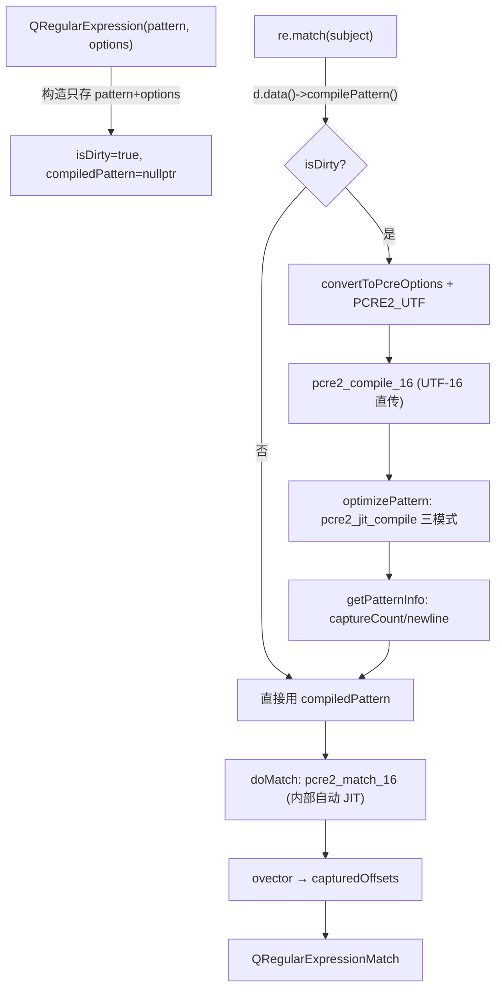

# QRegularExpression 封装 PCRE2 源码拆解

## 前言：正则引擎底下几个想当然

正则的替换，Qt5 起就定下来了，`QRegularExpression` 接了 `QRegExp` 的班，底下垫的是 PCRE2 库。用起来的样子大伙都熟：`QRegularExpression re("(\\d+)")` 这么构造、`re.match(str)` 这么调的，结果也就回来了。不过您往深里多问一句，这套封装就开始晃了。

笔者把当年自己答不上来的几个摆出来。`new QRegularExpression("pattern")` 这一句执行完了，pattern 是当场就编译了，还是等头一次 match 才编译？咱们都知道 `QString` 是 UTF-16，传给 PCRE2 的时候，Qt 是转成了 UTF-8，还是直接把 UTF-16 喂了进去？您再看 `PatternOption` 那些枚举值，跟 PCRE2 自己的 `PCRE2_CASELESS` 之类，数值对得上号吗？JIT 加速要不要咱们手动开？问得最隐蔽的一个，是 Qt 匹配的时候调的是 `pcre2_match` 还是 `pcre2_jit_match`？同一个 `QRegularExpression` 对象被多个线程并发地 match，安全吗？

这些问题落在 `QRegularExpression` 设计的几根主轴上。懒编译的这一根，说的是构造的时候只把 pattern 存下来，头一次真正 match 了才编译。16 位宽接口的这一根，UTF-16 是直接喂给 PCRE2 的，中间是不转 UTF-8 的。选项映射的这一根，Qt 的枚举值跟 PCRE2 自己那套对不上数，中间要经过一个映射函数的转换。JIT 的这一根，Release 构建编译 pattern 的时候 JIT 就一并做完了，不用您管。匹配入口的这一根，Qt 调的是 `pcre2_match_16`，走不走 JIT 是 PCRE2 在里头自己检测的。线程安全的这一根，靠的是隐式共享、mutex、thread_local 的 JIT 栈，三层叠出来的。这几根主轴咱们一根一根地过。

入门篇的 [正则](../../beginner/01-qtbase/15-regex-beginner.md) 教了 `QRegularExpression` 怎么用，进阶篇的 [正则进阶](../../advanced/01-qtbase/15-regex-advanced.md) 补了命名捕获、灾难性回溯、JIT 性能这些。本篇咱们往源码里走，打开的是 `qregularexpression.cpp`。pattern 是怎么编译的，match 又是怎么调到 PCRE2 的，JIT 是不是默认就开了，跨线程并发 match 凭什么能让您放心，这几件事咱们一件件从源码里对出来。

边界咱们也划清楚。PCRE2 库自己肚里的正则引擎，NFA 也好、回溯也好、字符类的展开也好，咱们一概不碰，讲的是 Qt 这一层怎么封装、怎么调 PCRE2。`QRegularExpressionMatch` 的 `captured`/`mid` 这些便捷方法，只讲到 ovector 拷进 `capturedOffsets` 的机制为止，ovector 就是 PCRE2 存各组首尾偏移的那个数组。正则语法本身（贪婪、前瞻断言、反向引用）是正则语言的主题，也不在本篇的射程里。`QRegExp`（Qt4/5 的老类，Qt6 已经移除了）的迁移对比，笔者这儿就不铺开了。

## 环境说明

本篇的源码引用都基于 `qt_src/qt6.9.1`，行号是会随 Qt 版本漂移的，您对照着读的时候，拿函数名去定位是最稳的办法。本篇要翻的文件咱们列在下面：

| 文件 | 角色 |
|---|---|
| `qtbase/src/corelib/text/qregularexpression.h` | QRegularExpression/Match/Iterator 公共声明 + PatternOption/MatchOption 枚举 |
| `qtbase/src/corelib/text/qregularexpression.cpp` | PCRE2 封装：compilePattern/optimizePattern/doMatch/convertToPcreOptions（3090 行） |
| `qtbase/src/3rdparty/pcre2/` | PCRE2 第三方库（本篇只看 Qt 调的 pcre2_*_16 API，不深入） |

本篇没有配套的 example，原因和前几篇是一样的，纯源码的拆解，您对照着 `qt_src` 翻代码，这就是最好的实验了。

## 核心概念讲解

拆源码以前咱们把从构造、到 match、再到拿捕获的完整链路对一遍，下图帮您看清中间都发生了什么：



整条链路是这样走的：构造的时候只存字段，编译是留给 `match` 来触发的，编译走的是 `pcre2_compile_16`，pattern 以 UTF-16 的原样直传进去，选项上还硬给叠了一个 `PCRE2_UTF`，JIT 也在这一步一并做完了。匹配走的是 `pcre2_match_16`，走不走 JIT 是 PCRE2 在里头自己检测的，结果是从 ovector 里拷出来的。咱们这一篇就顺着它往下拆。

### 构造不编译，懒等到首次 match

本篇的头一个大纠偏就落在构造上。好些人以为 pattern 在构造的时候就编译好了，其实不会，构造函数的证据您在 `qt_src/qt6.9.1/qtbase/src/corelib/text/qregularexpression.cpp:1348-1353` 一看便知：

```cpp
QRegularExpression::QRegularExpression(const QString &pattern, PatternOptions options)
    : d(new QRegularExpressionPrivate)
{
    d->pattern = pattern;
    d->patternOptions = options;
}
```

函数体您数一数就三行，new 了一个 Private，pattern 给存了进去，options 也存了进去，`compilePattern` 是压根没被调的。那编译什么时候发生呢？答案藏在 Private 的默认状态里，它的证据在 `qt_src/qt6.9.1/qtbase/src/corelib/text/qregularexpression.cpp:824-836`（节选）：

```cpp
QRegularExpressionPrivate::QRegularExpressionPrivate()
    : QSharedData(),
      patternOptions(),
      pattern(),
      mutex(),
      compiledPattern(nullptr),
      ...
      isDirty(true)
{}
```

`compiledPattern` 默认摆的是 nullptr，`isDirty` 默认给的是 true，编译这件事就这么被推到了头一次真正需要的时候。`match`、`isValid`、`errorString`、`captureCount` 这一排公开方法的头一行，调的都是 `d.data()->compilePattern()`。咱们拿 match 的入口看，它的证据在 `qt_src/qt6.9.1/qtbase/src/corelib/text/qregularexpression.cpp:1587-1600`：

```cpp
QRegularExpressionMatch QRegularExpression::match(const QString &subject,
                                                  qsizetype offset,
                                                  MatchType matchType,
                                                  MatchOptions matchOptions) const
{
    d.data()->compilePattern();
    auto priv = new QRegularExpressionMatchPrivate(*this,
                                                   subject,
                                                   QStringView(subject),
                                                   matchType,
                                                   matchOptions);
    d->doMatch(priv, offset);
    return QRegularExpressionMatch(*priv);
}
```

头一行干活的正是 `d.data()->compilePattern()`，这个写法值得您停下来看一眼。`match` 是个 const 的成员函数，`compilePattern` 在 Private 那边却声明成了非 const 的成员（`qregularexpression.cpp:713`），const 的 `match` 要调到它，借的就是 `data()` 交回来的那根裸指针。`d` 的类型是 `QExplicitlySharedDataPointer<QRegularExpressionPrivate>`（`qregularexpression.h:176`），它的 `data()` 虽然也是 const 成员函数，交回来的却是不带 const 的 `T*`（`qshareddata.h:142`），非 const 的 `compilePattern` 就从这里调进去了，这根指针拿的过程既不 detach 也不动引用计数。有些资料上讲的 `d->` 在 const 成员里会 detach，那是 `QSharedDataPointer` 那边的脾气，它的非 const `operator->` 进门就 detach（`qshareddata.h:44`），`QExplicitlySharedDataPointer` 的 `operator->` 是从来都不 detach 的（`qshareddata.h:139`）。给 const 路径加锁的事也有安排，Private 里的 `mutex` 声明成了 `mutable`（`qregularexpression.cpp:736`），const 的路径照样锁得上。

`compilePattern` 的实现咱们照着看，它的证据在 `qt_src/qt6.9.1/qtbase/src/corelib/text/qregularexpression.cpp:885-916`（节选）：

```cpp
void QRegularExpressionPrivate::compilePattern()
{
    const QMutexLocker lock(&mutex);

    if (!isDirty)
        return;

    isDirty = false;
    cleanCompiledPattern();

    int options = convertToPcreOptions(patternOptions);
    options |= PCRE2_UTF;

    PCRE2_SIZE patternErrorOffset;
    compiledPattern = pcre2_compile_16(reinterpret_cast<PCRE2_SPTR16>(pattern.constData()),
                                       pattern.size(),
                                       options,
                                       &errorCode,
                                       &patternErrorOffset,
                                       nullptr);
    ...
    optimizePattern();
    getPatternInfo();
}
```

这一段拢共干了三样活，咱们挨个说。头一件干的是加锁，`QMutexLocker` 锁的就是 `mutex`，防的是多线程一齐涌进来编译。第二件干的是 `!isDirty` 就早退，编译过了的就不再编一遍。第三件干的才是真编译，`pcre2_compile_16` 这就上场了，末尾还跟着 `optimizePattern`（JIT）和 `getPatternInfo`（capture 数一类的元信息，pattern 的换行约定也在这儿记了下来，存的就是 `usingCrLfNewlines` 标志）。

懒编译有个副作用您得知道，笔者自己就栽过一回：`isValid()` 这个看着像纯查询的方法，其实会触发编译的，它的证据在 `qt_src/qt6.9.1/qtbase/src/corelib/text/qregularexpression.cpp:1525-1529`：

```cpp
bool QRegularExpression::isValid() const
{
    d.data()->compilePattern();
    return d->compiledPattern;
}
```

它把 pattern 编译完了，返回的就是 `compiledPattern` 指针非空与否。您要是在性能敏感的路径里调 `isValid()`，头一次是带着编译开销的，您可别拿它当 O(1) 的查询。

### 直接喂 UTF-16，不转 UTF-8

第二个大纠偏点轮到字符串的进法。咱们都知道 `QString` 内里是 UTF-16 的，PCRE2 那边是既吃 UTF-8 也吃 UTF-16 的，Qt 选了哪一边呢？编译那一行的证据在 `qt_src/qt6.9.1/qtbase/src/corelib/text/qregularexpression.cpp:899-904`：

```cpp
    compiledPattern = pcre2_compile_16(reinterpret_cast<PCRE2_SPTR16>(pattern.constData()),
                                       pattern.size(),
                                       options,
                                       &errorCode,
                                       &patternErrorOffset,
                                       nullptr);
```

您注意那个 `_16` 的后缀，这是 PCRE2 的 16 位宽接口。`pattern.constData()` 交回来的是 `const QChar*`，也就是 UTF-16 的 `char16_t`，直接 `reinterpret_cast` 成 `PCRE2_SPTR16` 就喂进去了，中间没有转成 UTF-8 的那道手续。笔者 grep 了整个 `qregularexpression.cpp`，`_8` 后缀的 PCRE2 调用是零命中的。

您再看 subject 一边（被匹配的那段文本），也是一样的待遇，它的证据在 `qt_src/qt6.9.1/qtbase/src/corelib/text/qregularexpression.cpp:1158-1169`（节选）：

```cpp
    const char16_t * const subjectUtf16 = [&]()
    {
        const auto subjectUtf16 = priv->subject.utf16();
        if (subjectUtf16)
            return subjectUtf16;
        Q_ASSERT(subjectLength == 0);
        return &dummySubject;
    }();
    ...
    result = safe_pcre2_match_16(compiledPattern,
                                 reinterpret_cast<PCRE2_SPTR16>(subjectUtf16), subjectLength,
                                 offset, pcreOptions,
                                 matchData, matchContext);
```

`priv->subject.utf16()` 直接就把 UTF-16 的指针拿过来传了，您看它连转的手续都没办。空串给的是一个 dummy 指针，因为 PCRE2 不收 nullptr 的 subject，长度是 0 的时候也不例外。

这个设计笔者头一回看的时候觉得理所当然，细想了一轮才回过味来，省掉的是 `QString`（UTF-16）跟 UTF-8 之间来回转换的开销。代价也要交代的，Qt 链的 PCRE2 得在编译时就开着 16 位支持，Qt 自带的那个 PCRE2 第三方库默认是开了的。

还有个细节您留意一下，编译选项里硬叠加了 `PCRE2_UTF`：

```cpp
    int options = convertToPcreOptions(patternOptions);
    options |= PCRE2_UTF;
```

这么一来 `QRegularExpression` 就永远跑在 Unicode 模式里了，pattern 和 subject 都是按 UTF 解码的，您不用去关，想关也关不掉的。

### PatternOption 值跟 PCRE2 不一样，得映射

第三个大纠偏点轮到了枚举值。`PatternOption` 枚举的数值，跟 PCRE2 对应选项的数值是一样的吗？您猜怎么着，对不上号的。枚举本体的证据在 `qt_src/qt6.9.1/qtbase/src/corelib/text/qregularexpression.h:33-46`：

```cpp
    enum PatternOption {
        NoPatternOption                = 0x0000,
        CaseInsensitiveOption          = 0x0001,
        DotMatchesEverythingOption     = 0x0002,
        MultilineOption                = 0x0004,
        ExtendedPatternSyntaxOption    = 0x0008,
        InvertedGreedinessOption       = 0x0010,
        DontCaptureOption              = 0x0020,
        UseUnicodePropertiesOption     = 0x0040,
    };
```

您看，Qt 自己定的一套位掩码，`0x1`/`0x2`/`0x4` 这么连着排的。PCRE2 那边的数就另是一套了，`PCRE2_CASELESS` 给的是 `0x00000008`，`PCRE2_DOTALL` 又是另外的值，两套数值是各说各的。所以 `PatternOption` 的位掩码不能直接当 PCRE2 的选项传，中间要经过一个映射函数的转换，它的证据在 `qt_src/qt6.9.1/qtbase/src/corelib/text/qregularexpression.cpp:669-689`：

```cpp
static int convertToPcreOptions(QRegularExpression::PatternOptions patternOptions)
{
    int options = 0;

    if (patternOptions & QRegularExpression::CaseInsensitiveOption)
        options |= PCRE2_CASELESS;
    if (patternOptions & QRegularExpression::DotMatchesEverythingOption)
        options |= PCRE2_DOTALL;
    if (patternOptions & QRegularExpression::MultilineOption)
        options |= PCRE2_MULTILINE;
    if (patternOptions & QRegularExpression::ExtendedPatternSyntaxOption)
        options |= PCRE2_EXTENDED;
    if (patternOptions & QRegularExpression::InvertedGreedinessOption)
        options |= PCRE2_UNGREEDY;
    if (patternOptions & QRegularExpression::DontCaptureOption)
        options |= PCRE2_NO_AUTO_CAPTURE;
    if (patternOptions & QRegularExpression::UseUnicodePropertiesOption)
        options |= PCRE2_UCP;

    return options;
}
```

一个位一个位对应着翻的。教材里常说 `PatternOption` 的数值等于 PCRE2，这个说法是错的，您哪天要绕开 Qt 直接调 PCRE2，千万别拿 `PatternOption` 的值直接传，得走的是这一道映射。`MatchOption` 也是一样的理，翻译的活儿交给了 `PCRE2_ANCHORED`（`AnchorAtOffsetMatchOption`）和 `PCRE2_NO_UTF_CHECK`（`DontCheckSubjectStringMatchOption`）。后一个是跳过 UTF 合法性校验用的，非法串塞进去是可能崩的，您使这一项的时候心里得有数。

Qt 6.0 之前的 `PatternOption` 里头，还有过的是 `OptimizeOnFirstUsageOption`/`DontAutomaticallyOptimizeOption` 这俩选项（值是 0x0080/0x0100）。JIT 改成自动管理了以后，这俩就没有存在的意义了，Qt 6.0 把它们删了。您在老代码里要是碰见它们，删掉就是了。

### JIT Release 默认开，编译时自动搞定

第四个大纠偏点轮到了 JIT。加速要不要咱们手动开？不用您动手，Release 默认就是开着的。`isJitEnabled` 的证据在 `qt_src/qt6.9.1/qtbase/src/corelib/text/qregularexpression.cpp:974-990`：

```cpp
static bool isJitEnabled()
{
    QByteArray jitEnvironment = qgetenv("QT_ENABLE_REGEXP_JIT");
    if (!jitEnvironment.isEmpty()) {
        bool ok;
        int enableJit = jitEnvironment.toInt(&ok);
        return ok ? (enableJit != 0) : true;
    }

#ifdef QT_DEBUG
    return false;
#elif defined(Q_OS_MACOS)
    return !qt_mac_runningUnderRosetta();
#else
    return true;
#endif
}
```

判断的顺序咱们给您捋一遍。环境变量 `QT_ENABLE_REGEXP_JIT` 是最大的，设了就按它来，非空的值按整数解析，解析不出来的时候当 true 算。没设这个变量的话，Debug 构建是关的。macOS 的情况还要多看一层，跑在 Rosetta2 转译底下的时候关掉，免得双重转译的开销。剩下的（Release 的 Linux/Windows）就都是开的了。所以 Release 部署的程序，JIT 是自动开的，笔者以前还纠结过要不要手动调一把 `optimize()`，压根就不用您管。

咱们看 JIT 的编译是在哪儿触发的，懒编译一节的 `compilePattern` 末尾调了 `optimizePattern`，它的证据在 `qt_src/qt6.9.1/qtbase/src/corelib/text/qregularexpression.cpp:1001-1011`：

```cpp
void QRegularExpressionPrivate::optimizePattern()
{
    Q_ASSERT(compiledPattern);

    static const bool enableJit = isJitEnabled();

    if (!enableJit)
        return;

    pcre2_jit_compile_16(compiledPattern, PCRE2_JIT_COMPLETE | PCRE2_JIT_PARTIAL_SOFT | PCRE2_JIT_PARTIAL_HARD);
}
```

咱们细看 `static const bool enableJit = isJitEnabled()` 这一句，这里头是有讲究的，static 的局部变量头一次执行到就定下来了，进程里往后就不再变了。JIT 开着的时候，`pcre2_jit_compile_16` 把三种模式一起编了，`JIT_COMPLETE`（普通匹配）、`JIT_PARTIAL_SOFT`、`JIT_PARTIAL_HARD`（partial 匹配的两种），所有的 `MatchType` 都覆盖到了。所以 pattern 编好的那一刻，JIT 也一并跟上了。

公开的 `QRegularExpression::optimize()` 呢？它就是手动触发 `compilePattern` 的一个入口，里头一行 `d.data()->compilePattern()` 就完事了，JIT 早就在编译那会儿做完了。您调不调 `optimize()`，Release 底下行为是一个样的。

### 匹配调 pcre2_match_16，不是 pcre2_jit_match

第五个大纠偏点在匹配的入口上。PCRE2 摆了两个匹配入口给您，一个走的是 `pcre2_match`（解释器打底、有 JIT 的话就自动选），一个走的是 `pcre2_jit_match`（它只走 JIT、pattern 没编过 JIT 的话就失败），Qt 用的是哪一个呢？`safe_pcre2_match_16` 的证据在 `qt_src/qt6.9.1/qtbase/src/corelib/text/qregularexpression.cpp:1055-1074`：

```cpp
static int safe_pcre2_match_16(const pcre2_code_16 *code,
                               PCRE2_SPTR16 subject, qsizetype length,
                               qsizetype startOffset, int options,
                               pcre2_match_data_16 *matchData,
                               pcre2_match_context_16 *matchContext)
{
    int result = pcre2_match_16(code, subject, length,
                                startOffset, options, matchData, matchContext);

    if (result == PCRE2_ERROR_JIT_STACKLIMIT && !jitStacks) {
        // The default JIT stack size in PCRE is 32K,
        // we allocate from 32K up to 512K.
        jitStacks.reset(pcre2_jit_stack_create_16(32 * 1024, 512 * 1024, NULL));

        result = pcre2_match_16(code, subject, length,
                                startOffset, options, matchData, matchContext);
    }

    return result;
}
```

答案就在这儿了，Qt 调的是 `pcre2_match_16`。笔者 grep 了整个文件，`pcre2_jit_match` 是零命中的。PCRE2 的设计是这样的，`pcre2_match` 内部是会自动看的，看的是 pattern 有没有 JIT 编译过，有就走 JIT 的路子，没有的话就走解释器，入口是统一的，上层的代码不用挑。有的教材爱讲 Qt 得用 `pcre2_jit_match` 才走得上 JIT 这样的说法，这也是错的。

咱们看 `safe_pcre2_match_16` 这个包装办的只有一件事，JIT 的栈耗尽了（`PCRE2_ERROR_JIT_STACKLIMIT`）的话，就分一个 32K-512K 的 thread_local JIT 栈出来，再拿它重试一回就是了。PCRE2 默认的 JIT 栈是 32K，回溯一深的正则可能就不够用了。

匹配的结果您怎么拿呢？PCRE2 把捕获组的偏移摆在 ovector 里，它的证据在 `qt_src/qt6.9.1/qtbase/src/corelib/text/qregularexpression.cpp:1232-1244`：

```cpp
    if (priv->capturedCount) {
        PCRE2_SIZE *ovector = pcre2_get_ovector_pointer_16(matchData);
        qsizetype *const capturedOffsets = priv->capturedOffsets.data();

        static_assert(qsizetype(PCRE2_UNSET) == qsizetype(-1), "Internal error: PCRE2 changed its API");

        for (int i = 0; i < priv->capturedCount * 2; ++i)
            capturedOffsets[i] = qsizetype(ovector[i]);
```

ovector 是 `PCRE2_SIZE` 的数组，start 和 end 一对一对地摆。Qt 把它们成对拷进自己的 `capturedOffsets`。里头那个 `static_assert(PCRE2_UNSET == -1)` 您可别当摆设，PCRE2 的约定是没参与匹配的捕获组偏移记成 `PCRE2_UNSET`（值 -1），Qt 靠的就是这个来区分“没匹配到”。您看到 `capturedStart(n)` 交回来 -1，根子就在这儿了。

### 命名捕获与 (?J) 的不支持

咱们看命名捕获组（`(?<name>...)`）查 name 索引的路子，走的是 PCRE2 的 name table，它的证据在 `qt_src/qt6.9.1/qtbase/src/corelib/text/qregularexpression.cpp:1019-1046`（节选）：

```cpp
int QRegularExpressionPrivate::captureIndexForName(QAnyStringView name) const
{
    ...
    PCRE2_SPTR16 *namedCapturingTable;
    unsigned int namedCapturingTableEntryCount;
    unsigned int namedCapturingTableEntrySize;

    pcre2_pattern_info_16(compiledPattern, PCRE2_INFO_NAMETABLE, &namedCapturingTable);
    pcre2_pattern_info_16(compiledPattern, PCRE2_INFO_NAMECOUNT, &namedCapturingTableEntryCount);
    pcre2_pattern_info_16(compiledPattern, PCRE2_INFO_NAMEENTRYSIZE, &namedCapturingTableEntrySize);

    for (unsigned int i = 0; i < namedCapturingTableEntryCount; ++i) {
        ...
        if (name == (currentNamedCapturingTableRow + 1)) {
            const int index = *currentNamedCapturingTableRow;
            return index;
        }
    }
    return -1;
}
```

PCRE2 的 name table 每一条目的样子是这样的，开头的 char16_t 存组号，后头跟着 NUL 结尾的 name 字符串。您拿 Qt 这段代码对着看，它是线性扫一遍来比对 name 的。这里头有个隐含的假设，name 得是唯一的。

PCRE2 那边有个 `(?J)` 的选项，开了就允许重名的捕获组。Qt 这边是明着不支持的，您翻 `qt_src/qt6.9.1/qtbase/src/corelib/text/qregularexpression.cpp:938-943` 就能看到它的证据：

```cpp
    unsigned int hasJOptionChanged;
    pcre2_pattern_info_16(compiledPattern, PCRE2_INFO_JCHANGED, &hasJOptionChanged);
    if (Q_UNLIKELY(hasJOptionChanged)) {
        qWarning("QRegularExpressionPrivate::getPatternInfo(): the pattern '%ls'\n    is using the (?J) option; duplicate capturing group names are not supported by Qt",
                 qUtf16Printable(pattern));
    }
```

`getPatternInfo` 里查到了 `PCRE2_INFO_JCHANGED`（pattern 用了 (?J)）的话，就打一条 qWarning 提醒您。您留意这儿是警告完了放行的路子，pattern 照样地编、照样地用，可 `namedCaptureGroups()` 在重名的场景下行为是未定义的，`captureIndexForName` 打的假设就是 name 唯一，重名的时候只交回扫到的头一个。有的教材说 `QRegularExpression` 完整支持 PCRE2 的全部特性，这个说法也是错的，笔者是翻到这一行才认下来的，(?J) 是有意不支持的那一类。

### 线程安全三层，const 对象可并发 match

压轴的问题来了：同一个 `QRegularExpression` 对象，被多个线程并发地 match，到底安全吗？答案是安全的，前提是您把它当 const 来用（编好了、只 match），底下垫着的是三层的设计。

头一层靠的是隐式共享。`QRegularExpression` 是拿 `QExplicitlySharedDataPointer` 持着 Private 的，Private 继承的是 `QSharedData`，多个 `QRegularExpression` 的拷贝共享的就是同一份 Private，管它们生死的是引用计数。您改 pattern 或者 options 的时候，detach 就被触发了（写时复制），它的证据在 `qt_src/qt6.9.1/qtbase/src/corelib/text/qregularexpression.cpp:1412-1419`：

```cpp
void QRegularExpression::setPattern(const QString &pattern)
{
    if (d->pattern == pattern)
        return;
    d.detach();
    d->isDirty = true;
    d->pattern = pattern;
}
```

咱们看 `d.detach()`，它在引用计数大于 1 的时候会拷一份新的 Private 出来。新副本的 `compiledPattern` 被拷贝构造置成了 nullptr，`isDirty` 给的也是 true，下一次 match 就得从头再编一遍了。这是隐式共享跟懒编译的一出协奏，共享着读的时候零拷贝，写了才拷贝加重编译。

第二层靠的是 mutex 护着编译。Private 的成员区里躺着一个 `mutable QMutex mutex`（`qregularexpression.cpp:736`），进门就加锁的是 `compilePattern`，咱们看：

```cpp
void QRegularExpressionPrivate::compilePattern()
{
    const QMutexLocker lock(&mutex);
    if (!isDirty)
        return;
    ...
}
```

咱们把多线程摆进来，头一次同时 match 同一个对象的话，mutex 保证的只有头一个能进去干活的，其余的等着，编完了共享同一个结果。`compiledPattern`（PCRE2 编出来的那个 pattern 对象）本身是只读的，编好了以后多线程并发地读，是安全的。

第三层靠的是 thread_local 的 JIT 栈，它的证据在 `qt_src/qt6.9.1/qtbase/src/corelib/text/qregularexpression.cpp:948-969`（节选），咱们看：

```cpp
Q_CONSTINIT static thread_local std::unique_ptr<pcre2_jit_stack_16, PcreJitStackFree> jitStacks;

static pcre2_jit_stack_16 *qtPcreCallback(void *)
{
    return jitStacks.get();
}
```

每个线程都有自己独用的一份 JIT 栈，match 的时候经 PCRE2 的 callback（`qtPcreCallback`）挂上去。多线程并发 match 的时候谁也抢不着同一个栈，您放心，靠的就是这一层，JIT 的路子能跨线程并发，根基也就打在这儿了。

再加上 `match_context` 和 `match_data` 是每回 match 都新造新毁的，这一点咱们当场交代：`doMatch` 进门就调 `pcre2_match_context_create_16` 加 `pcre2_match_data_create_from_pattern_16`，两个各造各的一份（`qregularexpression.cpp:1147-1149`），咱们用完就毁，并发 match 之间就没有共享的可变状态了。靠的就是这三层，const 的已编译 `QRegularExpression` 对象，多线程并发地 match，您可以放一百二十个心。

`globalMatch` 那一边的迭代器是怎么往前挪的呢？它的证据在 `qt_src/qt6.9.1/qtbase/src/corelib/text/qregularexpression.cpp:1286-1306`（节选），咱们看一眼：

```cpp
QRegularExpressionMatch QRegularExpressionMatchPrivate::nextMatch() const
{
    ...
    auto nextPrivate = new QRegularExpressionMatchPrivate(regularExpression,
                                                          subjectStorage,
                                                          subject,
                                                          matchType,
                                                          matchOptions);
    regularExpression.d->doMatch(nextPrivate,
                                 capturedOffsets.at(1),
                                 QRegularExpressionPrivate::DontCheckSubjectString,
                                 this);
    return QRegularExpressionMatch(*nextPrivate);
}
```

每回 `next()` 拿上一段匹配的 end 当新的 offset 接着 match。挪的时候传的是 `DontCheckSubjectString`，同一个 subject 校验过一回了，UTF 的检查就跳过去，省下的是时间。空匹配还有特殊的照顾您得知道，上一回匹配是空串的话，这一回强制上的就是 `ANCHORED|NOTEMPTY_ATSTART`，失败了就拿 offset+1 往下挪，还得把 CRLF（`\r\n` 按一个换行算）跟 UTF-16 的代理对都跳对了。懒编译一节里 `getPatternInfo` 留下的那个 `usingCrLfNewlines` 标志，用处就在这儿了。

### 工具函数：anchoredPattern、wildcard、escape

末了补几个趁手的工具函数。头一个工具管的是锚定，把整个 pattern 按在串的头尾上。它的证据在 `qt_src/qt6.9.1/qtbase/src/corelib/text/qregularexpression.cpp:2077-2083`，咱们看：

```cpp
QString QRegularExpression::anchoredPattern(QStringView expression)
{
    return QString()
           + "\\A(?:"
           + expression
           + ")\\z";
}
```

交回来的是 `\A(?:expr)\z`。`\A` 是串的头、`\z` 是串的尾，跟 `^`/`$` 不是一路的，`^`/`$` 受 `MultilineOption` 的管（多行模式下行行都能匹配首尾），`\A`/`\z` 认的永远是整个字符串的绝对头尾。外头还包了一层 `(?:...)` 的非捕获组，防的是 expr 里有 `|` 的时候锚定的范围跑偏（不包的话，`\Aa|b\z` 就给弄成了 `\Aa` 或者 `b\z` 两截的效果，不是您想要的把 `a|b` 整个锚住）。

通配符转正则的工具也在，它的证据在 `qt_src/qt6.9.1/qtbase/src/corelib/text/qregularexpression.cpp:1931-1959`（节选），咱们看：

```cpp
    const GlobSettings settings = [options]() {
        if (options.testFlag(NonPathWildcardConversion)) {
            return GlobSettings{ u'\0', u".*", u"." };
        } else {
#ifdef Q_OS_WIN
            return GlobSettings{ u'\\', u"[^/\\\\]*", u"[^/\\\\]" };
#else
            return GlobSettings{ u'/', u"[^/]*", u"[^/]" };
#endif
        }
    }();

    rx += u"(?s:";
```

`wildcardToRegularExpression` 默认是按文件路径的 glob 来转的，`*` 变成的是 `[^/]*`（Unix）或者 `[^/\\]*`（Windows），不跨目录的分隔符。生成的正则外头套着 `(?s:` 强制 DOTALL（让 `.` 连换行也匹配得上），默认的锚定也是带着的。您要的是非路径的模式（`*` 什么都匹配、连 `/` 也算），那就得传 `NonPathWildcardConversion` 了。`fromWildcard` 是个便捷的封装，转完了直接给您构一个 `QRegularExpression`。

`escape` 干的是转义的活，把字符串字面量弄成能安全放进正则的样子，等价于 Perl 的 `quotemeta`。它的证据在 `qt_src/qt6.9.1/qtbase/src/corelib/text/qregularexpression.cpp:1809-1841`（节选），咱们看：

```cpp
QString QRegularExpression::escape(QStringView str)
{
    ...
    for (qsizetype i = 0; i < count; ++i) {
        const QChar current = str.at(i);
        if (current == QChar::Null) {
            result.append(u'\\');
            result.append(u'0');
        } else if ((current < u'a' || current > u'z') &&
                   (current < u'A' || current > u'Z') &&
                   (current < u'0' || current > u'9') &&
                   current != u'_') {
            result.append(u'\\');
            result.append(current);
            ...
        } else {
            result.append(current);
        }
    }
```

ASCII 的字母、数字、下划线是原样过的，剩下的就得一律加上 `\` 了。有两个细节您得知道。头一个是 NUL 的转法，得转成 `\0`（反斜杠加个 0）的，源码注释里写了缘由的，`pcre16_compile`（注释里留的旧名，PCRE 一代 16 位接口的叫法，Qt5 早期用的就是它，跟本篇处处在看的 `pcre2_compile_16` 差着一代）用的是 NUL 终止的串。另一个是高代理项的转法，得连着低代理项一起转的，这样 emoji 才不会被拦腰截成两半的。

## 风险与故障预防

本篇挑出来讲的风险，都是源码里能直接对上号的，笔者自己也真栽过，后果和解法咱们一条条交代清楚。

头一类风险是 `isValid()` 的副作用。您在性能敏感的热路径里写了 `if (re.isValid()) { ... }`，心里当它是 O(1) 的查询，结果头一次调用就触发了 pattern 的编译（JIT 也捎带着做了），卡了那么一下。或者您构造了一堆 `QRegularExpression` 对象搁在容器里，把它们当成预编译好了的，其实都还没编就是了，头一次用的时候才编。根因就是构造不编译一节理出来的懒编译，构造的时候只存了字段，这些方法在头一次访问的时候就触发了 `compilePattern`。要预热的话，显式地调一回 `re.optimize()`（触发的是 `compilePattern`，JIT 也跟着做了），或者您拿 `re.match("")` 跑一回空匹配。`isValid()` 拿来当 O(1) 查询用在热路径的这件事，您就别再干了。

第二类风险是 JIT 的开关，Debug 里是关的、Release 里是开的，性能差就出在这一开一关上了。您在 Debug 构建下测正则的性能，比预期慢了整整一个数量级，怀疑是自己的 pattern 写烂了。其实是 Debug 构建下 JIT 默认就关着（`isJitEnabled` 在 `QT_DEBUG` 下返回 false），走的是解释器。到了 Release 部署，性能忽然就正常了，您又一头雾水。根因就是 JIT 一节讲的 `isJitEnabled`，Debug 默认就把 JIT 关了。性能的测试请在 Release 下做。Debug 下想开的话，设环境变量 `QT_ENABLE_REGEXP_JIT=1` 就是了。另外 macOS 在 Rosetta2 转译下也是关 JIT 的（双重转译的开销），原生 arm64 是不受这影响的。

第三类风险是 `(?J)` 的重名捕获，警告是照样打的，行为却没人管了。您用了 PCRE2 的 `(?J)` 开重名的捕获组（比如不同的分支里同名，`(?J)(?<id>...)|(?<id>...)` 这样的 pattern），程序是不报错的，就打了一条 qWarning，您以为就能用了。结果 `namedCaptureGroups()` 交回来的列表、`captured("id")` 取到的值都不对，Qt 的 `captureIndexForName` 打的假设是 name 唯一，重名的时候只认头一个。根因是命名捕获一节讲的 (?J) 不支持，警告了但不拒编译。您就别在 QRegularExpression 里使 `(?J)` 了。要不同分支抓同一类的信息，name 起不同的（`id1`/`id2`），或者交给您的业务层去处理。

第四类风险是 `setPattern` 会带来的 detach，多线程底下您得留神。您一个 `QRegularExpression` 对象在多线程里并发地 match，同时另一个线程调了 `setPattern` 把 pattern 改了。setPattern 触发的是 detach（写时复制），改 pattern 的线程拿到的是新副本，match 的线程可能还攥着旧的 `compiledPattern`，这一下倒是不崩的（隐式共享保证旧的引用还有效），可行为未必合您的预期（一部分 match 使的是旧 pattern，一部分使的是新的）。根因是线程安全一节讲的隐式共享，const 的操作共享着只读是安全的，非 const 的 `setPattern`/`setPatternOptions` 是要 detach 的。要换 pattern 的话，您就新建一个 `QRegularExpression` 对象，别改现成的。pattern 您就当它是不可变的，构造的时候定好，用的时候不改，要改的话就换对象，这么着多线程并发 match 是天然安全的。

## 练习项目

本篇跟前几篇是一样的，走的是纯源码拆解的路子，练习也就是验证的路子，四道题给的是方向跟验证的手段，完整的工程留给您自己搭。

头一道题验的是懒编译。您写个小程序，在循环里构造一万个只存不编的 `QRegularExpression`，构造完了什么都不做，时间您拿表掐下来。跟着您再逐个调一回 `isValid()`，时间掐法是一样的。两边的时间一比，差出来的就是一万回编译的工夫。您还能够在 `pcre2_compile_16` 上下个断点，构造的时候它是不动的，`isValid()` 一调它就到了。

第二道题验的是 JIT 的开关。头一道题的程序只量了构造跟 `isValid()`，咱们没让它跑过一回 match，JIT 提了多少速，咱们拿它就量不出来了，您在里头补一段循环 match 同一个 pattern 的计时，或者另写一个反复 match 的小程序也行。程序有了，您拿 Debug 构建跑一遍把耗时记下来。您把 `QT_ENABLE_REGEXP_JIT=1` 设上再跑，耗时会明显地掉下来，这就把 JIT 一节的 `isJitEnabled` 亲眼对上了。您再换 Release 构建跑一遍，不设变量的默认态就是开着的。macOS 上有条件的，Rosetta 底下跟原生的各跑一遍，关跟开的差也能看出来。

第三道题验的是 (?J) 的警告加放行。您写一个 `QRegularExpression re("(?J)(?<id>a)|(?<id>b)")`，跑起来程序是不崩的，stderr 上多出来的就是一条 qWarning，说的就是重名的捕获组 Qt 不支持。跟着您调 `re.namedCaptureGroups()`、`re.match("a").captured("id")`，看交回来的东西对不对得上您的预期，重名的时候 `captureIndexForName` 只交回扫到的头一个，这是命名捕获一节讲的线性扫描。走完这一圈您就明白了，在 `QRegularExpression` 里就别使 `(?J)` 了。

第四道题咱们回源码里做核对，要对的都在前文的行号里。头一处您看 `qregularexpression.cpp:1348-1353`，构造函数的体就三行，编译的影子都没有。第二处您看 `qregularexpression.cpp:885-916`，`compilePattern` 里头 `options |= PCRE2_UTF` 是硬给叠上的。第三处您看 `qregularexpression.cpp:974-990`，`isJitEnabled` 的 `QT_DEBUG` 分支返回的是 false。第四处您看 `qregularexpression.cpp:1055-1074`，`safe_pcre2_match_16` 里头调的只有 `pcre2_match_16`。四处都对上了，本篇的断言也就落了地。

## 官方文档参考链接

- [QRegularExpression Class](https://doc.qt.io/qt-6/qregularexpression.html) —— 公开 API 与 PatternOption/MatchOption 枚举的入口，枚举值跟 PCRE2 对不上这件事，您拿它跟选项映射一节对着看更清楚。
- [QRegularExpression::match](https://doc.qt.io/qt-6/qregularexpression.html#match) —— 匹配的入口，懒编译的副作用也落在这儿，咱们在构造不编译一节拆的就是它触发的时机。
- [PCRE2 正则语法](https://www.pcre.org/current/doc/html/pcre2pattern.html) —— PCRE2 支持的正则语法，Qt 是原样透传的，您写 pattern 卡在语法上的时候查这一页。
- [QRegularExpression::fromWildcard](https://doc.qt.io/qt-6/qregularexpression.html#fromWildcard) —— 通配符转正则的说明，您带着 NonPathWildcardConversion 这个词去查，就在这一页。
- [QRegularExpression::anchoredPattern](https://doc.qt.io/qt-6/qregularexpression.html#anchoredPattern) —— \A(?:...)\z 锚定的说明，工具函数一节拆的那串拼接，官方的讲法在这儿对得上。

---

`QRegularExpression` 的设计走的是薄封装、懒求值、自动优化这一路的组合，Qt 自己没有重写正则的引擎，它把 PCRE2 这个工业级的库包了一层 C++ 顺手的 API 出来。构造不编译省掉的是无用功，头一次 match 来了才轮到编译，编译的那一刻 JIT 也一并做了（Release 默认是开的），匹配的时候 `pcre2_match` 在里头自己挑 JIT 的路子，UTF-16 直传省掉的是转换的开销，隐式共享、mutex、thread_local 的 JIT 栈，三层垫出了 const 对象跨线程并发的安全。这些机制平常您是感觉不到的，pattern 您一写、match 一调、capture 一取，一气就呵成了。可剩下那百分之一出毛病的时候（`isValid` 的副作用、Debug 关了 JIT、(?J) 不支持、`setPattern` 的 detach），就得靠懂源码才找得着方向了。这一篇读完了，正则的行为要是再诡异起来，您该知道往哪儿查了。

本篇的行号证据要是想拿去一一核对，它们按源码的机制归类收在 [code-index · QRegularExpression 源码索引](../code-index/qtbase/qregularexpression.md) 里头，您带着行号去 `qt_src/qt6.9.1` 翻原文就行。
