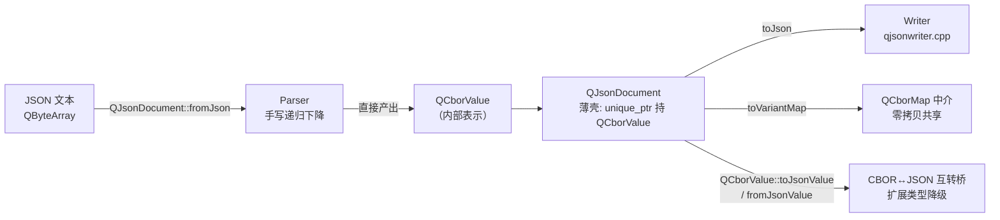
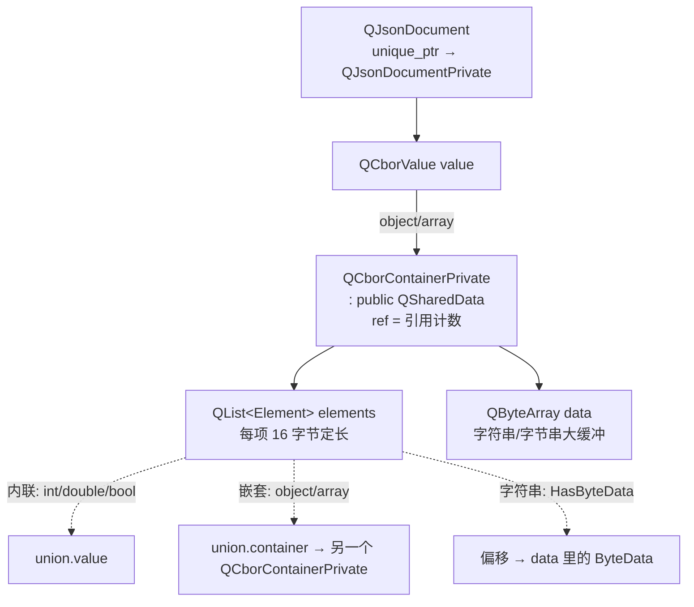

# JSON 解析与 CBOR 内核源码拆解

## 前言：为什么要拆 JSON 的源码

咱们配网络接口、读配置文件的时候，下面这几行您大概都写过无数遍：

```cpp
QJsonParseError err;
QJsonDocument doc = QJsonDocument::fromJson(byteArray, &err);
QJsonObject obj = doc.object();
QString name = obj.value("name").toString();
```

这几行代码咱们用起来丝滑得很，`fromJson` 进去了、`object()` 出来了，中间的 `QJsonDocument` 就像个黑盒。笔者翻源码的时候被一个问题卡住了：`QJsonDocument` 内部到底存的是什么？早年的教程会告诉您，它有个二进制的内部格式，序列化走的是 `fromBinaryData`/`toBinaryData`。可笔者把 Qt 6.9 的头文件翻了个遍，这俩函数是压根找不到的。再去追 `QJsonObject::value()` 交回来的 `QJsonValue`，它的数据又住在哪儿呢？

咱们把前面两问串起来，答案就是本篇要跟您讲明白的东西：**自 Qt 5.15 起，JSON 在 Qt 内部的表示早就换成了 CBOR，所谓 JSON 专属的二进制格式并不存在。**咱们手里的 `QJsonDocument`，本质是 `QCborValue` 外面套的一层薄壳，`QJsonObject`/`QJsonArray` 共享的是 `QCborContainerPrivate`，连解析器 `Parser::parse` 交回来的都直接是 `QCborValue`，所以在 Qt 6 的源码层面，JSON 就是 CBOR 的一个子集。整条线索理顺了，前面那些找不到、住哪儿的困惑就都解开了。

入门篇的 [1.16 JSON 与 XML 解析](../../beginner/01-qtbase/16-json-xml-beginner.md) 带咱们走过了怎么用，`QJsonDocument` 的解析、`QJsonObject`/`QJsonArray` 的遍历、`QJsonParseError` 的读法，都在它的射程里。进阶篇的 [JSON/XML 进阶：流式处理大文件](../../advanced/01-qtbase/16-json-xml-advanced.md) 聊的是大文件的内存开销和流式生成，外加 XML 的读写与命名空间。本篇不重复那些 API 层的东西，咱们往源码里走：把 `QJsonDocument` 的薄壳揭开，看 `QCborValue` 怎么承载 JSON，看手写的递归下降解析器长什么样，也看 `QVariant` 互转为什么要绕一道 CBOR。

边界咱们得划清楚，免得您越读越迷。本篇讲的对象只有 JSON 自己：`QJsonDocument`/`QJsonValue`/`QJsonObject`/`QJsonArray` 四件套，加手写的解析器 `Parser`，加序列化的写出层 `Writer`，加上容器 `QCborContainerPrivate` 这一层隐式共享与写时复制的门道，外加 JSON 与 CBOR/QVariant 的互转桥。XML 那边的 `QXmlStreamReader` 是一套完全独立的流式拉模型解析器，跟本篇是没有关系的。CBOR 自己的流式编解码（`QCborStreamReader`/`QCborStreamWriter`）咱们也不深拆，只在它是 JSON 内部表示的视角底下看它长什么样。

## 环境说明

本篇所有的源码引用都基于 `qt_src/qt6.9.1`，行号是会随 Qt 版本升级漂移的，您对照着读的时候，拿函数名或字段名搜索定位是最稳的。JSON 相关的源码全部集中在 `qtbase/src/corelib/serialization/` 目录底下，本篇要翻的文件咱们按正文里出场的顺序列在下面：

| 文件 | 角色 |
|---|---|
| `qt_src/qt6.9.1/qtbase/src/corelib/serialization/qjsondocument.h` / `.cpp` | QJsonDocument 主体、QJsonDocumentPrivate |
| `qt_src/qt6.9.1/qtbase/src/corelib/serialization/qjsonvalue.h` / `.cpp` | QJsonValue（QCborValue 的语义包装） |
| `qt_src/qt6.9.1/qtbase/src/corelib/serialization/qjsonobject.h` / `qt_src/qt6.9.1/qtbase/src/corelib/serialization/qjsonarray.h` | QJsonObject/QJsonArray 头文件（QCborContainerPrivate 指针成员声明） |
| `qt_src/qt6.9.1/qtbase/src/corelib/serialization/qcborvalue_p.h` | QCborContainerPrivate / Element / ByteData 内部布局 |
| `qt_src/qt6.9.1/qtbase/src/corelib/serialization/qjsonparser.cpp` / `qjsonparser_p.h` | 手写递归下降解析器（Parser 类） |
| `qt_src/qt6.9.1/qtbase/src/corelib/serialization/qjson_p.h` | QJsonPrivate 命名空间、Value/fromTrustedCbor |
| `qt_src/qt6.9.1/qtbase/src/corelib/serialization/qjsonwriter.cpp` / `qjsonwriter_p.h` | JSON 序列化写出（Writer 类） |
| `qt_src/qt6.9.1/qtbase/src/corelib/serialization/qjsonobject.cpp` / `qjsonarray.cpp` | toVariantMap/fromVariantMap（CBOR 中介） |
| `qt_src/qt6.9.1/qtbase/src/corelib/serialization/qjsoncbor.cpp` | JSON ↔ CBOR 互转桥、QVariant 中介实现 |

`qjsonparseerror.h` 是错误枚举 `QJsonParseError` 的老家（15 个值），咱们没给它单独开一节，您跟着正文走到风险一节，讲到 `DeepNesting`、死枚举这些值的时候再进去翻它。

本篇没有配套的 example，原因跟前面的纯源码篇是一样的：您不会为了看 `QCborContainerPrivate` 的内存布局去单独写一个工程，对着 `qt_src` 翻源码、拿调试器观察 `QJsonDocument` 的 `d` 指针，就是最好的实验了。

## 核心概念讲解

咱们动手翻源码以前，把 JSON 在 Qt 6 里的全链路看清楚。好些人读 JSON 源码是读不下去的，读不下去的原因是把解析、存储、序列化、互转这么几件事搅成了一锅。咱们拿一张图把数据流向理顺：



图里从左边进来的 `QByteArray`，经 `Parser` 解析以后直接就变成了 `QCborValue`，这就是 JSON 在 Qt 内部的唯一表示。`QJsonDocument` 只是拿 `unique_ptr` 把这个 `QCborValue` 给包了起来。往右的出路有三条：`toJson` 走的是 `Writer`，把数据重新序列化成了文本，`toVariantMap` 经的是 `QCborMap` 中介，转出来的就是 `QVariant`，CBOR 互转桥则负责跟原生的 CBOR 类型互转。咱们这一篇就顺着整条链走一遍，头一站从最反直觉的事实讲起：`QJsonDocument` 是个薄壳。

### QJsonDocument 的真相：它只是 QCborValue 的一层薄壳

笔者头一回打开 `qjsondocument.cpp` 找内部数据结构的时候，本来是准备看到一大坨字段的，毕竟一个 JSON 文档要存的对象、数组、字符串、数字，怎么也得有个像样的内部表示。结果看到的是这个，它的证据在 `qt_src/qt6.9.1/qtbase/src/corelib/serialization/qjsondocument.cpp:51`：

```cpp
class QJsonDocumentPrivate
{
    Q_DISABLE_COPY_MOVE(QJsonDocumentPrivate);
public:
    QJsonDocumentPrivate() = default;
    QJsonDocumentPrivate(QCborValue data) : value(std::move(data)) {}

    QCborValue value;
};
```

就这么一个 `QCborValue value` 字段。咱们数一遍，整个 `QJsonDocumentPrivate` 除了构造函数就没有别的成员了，`value` 是独一份的。这意味着 `QJsonDocument` 从头到尾拿到手的就是一个 `QCborValue`，一个 CBOR 的值类型。咱们以为的 JSON 专属内部格式，在 Qt 6 里是根本不存在的，JSON 数据从被解析出来的那一刻起，住的就是 CBOR 的房子。

那 `QJsonDocument` 自己怎么持有这个 Private 呢？咱们看头文件，它的证据在 `qt_src/qt6.9.1/qtbase/src/corelib/serialization/qjsondocument.h:109`：

```cpp
    std::unique_ptr<QJsonDocumentPrivate> d;
```

您注意这里是 `std::unique_ptr` 而不是 `QSharedDataPointer`，这个区分对咱们很重要：`QJsonDocument` 本身**不是**隐式共享的类，它拿 `unique_ptr` 独占自己的私有数据。拷贝一个 `QJsonDocument` 会发生什么？它的证据在 `qt_src/qt6.9.1/qtbase/src/corelib/serialization/qjsondocument.cpp:108`：

```cpp
QJsonDocument::QJsonDocument(const QJsonDocument &other)
{
    if (other.d) {
        if (!d)
            d = std::make_unique<QJsonDocumentPrivate>();
        d->value = other.d->value;
    } else {
        d.reset();
    }
}
```

拷贝的时候 `make_unique` 新建一个 `QJsonDocumentPrivate`，再把 `other.d->value`（就是那个 `QCborValue`）赋了过来。这里头有个细节值得您停下来想一想：`QCborValue` 自己的赋值是浅拷贝，它内部的字段拢共就三个：`n`、`container`、`t`。`container` 指针被复制了，可两个指针指向的是同一份底层数据。所以拷贝 `QJsonDocument` 几乎是零成本的，不过语义上它是值类型（`Q_DECLARE_SHARED` 在 `qjsondocument.h:112` 还是有的），您改副本是动不着原件的。真正的引用计数共享发生在更下面一层的 `QCborContainerPrivate`，咱们在它自己的小节里细看。

咱们再看 `fromJson` 是怎么把这个薄壳填上的，整条解析链的入口就落在它身上，它的证据在 `qt_src/qt6.9.1/qtbase/src/corelib/serialization/qjsondocument.cpp:266`：

```cpp
QJsonDocument QJsonDocument::fromJson(const QByteArray &json, QJsonParseError *error)
{
    QJsonPrivate::Parser parser(json.constData(), json.size());
    QJsonDocument result;
    const QCborValue val = parser.parse(error);
    if (val.isArray() || val.isMap()) {
        result.d = std::make_unique<QJsonDocumentPrivate>();
        result.d->value = val;
    } else if (!val.isUndefined() && error) {
        error->error = QJsonParseError::IllegalValue;
        error->offset = 0;
    }
    return result;
}
```

拢共走了三步。头一步咱们构造一个 `Parser`，把 `QByteArray` 的 `constData()`（裸 `const char*`）和长度喂进去。第二步咱们调 `parser.parse(error)` 拿到一个 `QCborValue`。第三步咱们判断这个值是不是 array 或 map（JSON 规范要求顶层必须是对象或数组），是的话才 `make_unique` 把它装进文档，不是的话就填一个 `IllegalValue` 错误。这里头还有个容易被忽略的点：`Parser` 的构造只吃 `const char*` 加 `int`，是没有编码参数的，`QByteArray` 是被当作 UTF-8 字节流处理的，真正的 UTF-8 解码发生在解析器内部，后面讲解析器的小节里咱们细说。

在彻底接受 Qt 6 的 JSON 内部就是 CBOR 以前，咱们补一条能堵住质疑的版本证据。`QJsonValue` 的头文件里有这么一行注释加断言，它的证据在 `qt_src/qt6.9.1/qtbase/src/corelib/serialization/qjsonvalue.h:134-135`：

```cpp
    // Assert binary compatibility with pre-5.15 QJsonValue
    static_assert(sizeof(QExplicitlySharedDataPointer<QCborContainerPrivate>) == sizeof(void *));
```

`pre-5.15` 这几个字值得您多看一眼。它说明的是 JSON 内部表示切到 CBOR 这件事根本不是 Qt 6 才动手的，Qt 5.15 就换掉了。5.15 把 `QJsonValue` 的内部换成了 `QCborValue`，还用 `static_assert` 把指针的大小锁住不变，跟 5.14 的二进制兼容就这么保住了。Qt 6 是在这个底子上继续深化的：解析器直接产 `QCborValue`，旧的二进制格式 API 也删干净了。所以严格讲，本篇讲的是自 5.15 起确立、Qt 6 全系列继承的内核，不是 Qt 6 的独创。

### QCborContainerPrivate：JSON 数据真正住的地方

既然薄的是 `QJsonDocument`，咱们就得往 `QCborValue` 底下找真正的数据结构。对象和数组对应的是 `QCborContainerPrivate`，它是整个 CBOR 内核的地基，它的证据在 `qt_src/qt6.9.1/qtbase/src/corelib/serialization/qcborvalue_p.h:98`：

```cpp
class QCborContainerPrivate : public QSharedData
{
    friend class QExplicitlySharedDataPointer<QCborContainerPrivate>;
    ...
    QByteArray::size_type usedData = 0;
    QByteArray data;
    QList<QtCbor::Element> elements;
```

这段声明里头有三样东西值得咱们停下来点一点。头一样是它的基类 `public QSharedData`，`QSharedData` 是 Qt 隐式共享的根基，里面的 `QAtomicInt ref` 就是引用计数器，引用计数的轮子它自己没造，直接继承下来用的。第二样是它手里的家当，一个 `QList<QtCbor::Element> elements` 的元素表，加一个 `QByteArray data` 的大缓冲。第三样是 `QExplicitlySharedDataPointer<QCborContainerPrivate>` 的友元声明，它正是 `QJsonObject::o`、`QJsonArray::a` 这俩成员的类型，也就是说 `QJsonObject` 和 `QJsonArray` 拿到的，是指向同一类容器的共享指针。

`Element` 是元素表里每一项的结构，咱们看它的声明，它是定长 16 字节的，它的证据在 `qt_src/qt6.9.1/qtbase/src/corelib/serialization/qcborvalue_p.h:38`：

```cpp
struct Element
{
    enum ValueFlag : quint32 {
        IsContainer                 = 0x0001,
        HasByteData                 = 0x0002,
        StringIsUtf16               = 0x0004,
        StringIsAscii               = 0x0008
    };
    Q_DECLARE_FLAGS(ValueFlags, ValueFlag)

    union {
        qint64 value;
        QCborContainerPrivate *container;
    };
    QCborValue::Type type;
    ValueFlags flags = {};
```

这里头的设计很巧：一个 `union` 把内联值和子容器指针，挤在了同一个 8 字节槽位里。整数、双精度、布尔、null 这些基本类型直接内联在了 `value` 里（`double` 经 `memcpy` 重解释成 `qint64` 存进去），嵌套的对象、数组则把指针放在 `container`。槽位里现在装的是 `value` 还是 `container`，靠 `flags` 的 `IsContainer` 位判断。`HasByteData` 位表示 `value` 现在不是数字了，它存的是指向 `data` 缓冲里某个 `ByteData` 的偏移，字符串和字节串走的正是它。`flags` 里还藏着字符串的编码档位 `StringIsUtf16`/`StringIsAscii`，咱们马上讲。

咱们再往下看 `ByteData`，它是字符串/字节串在 `data` 缓冲里的头部，是个变长的结构，它的证据在 `qt_src/qt6.9.1/qtbase/src/corelib/serialization/qcborvalue_p.h:75-79`：

```cpp
struct ByteData
{
    QByteArray::size_type len;

    const char *byte() const        { return reinterpret_cast<const char *>(this + 1); }
    const QChar *utf16() const      { return reinterpret_cast<const QChar *>(this + 1); }
```

头部记的就一个 `len`，真正的字节紧跟在 `this + 1` 后头（`this + 1` 按结构体大小对齐，正好跳过了头部）。同一块内存拿 `flags` 里的编码档位一对照，就能解释成 `byte()`（UTF-8 或 Latin-1 的窄字符），也能照 `utf16()` 的样子解释成 `QChar` 的宽字符。这是 Qt 6 给字符串做的三档存储优化，三档咱们点实名：`StringIsAscii` 档存的是单字节的 ASCII，不带档位的存的是裸 UTF-8，这两档您都拿 `byte()` 去读，`StringIsUtf16` 档存的是宽字符，咱们换 `utf16()` 来读。解析器怎么往这几档里填，咱们讲解析器的时候看。

咱们把这套布局画成图，JSON 数据在内存里的样子就清楚了：



咱们把整幅图串起来看：一个 `QJsonDocument` 经 `QCborValue` 指向一个 `QCborContainerPrivate`，后者手里的一张 `elements` 表加一个 `data` 缓冲，就是它的全部家当。每个 `Element` 要么内联基本值，要么指向子容器（递归下去就是 JSON 的嵌套结构），要么拿偏移引用 `data` 里的字符串。这就是 Qt 6 里一个 JSON 文档在内存中的全部真相了。

### Parser：一台手写的递归下降解析器

数据结构看完了，咱们来看数据是怎么从文本变出来的。Qt 的 JSON 解析器是一台纯手写的递归下降解析器，不是 `yacc`/`lex` 生成的，也不是表驱动的状态机。类声明咱们照着看，它的证据在 `qt_src/qt6.9.1/qtbase/src/corelib/serialization/qjsonparser_p.h:26`：

```cpp
class Parser
{
public:
    Parser(const char *json, int length);

    QCborValue parse(QJsonParseError *error);

private:
    inline void eatBOM();
    inline bool eatSpace();
    inline char nextToken();

    bool parseObject();
    bool parseArray();
    bool parseMember();
    bool parseString();
    bool parseValueIntoContainer();
    QCborValue parseValue();
    QCborValue parseNumber();
```

咱们把六个互相递归的私有方法念一遍（`parseObject`/`parseArray`/`parseMember`/`parseString`/`parseValue`/`parseNumber`），它们恰好对应 RFC 8259（JSON 的规范文档）的文法规则。遇到 `[` 的时候 `parseValue` 调的是 `parseArray`，遇到 `{` 的时候调的就是 `parseObject`，接着它对每个元素调的是 `parseValueIntoContainer`，转一圈又回到了 `parseValue`，递归就这样自然地嵌下去了。状态转移表是没有的，词法生成器的痕迹也没有，咱们数一数，里头就是一群 `if` 和递归调用的组合。

解析入口 `parse` 进门干的头一件事是吃掉 UTF-8 BOM，咱们看它的证据（`qt_src/qt6.9.1/qtbase/src/corelib/serialization/qjsonparser.cpp:232-242`）：

```cpp
void Parser::eatBOM()
{
    // eat UTF-8 byte order mark
    uchar utf8bom[3] = { 0xef, 0xbb, 0xbf };
    if (end - json > 3 &&
        (uchar)json[0] == utf8bom[0] &&
        (uchar)json[1] == utf8bom[1] &&
        (uchar)json[2] == utf8bom[2])
        json += 3;
}
```

这个函数咱们一眼就能读明白，它只认 UTF-8 的 BOM（`EF BB BF` 三个字节按顺序匹配），UTF-16/UTF-32 的 BOM 一概不处理，这也呼应了前面讲的，输入必须是 UTF-8 的。非 ASCII 字符串的解析走 `scanUtf8Char`（`qjsonparser.cpp:786`），用的是 `QUtf8Functions::fromUtf8` 的严格解码，非法的 UTF-8 序列直接判 `IllegalUTF8String`，没有回退到 Latin-1 的宽容模式。咱们再看字符串落进哪一档，`parseString` 扫完一遍才定的档：一个转义序列都没有的，纯 ASCII 的走 `appendAsciiString` 进 `StringIsAscii` 档，含非 ASCII 字符的走 `appendUtf8String` 存裸 UTF-8。见着转义序列的就不一样了，咱们就把整串解码成 `QString` 再按 UTF-16 存进去，档位给的是 `StringIsUtf16`（定档的分支在 `qjsonparser.cpp:832-837`，真正落数据的调用在 `qjsonparser.cpp:868`）。前面 ByteData 一节说好的三档，就是这么填满的。

递归下降解析器最怕的是栈溢出，恶意构造的超深嵌套 JSON 能把调用栈撑爆，咱们就得看看 Qt 怎么防。它的防御是一个文件级常量，它的证据在 `qt_src/qt6.9.1/qtbase/src/corelib/serialization/qjsonparser.cpp:16`：

```cpp
static const int nestingLimit = 1024;
```

咱们跟进 `parseObject` 和 `parseArray` 的入口，两处都有一句 `if (++nestingLevel > nestingLimit)` 的检查（`qjsonparser.cpp:449` 和 `qjsonparser.cpp:507`），嵌套超过了 1024 层就报 `DeepNesting` 终止。解析器是真的递归，`parseValue` 调的是 `parseArray`/`parseObject`，后者又调回了 `parseValue`，所以 `nestingLevel` 跟 C++ 调用栈深度是一一对应的，这个上限本质上是给栈深度的间接保护，超了会提前失败交回错误，而不是 segfault。

那遇到嵌套结构的时候，外层容器往哪儿暂存呢？咱们想一下，解析器手里有的只是一个 `container` 成员指针（`qjsonparser_p.h:51` 里那根单栈的指针），钻进内层以前就得把外层存起来了。这个活儿交给一个 RAII 的小助手 `StashedContainer`。RAII 这类对象咱们可以这么理解：构造函数里把资源接过来管，出了作用域就自动归还，正好接住了咱们暂存、归还这两步。咱们看它的证据（`qt_src/qt6.9.1/qtbase/src/corelib/serialization/qjsonparser.cpp:158-177`）：

```cpp
class StashedContainer
{
    Q_DISABLE_COPY_MOVE(StashedContainer)
public:
    StashedContainer(QExplicitlySharedDataPointer<QCborContainerPrivate> *container,
                     QCborValue::Type type)
        : type(type), stashed(std::move(*container))
    {
    }

    QCborValue intoValue(QExplicitlySharedDataPointer<QCborContainerPrivate> *parent)
    {
        std::swap(stashed, *parent);
        return QCborContainerPrivate::makeValue(type, -1, stashed.take(),
                                                QCborContainerPrivate::MoveContainer);
    }
```

`StashedContainer` 构造的时候拿 `std::move` 把当前的 `*container` 接管到 `stashed`，腾出 `container` 给内层的 `parseObject`/`parseArray` 用。内层解析完了，`intoValue` 把 `stashed` 还给了 `parent`，再拿 `QCborContainerPrivate::makeValue` 把内层的容器包成一个 `QCborValue` 交回去。这里 `makeValue` 的第二个参数传的是 `-1`，容器承载的场景里就用 `-1` 标记值由 container 字段提供（解析器内部别处也拿同样的 `-1` 调 `makeValue`，算是内部的一套约定），您知道这个用法就行了，不必把它想成什么神秘的哨兵。

数字的解析值得咱们单独看一眼，它把 Qt 既支持 64 位整数、又支持双精度的做法亮了出来。数字切成了片以后，`parseNumber` 是按三段来处理的，它的证据在 `qt_src/qt6.9.1/qtbase/src/corelib/serialization/qjsonparser.cpp:684-705`：

```cpp
    const QByteArray number = QByteArray::fromRawData(start, json - start);

    if (isInt) {
        bool ok;
        qlonglong n = number.toLongLong(&ok);
        if (ok) {
            return QCborValue(n);
        }
    }

    bool ok;
    double d = number.toDouble(&ok);

    if (!ok) {
        lastError = QJsonParseError::IllegalNumber;
        return QCborValue();
    }

    qint64 n;
    if (convertDoubleTo(d, &n))
        return QCborValue(n);
    return QCborValue(d);
```

头一段咱们看它能不能当整数（`isInt` 在没有小数部分、没有指数、且小数位全零的时候为真，无小数无指数的话就一直保持初始的 `true`），能当的话就 `toLongLong` 直接存 `QCborValue(qint64)`。第二段走的是 `toDouble` 的双精度。末一段咱们还试一把 `convertDoubleTo`，要是这个 double 本身是个整数值的话（比如 `42.0`），就升回 `qint64` 的存储，省得白白多占一份双精度的存储。整套数字解析委托给了 `QByteArray` 自家的转换函数（底层交给的是 `strtoll`/`strtod` 这类 C 标准转换函数），Qt 没有自己手写过的 IEEE 解析器。

这套能当整数就当整数、能升就升的策略，正是咱们理解 `QJsonValue::type()` 行为的门路。JSON 规范里 number 是只有一种类型的，可 CBOR 内部是区分 `Integer` 和 `Double` 的。于是 `QJsonValue::type()` 把 CBOR 类型映射回 JSON 类型的时候，做了合并，它的证据在 `qt_src/qt6.9.1/qtbase/src/corelib/serialization/qjsonvalue.cpp:30-35`：

```cpp
static QJsonValue::Type convertFromCborType(QCborValue::Type type) noexcept
{
    switch (type) {
    ...
    case QCborValue::Double:
    case QCborValue::Integer:
        return QJsonValue::Double;
    ...
```

咱们对着结果看，`QCborValue::Integer` 和 `QCborValue::Double` 都被映射成了 `QJsonValue::Double`。这个合并不是 Qt 6 的新设计，`QJsonValue` 从 Qt 5.0 就存在了，JSON 规范里 number 本来就是唯一的数字类型，Qt 5 对外报的也只有 `Double`。真正属于 CBOR 内核化之后的新机制的，是内部拿 `QCborValue::Integer` 标签保住了 64 位精度：对外 `type()` 报 `Double`，内部存的却可能是 `qint64`。`QJsonValue(double)` 构造的时候还会反过来用 `convertDoubleTo` 试着把整数值的 double 升级成 `qint64`（`qjsonvalue.cpp:148-153` 的 `doubleValueHelper`），躲开 IEEE 754 的精度损失。这是 CBOR 内核带来的副产物，可不是 Qt 独创的 JSON 扩展。

末了看一个好些人没意识到的行为：JSON 对象的 key 排序。您可能以为 `toJson` 写出的时候才排，其实不是，排序在解析的时候就做完了。`parseObject` 收尾的时候会调 `sortContainer`，它的证据在 `qt_src/qt6.9.1/qtbase/src/corelib/serialization/qjsonparser.cpp:416-423`：

```cpp
    std::stable_sort(
                Forward(container->elements.begin()), Forward(container->elements.end()),
                [&compare](const Value &a, const Value &b) { return compare(a, b) < 0; });

    Forward result = customAssigningUniqueLast(
                Forward(container->elements.begin()),  Forward(container->elements.end()),
                [&compare](const Value &a, const Value &b) { return compare(a, b) == 0; }, move);

    container->elements.erase(result.elementsIterator(), container->elements.end());
```

排与去重的两样活，咱们挨个看，一次做完：`std::stable_sort` 按 key 的字典序排（比较函数对 UTF-8/UTF-16 的 key 都处理得对），跟着 `customAssigningUniqueLast` 把相同 key 的元素去重，去重保留的是最后写入的值。这意味着一个 JSON 对象里要是有重复的 key，解析器是不报错的，它默默拿后一个覆盖了前一个，而且这一步在解析的时候就完成了。`toJson` 写出的时候直接顺序遍历 `elements`，天然就是字典序的，不用再排一遍了。数组不参与排序的事咱们也交代一句，`sortContainer` 的调用点只有 `parseObject` 收尾的那么一回（`qjsonparser.cpp:478` 一处），JSON 数组按定义就是有序的，原序是得保持的。

### Writer：把 QCborValue 写回 JSON 文本

解析干的活是把文本变成 `QCborValue`，反过来怎么把 `QCborValue` 写回 JSON 文本，咱们看另一套独立的代码 `qjsonwriter.cpp`。入口 `QJsonDocument::toJson` 进门拿内部的 `QCborValue` 用一个私有快捷路径包成 `QJsonValue`，往下的活就委托出去了，它的证据在 `qt_src/qt6.9.1/qtbase/src/corelib/serialization/qjsondocument.cpp:245-253`：

```cpp
QByteArray QJsonDocument::toJson(JsonFormat format) const
{
    QByteArray json;
    if (!d)
        return json;

    return QJsonPrivate::Value::fromTrustedCbor(d->value).toJson(
            format == JsonFormat::Compact ? QJsonValue::JsonFormat::Compact
                                          : QJsonValue::JsonFormat::Indented);
}
```

俩细节咱们挨个说。头一个是 `d` 为 `nullptr` 的情形（默认构造或解析失败的文档），直接交回的是空 `QByteArray`，是不抛异常的，这也是为什么您得用 `isNull()` 去区分空文档跟解析失败的非法文档。另一个是 `fromTrustedCbor` 的快捷路径，咱们在 `qjson_p.h:200` 能找到它的定义，它是 `QJsonPrivate::Value` 的一个静态方法，干的活是直接把 `QCborValue` 塞进 `QJsonValue`，省掉一次类型映射的开销。紧凑和缩进的两种格式，靠的是 `JsonFormat` 枚举来分流。

真正干活的 `Writer` 咱们看一眼，它是静态的工具类，它的三个方法分别处理对象、数组、单个值，它的证据在 `qt_src/qt6.9.1/qtbase/src/corelib/serialization/qjsonwriter_p.h:26-31`：

```cpp
class Writer
{
public:
    static void objectToJson(const QCborContainerPrivate *o, QByteArray &json, int indent, bool compact = false);
    static void arrayToJson(const QCborContainerPrivate *a, QByteArray &json, int indent, bool compact = false);
    static void valueToJson(const QCborValue &v, QByteArray &json, int indent, bool compact = false);
};
```

`compact` 这个布尔参数就是缩进/紧凑的运行时开关。它管的是 key 后面那个冒号的写法，对象内容的写出咱们照着看，它的证据在 `qt_src/qt6.9.1/qtbase/src/corelib/serialization/qjsonwriter.cpp:165-180`：

```cpp
static void objectContentToJson(const QCborContainerPrivate *o, QByteArray &json, int indent, bool compact)
{
    if (!o || o->elements.empty())
        return;

    QByteArray indentString(4*indent, ' ');

    ...
        json += indentString;
        json += '"';
        json += escapedString(o->valueAt(i).toString());
        json += compact ? "\":" : "\": ";
```

紧凑模式（`compact=true`）下 key 后是紧贴冒号不加空格的，元素之间用的分隔符是 `,`。缩进模式（`compact=false`）冒号后留的是一个空格，元素之间的换行写的是 `,\n`，每行的前缀是 `indentString`（`4*indent` 个空格，每深一层就多 4 格的缩进）。非有限数（NaN/正负 Inf）在这里被写成了 `null`（Double 分支的处理在 `qjsonwriter.cpp:109-116`），这个行为后面讲风险的时候咱们还要细说。

### QVariant 互转：中间为什么要绕一道 CBOR

咱们不少人头一回看到 `QJsonObject::toVariantMap` 的实现都会愣一下：它没有直接把 JSON 对象转成 `QVariantMap`，而是绕到了 `QCborMap`，它的证据在 `qt_src/qt6.9.1/qtbase/src/corelib/serialization/qjsonobject.cpp:186-189`：

```cpp
QVariantMap QJsonObject::toVariantMap() const
{
    return QCborMap::fromJsonObject(*this).toVariantMap();
}
```

咱们追进去看，`fromJsonObject` 在 `qjsoncbor.cpp` 里的实现，其实只是把 `QJsonObject` 内部的 `o`（那个 `QCborContainerPrivate` 指针）共享给 `QCborMap`，零拷贝的。往下的活是 `QCborMap::toVariantMap` 来遍历元素，元素一个个递归转成了 `QVariant`。反方向的 `fromVariantMap` 也是一样的路子，它的证据在 `qt_src/qt6.9.1/qtbase/src/corelib/serialization/qjsonobject.cpp:174-177`：

```cpp
QJsonObject QJsonObject::fromVariantMap(const QVariantMap &map)
{
    return QJsonPrivate::Variant::toJsonObject(map);
}
```

咱们再看 `QJsonPrivate::Variant::toJsonObject`，它是在 `qjsoncbor.cpp:474-477` 里实现的，进门过的是 `QCborMap::fromVariantMap(map)` 这一道，再交给 `convertToJsonObject` 转回 JSON 的类型空间。`QJsonArray` 的 `toVariantList`/`fromVariantList` 也是走 `QCborArray` 中介。

为什么要绕这一道呢？咱们把原因摆出来：QVariant 跟 JSON 的类型对不上号，`QVariant` 能装 `QDate`、`QUrl`、`QUuid` 这些 JSON 里没有的类型，而 CBOR 恰好也支持这些扩展类型。让 CBOR 当中间人的话，转换逻辑是一份写完两处用的（`QVariant ↔ QCborValue` 和 `QJsonValue ↔ QCborValue` 各一套），JSON 就能借道复用了。而且底层共享的是同一个 `QCborContainerPrivate`，绕这一道几乎是零拷贝的，接口形式上的中介并不带来实际的数据搬运成本。

### CBOR 互转：扩展类型怎么降级回 JSON

CBOR 比 JSON 的表达力强，tag 是有的，DateTime/Url/Uuid 这些扩展类型也是有的，咱们把 CBOR 转成 JSON 的时候，JSON 承载不了的类型就得降级。降级的逻辑集中在 `convertExtendedTypeToJson`，它的证据在 `qt_src/qt6.9.1/qtbase/src/corelib/serialization/qjsoncbor.cpp:171-186`：

```cpp
static QJsonValue convertExtendedTypeToJson(QCborContainerPrivate *d)
{
    qint64 tag = d->elements.at(0).value;

    switch (tag) {
    case qint64(QCborKnownTags::Url):
        ...
        if (d->elements.at(1).type == QCborValue::String)
            return QUrl::fromEncoded(d->byteData(1)->asByteArrayView()).toString(QUrl::FullyEncoded);
        Q_FALLTHROUGH();

    case qint64(QCborKnownTags::DateTimeString):
    case qint64(QCborKnownTags::ExpectedBase64url):
    case qint64(QCborKnownTags::ExpectedBase64):
    case qint64(QCborKnownTags::ExpectedBase16):
    case qint64(QCborKnownTags::Uuid): {
        QString s = maybeEncodeTag(d);
        if (!s.isNull())
            return s;
    }
}

    // for all other tags, ignore it and return the converted tagged item
    return qt_convertToJson(d, 1);
```

咱们把它的策略摆出来：已知的 tag 转成字符串，Url 转成完全编码的字符串，DateTime 转成 RFC 3339 格式的字符串，Base64/Base64url/Base16 转成对应编码的字符串，Uuid 转成 `toString()` 的形式。未知的 tag 就把 tag 本身忽略掉，直接转它包着的那个值（`qt_convertToJson(d, 1)`）。

非有限数也有专门的安排，咱们看它的证据（`qt_src/qt6.9.1/qtbase/src/corelib/serialization/qjsoncbor.cpp:27-30`）：

```cpp
static QJsonValue fpToJson(double v)
{
    return qt_is_finite(v) ? QJsonValue(v) : QJsonValue();
}
```

咱们把非有限数的归宿接下来说完：`QJsonValue()` 默认构造出来就是 `Null`，所以 NaN、正负 Inf 走到 CBOR 转 JSON 这一步，就被降级成了 null。这样的处理跟前面 Writer 一节写出时的做法是一致的，两处用的是同一套非有限数变 null 的策略，出处是 RFC 4627 早期对 JSON 数值的规定。这是 JSON 规范自己的限制，不是 Qt 的选择。

### COW 与隐式共享：detach 在哪一层触发

前面咱们说过，`QJsonDocument` 自己不是隐式共享的类（独占的是 `unique_ptr`）。可真正的隐式共享是有的，就在 `QCborContainerPrivate` 的这一层。`QJsonObject::o`、`QJsonArray::a` 都是 `QExplicitlySharedDataPointer<QCborContainerPrivate>` 这样的指针（`qjsonobject.h:356`、`qjsonarray.h:315` 两处），好几个 `QJsonObject` 引用同一个 `elements` 表是零拷贝的，引用计数靠基类 `QSharedData` 的 `QAtomicInt ref` 维护。

写时复制（COW）的 `detach` 触发条件，咱们看容器自己的 `detach`，它的证据在 `qt_src/qt6.9.1/qtbase/src/corelib/serialization/qcborvalue.cpp:971-976`：

```cpp
QCborContainerPrivate *QCborContainerPrivate::detach(QCborContainerPrivate *d, qsizetype reserved)
{
    if (!d || d->ref.loadRelaxed() != 1)
        return clone(d, reserved);
    return d;
}
```

咱们把条件读出来：引用计数不等于 1（说明还有别人指着同一个容器），写以前就 `clone` 一份深拷贝出来再改（`clone` 的实现在 `qcborvalue.cpp:948`）。`QJsonObject`/`QJsonArray` 的所有写操作（`insert`/`remove`/`replace`/`[]`）内部都会走一遍 `detach`。这里头有个特别容易踩的触发点，非 `const` 的 `begin()`，它的证据在 `qt_src/qt6.9.1/qtbase/src/corelib/serialization/qjsonobject.h:283`：

```cpp
    inline iterator begin() { detach(); return iterator(this, 0); }
```

Qt 6 的 `begin()` 就算您只是想遍历，只要对象不是 `const` 的，它也是会触发 `detach` 的。这意味着您拿着一个共享自别处的 `QJsonObject`，调一次非 const 的 `begin()` 就可能引发一次整份容器的深拷贝。这个行为后面讲风险的时候咱们展开。JSON 在 Qt 6 里的全链路咱们读到这儿就算走通了，从薄壳 `QJsonDocument` 走到了 CBOR 内核 `QCborContainerPrivate`，从手写解析器 `Parser` 走到了序列化器 `Writer`，从 QVariant 的中介走到了 CBOR 的互转。往下咱们看几个实战里真会碰上的麻烦。

## 风险与故障预防

本篇挑出来的麻烦都是源码里能直接对上号的，后果和解法咱们一条条交代清楚。

头一类麻烦是超深嵌套的 JSON 触发 `DeepNesting` 失败，报错的位置还让您摸不着头脑。根子在解析器一节讲的 `nestingLimit = 1024`，解析器是真的递归，栈深度跟嵌套层级是一一对应的，超过了 1024 层就终止。后果是这样的，`QJsonParseError` 交回来的是 `DeepNesting`，`offset` 指向嵌套很深的位置，而您的业务代码看到的是 `fromJson` 交回一个空文档（`d` 为 `nullptr`）。您要是没检查 `error.error` 就直接 `doc.object()`，拿到手的就是个空对象，数据是静默丢失的。这样的 bug 难查，开发期拿正常 JSON 测得好好的，一到生产环境碰上某个恶意或畸形的输入就出事。要避开它的话，您永远检查 `QJsonParseError::error` 是不是 `NoError` 再去用文档。数据源要是可能产生超深嵌套（比如某些递归结构的序列化），解析以前考虑做一轮深度的预检，或者干脆把结构改浅了再解析。

第二类麻烦是 offset 引来的，您拿 `QJsonParseError::offset` 当字符位置去定位，定位就是错的。咱们再看 `offset` 本身，它的实现是 `json - head`（`qjsonparser.cpp:324`），两个 `const char*` 的差，它是字节的偏移量，不是字符的偏移量，源码的文档注释也写得明白，原话是这样写的，“byte offset in the UTF-8 byte array”，出处是 `qjsonparser.cpp:89` 的注释。后果是这样的：一段 JSON 里有个中文，您拿 `offset` 去 `QString::mid(offset)` 截取上下文，或者您拿它去 `QTextCursor` 里定位，位置就全是错的，一个中文字符在 UTF-8 里占的是 3 个字节，字节偏移是会比字符偏移大的。您对着错误的行列号找半天，根本对不上真正的出错点。要把 `offset` 映射回字符位置的话，办法是拿 `QString::fromUtf8(json.left(offset)).length()` 这样的转换，把字节切片转成字符串了再数字符数。

第三类麻烦是非 `const` 地遍历 `QJsonObject`/`QJsonArray`，意外触发了深拷贝。COW 小节咱们看到 `begin()` 里藏着一句 `detach()`。后果是：您写了个函数接收 `QJsonObject` 参数（值传递或非 const 引用），进去遍历用的是 `for (auto it = obj.begin(); ...)`，心里当它是只读的，结果每回调用都 clone 一份容器，大文档底下性能是直接塌下去的，而且 `QCborContainerPrivate` 还要递归 clone 所有子容器，开销跟文档大小是成正比的。这样的性能问题很难从代码表面看出来。要避开它的话，纯读的访问您一律用 `constBegin()`/`cbegin()`/`constFind()`，或者把参数声明成 `const QJsonObject &`、`const QJsonValue &` 这样的引用，让编译器把 `begin()` 解析成 `const` 的版本（`const` 的版本在 `qjsonobject.h:284` 是不 detach 的）。C++ 的 const 正确性在这儿直接跟性能挂了钩。

第四类麻烦是把希望寄托在两个死枚举上了，或者还在找早就删掉的二进制 API。`qjsonparseerror.h` 的枚举表里躺着 `DocumentTooLarge` 和 `TerminationByNumber`，这俩值在 `qjsonparser.cpp` 里没有任何 `lastError = ...` 的赋值，`TerminationByNumber` 的文档写得更直白，原话是这样写的，“as of 6.9, this is no longer returned”，出处是 `qjsonparser.cpp:64` 的注释。它们留在枚举里纯粹是为了二进制兼容。后果是：您写 `switch (error.error)` 的时候要是给这俩 case 做了特殊处理，那段代码是永远不会执行的，错误处理里有个永远进不去的分支，等于留了个洞。二进制 API 那边的遭遇也一样，前言里咱们怎么找都找不到的 `fromBinaryData`/`toBinaryData`，薄壳一节咱们已经确认过，这俩在 Qt 6 的头文件里是整个删掉的，没有 deprecated 的过渡期，声明直接就没了，只剩一个 `BinaryFormatTag` 的魔数常量（`qjsondocument.h:33`）。第三个 `fromRawData` 前文咱们没提过，它同样在 Qt 6 里删没了，这里顺带把撞名的事说清：它跟数字解析里用的 `QByteArray::fromRawData` 是两个东西，后者只是把一段已有的内存包成 `QByteArray`、不搬数据的，别看名字一样就混到一块去了。后果是您照着老教程写 `QJsonDocument::fromBinaryData(...)` 直接编译报错，还没有 deprecation 警告提示您该换成什么。两处麻烦的避开方式也一样直接：死枚举不给它写处理分支，二进制持久化改用 CBOR（`QCborValue`/`QCborMap` 的 `toCbor`/`fromCbor`），它才是 Qt 6 推荐的二进制格式。

第五类麻烦是往 JSON 里存了 NaN 或正负无穷，值静默变成了 null。Writer 一节和 `fpToJson`（`qjsoncbor.cpp:27-30`）都把非有限数写成了 `null`。后果是：您拿 JSON 存传感器读数、科学计算的结果，某个时刻冒出来一个除零产生的 Inf 或者脏数据 NaN，存进 JSON 再读出来的时候，值变成了 `null`，警告是没有一条的。下游代码要是对 null 没有防护的话，轻则闹的是逻辑错误，重则除零引发的崩溃就在后头等着。更阴的是 round-trip 不一致，原始的数据本来是个 Inf，存读之后变成了 null，您再判断 `isNull()`，还当这个字段是本来就没填的。要避开它的话，序列化以前您拿 `std::isfinite()` 把非有限数过滤一遍，要么拒绝存储，要么换成可表示的哨兵值（比如特定的大数或字符串标记），别指望 JSON 能忠实地搬运 IEEE 754 的特殊值。

## 练习项目

本篇跟前面的纯源码篇是一样的，练习也就是验证的路子，几道题给的是方向跟核对手段，完整的工程留给您自己搭。

头一道题验的是嵌套上限。您写个小程序，拿循环拼一个两千层的嵌套 JSON（`[` 和 `{` 交替着嵌就行），拼好了交给 `fromJson` 解析。`error.error` 交回的应该就是 `DeepNesting`，`doc.isNull()` 的结果是 true，`offset` 指向一千零二十四层上下的位置。您把嵌套层数降到一千以内再跑一遍，解析就正常了，这就把 `nestingLimit` 那一段亲眼对上了。

第二道题验的是 offset 的字节语义。您在一份带中文 key 的 JSON 末尾故意补几个非法字节，解析失败以后您把 `error.offset` 打出来，跟您自己数的字符位置对一对，差出来的就是中文字符多占的字节。跟着您拿 `QString::fromUtf8(json.left(offset)).length()` 转一道，两边的数就能对上了，字节偏移跟字符偏移的错位您也就有体感了。

第三道题验的是非 const 遍历的 detach。您构造一个大的 `QJsonObject`，您再拷贝一份出来，跟着您在调试器里拿 `QCborContainerPrivate::clone`（`qcborvalue.cpp:948`）下一个断点，您拿 `begin()` 遍历了一回，再拿 `cbegin()` 遍历了一回。`begin()` 的那一遍，断点被您踩中了，`cbegin()` 的那一遍纹丝不动，深拷贝就发生在您眼皮底下。

第四道题验的是非有限数变 null。您往 `QJsonObject` 里塞一个 `QJsonValue(std::numeric_limits<double>::infinity())`，`toJson` 出来的文本里对应的位置就是 `null`，您再 `fromJson` 读回来，`isNull()` 也就变成了 true。NaN 是同样的下场。跑完这一圈您就记下了，IEEE 754 的特殊值一进 JSON 就没了。

末了是一道对行号的题，要对的都在前文里。您挑上三四处（比如 `qjsondocument.cpp:51` 的单字段、`qjsonparser.cpp:16` 的 1024、`qcborvalue.cpp:971` 的 detach 条件、`qjsonobject.h:283` 的 begin），您带着行号去 `qt_src/qt6.9.1` 翻原文，把它们一处一处地核对过去。四处都对上了，本篇的断言也就落了地。

## 官方文档参考链接

咱们把本篇用到的官方文档列在下面，链接都是 Qt 6 的官方文档：

- [Qt 文档 · QJsonDocument](https://doc.qt.io/qt-6/qjsondocument.html) —— QJsonDocument 的类参考，fromJson/toJson/array/object 这些入口都在这一页。
- [Qt 文档 · QJsonParseError](https://doc.qt.io/qt-6/qjsonparseerror.html) —— 解析错误类型跟 offset 语义的说明，offset 是字节偏移这件事，文档里也交代了。
- [Qt 文档 · QJsonValue](https://doc.qt.io/qt-6/qjsonvalue.html) —— QJsonValue 的类型映射说明，Integer 合并进 Double 的行为可以拿它对照。
- [Qt 文档 · QCborValue](https://doc.qt.io/qt-6/qcborvalue.html) —— CBOR 值类型，JSON 内部表示的本体，toJsonValue/fromJsonValue 互转桥也在这页。
- [Qt 文档 · JSON Support in Qt](https://doc.qt.io/qt-6/json.html) —— Qt 对 JSON 支持的总览文档。

---

Qt 6 的 JSON 子系统，咱们走到这儿就从源码层面拆明白了。笔者拆完最大的感受是这套实现比表面上统一得多，您以为 JSON 是 JSON、CBOR 是 CBOR，两套并行地各过各的，咱们钻进去才发现，自 Qt 5.15 起 JSON 在内部就只剩 CBOR 这一套表示了，`QJsonDocument` 不过是 `QCborValue` 的一层包装，`QJsonObject`/`QJsonArray` 共享的是 `QCborContainerPrivate`，连解析器都直接产出了 `QCborValue`。咱们从薄壳这个最反直觉的事实出发，看到了 `QCborContainerPrivate` 怎么拿一张 16 字节的 `Element` 表加一个 `data` 缓冲承载所有的 JSON 结构，手写的递归下降 `Parser` 怎么拿 1024 的嵌套上限防住栈溢出，`Writer` 怎么按紧凑或缩进两种格式把数据写回文本，QVariant 互转为什么要借道 CBOR，还有 CBOR 的扩展类型怎么降级回 JSON 的窄类型空间。下回您再拿到一个 `QJsonDocument`，脑子里浮现的就不该是个黑盒了，得是 `QCborContainerPrivate` 在内存里的模样。

本篇的行号证据要是想一一核对，它们按源码的机制归类收在 [code-index · JSON/CBOR 内核源码索引](../code-index/qtbase/qjson-internals.md) 里头，您带着行号去 `qt_src/qt6.9.1` 翻原文就行。
