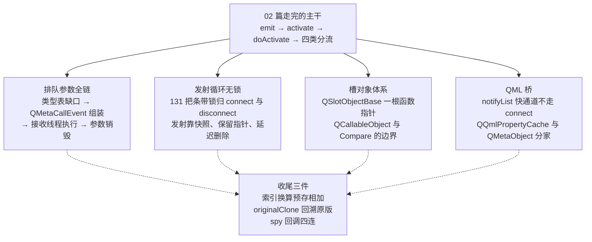
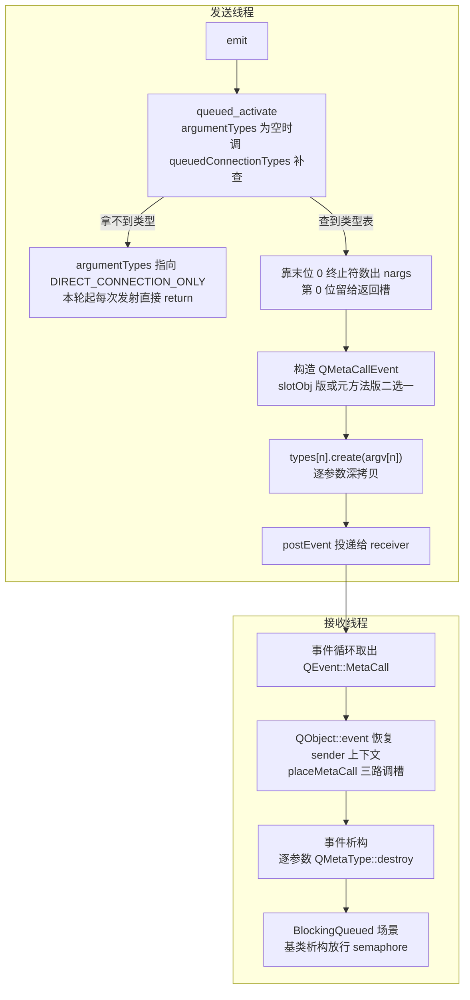
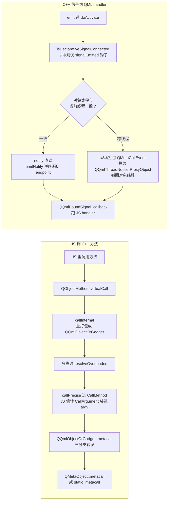

# 信号槽深度拆解：排队参数、无锁发射与 QML 的另一条路

信号发射出去的那一刻，没有一把 sender 的连接表锁为它落下。这句话笔者把 `doActivate` 从头到尾过了一遍才敢写下来，因为不少资料把 activate 描绘成拿着互斥量遍历连接表的过程，读者顺着想象，很容易以为发射路径是被锁保护起来的。6.9.1 的实况反着来，锁全留给了改表的人，`connect` 与 `disconnect` 拿锁，发射循环两手空空地走链表，安全性由另一套机制兜住。这套机制怎么兜住，是本篇要走的深水区之一。

02 篇（[信号槽底层：activate 调用链](./02-signal-slot-internals-expert.md)）已经把主干走完，emit 空宏、activate 三重载收敛、连接表的双链结构、四类分流、析构清理、重入保护，都在那边。本篇不回头重讲，咱们直接下潜。02 篇路过没停的地方有四处。排队连接的参数，咱们从类型表缺口走到析构销毁全程。发射循环不拿锁，咱们看它靠什么不出事。槽对象是不依赖虚函数的一套体系，QML 信号到 handler 另有一条通道。一路上还要对质十几处流传很广、在 6.9.1 源码里对不上号的说法，每一处都落到具体行号上，您拿着行号自己能验。

本篇源码基线 `qt_src/qt6.9.1`，行号基于此版本，升级会漂移，对不上号时拿函数名或字段名进文件里搜。咱们会碰到的源码文件按出场顺序列在下面，qtbase 与 qtdeclarative 两边都有。

| 文件 | 角色 |
|---|---|
| `qt_src/qt6.9.1/qtbase/src/corelib/kernel/qobject.cpp` | queuedConnectionTypes、queued_activate、QMetaCallEvent 的生成分发析构、131 把条带锁、removeConnection、orphaned 清理、unique 判重、spy 回调 |
| `qt_src/qt6.9.1/qtbase/src/corelib/kernel/qobject_p.h` | QMetaCallEvent 新布局、QAbstractMetaCallEvent、QSignalSpyCallbackSet |
| `qt_src/qt6.9.1/qtbase/src/corelib/kernel/qobject_p_p.h` | ConnectionDataPointer、SignalVector、Connection 的 `ref_` 与字段 |
| `qt_src/qt6.9.1/qtbase/src/corelib/kernel/qobjectdefs_impl.h` | QSlotObjectBase、Operation、QCallableObject |
| `qt_src/qt6.9.1/qtbase/src/corelib/kernel/qmetaobject_p.h` | signalOffset |
| `qt_src/qt6.9.1/qtbase/src/corelib/kernel/qmetaobject.cpp` | originalClone、methodOffset |
| `qt_src/qt6.9.1/qtdeclarative/src/qml/qml/qqmlboundsignal.cpp` | onXxx handler 的真实连接路径 |
| `qt_src/qt6.9.1/qtdeclarative/src/qml/qml/qqmlnotifier.cpp` | 快通道 emitNotify 与回调表 |
| `qt_src/qt6.9.1/qtdeclarative/src/qml/qml/qqmlnotifier_p.h` | endpoint 侵入式链表的 next/prev 成员 |
| `qt_src/qt6.9.1/qtdeclarative/src/qml/qml/qqmlengine.cpp` | signalEmitted 钩子与跨线程搬运 |
| `qt_src/qt6.9.1/qtdeclarative/src/qml/qml/qqmldata_p.h` | notifyList、connectionMask、signalIndex 编址 |
| `qt_src/qt6.9.1/qtdeclarative/src/qml/qml/qqmlpropertycache_p.h` | QQmlPropertyCache 的 final 声明 |
| `qt_src/qt6.9.1/qtdeclarative/src/qml/qml/qqmlpropertycache.cpp` | createMetaObject 惰性生成实现 |
| `qt_src/qt6.9.1/qtdeclarative/src/qml/qml/qqmlmetaobject_p.h` | QQmlMetaObject 基类只存 `const QMetaObject *` |
| `qt_src/qt6.9.1/qtdeclarative/src/qml/qml/qqmlobjectorgadget_p.h` | QQmlObjectOrGadget 与 QBiPointer |
| `qt_src/qt6.9.1/qtdeclarative/src/qml/qml/qqmlobjectorgadget.cpp` | metacall 三分支转发 |
| `qt_src/qt6.9.1/qtdeclarative/src/qml/jsruntime/qv4qmetaobjectwrapper.cpp` | JS 构造路对 QQmlObjectOrGadget 空指针分支的投喂 |
| `qt_src/qt6.9.1/qtdeclarative/src/qml/jsruntime/qv4qobjectwrapper.cpp` | V4 调用链与 CallMethod |

本篇不配 example，理由和 01 篇（[QObject 元对象系统源码拆解](./01-qobject-meta-system-expert.md)）、02 篇一样直白，纯源码拆解，您对照 `qt_src` 翻原文就是最好的实验。动身前把四块深水区的路线图对一遍。



## queued 参数的完整旅程：从 connect 留下的缺口出发

02 篇讲四类分流时留过一个话头，函数指针版的 `connect`（行话叫 PMF，指成员函数指针）拿不到参数元类型时，类型表是空的，第一次 emit 才由 `queued_activate` 头部补查，补查调用的是 `queuedConnectionTypes`。咱们就从这次补查进深水区，把参数从补查到销毁的一生走完。

### 类型表的缺口：connect 时没查，发射那一刻补课

咱们把补查的本体请出来。旧教程把参数类型表写成连接建立时就备好的固定开销，函数指针版的实况是它可能到第一次发射才落地，落地的动作全在这个函数里。

`qt_src/qt6.9.1/qtbase/src/corelib/kernel/qobject.cpp:76-82`

```cpp
static int *queuedConnectionTypes(const QMetaMethod &method)
{
    const auto parameterCount = method.parameterCount();
    int *typeIds = new int[parameterCount + 1];
    Q_CHECK_PTR(typeIds);
    for (int i = 0; i < parameterCount; ++i) {
        const QMetaType metaType = method.parameterMetaType(i);
```

它走的是单数路线，`parameterCount()` 拿到个数，循环里逐个调 `parameterMetaType(i)`。网上流传的写法顺口把它写成一次取全的复数版 `parameterMetaTypes()`，名字差一个字母，路子是两条。指针类型的参数一律映射成 `QMetaType::VoidStar`，因为排队投递只搬指针值，不追指向的对象。某个参数拿不到 id，函数当场打那句 02 篇见过的 Cannot queue 警告，`delete[]` 释放半成品、返回 nullptr（89-97 行）。成功路径的末位有一个不起眼的动作，第 99 行补了一个 0 作为数组终止符。笔者第一遍读没在意这个 0，读到后面 `queued_activate` 数参数的写法，才回头把两头接上，它是给数参数的人留的路标。

补查的结果会经 `testAndSetOrdered` 缓存进连接节点（02 篇引过 3961-3974 那段），所以补课只发生一次，警告也只打一次。

### DIRECT_CONNECTION_ONLY：一根地址当身份的哨兵

补查失败时，`argumentTypes` 会被指到一个叫 `DIRECT_CONNECTION_ONLY` 的东西上，之后每次发射都跳过它。它是什么，值得单独看一眼。

`qt_src/qt6.9.1/qtbase/src/corelib/kernel/qobject.cpp:56`

```cpp
static int DIRECT_CONNECTION_ONLY = 0;
```

一个值恒为 0 的普通 static int，值本身没有任何含义，起作用的是它的地址。拿不到类型表时 `argumentTypes` 指向它（3965-3966），发射路径一看指针等于这个地址，就知道该跳过（3973-3974）。有的资料把它描述成一个特殊的类型 id 或者某种数组，实况就是一根地址当身份的全局变量。连它的析构保护都要围着地址转，咱们看 `~Connection`。

`qt_src/qt6.9.1/qtbase/src/corelib/kernel/qobject.cpp:1151-1159`

```cpp
inline QObjectPrivate::Connection::~Connection()
{
    if (ownArgumentTypes) {
        const int *v = argumentTypes.loadRelaxed();
        if (v != &DIRECT_CONNECTION_ONLY)
            delete[] v;
    }
    if (isSlotObject)
        slotObj->destroyIfLastRef();
```

释放前先比地址，不等于哨兵才 `delete[]`，免得把全局变量当数组误删。拿地址当身份的哨兵，配的就是拿地址当护栏的释放，一一对得上。这段末尾两行还埋着一条线，`slotObj->destroyIfLastRef()`，槽对象的生死咱们到槽对象一节展开。

### QMetaCallEvent 的布局换了一副骨架

类型表过关，`queued_activate` 就开始组装事件。动手组装之前，咱们把 QMetaCallEvent 认识一下，旧资料在它身上写错得最多。常见资料（Qt5 与早期 Qt6 时代的拆解文章）把它画成平铺成员的布局，一个 `types_` 指针成员管类型数组，semaphore 也在自己手里。笔者拿旧图对 6.9.1 的源码，对不上，成员全收进了一个 `Data` 结构里。

`qt_src/qt6.9.1/qtbase/src/corelib/kernel/qobject_p.h:440-449`

```cpp
    struct Data {
        QtPrivate::SlotObjUniquePtr slotObj_;
        void **args_;
        QObjectPrivate::StaticMetaCallFunction callFunction_;
        int nargs_;
        ushort method_offset_;
        ushort method_relative_;
    } d;
    // preallocate enough space for three arguments
    alignas(void *) char prealloc_[3 * sizeof(void *) + 3 * sizeof(QMetaType)];
```

三个要点。第一，`types_` 成员没有了，QMetaType 数组内联排在 `args_` 数组后面，取的时候靠 `types()` 访问器 `reinterpret_cast` 拿（420-421 行）。第二，`prealloc_` 是一块按三个参数预分配的内联缓冲，三个指针加三个 QMetaType 的量，小调用不碰堆。第三，`semaphore_`、`sender_`、`signalId_` 上移到了基类 `QAbstractMetaCallEvent`（345 行起，`semaphore_` 在 365，派生类从 369 行开始），放行时机挪到基类析构，这个安排咱们在 semaphore 一节单独看。构造函数一共有六个（507-598 行），外加一个 `create<T...>` 模板工厂，编译期已知 QMetaType 的调用直接把类型填进去，省掉运行时查表。

### 组装现场：第 0 位永远是返回槽

布局认识了，咱们看组装。`nargs` 是数出来的，数法就靠类型表末位那个 0 终止符。

`qt_src/qt6.9.1/qtbase/src/corelib/kernel/qobject.cpp:3975-3977`

```cpp
    int nargs = 1; // include return type
    while (argumentTypes[nargs - 1])
        ++nargs;
```

从 1 起数，终止符之前数到哪就是哪，第 0 位天然空出来，留给返回槽。接下来 `types[0]` 填一个无效的 `QMetaType()`、`args[0]` 填 nullptr（3996-3997），把返回槽占住。事件本体按 `isSlotObject` 二选一构造（3989-3991），函数对象连接带 `slotObj`，元方法连接带 `method_offset` 加 `method_relative`，这就是上面 `Data` 结构两套字段并存的原因。然后才是 02 篇见过的深拷贝循环，从下标 1 起 `types[n].create(argv[n])`（3999-4004）。深拷贝为什么非做不可，02 篇讲清楚了，这里补一处新细节，进事件构造前还有一小段接收侧动作。

深拷贝之前，3979-3987 这一小段先锁 receiver 的条带锁，查 receiver 是否还活着，再给槽对象套一层 `SlotObjectGuard` 引用（守卫类在 3932-3950），锁只拿一小会儿就放。发射线程碰接收方的数据，动作全部压缩在锁内的几行里，这是无锁一节回头看时的一个伏笔。

到这里，一份参数的旅程走完了发送线程这半段。咱们把全程画下来，再进接收线程。



图里有一步对写多线程代码的人是要紧的，深拷贝发生在发送线程，销毁发生在接收线程。这就带出本篇第一个要当场讲清的风险。

`create` 在 emit 现场、发送线程的栈边执行。`destroy` 却在接收线程的事件析构处执行。行号见上文组装现场与下文参数的终点两处。也就是说，一个跨线程排队传递的自定义类型，它的拷贝构造跑在发送线程，析构跑在接收线程。类型本身干净时这没什么。您要是把线程亲和的资源塞进了类型里，比如只在某一线程可用的句柄、内部锁不防异线程的缓存池，析构就会在错误的线程里执行，轻则偶发崩溃，重则静默泄漏。解法顺着机制走。排队传递的类型，保持任意线程可拷贝可析构。做不到就传指针，写明所有权归谁，资源释放挪进槽里显式处理。

### 接收线程进门：MetaCall 分支与三路分发

事件投出去了，接收线程的事件循环怎么接。07 篇（[事件循环源码拆解](./07-event-loop-internals-expert.md)）讲过事件从队列到 `QObject::event` 的主干，咱们这里只看 MetaCall 这个 case 的内景。

`qt_src/qt6.9.1/qtbase/src/corelib/kernel/qobject.cpp:1419-1431`

```cpp
    case QEvent::MetaCall:
        {
            QAbstractMetaCallEvent *mce = static_cast<QAbstractMetaCallEvent*>(e);

            QObjectPrivate::ConnectionData *connections = d_func()->connections.loadAcquire();
            if (!connections) {
                QMutexLocker locker(signalSlotLock(this));
                d_func()->ensureConnectionData();
                connections = d_func()->connections.loadRelaxed();
            }
            QObjectPrivate::Sender sender(this, const_cast<QObject*>(mce->sender()), mce->signalId(), connections);
```

进门先 `static_cast` 成抽象基类指针，然后懒加载 `ConnectionData`，接收者这辈子还没建过连接表的话，就锁着补建一份。接着构造栈上的 `QObjectPrivate::Sender`，把 sender 与 signalId 恢复出来，槽里调 `sender()` 拿到的就是它，这是接收线程视角的现场重建。最后一行 1431 调 `placeMetaCall`，真正的分发在这里。

`qt_src/qt6.9.1/qtbase/src/corelib/kernel/qobject.cpp:619-625`

```cpp
void QMetaCallEvent::placeMetaCall(QObject *object)
{
    if (d.slotObj_) {
        d.slotObj_->call(object, d.args_);
    } else if (d.callFunction_ && d.method_offset_ <= object->metaObject()->methodOffset()) {
        d.callFunction_(object, QMetaObject::InvokeMetaMethod, d.method_relative_, d.args_);
    } else {
```

三路。第一路 `slotObj_->call`，函数对象连接直调，不经过元对象系统。第二路 `callFunction_`。条件里比了 `method_offset_` 与接收者实际元对象的 `methodOffset()`，接收者的类层级不低于连接时记录的层级才走，传的是相对索引。第三路兜底 `QMetaObject::metacall`，传绝对索引，offset 加 relative 的和。01 篇（[QObject 元对象系统源码拆解](./01-qobject-meta-system-expert.md)）讲的那套总分发，在接收线程落地。为什么第二路敢传相对索引而第三路必须传绝对索引，咱们在索引换算一节讲清。第三路的落点是 626-627 行。

### semaphore 的放行时机挪进了析构

BlockingQueued 的发送线程阻塞在 `semaphore.acquire()` 上等放行，02 篇讲过同线程死锁的那一幕。放行发生在哪，答案在基类析构。

`qt_src/qt6.9.1/qtbase/src/corelib/kernel/qobject.cpp:477-483`

```cpp
QAbstractMetaCallEvent::~QAbstractMetaCallEvent()
{
#if QT_CONFIG(thread)
    if (semaphore_)
        semaphore_->release();
#endif
}
```

release 不在 `placeMetaCall` 里，也不在 `QMetaCallEvent` 自己的析构里，在基类的析构里。咱们把 477 与 603 两段析构摆在一起看，顺序就出来了，派生类析构先跑完，把参数销毁、缓冲释放这些事都办利索，基类析构收尾，这才放行。所以 BlockingQueued 的语义比槽函数跑完再回来更严一格，是槽跑完、事件对象也析构完才回来。职责也顺了，`placeMetaCall` 只管调槽，放行这件事从派生类身上挪走，代码各管一段。

### 参数的终点：事件析构逐个销毁

派生类析构干什么，正是参数一生的终点。

`qt_src/qt6.9.1/qtbase/src/corelib/kernel/qobject.cpp:603-609`

```cpp
QMetaCallEvent::~QMetaCallEvent()
{
    if (d.nargs_) {
        QMetaType *t = types();
        for (int i = 0; i < d.nargs_; ++i) {
            if (t[i].isValid() && d.args_[i])
                t[i].destroy(d.args_[i]);
```

循环走 `nargs_`，类型有效且指针非空就调 `QMetaType::destroy`。咱们把循环的边界数一遍，它连第 0 位也扫进来，返回槽类型无效、指针为空，两个条件都拦住它，销毁不会落到空指针头上。缓冲的释放条件在 611-612 行，`args_` 不指向 `prealloc_` 才 free。缓冲正好三格，连返回槽算在内，两个参数以内的排队事件，参数缓冲从构造到析构不碰一次堆，第三个参数起才走 `calloc`（判定在 qobject.cpp:488-499 的 `allocArgs`）。到这里，`create` 拷进去的参数由 `destroy` 逐一还掉，参数的一生走完了。它在发送线程出生，跟着事件在队列里排队，在接收线程归还，每一跳都有行号可查。

## 发射循环的无锁真相：131 把条带锁只服务改表的人

排队参数的旅程里咱们两次路过锁，接收侧条带锁、`event` 分支的补建锁，都是拿一下就放。现在正面回答开篇那句话，发射主循环凭什么不拿锁。

### 锁分了家：改表的拿锁，发射的不拿

咱们把锁池的本体请出来。

`qt_src/qt6.9.1/qtbase/src/corelib/kernel/qobject.cpp:130-137`

```cpp
Q_CONSTINIT static QBasicMutex _q_ObjectMutexPool[131];

/**
 * \internal
 * mutex to be locked when accessing the connection lists or the senders list
 */
static inline QBasicMutex *signalSlotLock(const QObject *o)
{
```

131 把 `QBasicMutex`，按对象地址取模选一把，两个对象可能共享同一把锁。条带锁就是把一大群对象分摊到固定的几把锁上，省得一个对象一把锁的开销，共享带来的冲突靠摊薄概率换回来。全 corelib 搜不到 `SignalMutex` 或 `ConnectionListLock` 这样的名字，有些资料提的 `QMutableConnectionListRef` 同样不存在。锁的分工是这样的，`connect` 与 `disconnect` 改表，用 `QOrderedMutexLocker` 按固定顺序拿发送方与接收方两把条带锁（3613-3614），`doActivate` 的发射循环全程不持 sender 的连接表锁，receiver 侧短暂加锁只有三处（3979、4095、4120）。常见说法把 activate 写成持锁遍历，6.9.1 的源码里找不到这个安排。那发射期间表被改了怎么办，靠三件套，一件一件看。

### 第一件：快照护住整张表

`qt_src/qt6.9.1/qtbase/src/corelib/kernel/qobject_p.h:206-207`

```cpp
    using ConnectionDataPointer = QExplicitlySharedDataPointer<ConnectionData>;
    QAtomicPointer<ConnectionData> connections;
```

`ConnectionDataPointer` 就是 `QExplicitlySharedDataPointer`，02 篇讲过 `doActivate` 进门第一步拿连接表快照（4061 行），当时没展开它的类型。现在看到了，构造快照时原子递增 `ConnectionData::ref`（qobject_p_p.h:141）。咱们接着推一层，发射期间有人把 `connections` 指针整个换掉会怎样，比如表扩容重建，快照手里的旧表连同引用计数一起活着，走到哪一步都有完整的表可读，不会半路被销。整表级的保护，这一件管完。

### 第二件：摘链不摘指针

表护住了，链上的单个节点被 `disconnect` 摘走呢，咱们问一句，发射循环正踩着的节点被摘走会怎样。`removeConnection` 的摘链动作里有一行注释，是理解整件事的钥匙。

`qt_src/qt6.9.1/qtbase/src/corelib/kernel/qobject.cpp:337-343`

```cpp
    // keep c->nextConnectionList intact, as it might still get accessed by activate
    Connection *n = c->nextConnectionList.loadRelaxed();
    if (n)
        n->prevConnectionList = c->prevConnectionList;
    if (c->prevConnectionList)
        c->prevConnectionList->nextConnectionList.storeRelaxed(n);
    c->prevConnectionList = nullptr;
```

注释原话，保留 `nextConnectionList`，因为 activate 可能还在访问它。摘链改的是前后节点的互指，把本节点从链上摘下来，可它自己通往下一节点的指针原样留着。发射循环正踩在这根指针上往前走，走到的下一个节点无论摘没摘，内存都还在（被摘节点随即进 orphaned 链延迟删除，下一件讲）。02 篇讲过循环条件 4178 行的 `c->id <= highestConnectionId` 拦新连接，这里补另一半，它不拦被摘的节点。02 篇还讲过 `Connection` 自带 `ref_` 逐节点计数（qobject_p_p.h:85-87），管的是节点内存的最终释放。发射循环期间不做逐节点的加一减一，热路径上一次原子操作都不想多付。

这就带出本篇第二个要当场讲清的风险。现象是这样的，信号连着 slot1 和 slot2，slot1 里把 slot2 的连接 disconnect 掉了，这一轮发射里 slot2 照样执行。原因正是上面两层机制，`removeConnection` 保留 `nextConnectionList`，发射循环顺着它继续走，id 条件只拦发射开始之后新建的连接，拦不住被摘的老节点。后果是您指望断开立即生效的防重入、去重逻辑落空，界面上表现为开关关了还会被触发一次。解法是认清 disconnect 的生效边界，它管下一次发射，管不了进行中的这一轮，要拦本轮就在槽入口设标志位自查，或者把断开挪到发射之外的管理点去做。

### 第三件：orphaned 链，延迟删除

被摘的节点去哪了，比较并交换（CAS，一条“链头没被别人动过才写入”的原子操作）把它挂进 orphaned 链（346-353 行），等安全时机统一销毁。清理的入口在 `cleanOrphanedConnectionsImpl`。

`qt_src/qt6.9.1/qtbase/src/corelib/kernel/qobject.cpp:377-383`

```cpp
        if (ref.loadAcquire() > 1)
            return;

        // Since ref == 1, no activate() is in process since we locked the mutex. That implies,
        // that nothing can reference the orphaned connection objects anymore and they can
        // be safely deleted
        c = orphaned.exchange(nullptr, std::memory_order_relaxed);
```

锁 sender 的条带锁之后先看 `ConnectionData::ref`，大于 1 说明还有别的发射在跑，直接返回什么都不清。等于 1 才摘下整条 orphaned 链，解锁之后 `deleteOrphaned` 逐个删。注释把推理写得很直白，锁在手上且引用只剩自己，就没有 activate 还在引用这些节点了，删是安全的。删的动作特意放在锁外，因为析构会跑用户代码，槽对象的析构可能调到您的 lambda，持锁跑用户代码是死锁的温床。触发点有四个。`~QObject` 析构是一个（1117）。disconnect 的两条路径各占一个（3780、5566）。`doActivate` 收尾是最后一个（4188）。

流传的讲法把孤儿清理放在 receiver 侧，说 sender 死了由接收方收尸，笔者一开始也顺着这个方向找，源码给出了相反的方向，orphaned 链挂在持连接表的 sender 侧，谁持表谁清理，清理时机由表上的引用计数说了算。挂在链上的除了被摘的 Connection，还有被换掉的旧 SignalVector，表扩容换下来的旧表也一样，从 orphaned 链回收。

### connectedSignals 位图已经不在了

发射前 Qt 会先问一句这个信号到底有没有人连，没人连就短路。旧资料讲这段时搬出 Qt5 时代的 connectedSignals 位图，64 位上限、信号多了降级查询的旧闻，讲得有鼻子有眼。6.9.1 全 corelib 搜不到 `connectedSignals` 这个名字，位图连同它的溢出故事都不在了，短路查询直接看表。

`qt_src/qt6.9.1/qtbase/src/corelib/kernel/qobject.cpp:448-455`

```cpp
bool QObjectPrivate::maybeSignalConnected(uint signalIndex) const
{
    ConnectionData *cd = connections.loadAcquire();
    if (!cd)
        return false;
    SignalVector *signalVector = cd->signalVector.loadRelaxed();
    if (!signalVector)
        return false;
```

先查 `at(-1)` 那个全体桶（457-458 行，连到任意信号的连接都算），再查本信号的桶（460-462 行）。`doActivate` 在 4046 行发射前调它，返回假就直接短路走人。这个短路对 QML 一节是关键伏笔，咱们先记在这里。完整版 `isSignalConnected`（422-446 行）还带 QML 的 declarative 通道，走的判断比内联版多一层。

### SignalVector 长大：一次 malloc、八格对齐

连接表随信号增多要扩容，旧资料给这段起过 `alloc_or_grow` 一类名字，6.9.1 里函数叫 `resizeSignalVector`。

`qt_src/qt6.9.1/qtbase/src/corelib/kernel/qobject_p_p.h:182-189`

```cpp
    void resizeSignalVector(uint size)
    {
        SignalVector *vector = this->signalVector.loadRelaxed();
        if (vector && vector->allocated > size)
            return;
        size = (size + 7) & ~7;
        void *ptr = malloc(sizeof(SignalVector) + (size + 1) * sizeof(ConnectionList));
        auto newVector = new (ptr) SignalVector;
```

容量够就直接返回，不够就向上取整到 8 的倍数，然后一次 `malloc` 把头和桶一起分配，桶数加一，多出来的那个就是 `at(-1)` 全体桶。接着 memcpy 旧表、新槽逐个构造、原子换指针，旧表头 CAS 挂进 orphaned（196-215 行，注释专门说明这里没有 ABA 问题，ABA 指值看着没变、中间其实被人改过又改回来的并发陷阱）。`SignalVector` 本体定义在 122-132 行，`at(i)` 用 `reinterpret_cast` 从 `this + 1` 起取第 i 加 1 个桶，负一下标取到头部前一格，正是全体桶的戏法。换表的瞬间，上一件快照机制护着旧表的读者，新旧两代在这里交接。

## 槽对象：一根函数指针顶替了虚函数表

Direct 分支里 `slotObj_->call`、queued 路径里事件携带的 `slotObj_`，槽对象在前面的旅程里反复露脸，后面 unique 判重还得请它的 compare 出场，现在咱们正面看它。02 篇在 Direct 快路径把它当黑盒用了一下，本篇看它的内部。

### 一根指针三种操作

`qt_src/qt6.9.1/qtbase/src/corelib/kernel/qobjectdefs_impl.h:418-423`

```cpp
    class QSlotObjectBase
    {
        // Don't use virtual functions here; we don't want the
        // compiler to create tons of per-polymorphic-class stuff that
        // we'll never need. We just use one function pointer, and the
        // Operations enum below to distinguish requests
```

这段注释是设计动机的自述，不用虚函数，免得编译器为每个多态类生成一大堆咱们永远用不到的东西，一根函数指针加一个枚举就够了。每个 lambda 连接、每个 PMF 连接都会实例化出一个槽对象类，虚函数表的开销会跟着实例化数量翻倍，Qt 在这里选了手动分发。

`qt_src/qt6.9.1/qtbase/src/corelib/kernel/qobjectdefs_impl.h:436-442`

```cpp
        enum Operation {
            Destroy,
            Call,
            Compare,

            NumOperations
        };
```

真实操作三个，Destroy、Call、Compare，`NumOperations` 是哨兵。成员就两个，`QAtomicInt m_ref` 初值 1 和 `const ImplFn m_impl`（425-427 行），析构是 protected 且非虚，销毁统一走 `destroyIfLastRef`，引用归零才调 `m_impl(Destroy, ...)`。一根指针承三种请求，请求方把枚举传进去，实现方 switch 出去。

### QCallableObject 接了 QFunctorSlotObject 的班

lambda 和仿函数连接被包成哪个类，旧资料的答案是 `QFunctorSlotObject`。笔者拿这个名字在 6.9.1 全库搜，一个结果都没有，这个类不在了。继任者叫 `QCallableObject`（522 行起），继承 `QSlotObjectBase`，用 `CompactStorage` 存 functor 本体。它的 `impl` 静态函数就是那根指针指向的实现。

`qt_src/qt6.9.1/qtbase/src/corelib/kernel/qobjectdefs_impl.h:537-543`

```cpp
        {
            const auto that = static_cast<QCallableObject*>(this_);
            switch (which) {
            case Destroy:
                delete that;
                break;
            case Call:
```

switch 分发的现场。Destroy 直接 delete。Call 接着按 functor 是不是成员函数指针，二选一调 `FuncType::call`（543-548 行）。照旧资料写 `QFunctorSlotObject` 的读者，拿着名字去源码里对质会扑空，换代已经完成了。

### lambda 配 UniqueConnection 为什么静默失效

`connect` 加 `Qt::UniqueConnection` 能防重复连接，这是文档承诺过的能力。它对 lambda 有效吗，这里是旧说法与源码分歧最大的一处，失效还分两层，咱们分层看。

第一层在判重现场，`connectImpl` 的 unique 分支。

`qt_src/qt6.9.1/qtbase/src/corelib/kernel/qobject.cpp:5298-5305`

```cpp
    if (type & Qt::UniqueConnection && slot) {
        QObjectPrivate::ConnectionData *connections = QObjectPrivate::get(s)->connections.loadRelaxed();
        if (connections && connections->signalVectorCount() > signal_index) {
            const QObjectPrivate::Connection *c2 = connections->signalVector.loadRelaxed()->at(signal_index).first.loadRelaxed();

            while (c2) {
                if (c2->receiver.loadRelaxed() == receiver && c2->isSlotObject && c2->slotObj->compare(slot))
                    return QMetaObject::Connection();
```

就地内联遍历，没有叫 `ensureUniqueConnection` 的独立函数。判重条件是 receiver 相同且 `slotObj->compare(slot)` 返回真。字符串版 connect 的判重在另一处（3617-3629 行），比对的是元方法绝对索引，靠索引判重是可靠的。成败压在 compare 身上，这就到了第二层。

`qt_src/qt6.9.1/qtbase/src/corelib/kernel/qobjectdefs_impl.h:549-555`

```cpp
            case Compare:
                if constexpr (std::is_member_function_pointer_v<FunctorValue>) {
                    *ret = *reinterpret_cast<FunctorValue *>(a) == that->object();
                    break;
                }
                // not implemented otherwise
                Q_FALLTHROUGH();
```

Compare 只为成员函数指针实现，比较两个 PMF 是否指向同一个函数。functor 是 lambda 时 `if constexpr` 不成立，注释写着 not implemented otherwise，`Q_FALLTHROUGH()` 直接掉下去，compare 返回 false。判重永远不命中，第二个一模一样的 lambda 照样连上，信号一发射就触发两回，编译期不报，运行期也不警告。另一层机制别跟这层混了，传空 slot 配 unique 是被显式拒绝的，5287-5290 行有警告输出，那是有人管的路，lambda 这层是没人管的路。您要防 lambda 重复连接，就得自己管，connect 前断开旧句柄，或者换成成员函数连接让 PMF 的比较生效，没有第三条路。

### 槽对象活得比连接久

回看 `~Connection` 末尾那行 `slotObj->destroyIfLastRef()`。调用链是 `~Connection` 触发 `destroyIfLastRef`，引用归零后 `m_impl(Destroy, ...)` 进到 `QCallableObject::impl` 的 case Destroy。而 `~Connection` 什么时候跑，节点要先从 orphaned 链被 `deleteOrphaned` 捡走，节点析构才轮得到。也就是说槽对象的寿命盖过在途发射，一个 Direct 发射正拿着 `SlotObjectGuard obj{c->slotObj}` 走到一半，连接被摘、节点进了 orphaned，槽对象还得等这次发射退场才随节点销毁。queued 路径同理，事件的 `slotObj_` 成员本身就是一份引用，事件在队列里排多久槽对象活多久。`freeSlotObject` 的实际调用点在 `deleteOrphaned`（qobject.cpp:409），`~QObject` 走的是手动等效操作，1100-1103 行摘指针置标志，1126-1127 行自己调 `destroyIfLastRef`，两条路殊途同归。

## QML 桥：onXxx 从不路过 connect

咱们写过无数遍的 QML handler，`onClicked: doSomething()`，它在 C++ 侧是什么。02 篇在 `doActivate<true>` 的模板开关旁提过 signal_spy 钩子，其实 `doActivate` 开头还有另一个钩子，`QAbstractDeclarativeData::signalEmitted`，QML 就是顺着它上船的。接下来翻四个案子，每一个都对准一条与 6.9.1 对不上号的旧说法。咱们把两条链的全貌画出来，JS 调 C++ 方法一条，C++ 信号到 QML handler 一条，两条链方向相反，交接点都在 qtbase 的 `doActivate` 一带。



### notifyList：QML 自己的连接表

第一案。常见说法，QML 的 onXxx handler 是 connect 出来的连接，是 QObject 连接表里的一个节点，断开也能走 disconnect。实况是整条链上没有 `QObject::connect` 的影子。咱们看 `QQmlBoundSignal` 的构造收尾。

`qt_src/qt6.9.1/qtdeclarative/src/qml/qml/qqmlboundsignal.cpp:227-229`

```cpp
    signal = QQmlPropertyCache::originalClone(target, signal);
    QQmlNotifierEndpoint::connect(target, signal, engine);
}
```

构造函数开头就把自己初始化成了 `QQmlNotifierEndpoint`（初始化列表在 215 行），收尾调的 connect 是 `QQmlNotifierEndpoint::connect`（实现在 qqmlnotifier.cpp:82-112），它内部 `ddata->addNotify(sourceSignal, this)`（105-106 行）把 endpoint 挂进 `QQmlData::notifyList`。笔者拿 `Qt::ConnectionType` 在这个文件里全文搜索，一处都没有，QObjectPrivate 那套连接列表与它零交集。QML 有自己的连接表，notifyList，外加一张按信号索引组织的稀疏数组（qqmldata_p.h:126-137 的 NotifyList，connectionMask 加 todo 列表，写入在 qqmlengine.cpp:1298-1313）。

### 快通道：一个普通连接都没有时整段跳过

第一案讲的是挂接，发射侧的收益点藏在 4033 行往后。`doActivate` 一进门先问 `isDeclarativeSignalConnected`，命中就调 `signalEmitted` 钩子，把 QML 的 endpoint 先处理掉（4033-4038）。真正值钱的在后面，`maybeSignalConnected` 一节咱们记下的伏笔在这里兑现。4046-4052 行，钩子处理完，若这个信号没有任何普通连接，`doActivate` 直接 return。普通连接列表的遍历、四类分流、锁的边界检查，整段跳过。纯 QML 场景下一个信号只挂着 handler，发射成本就停在钩子这一跳，比走全套 QObject 连接表轻了一大截。

QML 侧的接收现场长这样。

`qt_src/qt6.9.1/qtdeclarative/src/qml/qml/qqmlnotifier.cpp:46-52`

```cpp
void QQmlNotifier::emitNotify(QQmlNotifierEndpoint *endpoint, void **a)
{
    QVarLengthArray<NotifyListTraversalData> stack;
    while (endpoint) {
        stack.append(NotifyListTraversalData(endpoint));
        endpoint = endpoint->next;
    }
```

endpoint 之间靠 `next` 和 `prev` 相互牵着，串成侵入式链表，定义在 qqmlnotifier_p.h:47-48。`emitNotify` 先把整条链入栈，再逆序遍历，调的是 `QQmlNotifier_callbacks` 裸函数指针表（18-24 行）。表里第二个槽位就是 `QQmlBoundSignal_callback`（qqmlboundsignal.cpp:294），由它去跑 JS handler。咱们猜一猜为什么先入栈再逆序。回调里 handler 可能增删 endpoint。先把链拍成快照再调，回调改表就伤不到这次遍历，思路上与 qtbase 的快照异曲同工。还有一处编址细节值得记。endpoint 挂接用的索引是 `QObjectPrivate::signalIndex()` 的范围。qqmldata_p.h:352-355 的注释专门强调，它与 `QMetaMethod::methodIndex()` 不同，QML 整个 notify 体系都活在信号索引空间里。

### 跨线程的搬家服务

handler 与信号源分居两个线程时，`signalEmitted` 钩子内部走另一条路（qqmlengine.cpp:307-341）。它现场查对象线程，跨线程就构造一个 `QMetaCallEvent`，参数逐个按类型名解析成 QMetaType 再深拷贝，解析不出来还打那句同款 Cannot queue 警告，然后 new 一只 `QQmlThreadNotifierProxyObject`，`moveToThread` 搬回对象线程，事件投给它，由它回到对象线程后再触发 notify。同线程则直接走 else 分支的 `notify` 加 `emitNotify`。

跨线程投递与 `QueuedConnection` 语义上很像，同线程同步直调、跨线程排队投递，但机制上是两回事，差别您写代码时要心里有数。链上没有 `QMetaObject::Connection` 句柄，您拿不到断开它的把手，handler 的挂接与摘除归 QML 引擎的绑定系统管。handler 里也没有 `sender()` 那套恢复，回调收到的是 endpoint 加参数数组，QObjectPrivate::Sender 的现场重建整个不存在。想控制 handler 生效与否，从 QML 侧的绑定表达式入手，别往 disconnect 上想。

### QQmlPropertyCache 与 QMetaObject 分了家

第二案。流传的讲法是 `QQmlPropertyCache` 继承自 `QMetaObject`，QML 动态属性的元数据直接长在元对象上。不少资料靠它解释 QML 类型为什么能当 QMetaObject 用。笔者照着旧资料的讲法去找它的基类列表，看到的是 final，6.9.1 全文件搜不到 `public QMetaObject`。

`qt_src/qt6.9.1/qtdeclarative/src/qml/qml/qqmlpropertycache_p.h:119-121`

```cpp
class Q_QML_EXPORT QQmlPropertyCache final
    : public QQmlRefCounted<QQmlPropertyCache>
{
```

`final`，基类是 `QQmlRefCounted`，一个引用计数基类。缓存本体是 `QVector<QQmlPropertyData>` 的索引表（IndexCache 与 StringCache，253-255 行）。需要 QMetaObject 的时候走 `createMetaObject()`，首次调用经 `QMetaObjectBuilder` 现场造一个，存进 `_metaObject`（实现 qqmlpropertycache.cpp:322-331）。基类链由 `builder.setSuperClass(_parent->createMetaObject())` 递归接上。继承换成了组合加惰性生成，什么时候真需要元对象什么时候才造，大多属性访问停在索引表这一层。

### QQmlObjectOrGadget：一个指针装两种东西

第三案在 JS 调 C++ 的链上。旧资料说 `QQmlObjectOrGadget` 持有一个双态指针，一边 `QMetaObject` 一边 `QQmlPropertyCache`。双态到底双在哪个成员上，咱们把两个构造函数的形参对一遍就知道，6.9.1 的双态在别的位置。

`qt_src/qt6.9.1/qtdeclarative/src/qml/qml/qqmlobjectorgadget_p.h:26-33`

```cpp
    QQmlObjectOrGadget(QObject *obj)
        : QQmlMetaObject(obj),
        ptr(obj)
    {}
    QQmlObjectOrGadget(const QMetaObject *metaObject, void *gadget)
        : QQmlMetaObject(metaObject)
        , ptr(gadget)
    {}
```

双态的是 `ptr`，一个 `QBiPointer<QObject, void>`（44 行），一边是 QObject 指针、一边是 gadget 的裸指针，QObject 与值类型共用同一条调用路径的包装点就在这。元数据指针在基类 `QQmlMetaObject` 手里，6.9.1 的基类只存一个 `const QMetaObject *_m`（qqmlmetaobject_p.h:170），传 `QQmlPropertyCache` 进来构造时立刻 `createMetaObject()` 物化成真元对象（185-189 行），上一案讲的惰性生成就发生在这类构造现场。双态指针里再没有 PropertyCache 的位置，那是旧资料描述的形态。

包装好了怎么转发，三分支。

`qt_src/qt6.9.1/qtdeclarative/src/qml/qml/qqmlobjectorgadget.cpp:10-19`

```cpp
    if (ptr.isNull()) {
        _m->d.static_metacall(nullptr, type, index, argv);
    }
    else if (ptr.isT1()) {
        QMetaObject::metacall(ptr.asT1(), type, index, argv);
    }
    else {
        const QMetaObject *metaObject = _m;
        QQmlMetaObject::resolveGadgetMethodOrPropertyIndex(type, &metaObject, &index);
        metaObject->d.static_metacall(reinterpret_cast<QObject*>(ptr.asT2()), type, index, argv);
```

咱们拿 ptr 的三种状态推一遍，就能看出每个分支各管谁。ptr 为空时拿 `_m` 的静态元调用表、传 nullptr 直接调。这个分支有真实主顾，QML 里 `new` 一个 C++ 类型时，`QMetaObjectWrapper::constructInternal` 把一个裸 `const QMetaObject*` 包成 `QQmlObjectOrGadget`（qv4qmetaobjectwrapper.cpp:71），ptr 保持空，构造请求经 callPrecise 进 CallMethod（两个名字在第四案的链里交代），落到这一分支，由静态表拿着 `QMetaObject::CreateInstance` 这类调用类型把实例建出来。ptr 是 QObject 时走 `QMetaObject::metacall`，01 篇讲过的总分发，动态元对象（QML 扩展的类型）会先经 object 的 `metaObject()->metaCall`，否则落到 `qt_metacall`。gadget 时先 `resolveGadgetMethodOrPropertyIndex` 沿基类链爬到持有该成员的那层 QMetaObject，再直接 `static_metacall`，值类型不走实例那一层分发，moc 给它的只有一张静态表，`static_metacall` 就是全部入口。

### V4 调用链的函数名换了一代

第四案，链尾。旧教程讲 JS 调 C++ 方法经过 `callMethodWithInstance` 与 `callOverloaded`。两个名字在 6.9.1 的 qv4qobjectwrapper.cpp 里都搜不到了。当代链从 `QObjectMethod::virtualCall`（2956-2961）出发，进 `callInternal`（2970，重打包成 `QQmlObjectOrGadget`，3005-3026），多态时经 `resolveOverloaded`（2099）挑选版本，再由 `callPrecise`（2012）进 `CallMethod`（1667）。另有一条带 QMetaType 的姊妹通道 `callInternalWithMetaTypes`（3088），跳过 JS 值转换那一段。

`qt_src/qt6.9.1/qtdeclarative/src/qml/jsruntime/qv4qobjectwrapper.cpp:1700-1706`

```cpp
        QVarLengthArray<void *, 9> argData(args.size());
        for (int ii = 0; ii < args.size(); ++ii)
            argData[ii] = args[ii].dataPtr();

        object.metacall(callType, index, argData.data());

        return args[0].toValue(engine);
```

咱们顺着名字链追到 `CallMethod` 才见到合龙点。它先把 JS 实参按形参的 QMetaType 转进 `CallArgument`（1673-1677），`args[0]` 留给返回值，然后各 `CallArgument` 的 `dataPtr()` 收进 `void*` 数组，交给 `object.metacall`，也就是上一案的三分支。返回值由 `args[0].toValue` 转回 JS 值。V4 引擎与元对象系统在这里接上头，再往下就是纯 qtbase 的地盘了。

## 辅助件：索引换算与 spy 回调

四块深水区走完，咱们把三个横切的小件摆在一起收尾，索引换算、克隆信号回原版、调试工具的 spy 回调。前两件常被旧资料写错，第三件没有旧说法要翻，它是 QML 一节引出来的，那边的引文里刚露过面。

### 换算是预存加相加，没有换算函数

placeMetaCall 一节咱们欠了一个问题，第二路为什么敢传相对索引、第三路为什么必须传绝对索引。有的资料喜欢在这里讲一个信号索引到方法索引的换算函数，6.9.1 全库搜不到 `convertSignalIndexToMethodIndex` 这个名字。实况是连接期预存、发射期加法。

`qt_src/qt6.9.1/qtbase/src/corelib/kernel/qobject.cpp:4164`

```cpp
                const int method = c->method_relative + c->method_offset;
```

这一行是慢路径的现场，`method_relative` 加 `method_offset`，一行加法传给 `metacall`。字符串版 connect 在建立时就算好 offset（3609），存进节点（3646）。快路径 4148 只传相对索引，直接进 `callFunction`。queued 路径把两个数塞进 `QMetaCallEvent`（3991），`placeMetaCall` 在接收线程把它们加起来（626-627）。同一次连接的这一对数字，connect 时存进去，之后无论连接走哪条路径，加的都是这同一对值，换算函数从头到尾没有出场过。offset 本身从哪来。`signalOffset` 沿 superdata 链逐层累加 signalCount，出处 qmetaobject_p.h:155-162。孪生的 `methodOffset` 同构，出处 qmetaobject.cpp:479-488。求和的使用点在 activate 的两个公开重载（4201、4214）。

### originalClone：克隆信号往回找原版

`qt_src/qt6.9.1/qtbase/src/corelib/kernel/qmetaobject.cpp:4498-4506`

```cpp
int QMetaObjectPrivate::originalClone(const QMetaObject *mobj, int local_method_index)
{
    Q_ASSERT(local_method_index < get(mobj)->methodCount);
    while (QMetaMethod::fromRelativeMethodIndex(mobj, local_method_index).data.flags() & MethodCloned) {
        Q_ASSERT(local_method_index > 0);
        --local_method_index;
    }
    return local_method_index;
}
```

带默认参数的信号在元对象表里有克隆条目。原版 `destroyed(QObject*)` 在前，moc 又造出丢了参数的克隆 `destroyed()` 排在后头，克隆条目带 MethodCloned 标志。这个函数沿索引向下回溯，找到不带标志的原始声明为止。为什么需要它，QML 一节的引文里正好有答案。`QQmlBoundSignal` 构造收尾第一句就是 `QQmlPropertyCache::originalClone(target, signal)`。克隆条目丢了默认参数，连回原版，QML 侧的 handler 才拿得到参数。qtbase 自己也调它，字符串版 connect 解析信号索引时，就先归一化回原版再加偏移，出处 qobject.cpp:3012-3013。

### spy 回调：调试工具安插的耳朵

02 篇见过 `doActivate<true>` 与 `doActivate<false>` 的模板开关，开了才有 spy 回调。回调集长什么样，旧资料把它写在 qobjectdefs.h 里、字段 camelCase。6.9.1 的实况，它在私有头里，字段是 snake_case。笔者按 camelCase 的记忆去搜字段名，扑了个空才回头翻结构体。

`qt_src/qt6.9.1/qtbase/src/corelib/kernel/qobject_p.h:48-56`

```cpp
struct QSignalSpyCallbackSet
{
    typedef void (*BeginCallback)(QObject *caller, int signal_or_method_index, void **argv);
    typedef void (*EndCallback)(QObject *caller, int signal_or_method_index);
    BeginCallback signal_begin_callback,
                    slot_begin_callback;
    EndCallback signal_end_callback,
                    slot_end_callback;
};
```

四个回调指针，两个 Begin 带 argv，两个 End 不带。注册入口 `qt_register_signal_spy_callbacks`（qobject.cpp:63-66），storeRelease 写进全局原子指针。调用顺序在 `doActivate` 里是固定的，signal_begin（4055-4056）开路，每个槽前后包 slot_begin 与 slot_end（快路径 4153-4162，慢路径 4166-4176），signal_end（4190-4191）收尾。有一处细节别漏掉，信号一个普通连接都没有、走了短路分支时，begin 与 end 也成对地调（4048-4051），GammaRay 这类工具因此能统计到完整的事件对，QML 一节讲的那个短路，在 spy 眼里不短路。

## 官方文档参考

本篇基于 Qt 6.9.1 源码核对（本地检出 `qt_src/qt6.9.1`），线上文档随小版本更新，语义冲突时以源码为准。

[Qt 文档 · QObject](https://doc.qt.io/qt-6/qobject.html) -- connect、disconnect 与 UniqueConnection 语义的官方定义处

[Qt 文档 · QMetaObject](https://doc.qt.io/qt-6/qmetaobject.html) -- activate、methodOffset 与 indexOfMethod 的类参考

[Qt 文档 · QMetaType](https://doc.qt.io/qt-6/qmetatype.html) -- create、destroy 与类型注册，排队参数的生与死都由它经手

[Qt 文档 · Qt::ConnectionType](https://doc.qt.io/qt-6/qt.html#ConnectionType-enum) -- 四种连接类型的枚举语义与官方的 BlockingQueued 死锁警告

---

四块深水区走完，开篇那个问题的每一处证据都已经在正文里对过行号，接下来轮到您动手。

想动手的您，把 `doActivate` 从 4023 行的模板声明读到 4191 行的收尾，无锁那一块的证据大半在这不到两百行里，拿本篇的行号逐个对过去，比读十遍文字都结实。全部行号证据按机制归类，qtbase 一侧收在 tutorial/expert/code-index/qtbase/，qtdeclarative 一侧收在 tutorial/expert/code-index/qtdeclarative/，您带着行号直接进 `qt_src/qt6.9.1` 翻原文。事件从 `postEvent` 进队到 `event()` 分发的那一段旅程，是 07 篇（[事件循环源码拆解](./07-event-loop-internals-expert.md)）的老地盘，更深的拆解在 [20 事件循环源码深潜](./20-event-loop-deep-dive-expert.md) 那边等着。

## 待证两处

- `QMetaCallEvent::create<T...>` 工厂的编译期 QMetaType 直填路径。本篇只取证了工厂的存在与用途（编译期已知类型免运行时查表），模板展开后类型如何落进内联数组未读。候选 `qtbase/src/corelib/kernel/qobject_p.h:407-415`（create 模板本体）与 `qtbase/src/corelib/kernel/qobject.cpp:631`（create_impl）。
- `callInternal` 重打包 `QQmlObjectOrGadget` 的内部分支。本篇按函数名与调用点采信（3005-3026 行三种 wrapper 的取舍），内部控制流未逐行核对，正文也没往里走。候选 `qtdeclarative/src/qml/jsruntime/qv4qobjectwrapper.cpp:2970-3086`。
