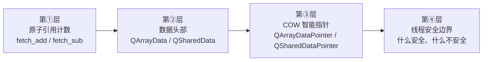
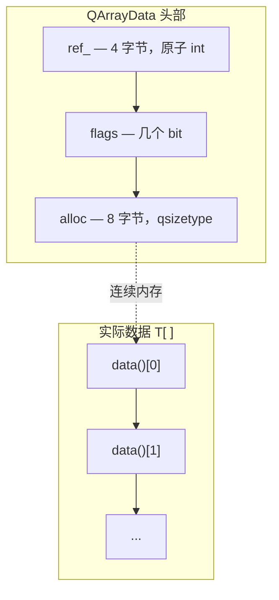
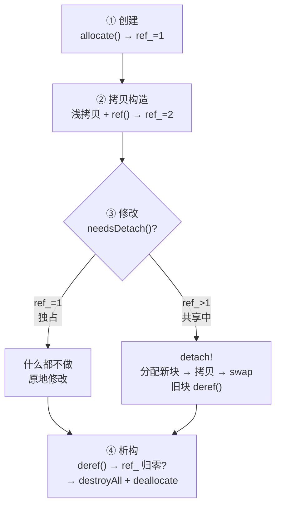
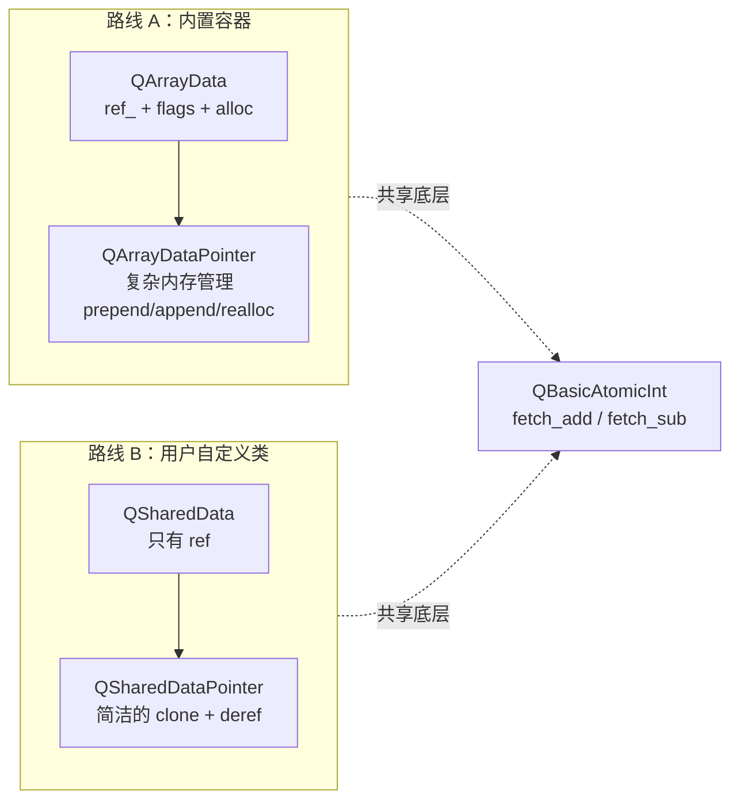

# 隐式共享（COW）机制原理

## 前言：拷贝一个 QString，为什么和拷贝一个 int 差不多快

咱们从两行再普通不过的 C++ 代码看起：

```cpp
QString s1 = "Hello, Qt!";
QString s2 = s1;
```

写过 C++ 的话，咱们的直觉会说第二行做了一次深拷贝，咱们把 “Hello, Qt!” 的每个字符都复制了一份（哦，C++11 之后有移动语义了，您可能猜这里走的是移动构造）。可咱们在 Qt 里实测一轮，拷贝一个 QString 和拷贝一个 int 是一样快的，字符串再长也是一样的速度。

这行代码背后的答案叫隐式共享（Implicit Sharing），咱们也常听它的另一个名字，也就是咱们常说的 Copy-on-Write（COW）。它的思路很直接，拷贝的时候只共享同一份数据，开销不过是 O(1)，等到真正要修改的时候才复制一份出来。写到这里您多半会联想到 `std::shared_ptr` 的引用计数，这个联想是对的，可 Qt 的 COW 有自己的一套基础设施，咱们能看到的是三样东西：引用计数直接嵌在数据头部、由原子操作保护、再靠非常量访问自动触发深拷贝（Qt 里把这个动作叫 detach）的机制，用的人完全感觉不到它的存在。

## 环境说明

本篇引用的源码全部来自 `qt_src/qt6.9.1`，行号会跟着 Qt 的升级漂移，您对照的时候要是发现对不上，拿函数名到对应的文件里搜一下就能找回来。咱们按出场顺序把要翻的文件列在下面：

| 文件 | 角色 |
|---|---|
| `qt_src/qt6.9.1/qtbase/src/corelib/thread/qatomic_cxx11.h` | 原子操作底层（std::atomic 封装） |
| `qt_src/qt6.9.1/qtbase/src/corelib/tools/qrefcount.h` | 引用计数高层封装（RefCount） |
| `qt_src/qt6.9.1/qtbase/src/corelib/tools/qarraydata.h` | 容器共享数据头部（QArrayData） |
| `qt_src/qt6.9.1/qtbase/src/corelib/tools/qarraydata.cpp` | 数据块分配与初始化（ref_ 起步值在这里设） |
| `qt_src/qt6.9.1/qtbase/src/corelib/tools/qarraydatapointer.h` | 容器 COW 智能指针（QArrayDataPointer） |
| `qt_src/qt6.9.1/qtbase/src/corelib/tools/qlist.h` | QList 容器本体（begin()/end() 触发 detach 的入口） |
| `qt_src/qt6.9.1/qtbase/src/corelib/tools/qshareddata.h` | 用户自定义共享类路线（QSharedData + QSharedDataPointer） |
| `qt_src/qt6.9.1/qtbase/src/gui/painting/qpen.h` | 显式共享的真实用例（QPen 的 dataPtr/detach） |

## 核心概念讲解

动身以前咱们把路线图对一下，本篇要看的东西不少，知道了整体走向，咱们才不会一头扎进某个函数里迷路。Qt 的 COW 是一个分层的系统，咱们从下往上分成四层来看：



咱们从第①层动身，一层一层地往上走。为什么按这个顺序？因为每一层都踩在下一层的机制上，您要是不知道底层的 ref/deref 是原子的，就理解不了 QArrayDataPointer 的 detach 为什么安全，您要是不知道 QArrayData 的 ref_ 字段在哪，detach 的判断条件也就没处着落了。Qt 实际上还设计了两条独立的路线来满足不同的场景，内置容器走的是 QArrayData 路线，用户自定义类走的是 QSharedData 路线，两条咱们都会走一遍，最后咱们把它们放在一起对比。

### 原子引用计数：COW 的地基

COW 要回答的问题很简单，眼下的数据有几个使用者在用。只有一个人在用的话，咱们想怎么改就怎么改。两个人以上在共享的时候，要改就得复制一份自己的出来。要安全地回答这个问题，引用计数就得是线程安全的，这是整套机制的地基。

Qt 把引用计数操作委托给了 `QBasicAtomicInteger`，它的底层就是 `std::atomic<int>`。咱们来看 `ref()` 的实现，对应的行号是 `qt_src/qt6.9.1/qtbase/src/corelib/thread/qatomic_cxx11.h:259`，咱们对着看：

> ```cpp
> return _q_value.fetch_add(1, std::memory_order_acq_rel) != T(-1);
> ```

这行代码的动作有两个，原子地加 1，接着检查加 1 之前的旧值是不是 -1。咱们展开说说 `memory_order_acq_rel`，它是一对 acquire-release 的语义，release 保证本次 fetch_add 之前的所有写操作对其他线程可见，acquire 保证 fetch_add 之后的读操作，不会重排到它的前面去。对引用计数来说这对语义足够了，ref() 执行之后的计数对其他线程一定可见。

咱们再看 `deref()` 的实现，用的还是同一个文件，对应的行号是 `qt_src/qt6.9.1/qtbase/src/corelib/thread/qatomic_cxx11.h:266`，咱们对着看：

> ```cpp
> return _q_value.fetch_sub(1, std::memory_order_acq_rel) != T(1);
> ```

同样是原子地减 1，判断条件换了，检查的是旧值是不是等于 1。旧值是 1 的话，减完之后就归零了，说明它就是最后一个引用了，数据到该释放的时候了。此时 `!= T(1)` 的结果是 false，外层拿到的是 false，就知道该释放了。这里的语义反转咱们要看清，deref() 返回 false 的意思是该释放，不是出了错。

这里的 -1 咱们得多说一句，它是 Qt 留给静态对象的标记值，静态对象就是那些永生不死、永远不该被释放的数据，比如空字符串共享的空块。对静态对象做 ref() 或 deref() 的时候，计数是不会变的，碰上它的时候怎么处理，不同的层面有不同做法，咱们后面会碰到。

Qt 还在 `QBasicAtomicInt` 之上包了一层 `QtPrivate::RefCount`，把静态对象的概念也装了进去，咱们看 `qt_src/qt6.9.1/qtbase/src/corelib/tools/qrefcount.h:18-23`：

> ```cpp
> inline bool ref() noexcept {
>     int count = atomic.loadRelaxed();
>     if (count != -1) // !isStatic
>         atomic.ref();
>     return true;
> }
> ```

RefCount::ref() 拿 loadRelaxed() 读一下当前的值，咱们读到的如果是 -1（静态对象），它就跳过递增、直接给您返回 true。有意思的是它始终返回 true，不管实际递增了没有。这是一个有意的设计选择，调用者不需要知道对象是不是静态的，只需要知道 ref 成功了、释放的事不用自己操心。

> ```cpp
> inline bool deref() noexcept {
>     int count = atomic.loadRelaxed();
>     if (count == -1) // isStatic
>         return true;
>     return atomic.deref();
> }
> ```

deref() 碰到静态对象的时候直接返回 true，这个 true 是说给咱们听的，说的是不用释放这件事，非静态的对象才走真正的 fetch_sub。

这里有一个让笔者头一回读到时很不安心的地方，RefCount::ref() 里头的逻辑分两步，loadRelaxed() 的读在前头，atomic.ref() 的调用在后头，两步之间要是另一个线程把 count 改了怎么办？比如线程 A 读到的 count 是 5（不是 -1），然后线程 B 把 count 改成了 -1，线程 A 接着调 atomic.ref() 的话，岂不是对 -1 做了递增？

实际上您不用担心这样的事。Qt 的设计里，一个对象要么是静态的（从创建到销毁一直是 -1），要么不是静态的，不存在运行途中突然变成静态对象的情况。所以 loadRelaxed() 读到非 -1 之后，哪怕有并发的 ref/deref，count 的变化也只在正整数之间、不会变成 -1，这个 loadRelaxed() 是安全的。

### QArrayData：容器共享数据的头部

看懂了原子引用计数，咱们来看 Qt 的内置容器是怎么组织共享数据的，QString、QByteArray、QList 走的都是这一套。要建立的认识是，容器的实际数据不是一截裸数组，数据前面有一个管元信息的头部结构。

这个头部的名字叫 `QArrayData`，字段的名单很短，三个就是全部了，对应的行号是 `qt_src/qt6.9.1/qtbase/src/corelib/tools/qarraydata.h:42-44`，咱们对着看：

> ```cpp
> QBasicAtomicInt ref_;
> ArrayOptions flags;
> qsizetype alloc;
> ```

`ref_` 是引用计数、`flags` 是容量预留一类的标志位，`alloc` 是已分配的容量（以元素个数为单位）。内存布局咱们可以画成下面的样子：



新分配的数据块会把 ref_ 初始化为 1，咱们把证据摘下来，对应的行号是 `qt_src/qt6.9.1/qtbase/src/corelib/tools/qarraydata.cpp:141`：

> ```cpp
> header->ref_.storeRelaxed(1);
> ```

分到新块的是创建它的人，所以 ref_ 从 1 起步。这个起步值咱们记在心里，后文讲 QSharedData 路线的时候您会看到，QSharedData 的构造函数把 ref 初始化成的是 0，跟这里的 1 对不上，两边为什么不一样，到时候咱们对着说。您把这个差别记到路线上就对了，QArrayData 路线在分配的时候直接设 1，因为分配就意味着已经有人持有它了，QSharedData 路线把 ref 留给外层的智能指针去递增。

接下来是两个起判断作用的函数，咱们看 `qt_src/qt6.9.1/qtbase/src/corelib/tools/qarraydata.h:69-80`：

> ```cpp
> bool isShared() const noexcept
> {
>     return ref_.loadRelaxed() != 1;
> }
> bool needsDetach() noexcept
> {
>     return ref_.loadRelaxed() > 1;
> }
> ```

两个函数的样子几乎一样，判断的条件却不一样，`isShared()` 用的是 `!= 1`，`needsDetach()` 用的是 `> 1`。差异出在 ref_==0 的情况，这个状态咱们得好好说说。什么场景下 ref_ 会是 0？您在源码里找不出一个停在 0 上的活数据块，减到 0 的那一下就把内存交还给系统了，所以头上的 `!= 1` 与 `> 1` 之别，防的只是一个理论状态。真正值得单独看的是另一类数据，它们连自己的头部都没有、根本走不到 ref_ 的判断，咱们接着看。

`fromRawData()` 创建出来的视图就是这一类，它根本没有自己的 QArrayData 头部，咱们看到它手里的 d 指针是 nullptr（d 是指向头部的那个指针，咱们下一节再正式认识它，`qt_src/qt6.9.1/qtbase/src/corelib/tools/qarraydatapointer.h:63-66` 的 `fromRawData` 就是返回 `{ nullptr, const_cast<T *>(rawData), length }`）。这样的数据没有头部可供查询，判断被提到了指针层来做，指针层的 `isShared()` 是 `!d || d->isShared()`、`needsDetach()` 是 `!d || d->needsDetach()`（`qt_src/qt6.9.1/qtbase/src/corelib/tools/qarraydatapointer.h:451-456`），d 为 null 的时候两个都返回 true，意思是谁也别想就地改它，要写的时候就得整份拷走。

实际触发深拷贝的判断是 `needsDetach()`，只有 ref_ > 1、真的有其他人在共享的时候才需要 detach。还有个细节咱们别放过，`needsDetach()` 被标记成了非 const，源码注释里的那句原话是 “intentionally not const”，把设计上的意图交代得很清楚，您一旦开口问需不需要 detach，说明的就是您打算修改数据，那这个提问本身就该发生在非常量的上下文里。

另一个值得看的细节是，两个判断函数用的都是 `loadRelaxed()`，既不是 acquire 也不是 release 的语义，这意味着它们不保证读到其他线程最新的写入。不过这是安全的，要是读到了旧值（比如实际的 ref_ 已经是 2，咱们还读到 1），最坏的情况是少做了一次 detach，而下一次操作会再检查一遍。反过来要是实际是 1 而读到了 2，顶多多做一次不必要的深拷贝。两种情况都不会破坏数据的一致性、也不会崩溃。

### QArrayDataPointer：COW 的智能指针

咱们已经看到，光秃秃的 `QArrayData` 头部本身不管生命周期，真正管着什么时候共享、什么时候复制、什么时候释放的，是后面要讲的 `QArrayDataPointer<T>`，一个专门为连续数组设计的 COW 智能指针。

它手里持有的成员有三个，对应的行号是 `qt_src/qt6.9.1/qtbase/src/corelib/tools/qarraydatapointer.h:516-518`，咱们对着看：

> ```cpp
> Data *d;
> T *ptr;
> qsizetype size;
> ```

`d` 指向的是 QArrayData 头部，准确的名字是 `QTypedArrayData<T>`（QArrayData 的模板子类），`ptr` 指向的是实际数据数组的首元素，`size` 装的是当前有效的元素数。您可能会疑惑 `ptr` 和 `d` 为什么要分开，数据不是紧跟在头部后面吗？大部分情况确实是这样，不过 Qt 的容器支持 prepend 优化，也就是在数组的前面预留空间，此时 `ptr` 会指向数据区中间的某个位置、不再紧跟头部，这样的设计让 prepend 和 append 一样高效。

接下来咱们走一遍完整的 COW 生命周期，这是本篇的主线，搞懂了它就搞懂了 Qt 的 COW。整个流程咱们概括成四步：



下面咱们一步一步展开，每一步都有对应的源码。

#### 创建：分配即持有，ref_ 从 1 起步

咱们构造一个 `QList<int> list = {1, 2, 3}` 的时候，底层调用的就是 `QArrayData::allocate()` 来分配内存，ref_ 被设成 1（前面的源码咱们看过了）。此时 QArrayDataPointer 的三个成员分别指向新分配的头部、数据的首元素，size 装的是 3。

#### 拷贝构造：浅拷贝三个指针，再加一次原子递增

```cpp
QList<int> list2 = list;  // 发生了什么？
```

拷贝构造的源码在 `qt_src/qt6.9.1/qtbase/src/corelib/tools/qarraydatapointer.h:37-40`，咱们对着看：

> ```cpp
> QArrayDataPointer(const QArrayDataPointer &other) noexcept
>     : d(other.d), ptr(other.ptr), size(other.size)
> {
>     ref();
> }
> ```

这里的动作是三步，咱们把 d/ptr/size 三个成员浅浅地复制过去，这一步只是指针的赋值、不碰数据，接着调用的是 `ref()`。`ref()` 的实现是 `if (d) d->ref()`（`qt_src/qt6.9.1/qtbase/src/corelib/tools/qarraydatapointer.h:451`），对 d 指向的 QArrayData 做一次原子递增，此时 ref_ 就从 1 变成了 2。两个 QList 共享的是同一份数据，拷贝的开销是复制三个指针加一次原子加法，list 装的是一万个元素还是一个亿，开销都保持在一个恒定的 O(1)。

#### 修改：detach 在这里发生

咱们常说的写时复制就发生在这一步。

```cpp
list2[0] = 99;  // list2 触发 detach
```

非 const 的 `operator[]` 被调用的时候，`detach()` 就被间接触发了，对应的行号是 `qt_src/qt6.9.1/qtbase/src/corelib/tools/qarraydatapointer.h:142-145`，咱们对着看：

> ```cpp
> void detach(QArrayDataPointer *old = nullptr)
> {
>     if (needsDetach())
>         reallocateAndGrow(QArrayData::GrowsAtEnd, 0, old);
> }
> ```

detach() 的逻辑就两行，查的条件是咱们前面见过的 `needsDetach()`，它的完整写法就是 `!d || d->needsDetach()`（`qt_src/qt6.9.1/qtbase/src/corelib/tools/qarraydatapointer.h:456`）。此刻的 ref_ 是 2，已经大于 1 了，条件就成立了，该深拷贝了，接下来走的就是 `reallocateAndGrow()`：

> ```cpp
> Q_NEVER_INLINE void reallocateAndGrow(QArrayData::GrowthPosition where, qsizetype n,
>                                       QArrayDataPointer *old = nullptr)
> {
>     // ... fast path 省略 ...
>
>     QArrayDataPointer dp(allocateGrow(*this, n, where));
>     // ...
>     if (size) {
>         qsizetype toCopy = size;
>         // ...
>         if (needsDetach() || old)
>             dp->copyAppend(begin(), begin() + toCopy);
>         else
>             dp->moveAppend(begin(), begin() + toCopy);
>     }
>
>     swap(dp);
>     if (old)
>         old->swap(dp);
> }
> ```

咱们把这段代码归拢成四个动作。`allocateGrow()` 分配的是一块新的 QArrayData 加数据区，新块的 ref_=1。`copyAppend()` 把旧数据一个元素一个元素地拷到新块，这一步就是深拷贝的本体。`swap(dp)` 把 this 和 dp 手里的 d/ptr/size 交换，this 从此指向的是新数据，dp 手里拿的是旧数据。dp 离开作用域的时候析构，对旧数据调用的就是 `deref()`。

咱们看这一步走完之后的局面，list2 指向的是新数据（ref_=1），list 仍然指向的是旧数据（ref_ 从 2 被 deref 到 1），两个对象是彼此独立的，修改的时候互不影响。

detach 的入口咱们还得补一处，QList 自己的非常量 `begin()` 走的也是同一条 detach 路，它的写法是 `iterator begin() { detach(); return iterator(d->begin()); }`（`qt_src/qt6.9.1/qtbase/src/corelib/tools/qlist.h:656`），风险部分讲 range-for 的时候咱们要用它，const 的 `begin()`（`qlist.h:659`）就没有这一步。

#### 析构：最后一个放手的人来收尾

> ```cpp
> ~QArrayDataPointer()
> {
>     if (!deref()) {
>         (*this)->destroyAll();
>         Data::deallocate(d);
>     }
> }
> ```

析构函数的原文在 `qt_src/qt6.9.1/qtbase/src/corelib/tools/qarraydatapointer.h:106-112`。析构的时候调用 `deref()`，它的实现是 `return !d || d->deref()`（`qt_src/qt6.9.1/qtbase/src/corelib/tools/qarraydatapointer.h:452`）。d 为 null（fromRawData 的场景）的时候，就直接返回 true、什么也不释放了。否则调用的是 `QArrayData::deref()`（`qt_src/qt6.9.1/qtbase/src/corelib/tools/qarraydata.h:64-67`），内部就是咱们熟悉的 `ref_.deref()`，也就是咱们看过的那个 fetch_sub。旧值是 1 的话，减完之后归零、返回的是 false，意思是该释放了。然后由 `destroyAll()` 把元素逐个地析构，整块的内存交给 `deallocate()` 释放。

赋值运算符也值得咱们说一句，Qt 用的是 copy-and-swap 惯用法，对应的行号是 `qt_src/qt6.9.1/qtbase/src/corelib/tools/qarraydatapointer.h:69-73`，咱们对着看：

> ```cpp
> QArrayDataPointer &operator=(const QArrayDataPointer &other) noexcept
> {
>     QArrayDataPointer tmp(other);
>     this->swap(tmp);
>     return *this;
> }
> ```

咱们把动作过一遍，头一步拷贝构造出 tmp（这一步 ref 加了 1），接着 swap（this 拿到的是新数据，tmp 拿到的是旧数据），tmp 析构的时候对旧数据 deref。自赋值也是安全的，`list = list` 的时候 tmp 拷贝的是自身（ref 从 1 变 2），swap 之后 tmp 持有原来的指针，tmp 析构的时候 deref 一次（ref 回到 1），最终加在 ref 上的净效果是零。

### QSharedDataPointer：用户自定义共享类的路线

前面讲的 QArrayDataPointer 是 Qt 内部给容器用的，针对连续数组做了不少的优化，prepend 的空间、reallocate 的快路径都是。咱们要是给自己的类加 COW，另一套更简洁的路线也早已备好，担纲的是 `QSharedData` 和 `QSharedDataPointer`。两条路线的架构对比画在下面的图里：



咱们下面的讲解会经常回头对比路线 A，您对照着看就好。

咱们从数据基类的声明看起，对应的行号是 `qt_src/qt6.9.1/qtbase/src/corelib/tools/qshareddata.h:22-25`：

> ```cpp
> mutable QAtomicInt ref;
> // ...
> QSharedData() noexcept : ref(0) { }
> QSharedData(const QSharedData &) noexcept : ref(0) { }
> ```

有两处细节咱们要留意。头一处是 `ref` 的初始值，它初始化成的是 0 而不是 1，这和 QArrayData 的 `storeRelaxed(1)` 不一样。设计上的理由是这样的，创建 QSharedData 子类对象的时候，还没有哪个智能指针持有它的，此时的 ref 就该是 0，等 `QSharedDataPointer` 接管的时候才递增成 1。另一处是 `ref` 声明里的 `mutable`，这是必要的，拷贝一个 `const QSharedDataPointer<T>` 的时候，要对新指向的 data 做 `ref()`，可 data 指向的是 const 对象，没有 mutable 的话，在 const 对象上改 ref 是编译不过的。

咱们再看智能指针，拷贝构造和析构是理解这套路线的两处入口。拷贝构造的源码在 `qt_src/qt6.9.1/qtbase/src/corelib/tools/qshareddata.h:66-67`，咱们对着看：

> ```cpp
> QSharedDataPointer(const QSharedDataPointer &o) noexcept : d(o.d)
> { if (d) d->ref.ref(); }
> ```

咱们看它做的还是浅拷贝 d 指针加 `ref()`，和 QArrayDataPointer 的拷贝构造完全对称。

> ```cpp
> ~QSharedDataPointer() { if (d && !d->ref.deref()) delete d.get(); }
> ```

析构函数的原文在 `qt_src/qt6.9.1/qtbase/src/corelib/tools/qshareddata.h:57`，咱们接着看。析构的时候调用的是 deref()，返回的是 false（ref 从 1 减到 0）就 delete 整个数据对象，这套路线的简洁在这里看得最清楚。

然后要看的是 detach，QSharedDataPointer 的 detach 逻辑比 QArrayDataPointer 简单得多，因为没有连续数组的 prepend/append 优化要处理，咱们看 `qt_src/qt6.9.1/qtbase/src/corelib/tools/qshareddata.h:41`：

> ```cpp
> void detach() { if (d && d->ref.loadRelaxed() != 1) detach_helper(); }
> ```

detach 的条件是 `d != nullptr` 且 `ref != 1`。这里的判断是 `!= 1` 而不是 `> 1`，和 QArrayData 的 `needsDetach()`（`> 1`）不一样，意味着 ref==0 的时候也会触发 detach_helper。那 ref==0 的场景是什么？您用 `QAdoptSharedDataTag` 构造了一个没有递增引用计数的指针，然后对它做非 const 访问的时候。这时候的 ref 是 0，detach_helper 会创建一个独立的副本。

> ```cpp
> Q_OUTOFLINE_TEMPLATE void QSharedDataPointer<T>::detach_helper()
> {
>     T *x = clone();
>     x->ref.ref();
>     if (!d.get()->ref.deref())
>         delete d.get();
>     d.reset(x);
> }
> ```

detach_helper 的原文在 `qt_src/qt6.9.1/qtbase/src/corelib/tools/qshareddata.h:243-250`。咱们数下来是四步。`clone()` 干的事就是 `new T(*d)`，拷贝构造出一个新的数据对象，新对象从 QSharedData 继承来的初始 ref 是 0。`x->ref.ref()` 把新对象的 ref 从 0 提到 1。接着就是对旧对象的 deref()，减到 0 的话就 delete。最后 `d.reset(x)` 让 d 指向的是新对象。整个流程比 QArrayDataPointer 的 reallocateAndGrow 简洁得多，因为它不用操心内存的布局、数据的搬迁这些麻烦事。

最后咱们认识一下 `QExplicitlySharedDataPointer`，它是 QSharedDataPointer 的手动挡版本，深拷贝的决定权在您自己手里：

> ```cpp
> T &operator*() const { return *(d.get()); }
> T *operator->() noexcept { return d.get(); }
> T *operator->() const noexcept { return d.get(); }
> ```

运算符的原文在 `qt_src/qt6.9.1/qtbase/src/corelib/tools/qshareddata.h:137-139`，咱们看看。看到了吗？非 const 的 `operator->()` 和 `operator*()` 都不调用 `detach()`。拿到指针之后您想怎么改就怎么改，深拷贝的流程也不会被自动触发。这就是显式共享的做法，什么时候调 `detach()` 得您自己决定。QExplicitlySharedDataPointer 适合您确实想让多个引用共享同一份数据的场景，Qt 里的真例子是 `QPen`，它的 `dataPtr` 用的就是 `QExplicitlySharedDataPointer<QPenPrivate>`（`qt_src/qt6.9.1/qtbase/src/gui/painting/qpen.h:109`），画笔在代码里经常被咱们拷来拷去，共享同一份数据省掉了不必要的复制，真要改的时候，QPen 自己的修改方法会去调它私有的 `detach()`（`qpen.h:112`）。

两条路线的对比，咱们摆在下面：

| | QArrayDataPointer 路线 | QSharedDataPointer 路线 |
|---|---|---|
| 适用对象 | 内置容器（QString/QByteArray/QList） | 用户自定义共享类 |
| 数据头 | QArrayData（ref_/flags/alloc） | QSharedData（只有 ref） |
| detach 触发 | 非常量访问自动触发 | QSharedDataPointer：自动触发；QExplicitlySharedDataPointer：手动触发 |
| detach 实现 | reallocateAndGrow（复杂的内存管理） | detach_helper（简洁的 clone+deref） |
| ref 初始值 | 1（分配即持有） | 0（指针接管后递增） |
| detach 条件 | ref_ > 1（needsDetach） | ref != 1 |

### 线程安全边界：COW 保护什么，不保护什么

这里是咱们最容易栽跟头的地方，什么能指望、什么不能指望这件事上，咱们把界线划清楚。COW 的线程安全只覆盖引用计数操作本身，不覆盖同一个对象在不同线程的同时修改。

咱们可以放心，引用计数的线程安全由 `memory_order_acq_rel` 保证，ref() 的 fetch_add 和 deref() 的 fetch_sub 都是原子的，多线程同时做引用计数的操作也不会出问题。

但 `needsDetach()` 用的是 `loadRelaxed()`，不保证咱们看到其他线程最新的写入，这是刻意的，读到了旧值，最坏也就是多做一次不必要的深拷贝、闹不出数据竞争。

COW 真正给咱们的线程安全保证是这样的场景，线程 A 和线程 B 各自持有一个 QString 的拷贝（通过拷贝构造共享数据），然后各自读自己的，这样读是完全安全的，因为读的操作根本不触发 detach，引用计数也就不动了。线程 A 要修改的话，detach 会创建出独立的副本，线程 B 手里的旧数据不受影响。有一点咱们得交代清楚，这是基于 ref/deref 原子性和 detach 后各持独立副本推出来的判断，不是 Qt 源码里一行可见的显式声明，不过推理的链条是站得住的。

COW 不保护的场景也要说清楚，两个线程对同一个非 const 的 QString 对象（不是各自的拷贝）同时调非 const 方法，这时候两个线程可能一齐进了 detach，而 detach 本身不是线程安全的（loadRelaxed 的检查在前，reallocate 的执行在后，两步之间不是原子的）。Qt 给隐式共享类挂的标记是 reentrant（可重入）而不是 thread-safe（线程安全），这个区分对您读文档很重要。

## 风险与故障预防

本篇挑出来的麻烦都能在源码里对上号，后果和解法咱们一条条交代。

头一处麻烦是非常量方法触发意外的 detach。讲 detach 机制的时候咱们已经见过它了，所有的非常量访问都会检查 needsDetach()，不过实际的后果比您想的要重得多。咱们看这段代码：

```cpp
QString big = loadHugeFile();  // 几十 MB
auto& ref = big[0];            // 非常量 operator[] → data() → detach()
```

假如 big 此时的 ref_ > 1（比如您之前做过 `QString copy = big`，copy 还活着的话），这一行就会触发一次完整的深拷贝，几十 MB 的内存分配加数据复制，就这么被一行看起来人畜无害的下标访问干了。更隐蔽的地方在 range-based for 循环，咱们看这一对写法：

```cpp
for (auto& c : str) { ... }       // 非常量 begin() → detach()!
for (auto& c : std::as_const(str)) { ... }  // const begin()，不触发
```

原因咱们在生命周期分析里见过了，非常量的 begin() 会调 detach()，const 的 begin() 就不会。后果咱们分两种情形看，str 被共享的话，第一种写法在循环开始前就白做了一次深拷贝。str 不被共享的话，看起来没什么区别，不过 detach 的检查本身也有原子读的开销，到了热循环里，这股开销就不能忽视了。解法简单得不能再简单了，不需要修改的时候，一律改用 const 的引用，或者借 `std::as_const()` 的光。

第二处麻烦是 detach 之后的迭代器失效，这个麻烦是真能给您一个 segfault 的。假设有这样的代码：

```cpp
QList<int> list = {1, 2, 3, 4, 5};
auto it = list.begin();
QList<int> copy = list;  // ref_ = 2
copy.append(6);          // detach! 新内存，旧内存 ref_ 从 2 减到 1
*it = 99;                // it 还指向旧数据...但如果 ref_ 归零就会悬垂
```

咱们看，这段代码眼下是不会崩溃的，因为 list 还握着旧数据的引用（ref_=1）。可您接下来的修改要是落在 list 上（触发另一次 detach），旧数据的 ref_ 归零、内存被释放，it 就成了悬垂指针。更危险的情形是把 it 传给另一个函数，函数里有人改了 copy，您根本意识不到迭代器已经失效了。后果是这样的，拿悬垂指针去读是实打实的未定义行为、可能 segfault、可能读到垃圾数据，也可能在您看起来一切正常，其实数据早就被覆盖了。解法是在您做修改操作之前，确保没有活跃的迭代器还指着可能被 detach 的数据。

第三处麻烦是您用了 `QExplicitlySharedDataPointer` 又忘了手动 detach。前面咱们讲了，它的 `operator->()` 不会自动调 detach()，这意味着下面的代码不会有任何深拷贝发生：

```cpp
QExplicitlySharedDataPointer<MyData> p1(new MyData);
auto p2 = p1;              // 浅拷贝，共享数据
p1->value = 42;            // 修改了共享数据
// p2->value 也是 42 了！  // 因为没有 detach，两个指针指向同一份数据
```

要是您的本意是 p1 和 p2 各自独立，却用了 `QExplicitlySharedDataPointer` 又忘了手动调 `detach()`，那您得到的就是意外的数据共享。后果是您的数据被悄悄改掉，而且这样的 bug 排查起来很折磨人，程序看起来跑得好好的，数据却莫名其妙变了。解法是这样的，除非您确实需要显式共享（比如上面 QPen 的场景），否则您一律用 `QSharedDataPointer` 就稳了。必须用 QExplicitlySharedDataPointer 的话，您在修改之前显式调一次 `detach()`。

## 练习项目

本篇的练习走验证的路子，几道题给的是方向和核对手段，完整的工程留给您自己搭。

头一道题验 ref_ 的初值。您在调试器里断到 `QArrayData::allocate()` 的返回处（`qt_src/qt6.9.1/qtbase/src/corelib/tools/qarraydata.cpp:141` 附近），看新块头部的 `ref_` 是不是 1，是的话，创建即持有的说法就落了地。

第二道题验 detach 的发生。您写一个 `QList<int>`，拷贝的时候留一份副本，咱们往副本上 append 几个新元素，单步跟进去看 `detach()` 走的分支（`qt_src/qt6.9.1/qtbase/src/corelib/tools/qarraydatapointer.h:142-145`），确认 ref_ 的变化是从 2 到 1、新块从 1 起步。

第三道题验的是迭代器失效。您按风险部分的第二处麻烦复现一遍，拿着 `begin()` 返回的迭代器触发一次 detach，您再用它去读写一次，构建的时候给工具链开上地址消毒器（ASan），悬垂访问会被 ASan 直接报给您。

第四道题验两条路线的分野。您写一个继承 `QSharedData` 的小数据类，`QSharedDataPointer` 和 `QExplicitlySharedDataPointer` 两个指针您都配上、各跑一遍，自动 detach 的 `QSharedDataPointer` 改副本的时候互不影响，手动挡的 `QExplicitlySharedDataPointer` 一动就全动了，两条路线的分野就摆在您眼前了。

末了是一道对行号的题，您挑上三四处（比如 `qatomic_cxx11.h:259` 的 fetch_add，`qrefcount.h:18` 的 RefCount::ref，`qarraydata.h:69` 的 isShared，`qshareddata.h:41` 的 detach），咱们带着行号去 `qt_src/qt6.9.1` 翻原文，一处一处地核对过去，都对上了，本篇的断言也就落了地。

## 官方文档参考链接

咱们把本篇用到的官方文档列在下面，链接都指向 doc.qt.io 的 Qt 6 文档（基线 6.9.1）：

- [Qt 文档 · Implicit Sharing](https://doc.qt.io/qt-6/implicit-sharing.html) —— 隐式共享机制的总览，哪些类用了 COW 都列在这一页。
- [Qt 文档 · QSharedData](https://doc.qt.io/qt-6/qshareddata.html) —— 用户自定义共享类的引用计数基类。
- [Qt 文档 · QSharedDataPointer](https://doc.qt.io/qt-6/qshareddatapointer.html) —— 自动 detach 的隐式共享智能指针。
- [Qt 文档 · QExplicitlySharedDataPointer](https://doc.qt.io/qt-6/qexplicitlyshareddatapointer.html) —— 手动 detach 的显式共享智能指针。

本篇写到这里就收尾了，Qt COW 机制的原理咱们从源码层面走了一遍。从最底层的 fetch_add 一路走到 detach_helper 的 clone、deref、reset，内置容器和用户自定义类的两条路线咱们都过了一遍。这套机制放回具体的容器（QString、QByteArray、QList）里是什么光景，咱们在[《COW 在 Qt 容器中的实战》](./04-cow-container-practice-expert.md)里接着看，那里逐个过它们各自哪些操作会触发 detach、const 和非常量访问的实战差异有多大，还有 `QVarLengthArray` 这样的容器不用 COW、它适合的场景也一并捋了。
