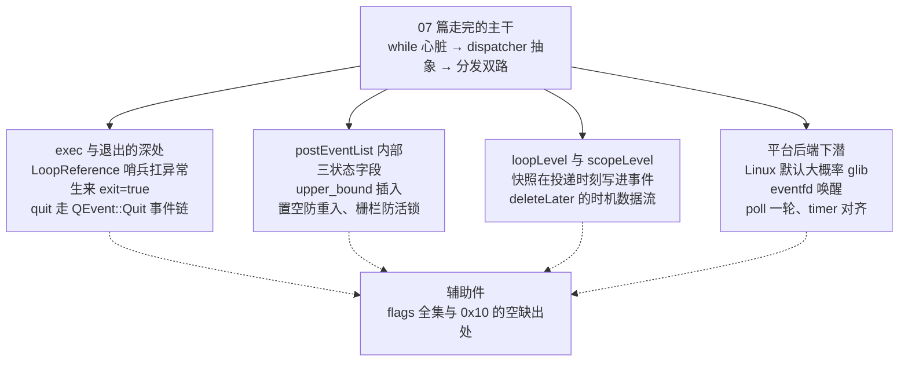
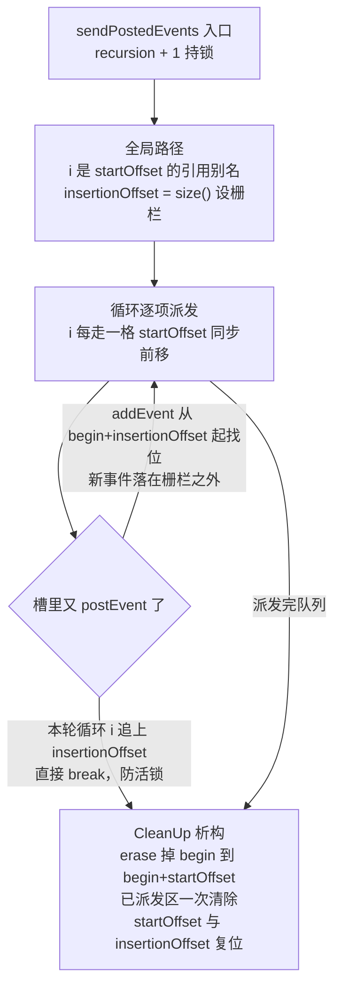
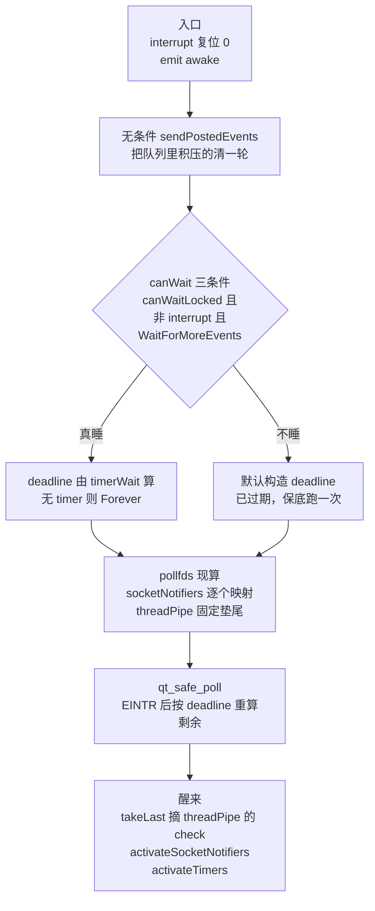

# 事件循环源码深潜：退出协议、队列状态与两个平台后端

您现在跑在 Linux 桌面上的 Qt 程序，它的事件循环大概率由 glib 版 dispatcher 驱动，本篇花最多篇幅拆的 poll 版，在典型发行版上反而当不了家。这句话带前提，官方默认构建、运行时没设 QT_NO_GLIB 环境变量，两个条件都满足时 glib 版胜出，依据在 `qt_src/qt6.9.1/qtbase/src/corelib/thread/qthread_unix.cpp:319-342`，咱们到平台后端一节把判定链逐行对一遍。开篇就把它摆出来，是因为不少拆解文章默认自己面对的是 QEventDispatcherUNIX，拿 poll 的模型去解释一切，而您在典型 Linux 发行版上实际面对的往往是 glib 在驱动。两个后端是平级兄弟，机制大量共用，把 glib 与 poll 的默认判定弄清，后面的拆解才不张冠李戴。

07 篇（[事件循环源码拆解](./07-event-loop-internals-expert.md)）已经把主干走完，while 心脏、exit 三步、interrupt 踹醒、notify 与 sendEvent 的同步路、postEvent 的异步入队、DeferredDelete 的时机判定、事件过滤器的双层拦截，都在那边。本篇不回头重讲，咱们下潜的四处分两类。07 篇明说弃权的两处，平台后端的实现与 addEvent 内部的排序算法。只讲了结果没拆机制的两处，一处是 exec 的退出协议，另一处是 loopLevel 与 scopeLevel 的数据流。exec 的退出协议，看异常安全由谁负责。postEventList 的内部，看 recursion、startOffset、insertionOffset，三个状态字段怎么管起一个优先级队列。loopLevel 与 scopeLevel 的数据流，看 deleteLater 的时机是怎么铸进事件的。最后下潜平台后端，eventfd、poll 的一轮、glib 兄弟。一路上还要对质十几处流传很广、在 6.9.1 源码里对不上号的说法，每一处都落到具体行号，您拿着行号自己能验。

本篇源码基线 `qt_src/qt6.9.1`，行号基于此版本，升级会漂移，对不上号时拿函数名或字段名进文件里搜。出场的源码文件按正文首次引用的顺序列在下面，gui 侧另有一件。

| 文件 | 角色 |
|---|---|
| `qt_src/qt6.9.1/qtbase/src/corelib/thread/qthread_unix.cpp` | createEventDispatcher 的默认后端选择 |
| `qt_src/qt6.9.1/qtbase/src/corelib/kernel/qeventloop.cpp` | LoopReference、exec、exit、quit、竞态防护 |
| `qt_src/qt6.9.1/qtbase/src/corelib/kernel/qeventloop_p.h` | QEventLoopPrivate 四字段与生来 exit=true |
| `qt_src/qt6.9.1/qtbase/src/corelib/kernel/qcoreapplication.cpp` | quit 事件链、postEvent、sendPostedEvents、removePostedEvents、canWait 写点 |
| `qt_src/qt6.9.1/qtbase/src/corelib/thread/qthread_p.h` | QPostEvent、QPostEventList、QThreadData、loopLevel 与 scopeLevel |
| `qt_src/qt6.9.1/qtbase/src/corelib/thread/qthread.cpp` | addEvent 的快路径与二分插入 |
| `qt_src/qt6.9.1/qtbase/src/corelib/kernel/qobject.cpp` | deleteLater 的层级快照、析构清残留 |
| `qt_src/qt6.9.1/qtbase/src/corelib/kernel/qabstracteventdispatcher.cpp` | native 过滤器对 scopeLevel 的抬升 |
| `qt_src/qt6.9.1/qtbase/src/corelib/kernel/qcoreevent_p.h` | QDeferredDeleteEvent |
| `qt_src/qt6.9.1/qtbase/src/corelib/kernel/qeventloop.h` | ProcessEventsFlags 枚举全集 |
| `qt_src/qt6.9.1/qtbase/src/gui/kernel/qwindowsysteminterface.cpp` | ExcludeUserInputEvents 的消费点 |
| `qt_src/qt6.9.1/qtbase/src/corelib/kernel/qeventdispatcher_glib.cpp` | glib 后端 |
| `qt_src/qt6.9.1/qtbase/src/corelib/kernel/qeventdispatcher_unix.cpp` | wakeUp、poll 一轮、SocketNotifier 与 timer 注册 |
| `qt_src/qt6.9.1/qtbase/src/corelib/kernel/qeventdispatcher_unix_p.h` | 三槽结构、eventfd 注释、events 映射 |
| `qt_src/qt6.9.1/qtbase/src/corelib/kernel/qcore_unix.cpp` | qt_safe_poll |
| `qt_src/qt6.9.1/qtbase/src/corelib/kernel/qsocketnotifier.cpp` | activated 发射点、setEnabled 注销 |
| `qt_src/qt6.9.1/qtbase/src/corelib/kernel/qtimerinfo_unix_p.h` | QTimerInfo 结构 |
| `qt_src/qt6.9.1/qtbase/src/corelib/kernel/qtimerinfo_unix.cpp` | timerWait、activateTimers、CoarseTimer 对齐 |

本篇不配 example，理由与 01 篇（[QObject 元对象系统源码拆解](./01-qobject-meta-system-expert.md)）、18 篇（[信号槽深度拆解](./18-signal-slot-deep-dive-expert.md)）一样直白，纯源码拆解，您对照 `qt_src` 翻原文就是最好的实验。动身前把深水区的路线图对一遍。



## exec 的深处：异常安全交给栈上哨兵

### 整个 exec 函数体里搜不到一个 catch

不少旧资料把 `QEventLoop::exec` 描述成 try/catch 包住派发循环的样子，说槽里抛出的异常会被 exec 吞掉或者转成警告继续跑。笔者把 6.9.1 的 exec 函数体从头到尾扫了一遍，一个 catch 都没有。异常安全全押在一个栈上的局部结构体身上，它的名字叫 LoopReference。

`qt_src/qt6.9.1/qtbase/src/corelib/kernel/qeventloop.cpp:145-160`

```cpp
    struct LoopReference {
        QEventLoopPrivate *d;
        QMutexLocker<QMutex> &locker;

        bool exceptionCaught;
        LoopReference(QEventLoopPrivate *d, QMutexLocker<QMutex> &locker) : d(d), locker(locker), exceptionCaught(true)
        {
            d->inExec = true;
            d->exit.storeRelease(false);

            auto threadData = d->threadData.loadRelaxed();
            ++threadData->loopLevel;
            threadData->eventLoops.push(d->q_func());

            locker.unlock();
        }
```

看构造函数的初始化列表，`exceptionCaught(true)`，这个哨兵生来就按异常已经发生记录。构造办了四件事，置 inExec、把 exit 标志复位成 false、给线程的 loopLevel 加一、把自己压进 eventLoops 栈，然后顺手把入口处拿的互斥量解开。真假在正常路径的末尾才翻转，188 行的 `ref.exceptionCaught = false`，夹在 while 循环退出与 return 之间。也就是说，栈展开凡是没走到 188 行，哨兵都按出事对待，这正是 RAII 的思路，对象出栈时顺手收拾状态，把正常收尾写成唯一一条洗白路径。

析构长这样。

`qt_src/qt6.9.1/qtbase/src/corelib/kernel/qeventloop.cpp:162-176`

```cpp
        ~LoopReference()
        {
            if (exceptionCaught) {
                qWarning("Qt has caught an exception thrown from an event handler. Throwing\n"
                         "exceptions from an event handler is not supported in Qt.\n"
                         "You must not let any exception whatsoever propagate through Qt code.");
            }
            locker.relock();
            auto threadData = d->threadData.loadRelaxed();
            QEventLoop *eventLoop = threadData->eventLoops.pop();
            Q_ASSERT_X(eventLoop == d->q_func(), "QEventLoop::exec()", "internal error");
            Q_UNUSED(eventLoop); // --release warning
            d->inExec = false;
            --threadData->loopLevel;
        }
```

警告打完，relock、弹栈、收 inExec、loopLevel 减一，四步把状态收拾干净，然后析构返回，异常继续往上抛，一个字都不吞。Qt 的态度全在那句警告里，从事件处理器抛异常不被支持，您别让任何异常穿过 Qt 代码。

这就带出本篇第一个要当场讲清的风险。现象是这样的，某个槽里抛出的异常没人 catch，它的上抛路径要穿过一整串 Qt 内部栈帧，sendPostedEvents 的派发层、processEvents、exec 的 while，沿途每一层都没有 catch，异常一路穿到 exec 之外。后果分两层，轻的一层是您在输出里看到那句 caught an exception 警告，线程的循环状态已经被 LoopReference 析构收拾干净，程序还能活。重的一层是 main 里没人接，`return app.exec()` 外面直接 std::terminate，整个进程当场倒下，析构顺序还没保证。根因正是本节拆的机制，exec 无 catch 是刻意设计，Qt 内部大量栈帧假设异常不穿行，穿行的行为没有承诺。解法顺着机制走，槽入口自己 catch 全部异常，第三方库抛异常的调用包一层隔离，别指望 exec 替您兜底。行号证据在上文两段引文，145-160 与 162-176。

### 循环的判据只有一个原子标志

07 篇讲过 while 心脏本身，这里补一个新量。processEvents 的返回值，exec 根本不看。

`qt_src/qt6.9.1/qtbase/src/corelib/kernel/qeventloop.cpp:185-189`

```cpp
    while (!d->exit.loadAcquire())
        processEvents(flags | WaitForMoreEvents | EventLoopExec);

    ref.exceptionCaught = false;
    return d->returnCode.loadRelaxed();
```

processEvents 返回 true 还是 false，循环体不消费，去留全由 exit 原子标志说了算，返回码另行存进 returnCode。还有一处归属容易记错，exceptionCaught 是 LoopReference 的成员，不在 QEventLoopPrivate 的字段表里，笔者第一次翻 qeventloop_p.h 找它，翻了个空才回过神来。

### 生来 exit=true：还没跑就被记成未运行

QEventLoopPrivate 一共四个字段，quitLockRef、exit、returnCode、inExec，构造函数体只有三行。

`qt_src/qt6.9.1/qtbase/src/corelib/kernel/qeventloop_p.h:27-39`

```cpp
    inline QEventLoopPrivate()
        : inExec(false)
    {
        returnCode.storeRelaxed(-1);
        exit.storeRelaxed(true);
    }
    ~QEventLoopPrivate() override;

    QAtomicInt quitLockRef;

    QBasicAtomicInt exit; // bool
    QBasicAtomicInt returnCode;
    bool inExec;
```

exit 存的是 true。一个刚出生的事件循环，被记成已经退出的状态。笔者第一次读到这行愣了一下，顺着用例想过去就通了，`isRunning()` 的实现是 `return !d->exit.loadAcquire()`，在 qeventloop.cpp:274-275，没跑过 exec 的循环用 exit=true 表示自己不在运行，exec 的 LoopReference 构造才把它复位成 false。exit 的语义是运行状态位，旧资料把它讲成谁退出时置起的旗子，方向反了。

quitLockRef 配合 QEventLoopLocker 用，锁计数归零且循环在跑时，投一个 Quit 事件。

`qt_src/qt6.9.1/qtbase/src/corelib/kernel/qeventloop_p.h:46-51`

```cpp
    void deref()
    {
        if (!quitLockRef.deref() && inExec) {
            qApp->postEvent(q_ptr, new QEvent(QEvent::Quit));
        }
    }
```

QEventLoopLocker 全部析构完，循环就该收摊，走的也是事件而非直调，与马上要讲的 quit 链路同一套路。

### quit 走的是事件链，静态直拿的路径不存在

常见说法把 `QCoreApplication::quit` 描述成静态函数直接摸到当前事件循环调 exit，一个静态调用当场生效。实况是它转了两道手，最终以一个 QEvent::Quit 事件的身份抵达。

`qt_src/qt6.9.1/qtbase/src/corelib/kernel/qcoreapplication.cpp:2090-2111`

```cpp
void QCoreApplication::quit()
{
    if (!self)
        return;

    if (!self->d_func()->in_exec)
        return;

    self->d_func()->quit();
}

void QCoreApplicationPrivate::quit()
{
    Q_Q(QCoreApplication);

    if (QThread::isMainThread()) {
        QEvent quitEvent(QEvent::Quit);
        QCoreApplication::sendEvent(q, &quitEvent);
    } else {
        QCoreApplication::postEvent(q, new QEvent(QEvent::Quit));
    }
}
```

两道检查，self 存在、in_exec 为真，都过了才走内部版 quit。主线程同步 sendEvent，跨线程 postEvent，然后事件到达 `QCoreApplication::event` 的 Quit 分支，在那里转成 `exit(0)`，2004-2009 行。真正遍历 eventLoops 栈逐个 exit 的是 `QCoreApplication::exit`，它发 aboutToQuit 信号在前，遍历 eventLoops 在后。

`qt_src/qt6.9.1/qtbase/src/corelib/kernel/qcoreapplication.cpp:1502-1517`

```cpp
void QCoreApplication::exit(int returnCode)
{
    if (!self)
        return;
    QCoreApplicationPrivate *d = self->d_func();
    if (!d->aboutToQuitEmitted) {
        emit self->aboutToQuit(QCoreApplication::QPrivateSignal());
        d->aboutToQuitEmitted = true;
    }
    QThreadData *data = d->threadData.loadRelaxed();
    data->quitNow = true;
    for (qsizetype i = 0; i < data->eventLoops.size(); ++i) {
        QEventLoop *eventLoop = data->eventLoops.at(i);
        eventLoop->exit(returnCode);
    }
}
```

嵌套循环有多层，全部一起退出，靠的就是遍历整张栈。Quit 事件还有压缩待遇，compressEvent 里专门有一段，队列里已经有同 receiver 的 Quit 在排着，新来的直接删掉拉倒，1694-1704 行。反方向也有一手，exec 进循环前清掉残留的 Quit，免得旧循环欠的退出事件误伤新循环。

`qt_src/qt6.9.1/qtbase/src/corelib/kernel/qeventloop.cpp:180-183`

```cpp
    // remove posted quit events when entering a new event loop
    QCoreApplication *app = QCoreApplication::instance();
    if (app && app->thread() == thread())
        QCoreApplication::removePostedEvents(app, QEvent::Quit);
```

### 与 QThread::exit 的竞态，入口一把互斥量挡住

exec 入口有一段注释写得直白，防的就是与 QThread::exit 的竞态。

`qt_src/qt6.9.1/qtbase/src/corelib/kernel/qeventloop.cpp:135-143`

```cpp
    //we need to protect from race condition with QThread::exit
    QMutexLocker locker(&static_cast<QThreadPrivate *>(QObjectPrivate::get(threadData->thread.loadAcquire()))->mutex);
    if (threadData->quitNow)
        return -1;

    if (d->inExec) {
        qWarning("QEventLoop::exec: instance %p has already called exec()", this);
        return -1;
    }
```

拿着 QThreadPrivate 的互斥量查 quitNow，quitNow 为真说明线程已经在退出流程里，exec 拒绝启动。您翻 09 篇（[QThread 源码拆解](./09-qthread-internals-expert.md)）能看到 quitNow 的另一头，QThread::exit 拿同一把锁置起它。退出标志的检查时机也值得记，exit() 的三步操作 07 篇拆过，而循环对 exit 标志的检查只发生在 while 顶部，一轮 processEvents 跑多久，标志就等多久才被看见，interrupt 的踹醒因此省不掉。

同一性质的检查在 `QCoreApplication::exec` 还有两道闸，非主线程调用、事件循环已在跑，各自的反应都是 qWarning 加 return -1。

`qt_src/qt6.9.1/qtbase/src/corelib/kernel/qcoreapplication.cpp:1435-1443`

```cpp
    QThreadData *threadData = self->d_func()->threadData.loadAcquire();
    if (threadData != QThreadData::current()) {
        qWarning("%s::exec: Must be called from the main thread", self->metaObject()->className());
        return -1;
    }
    if (!threadData->eventLoops.isEmpty()) {
        qWarning("QCoreApplication::exec: The event loop is already running");
        return -1;
    }
```

有资料把这里写成断言，实际是警告加温和返回，程序带病能继续跑，您别依赖它替您把关。

## postEventList：三个状态字段管起来的优先级队列

07 篇当年明说 addEvent 内部的排序算法不下钻，本篇补上下钻。从结构认起，QPostEvent 一家住在 thread 目录，不在 kernel，笔者也顺着 kernel/qthread_p.h 的老印象找过一次，那个文件根本不存在，头文件是 thread/qthread_p.h。

### QPostEvent 三个字段，没有 marker

`qt_src/qt6.9.1/qtbase/src/corelib/thread/qthread_p.h:40-58`

```cpp
class QPostEvent
{
public:
    QObject *receiver;
    QEvent *event;
    int priority;
    inline QPostEvent()
        : receiver(nullptr), event(nullptr), priority(0)
    { }
    inline QPostEvent(QObject *r, QEvent *e, int p)
        : receiver(r), event(e), priority(p)
    { }
};
Q_DECLARE_TYPEINFO(QPostEvent, Q_RELOCATABLE_TYPE);

inline bool operator<(const QPostEvent &first, const QPostEvent &second)
{
    return first.priority > second.priority;
}
```

receiver、event、priority，三个字段到头。operator< 的比较方向是 priority 大的算小，配合排序容器就是高优先级排前面，07 篇引过的文档语义在代码里的落点就是它。旧文献还说这个结构有个 marker 字段管防重入，那是更早版本的事，6.9 里没有，防重入的真实机制咱们三节后拆。

### addEvent：队尾快路径加二分，尾部回溯的说法过时

旧教程讲 postEvent 插队，说要从队尾向前线性回溯找插入点。实况是快慢两条路。

`qt_src/qt6.9.1/qtbase/src/corelib/thread/qthread.cpp:22-38`

```cpp
void QPostEventList::addEvent(const QPostEvent &ev)
{
    int priority = ev.priority;
    if (isEmpty() ||
            constLast().priority >= priority ||
            insertionOffset >= size()) {
        // optimization: we can simply append if the last event in
        // the queue has higher or equal priority
        append(ev);
    } else {
        // insert event in descending priority order, using upper
        // bound for a given priority (to ensure proper ordering
        // of events with the same priority)
        QPostEventList::iterator at = std::upper_bound(begin() + insertionOffset, end(), ev);
        insert(at, ev);
    }
}
```

快路径三个条件，队列为空、队尾事件的优先级不低于新来的、insertionOffset 已经顶到表尾，任一成立就 append。insertionOffset 在这里露了个头，它是派发期间拦住新事件的栅栏，怎么拦的，下一节细看。绝大多数事件优先级相同，append 一路到底，这就是热路径。慢路径从 begin() 加 insertionOffset 的位置起做 upper_bound 二分，等值区段后插的语义顺带保证了同优先级先进先出，注释里那句 proper ordering of events with the same priority，说的就是它。二分的起点定在 begin() 加 insertionOffset，begin 之前的区域已经派发过，插了也白插，为什么，状态字段一节给答案。

### 三个状态字段各管一件事

QPostEventList 是 QList 的子类，比父类多三个整数加一把锁。

`qt_src/qt6.9.1/qtbase/src/corelib/thread/qthread_p.h:60-80`

```cpp
// This class holds the list of posted events.
//  The list has to be kept sorted by priority
// It's used in a virtual in QCoreApplication, so ELFVERSION:ignore-next
class QPostEventList : public QList<QPostEvent>
{
public:
    // recursion == recursion count for sendPostedEvents()
    int recursion;

    // sendOffset == the current event to start sending
    qsizetype startOffset;
    // insertionOffset == set by sendPostedEvents to tell postEvent() where to start insertions
    qsizetype insertionOffset;

    QMutex mutex;

    inline QPostEventList() : QList<QPostEvent>(), recursion(0), startOffset(0), insertionOffset(0) { }

    void addEvent(const QPostEvent &ev);

private:
```

recursion 记有几层 sendPostedEvents 在跑，嵌套派发时外面那层的迭代位置不能被里面那层破坏。startOffset 是界碑，记全局派发推进到哪，已派发的区域不清除，只挪界碑。insertionOffset 是栅栏，addEvent 收它的指示，新事件一律从 begin() 加 insertionOffset 的位置起插，本轮已派发的区域不碰。三个字段各管一件事。sendPostedEvents 的调用分两种，不带参数的全局冲刷与带 receiver 或 event_type 的过滤派发，下图画的协作走的是全局路径，咱们照着把一轮派发走下来。



### 防重入不靠 marker，靠置空加栅栏

现在正面拆防重入。派发中对象可能析构、事件可能被重投、sendPostedEvents 可能嵌套，队列在锁下被多方读写，靠什么不乱。三件套，从循环本体的骨架看起。

`qt_src/qt6.9.1/qtbase/src/corelib/kernel/qcoreapplication.cpp:1809-1818`

```cpp
    while (i < data->postEventList.size()) {
        // avoid live-lock
        if (i >= data->postEventList.insertionOffset)
            break;

        const QPostEvent &pe = data->postEventList.at(i);
        ++i;

        if (!pe.event)
            continue;
```

第一件，栅栏。派发开始时 insertionOffset 被设成当时的 size()，1771 行，循环下标追上栅栏就 break。槽里投的新事件全落在栅栏之外，本轮一律不派发。没有它，一个不停给自己 postEvent 的槽能让循环永远到不了队尾，注释里的 live-lock 说的就是这出。第二件，置空。真正派发一个事件之前，队列里的 event 指针被置成 nullptr，1871 行，嵌套进来的 sendPostedEvents 走到同一个位置，见到 null 直接 continue，同一条目不会被派发两遍。DeferredDelete 的重投也一样，重投前把原件置空，1851 行，注释写明 re-post 之后重入者要 ignore this one。第三件就是 recursion 计数，上一节已经见过。旧文献的 marker 字段，笔者拿名字在 qcoreapplication.cpp 全文 grep，零命中，它的活被这三件分掉了。

派发完的清除由 CleanUp 结构体的析构一次办完，它同时还是 sendPostedEvents 的异常安全网，注释原话 Exception-safe cleaning up without the need for a try/catch block，与 exec 的 LoopReference 同一个思路。

`qt_src/qt6.9.1/qtbase/src/corelib/kernel/qcoreapplication.cpp:1792-1804`

```cpp
            --data->postEventList.recursion;
            if (!data->postEventList.recursion && !data->canWait && data->hasEventDispatcher())
                data->eventDispatcher.loadRelaxed()->wakeUp();

            // clear the global list, i.e. remove everything that was
            // delivered.
            if (!event_type && !receiver && data->postEventList.startOffset >= 0) {
                const QPostEventList::iterator it = data->postEventList.begin();
                data->postEventList.erase(it, it + data->postEventList.startOffset);
                data->postEventList.insertionOffset -= data->postEventList.startOffset;
                Q_ASSERT(data->postEventList.insertionOffset >= 0);
                data->postEventList.startOffset = 0;
            }
```

erase 的区间是队头到 startOffset，把已派发区一次截掉，两个偏移同步复位。注意条件，只有不带过滤参数的全局路径才缩表，带 receiver 或 event_type 的调用不 erase，靠置空让条目失效，因为过滤路径下 i 用的是局部副本 startOffset，缩表会错位。全局路径为什么敢缩表，1769-1770 行给了解答，它是 postEventList.startOffset 的引用别名，表头缩多少界碑自动跟多少。canWait 在这里的写点也顺带看到了，recursion 归零且 canWait 为假就 wakeUp，把可能睡着的 dispatcher 叫起来跑下一轮。加上 postEvent 处的置假、sendPostedEvents 进入时的置真、跳过不匹配条目时的置假、异常路径的置假，canWait 的写入时机凑成一组，它们全都服务于后面平台后端要讲的睡眠判定。

锁本身还有一个随线程走的细节。lockThreadPostEventList 按 receiver 的 threadData 加锁，对象若正在 moveToThread 搬家，锁完再核对一遍 threadData 没被换手，换了就重来，1565-1595 行的 for 循环就是干这个的，注释写着 if object has moved to another thread, follow it。

### removePostedEvents：派发进行中只置空，不缩表

对象析构时，它名下还排着的事件要清走，入口在 QObject 析构里。

`qt_src/qt6.9.1/qtbase/src/corelib/kernel/qobject.cpp:203-204`

```cpp
    if (postedEvents.loadRelaxed())
        QCoreApplication::removePostedEvents(q_ptr, 0);
```

计数为零直接跳过，不白拿锁。清除的本体遍历整张表，匹配的收走，不匹配的在特定条件下往前挪。

`qt_src/qt6.9.1/qtbase/src/corelib/kernel/qcoreapplication.cpp:1926-1940`

```cpp
    for (qsizetype i = 0; i < n; ++i) {
        const QPostEvent &pe = data->postEventList.at(i);

        if ((!receiver || pe.receiver == receiver)
            && (pe.event && (eventType == 0 || pe.event->type() == eventType))) {
            pe.receiver->d_func()->postedEvents.fetchAndSubAcquire(1);
            pe.event->m_posted = false;
            events.append(pe.event);
            const_cast<QPostEvent &>(pe).event = nullptr;
        } else if (!data->postEventList.recursion) {
            if (i != j)
                qSwap(data->postEventList[i], data->postEventList[j]);
            ++j;
        }
    }
```

匹配分支四步，计数减一、m_posted 复位、事件收进局部数组、指针置空。压缩分支挂在 else 上，条件是 recursion 为零，把未匹配的条目往前挪补位。表尾的截断同样看 recursion 是否为零，1948-1950 行，recursion 非零就不 erase。解锁之后 qDeleteAll 把收走的事件统一删除。笔者第一遍读把压缩分支的归属看反了，以为置空与压缩是一路的，逐字核对才发现两者中间隔着 recursion 检查，条件恰好互补。

这就带出本篇第二个要当场讲清的风险。现象是这样的，事件处理器里 delete 一个刚被 postEvent 过的对象，或者您手动调 removePostedEvents 时，本线程恰好有一轮 sendPostedEvents 正在跑。您若以为调用返回后队列立即缩短、长度立减，那就错了。recursion 非零时匹配条目只被置空，表长一动不动，压缩与截断全被门挡住，要等递归归零后的下一轮全局派发由 CleanUp 收尾。后果本身并不坏，置空的条目派发循环见到就跳过，不会派发给死对象，事件本体也在解锁后照常删除，只是表暂时虚长，内存释放顺延。根因是迭代不变量，派发循环正拿着下标走表，缩表会让下标指到错位的地方。解法是认清语义边界，removePostedEvents 保证事件不再派发，不保证表形立即复原，需要确定性释放时序的场景交给 deleteLater，别在派发中途手工清表。行号见上文 1926-1940 与 1948-1950。

## loopLevel 与 scopeLevel：deleteLater 的时机是怎么铸进事件的

### 两个计数器，一个管循环深度，一个管派发深度

`qt_src/qt6.9.1/qtbase/src/corelib/thread/qthread_p.h:365-368`

```cpp
    int loopLevel = 0;
    int scopeLevel = 0;

    bool quitNow = false;
```

loopLevel 记事件循环嵌套了几层，增减全在 LoopReference 的构造与析构里，exec 一节咱们已经亲眼见过加一减一。scopeLevel 记事件派发嵌套了几层，管家是 QScopedScopeLevelCounter。

`qt_src/qt6.9.1/qtbase/src/corelib/thread/qthread_p.h:378-387`

```cpp
class QScopedScopeLevelCounter
{
    QThreadData *threadData;
public:
    inline QScopedScopeLevelCounter(QThreadData *threadData)
        : threadData(threadData)
    { ++threadData->scopeLevel; }
    inline ~QScopedScopeLevelCounter()
    { --threadData->scopeLevel; }
};
```

消费点有两处要紧的。一处是 notifyInternal2，qcoreapplication.cpp:1098，每次事件派发都套一层，也就是说槽里代码看到的 scopeLevel 至少是一。另一处特别有讲头，native 事件过滤器调用前也套一层，注释把动机写明了。

`qt_src/qt6.9.1/qtbase/src/corelib/kernel/qabstracteventdispatcher.cpp:557-560`

```cpp
    if (!d->eventFilters.isEmpty()) {
        // Raise the loopLevel so that deleteLater() calls in or triggered
        // by event_filter() will be processed from the main event loop.
        QScopedScopeLevelCounter scopeLevelCounter(d->threadData.loadAcquire());
```

过滤器里如果有人调了 deleteLater，抬高的 scopeLevel 让删除判定推迟到外层循环，对象至少活过这次过滤，不会在过滤链中途蒸发。

### deleteLater：层级快照在投递时刻写进事件

两个计数器怎么影响删除时机，链路从 deleteLater 本体开始。它做的第一件事是去抖，同一个对象第二次调用直接返回，deleteLaterCalled 标志在队列锁保护下置起，2457-2467 行。然后是本节的主角，快照。

`qt_src/qt6.9.1/qtbase/src/corelib/kernel/qobject.cpp:2471-2499`

```cpp
    int loopLevel = 0;
    int scopeLevel = 0;

    auto *objectThreadData = eventListLocker.threadData;
    if (objectThreadData == QThreadData::current()) {
        // Remember the current running eventloop for deleteLater
        // calls in the object's own thread.

        // Events sent by non-Qt event handlers (such as glib) may not
        // have the scopeLevel set correctly. The scope level makes sure that
        // code like this:
        //     foo->deleteLater();
        //     qApp->processEvents(); // without passing QEvent::DeferredDelete
        // will not cause "foo" to be deleted before returning to the event loop.

        loopLevel = objectThreadData->loopLevel;
        scopeLevel = objectThreadData->scopeLevel;

        // If the scope level is 0 while loopLevel != 0, we are called from a
        // non-conformant code path, and our best guess is that the scope level
        // should be 1. (Loop level 0 is special: it means that no event loops
        // are running.)
        if (scopeLevel == 0 && loopLevel != 0)
            scopeLevel = 1;
    }

    eventListLocker.unlock();
    QCoreApplication::postEvent(this,
        new QDeferredDeleteEvent(loopLevel, scopeLevel));
```

只有对象线程就是当前线程时，deleteLater 才抄录两个计数器，跨线程调 deleteLater，两个数保持 0，事件带着 0/0 出发，07 篇讲过的 postedBeforeOutermostLoop 分支接手，任何在跑的循环都许删。同线程路径里还有一个兜底，scopeLevel 为零而 loopLevel 非零时猜成 1，注释自己写明是 best guess。它防的是一类边角，glib 这类非 Qt 原生的派发路径上，scopeLevel 可能没被正确抬高。笔者觉得这段注释值得整段读，它把 processEvents 里调 deleteLater 为什么不会当场删对象讲清楚了，靠的就是快照里存下的 scopeLevel，与未来派发时刻的实时值比对。

事件本体是一个极薄的壳。

`qt_src/qt6.9.1/qtbase/src/corelib/kernel/qcoreevent_p.h:24-35`

```cpp
class QDeferredDeleteEvent : public QEvent
{
    Q_DECL_EVENT_COMMON(QDeferredDeleteEvent)
public:
    explicit QDeferredDeleteEvent(int loopLevel, int scopeLevel);
    int loopLevel() const { return m_loopLevel; }
    int scopeLevel() const { return m_scopeLevel; }

private:
    int m_loopLevel = 0;
    int m_scopeLevel = 0;
};
```

两个 int，存进去就不再改。派发侧的比较，allowDeferredDelete 那段判定式，07 篇已经逐行拆过，本篇只补它的一半来源，快照是在 deleteLater 投递时刻拍的，另一边的实时值由 notifyInternal2 供给，每次派发抬一记 scopeLevel，判定式拿两边比对。21 篇（[对象树与所有权源码拆解](./21-object-tree-ownership-expert.md)）拆 deleteLater 时，引用的也是这套数据流。

### flags 全集：八个成员住 qeventloop.h，0x10 的空缺有出处

`qt_src/qt6.9.1/qtbase/src/corelib/kernel/qeventloop.h:25-34`

```cpp
    enum ProcessEventsFlag {
        AllEvents = 0x00,
        ExcludeUserInputEvents = 0x01,
        ExcludeSocketNotifiers = 0x02,
        WaitForMoreEvents = 0x04,
        X11ExcludeTimers = 0x08,
        EventLoopExec = 0x20,
        DialogExec = 0x40,
        ApplicationExec = 0x80,
    };
```

八个成员，笔者数过两遍，枚举本体住 qeventloop.h，不在 qcoreapplication.h。0x08 与 0x20 之间空着 0x10，空缺有出处，Qt 4 时代 QEventLoop::DeferredDeletion 占的就是 0x10，2012 年 1 月的上游提交把它整个删除，此后值空着再没回来。它的退役正好接住上一节，删除时机从用户可指定的 flags 语义，完全移交给了 loopLevel 与 scopeLevel 的自动判定，您想手动控制，显式路只剩 sendPostedEvents(nullptr, QEvent::DeferredDelete)。

两个 Exclude 的消费点也交代一处是一处。ExcludeSocketNotifiers 的消费在 unix dispatcher 手里，下一节引文里就能看到它被翻成 include_notifiers 布尔。ExcludeUserInputEvents 的消费在 gui 侧的窗口系统事件分流，已核对的位置是 qwindowsysteminterface.cpp:1102，gui 侧其余路径本篇没有排查，不写。

## 平台后端下潜：eventfd、poll 的一轮与 glib 兄弟

### 开工前对个表：Linux 默认大概率是 glib 版

开篇那句话在这里兑现。每条线程起 dispatcher 时走的判定链如下。

`qt_src/qt6.9.1/qtbase/src/corelib/thread/qthread_unix.cpp:331-338`

```cpp
#elif !defined(QT_NO_GLIB)
    const bool isQtMainThread = data->thread.loadAcquire() == QCoreApplicationPrivate::mainThread();
    if (qEnvironmentVariableIsEmpty("QT_NO_GLIB")
        && (isQtMainThread || qEnvironmentVariableIsEmpty("QT_NO_THREADED_GLIB"))
        && QEventDispatcherGlib::versionSupported())
        return new QEventDispatcherGlib;
    else
        return new QEventDispatcherUNIX;
```

条件摞了四层。编译期编入了 glib 支持，331 行的 QT_NO_GLIB 是编译宏。运行时环境变量 QT_NO_GLIB 为空，333 行同名的一个是环境变量，与编译宏同名不同物，得分开记。主线程，或者未设 QT_NO_THREADED_GLIB 时的任意线程。glib 版本达标，versionSupported 的判定是编译期常量比对 0x020301，即 glib 2.3.1，在 qeventdispatcher_glib.cpp:571-578。四层全过返回 glib 版，否则 poll 版。所以那句断言的准确表述是，官方默认构建、configure 检测到系统 glib、运行时没设环境变量覆盖，此时 Linux 上 Qt 程序的 dispatcher 大概率是 glib 版，您自编译加 -no-glib 或者设了 QT_NO_GLIB，拿到的就是 poll 版。笔者还是照 poll 版拆，它是理解模型最短的路，glib 版与它共用 timer 表与事件队列状态，从简单的拆起，再认亲戚。

### wakeUp 在 Linux 写 eventfd 值 1，往 pipe 写字节的讲法过时

老教程讲唤醒，说 dispatcher 自建一根 pipe，wakeUp 往里写一个字节。在 6.9 的 Linux 构建上这话不成立。

`qt_src/qt6.9.1/qtbase/src/corelib/kernel/qeventdispatcher_unix.cpp:131-141`

```cpp
void QThreadPipe::wakeUp()
{
    if ((wakeUps.fetchAndOrAcquire(1) & 1) == 0) {
#  ifdef EFD_CLOEXEC
        eventfd_write(fds[0], 1);
        return;
#endif
        char c = 0;
        qt_safe_write(fds[1], &c, 1);
    }
}
```

EFD_CLOEXEC 可用，也就是 Linux 内核给了 eventfd，唤醒就是往 eventfd 写值 1，写完直接返回。pipe 路径是回退，写一个值为 0 的字节。开头那下 fetchAndOrAcquire 是原子去重，wakeUps 位已经是 1 就什么都不写，连续十次 wakeUp 只落到内核一次，等 check() 在读端消费后复位，位才重新武装。init 的取舍也一致，112-121 行，`eventfd(0, EFD_NONBLOCK | EFD_CLOEXEC)` 打头，拿不到再退回 qt_safe_pipe。私有头文件里留了注释，fds[0] stores the eventfd, fds[1] is unused，qeventdispatcher_unix_p.h:54-55，回退路径之外第二个槽位闲着。check() 在 poll 醒来后读端消费，143-173 行，eventfd_read 取走计数，wakeUps 复位。

### poll 的一轮：pollfd 现算、deadline 现算

dispatcher 的 processEvents 每一轮的起手式是固定的，412 行把 interrupt 复位、415 行发 awake 信号、418 行无条件冲一遍 posted events，睡眠要用的数据随后现算。咱们把一轮的生命周期画下来，再对照源码。



睡眠的判定就三个条件。

`qt_src/qt6.9.1/qtbase/src/corelib/kernel/qeventdispatcher_unix.cpp:420-426`

```cpp
    const bool include_timers = (flags & QEventLoop::X11ExcludeTimers) == 0;
    const bool include_notifiers = (flags & QEventLoop::ExcludeSocketNotifiers) == 0;
    const bool wait_for_events = (flags & QEventLoop::WaitForMoreEvents) != 0;

    const bool canWait = (threadData->canWaitLocked()
                          && !d->interrupt.loadRelaxed()
                          && wait_for_events);
```

canWaitLocked 锁着队列读 canWait 标志，就是前面 postEventList 一节那组写点喂的变量，队列里还有没派发的事件它就是假。interrupt 是退出那一路踹过来的标志。wait_for_events 来自 flags。三缺一就不睡。超时的类型已经换成 QDeadlineTimer，int 毫秒的老接口不在了。

`qt_src/qt6.9.1/qtbase/src/corelib/kernel/qeventdispatcher_unix.cpp:434-446`

```cpp
    QDeadlineTimer deadline;
    if (canWait) {
        if (include_timers) {
            std::optional<nanoseconds> remaining = d->timerList.timerWait();
            deadline = remaining ? QDeadlineTimer{*remaining}
                             : QDeadlineTimer(QDeadlineTimer::Forever);
        } else {
            deadline = QDeadlineTimer(QDeadlineTimer::Forever);
        }
    } else {
        // Using the default-constructed `deadline`, which is already expired,
        // ensures the code in the do-while loop in qt_safe_poll runs at least once.
    }
```

咱们拿 timerWait 的返回值造 deadline，它是 optional 的纳秒数，有 timer 就取值构造，没有就 Forever 无限等。canWait 为假时用默认构造的 deadline，它生来已过期，注释说明这是保底让 poll 至少跑一次。笔者按 q_msecsTo 这个名字在 6.9 里搜，扑了个空，返回 int 毫秒的老接口连同 remainingMilliseconds 都不在了，ppoll 吃 timespec 纳秒精度。EINTR 打断后咱们不重头等，按 deadline 剩余量重算。

`qt_src/qt6.9.1/qtbase/src/corelib/kernel/qcore_unix.cpp:121-142`

```cpp
int qt_safe_poll(struct pollfd *fds, nfds_t nfds, QDeadlineTimer deadline)
{
    if (deadline.isForever()) {
        // no timeout -> block forever
        int ret;
        QT_EINTR_LOOP(ret, qt_ppoll(fds, nfds, nullptr));
        return ret;
    }

    using namespace std::chrono;
    nanoseconds remaining = deadline.remainingTimeAsDuration();
    // loop and recalculate the timeout as needed
    do {
        timespec ts = durationToTimespec(remaining);
        const int ret = qt_ppoll(fds, nfds, &ts);
        if (ret != -1 || errno != EINTR)
            return ret;
        remaining = deadline.remainingTimeAsDuration();
    } while (remaining > 0ns);

    return 0;
}
```

pollfd 数组也是每轮现算，不持久维护。清空、按 socketNotifiers 逐个映射、threadPipe 的 prepare 固定垫尾，455 行的注释提醒必须垫尾，因为醒来后 takeLast 从尾部摘它。

`qt_src/qt6.9.1/qtbase/src/corelib/kernel/qeventdispatcher_unix.cpp:448-459`

```cpp
    d->pollfds.clear();
    d->pollfds.reserve(1 + (include_notifiers ? d->socketNotifiers.size() : 0));

    if (include_notifiers)
        for (auto it = d->socketNotifiers.cbegin(); it != d->socketNotifiers.cend(); ++it)
            d->pollfds.append(qt_make_pollfd(it.key(), it.value().events()));

    // This must be last, as it's popped off the end below
    d->pollfds.append(d->threadPipe.prepare());

    int nevents = 0;
    switch (qt_safe_poll(d->pollfds.data(), d->pollfds.size(), deadline)) {
```

醒来后依次是，threadPipe 的 check 消费唤醒、activateSocketNotifiers、activateTimers，最后返回本轮有没有干活。interrupt 的复位安排在每轮入口 412 行，所以 interrupt() 置起标志只能影响一轮，这一轮把已到的事办完就退出循环，不会丢事件。

### SocketNotifier：从 revents 到 activated 信号要两段接力

注册表是一张 QHash，键是 fd，值是一个三槽结构，Read、Write、Exception 各占一格，qeventdispatcher_unix_p.h:30-38。槽位非空者叠加成 poll 事件。

`qt_src/qt6.9.1/qtbase/src/corelib/kernel/qeventdispatcher_unix_p.h:128-142`

```cpp
inline short QSocketNotifierSetUNIX::events() const noexcept
{
    short result = 0;

    if (notifiers[0])
        result |= POLLIN;

    if (notifiers[1])
        result |= POLLOUT;

    if (notifiers[2])
        result |= POLLPRI;

    return result;
}
```

同一个 fd 挂两个同类型的 notifier，注册处给一句 qWarning 但照样放行，后到的顶掉早到的，357-366 行。poll 醒来后走两段接力。第一段，markPendingSocketNotifiers 扫 revents（poll 返回时内核回填的就绪位），按类型匹配入队 pendingNotifiers，202-240 行，期间遇到 POLLNVAL，说明 fd 已经失效，由 dispatcher 亲自调 setEnabled(false)，把坏 fd 摘掉。第二段，逐个 sendEvent 一个 SockAct 事件。

`qt_src/qt6.9.1/qtbase/src/corelib/kernel/qeventdispatcher_unix.cpp:242-259`

```cpp
int QEventDispatcherUNIXPrivate::activateSocketNotifiers()
{
    markPendingSocketNotifiers();

    if (pendingNotifiers.isEmpty())
        return 0;

    int n_activated = 0;
    QEvent event(QEvent::SockAct);

    while (!pendingNotifiers.isEmpty()) {
        QSocketNotifier *notifier = pendingNotifiers.takeFirst();
        QCoreApplication::sendEvent(notifier, &event);
        ++n_activated;
    }

    return n_activated;
}
```

dispatcher 到这里就交差了，activated 信号的真正发射点，在 QSocketNotifier 自己的 event 里。

`qt_src/qt6.9.1/qtbase/src/corelib/kernel/qsocketnotifier.cpp:323-332`

```cpp
    case QEvent::SockAct:
    case QEvent::SockClose:
        {
            QPointer<QSocketNotifier> alive(this);
            emit activated(d->sockfd, d->sntype, QPrivateSignal());
            // ### Qt7: Remove emission if the activated(int) signal is removed
            if (alive)
                emit activated(int(qintptr(d->sockfd)), QPrivateSignal());
        }
        return true;
```

两段接力是刻意设计，dispatcher 只管把就绪事实翻译成事件，信号语义归 QSocketNotifier 的 event 分支，跨线程、过滤器、event 重写全都自然兼容。笔者拿 setSnEnabled 这个名字在 6.9 里搜，零命中，sn_activated 同样，两个都是 Qt 4 时代的旧名。

这里有一个流传很广的误解要当场讲清。说法是 setEnabled(false) 只关掉信号，fd 仍然挂在 poll 表里陪跑，白白占一个监听位。实况相反，setEnabled 直连 dispatcher 的注销。

`qt_src/qt6.9.1/qtbase/src/corelib/kernel/qsocketnotifier.cpp:301-304`

```cpp
    if (d->snenabled)
        thisThreadData->eventDispatcher.loadRelaxed()->registerSocketNotifier(this);
    else
        thisThreadData->eventDispatcher.loadRelaxed()->unregisterSocketNotifier(this);
```

unregister 从 QHash 摘槽，三槽全空连键一起删，403-406 行，下一轮 poll 现算时这个 fd 自然消失。析构函数头一件事也是 setEnabled(false)，169-171 行，所以 notifier 死了 fd 不会留在监听表里。误解的来源大约是把 setEnabled 想成了 UI 控件的 enable，只改状态不动注册。后果是有人为此绕路，特意在 delete notifier 前面补一次 setEnabled(false)，或者干脆不敢禁用，其实一次到位。顺带一句跨线程的约束，setEnabled 检查了当前线程，非本线程调用给一句 qWarning 然后返回，什么都不做，这是一个跨线程不生效点，您跨线程想关 notifier，得用信号槽或 invokeMethod 搬回对象线程再调。

### timer 表：二分插入、原地轮转、CoarseTimer 挤同一刻醒

timer 侧的容器是一张按触发时刻升序的 QList，条目 QTimerInfo 的字段表如下。

`qt_src/qt6.9.1/qtbase/src/corelib/kernel/qtimerinfo_unix_p.h:37-42`

```cpp
    TimePoint timeout = {};                     // - when to actually fire
    Duration interval = Duration{-1};           // - timer interval
    Qt::TimerId id = Qt::TimerId::Invalid;      // - timer identifier
    Qt::TimerType timerType; // - timer type
    QObject *obj = nullptr; // - object to receive event
    QTimerInfo **activateRef = nullptr; // - ref from activateTimers
```

timeout 是 steady_clock 时间点，剩余毫秒的理解对不上，注释里 when to actually fire 说得明白。插入是二分。

`qt_src/qt6.9.1/qtbase/src/corelib/kernel/qtimerinfo_unix.cpp:49-59`

```cpp
static bool byTimeout(const QTimerInfo *a, const QTimerInfo *b)
{ return a->timeout < b->timeout; };

/*
  insert timer info into list
*/
void QTimerInfoList::timerInsert(QTimerInfo *ti)
{
    timers.insert(std::upper_bound(timers.cbegin(), timers.cend(), ti, byTimeout),
                  ti);
}
```

upper_bound 二分插入，整表时刻升序，更早版本的尾部线性扫描讲法对不上 6.9 的代码。到期判定利用有序性，find_if 找到第一个还没到点的，它前面的全是到期者，383-386 行。派发走 sendEvent 直投 QTimerEvent，再经 QObject::event 转到 timerEvent，07 篇挂过链。触发之后不算完，算下一次时刻再原地轮转回表。

`qt_src/qt6.9.1/qtbase/src/corelib/kernel/qtimerinfo_unix.cpp:408-416`

```cpp
        // determine next timeout time
        calculateNextTimeout(currentTimerInfo, now);
        if (timers.size() > 1) {
            // Find where "currentTimerInfo" should be in the list so as
            // to keep the list ordered by timeout
            auto afterCurrentIt = timers.begin() + 1;
            auto iter = std::upper_bound(afterCurrentIt, timers.end(), currentTimerInfo, byTimeout);
            currentTimerInfo = *std::rotate(timers.begin(), afterCurrentIt, iter);
        }
```

咱们把引文里这三步走一遍，calculateNextTimeout 算出下一个触发时刻，upper_bound 在表里找新家，std::rotate 把表头一把轮转到新家跟前，不 erase 不 insert，时刻有序在原地保住。防递归的活归 activateRef，派发前置成自引用，槽里若又触发了 activateTimers，见到 activateRef 非空就跳过同一个 timer，422-432 行。

CoarseTimer 的注册处还有一道边界修正，interval 达到 20 秒降档 VeryCoarse，不超过 20 毫秒升档 Precise。

`qt_src/qt6.9.1/qtbase/src/corelib/kernel/qtimerinfo_unix.cpp:280-290`

```cpp
    // correct the timer type first
    if (timerType == Qt::CoarseTimer) {
        // this timer has up to 5% coarseness
        // so our boundaries are 20 ms and 20 s
        // below 20 ms, 5% inaccuracy is below 1 ms, so we convert to high precision
        // above 20 s, 5% inaccuracy is above 1 s, so we convert to VeryCoarseTimer
        if (interval >= 20s)
            timerType = Qt::VeryCoarseTimer;
        else if (interval <= 20ms)
            timerType = Qt::PreciseTimer;
    }
```

Coarse 档真正的重头戏在对齐算法，注释把设计目标写得明明白白。咱们拿后面风险段的例子提前对一眼落点，一个 1005 毫秒的 timer，触发点会被挪到最近的 25 倍数上去。

`qt_src/qt6.9.1/qtbase/src/corelib/kernel/qtimerinfo_unix.cpp:96-116`

```cpp
static void calculateCoarseTimerTimeout(QTimerInfo *t, steady_clock::time_point now)
{
    // The coarse timer works like this:
    //  - interval under 40 ms: round to even
    //  - between 40 and 99 ms: round to multiple of 4
    //  - otherwise: try to wake up at a multiple of 25 ms, with a maximum error of 5%
    //
    // We try to wake up at the following second-fraction, in order of preference:
    //    0 ms
    //  500 ms
    //  250 ms or 750 ms
    //  200, 400, 600, 800 ms
    //  other multiples of 100
    //  other multiples of 50
    //  other multiples of 25
    //
    // The objective is to make most timers wake up at the same time, thereby reducing CPU wakeups.

    Q_ASSERT(t->interval >= 20ms);

    const auto timeoutInSecs = time_point_cast<seconds>(t->timeout);
```

触发点被挪向整秒、500、250、200、100、50、25 的倍数边界，挪动幅度不超过 interval 的百分之五。目标是注释最后那句，让多数定时器挤在同一刻醒，CPU 少醒几次。timerWait 里的取整方向也配合着看，向上取整到毫秒，238-252 行。

这就带出本篇第三个要当场讲清的风险。现象是这样的，您开了两个 interval 略有差异的 Coarse 定时器，比如 1005 毫秒与 1010 毫秒，或者拿 Coarse 档去测一段间隔，读数总是与设定值差着一截，还会变。后果是依赖精确间隔的逻辑全数遭殃，采样率不稳、节拍器拖拍、用 timeout 计数算时间的代码漂移。根因正是上面的对齐算法，触发点被挪到 25 的倍数边界，误差上限是 interval 的百分之五，两个 timer 就算 interval 不同，也可能被对齐到同一刻一起醒，间隔读数自然对不上。解法分两步，要精度就明示 Qt::PreciseTimer，注册处的边界修正还会把 20 毫秒以内的 Coarse 自动升成 Precise，算一层保险。改不了 timerType 的场景，比如第三方库内部开的 timer，您就拿 steady_clock 自己补差。11 篇（[QTimer 源码拆解](./11-qtimer-expert.md)）讲 TimerType 三档容差时引的 5% 说法，本节的对齐代码就是它在源码里的出处。

### glib 兄弟：复用同一张 timer 表，没有 interrupt 标志位

最后认亲戚。glib 后端与 poll 版是兄弟，同级继承 QAbstractEventDispatcher 的接口，谁也没包着谁。glib 那边的 GSource 是事件源的基类型，主循环上下文 GMainContext 靠各 source 的 prepare 与 dispatch 回调驱动，Qt 把自己的活翻译成若干 source 挂进去。兄弟俩共用多少家当，看 GTimerSource 的结构。

`qt_src/qt6.9.1/qtbase/src/corelib/kernel/qeventdispatcher_glib.cpp:92-98`

```cpp
struct GTimerSource
{
    GSource source;
    QTimerInfoList timerList;
    QEventLoop::ProcessEventsFlags processEventsFlags;
    bool runWithIdlePriority;
};
```

内嵌的就是 poll 版的同款 QTimerInfoList，timer 侧的对齐、轮转、activateRef 全套照用。构造期一口气创建并 attach 四个 GSource，GPostEventSource、GSocketNotifierSource、GTimerSource、GIdleTimerSource，289-325 行，各自认领事件、socket、定时器、空闲四摊活。等待主体不再自己 poll，交给 glib 主循环。

`qt_src/qt6.9.1/qtbase/src/corelib/kernel/qeventdispatcher_glib.cpp:399-401`

```cpp
    bool result = g_main_context_iteration(d->mainContext, canWait);
    while (!result && canWait)
        result = g_main_context_iteration(d->mainContext, canWait);
```

timerWait 的结果由 timerSourcePrepareHelper 换算成 glib 的 timeout 毫秒数，100-112 行，睡眠预算的算法与 poll 版同源。差异最明显的一处是 interrupt，glib 版没有 interrupt 标志位。

`qt_src/qt6.9.1/qtbase/src/corelib/kernel/qeventdispatcher_glib.cpp:559-569`

```cpp
void QEventDispatcherGlib::interrupt()
{
    wakeUp();
}

void QEventDispatcherGlib::wakeUp()
{
    Q_D(QEventDispatcherGlib);
    d->postEventSource->serialNumber.ref();
    g_main_context_wakeup(d->mainContext);
}
```

interrupt 直接就是 wakeUp，没有标志可置，退出语义，全靠 GPostEventSource 的 serialNumber，与事件队列配合判定。wakeUp 的动作也换成 glib 原生的 g_main_context_wakeup，eventfd 与 pipe 在 glib 版里没有出场机会。您排查 Linux 程序的事件行为时，按开篇的判定链确认自己在跟哪个后端打交道，再决定拿 poll 的模型还是 glib 的模型去解读，两套睡眠与唤醒的机制并不通用，共用的只有 timer 表与 postEventList 那套状态字段。

## 官方文档参考

本篇基于 Qt 6.9.1 源码核对（本地检出 `qt_src/qt6.9.1`），线上文档随小版本更新，语义冲突时以源码为准。

[Qt 文档 · QEventLoop](https://doc.qt.io/qt-6/qeventloop.html) -- exec、exit、ProcessEventsFlags 的官方语义与退出行为约定

[Qt 文档 · QCoreApplication](https://doc.qt.io/qt-6/qcoreapplication.html) -- exec、quit、sendEvent、postEvent、removePostedEvents 的类参考

[Qt 文档 · QAbstractEventDispatcher](https://doc.qt.io/qt-6/qabstracteventdispatcher.html) -- 平台分发器的接口层约定，registerTimer 与 wakeUp 的抽象语义

[Qt 文档 · QSocketNotifier](https://doc.qt.io/qt-6/qsocketnotifier.html) -- fd 监视的公开语义，activated 信号与 setEnabled 行为

[Qt 文档 · QTimer](https://doc.qt.io/qt-6/qtimer.html) -- TimerType 三档的官方说明，Coarse 档 5% 容差的出处

[Qt 文档 · QDeadlineTimer](https://doc.qt.io/qt-6/qdeadlinetimer.html) -- 超时表达的公共类型，poll 睡眠预算的类型基础

---

深水区走完，QtBase 卷的 21 篇也到此走满。从 01 篇的对象系统起，经元对象、信号槽、字符串、容器、变体、内存、事件循环、文件、线程、进程、定时器、插件、国际化、日志、正则、JSON，到 MOC、深度信号槽、COW，本篇收在事件循环的最深处。退出协议、队列状态、时机数据流、平台后端，每一处咱们都对过行号。

接下来轮到您动手。把 `qeventloop.cpp` 从 130 行的 exec 入口读到 189 行的 return，一百多行里塞着竞态防护、RAII 哨兵、quit 清残留与 while 心脏，拿本篇的行号逐个对过去，比读十遍文字都结实。想延伸的话，07 篇（[事件循环源码拆解](./07-event-loop-internals-expert.md)）是本篇的主干前篇，分发双路与 DeferredDelete 判定在那边。09 篇（[QThread 源码拆解](./09-qthread-internals-expert.md)）接着 quitNow 竞态的另一头，线程退出与事件循环的交接在那边。11 篇（[QTimer 源码拆解](./11-qtimer-expert.md)）接着 CoarseTimer 的容差，TimerType 三档的用户视角在那边。顺读的您也别漏了编号排在后头的 21 篇（[对象树与所有权源码拆解](./21-object-tree-ownership-expert.md)），它早在这篇之前就已出稿，setParent 级联删子、deleteLater 在对象树里的角色，都在那边。全部行号证据按机制归类收在 code-index 的 qtbase 目录，与既有机制文件同目录，您带着行号直接进 `qt_src/qt6.9.1` 翻原文。QtGui 卷的绘图后端拆解在【待链：QtGui 卷首篇尚未生产】那边等着，事件循环收完，下一卷从 QPainter 开始。

## 待证三处

- GPostEventSource 的 prepare 与 dispatch 回调内景。本篇只证了 wakeUp 侧的 serialNumber.ref() 与 g_main_context_wakeup，serialNumber 如何驱动 glib 判定有事件待派发未逐行核对。候选 `qtbase/src/corelib/kernel/qeventdispatcher_glib.cpp:60-90`。
- qt_safe_poll 在 QT_CONFIG(poll) 关闭时降级 select 的路径。本篇只引了 ppoll 主路与 EINTR 重算，降级分支的条件与限制（FD_SETSIZE 一类）未展开。候选 `qtbase/src/corelib/kernel/qcore_unix.cpp` 同文件。
- activateTimers 里 firstTimerInfo 的三重比较分支。本篇按 activateRef 主线采信防递归的判断，firstTimerInfo 择主与 interval 比较的完整语义未逐行推演。候选 `qtbase/src/corelib/kernel/qtimerinfo_unix.cpp:396-404`。
