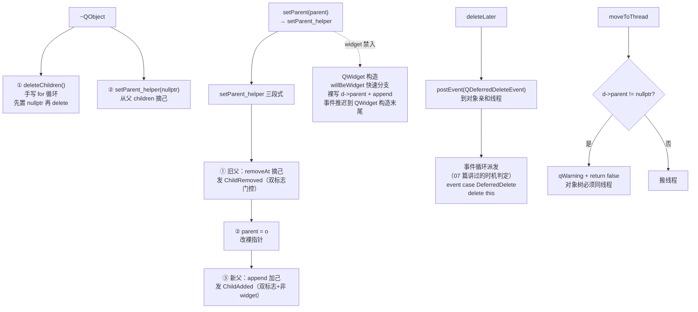

# 对象树与所有权源码拆解

## 前言：写完 new 就不管了，为什么代码不漏内存

咱们写 Qt 代码几乎每天都在依赖对象树，`new QLabel("hello", this)` 的第二个参数 `this` 就是 parent，往后这个 QLabel 的释放咱们不用管，跟着 `this` 一起析构的就是它。把生命周期交给 parent 管的这套做法乍看像黑魔法，咱们写完 `new` 就撒手不管了，漏掉的内存却是一个字节都没有。这套机制背后有一串值得咱们追问的问题：`setParent` 到底改了什么？为什么 parent 析构的时候会自动把所有 children 都 delete 掉，而且不出乱子？为什么碰上有 parent 的对象 `moveToThread` 会直接拒绝？`deleteLater` 和 `delete` 的差别到底在哪，Qt 为什么要专门发明它？

这些问题靠一句 parent 管理子对象生命周期的概括是答不全的，咱们要把所有权机制从源码里挖出来。这一篇把散落在前面几篇里的线索拼起来，[01 篇·元对象系统](./01-qobject-meta-system-expert.md) 咱们见过 `children` 字段存在 `QObjectData` 基类里、`children()` 内联返回它，[02 篇·信号槽底层](./02-signal-slot-internals-expert.md) 咱们见过 `~QObject` 的两类连接清理，[07 篇·事件循环](./07-event-loop-internals-expert.md) 咱们追过 `DeferredDelete` 事件的全链路。入门篇的 [QObject 与元对象系统](../../beginner/01-qtbase/01-qobject-meta-system-beginner.md) 讲过对象树的基本用法，那是知其然的层面，本篇要补的是知其所以然。本篇的边界也要交代清楚，咱们拆 `setParent`、析构级联的 `deleteChildren`、`deleteLater`、`moveToThread` 的线程亲和约束，还有 QWidget 走的 `willBeWidget` 快速分支，QWidget 特有的窗口系统部分（嵌入父 widget 的窗口、平台资源清理）不展开，咱们的拆解只讲到 `willBeWidget` 这个分支点为止。

## 环境说明

本篇引用的源码都在 `qt_src/qt6.9.1` 里，行号会跟着 Qt 的升级漂移，您对照的时候要是发现对不上，咱们拿函数名到文件里搜一下就能找回来。咱们按出场顺序把要翻的文件列在下面：

| 文件 | 角色 |
|---|---|
| `qt_src/qt6.9.1/qtbase/src/corelib/kernel/qobject.cpp` | setParent / setParent_helper / deleteChildren / ~QObject / deleteLater / moveToThread / thread / protected 构造 |
| `qt_src/qt6.9.1/qtbase/src/corelib/kernel/qobject.h` | sendChildEvents / receiveChildEvents 位域（QObjectData 基类） |
| `qt_src/qt6.9.1/qtbase/src/corelib/kernel/qcoreapplication.cpp` | DeferredDelete 三种时机的注释出处，对照阅读（判定主体 07 篇讲过，本篇只补名目） |
| `qt_src/qt6.9.1/qtbase/src/widgets/kernel/qwidget.cpp` | QWidgetPrivate 构造置 willBeWidget |

本篇没有配套的 example 工程，原因是对象树所有权发生在 QObject 的析构期内部，对着 `qt_src` 翻源码就是最好的实验。本篇讲的所有权机制围绕两条主线展开，一条讲的是建立父子关系，另一条讲的是析构级联，中间穿插 `deleteLater` 的延迟删除和 `moveToThread` 的同线程约束，咱们要走的全图如下：



咱们从建立父子关系动身。

## 核心概念讲解

### setParent 把活儿转手给 setParent_helper：三段式与双标志门控

`QObject::setParent` 这个公开方法其实几乎不干活，它把活儿全转手给了私有层的 `setParent_helper`，对应的行号是 `qt_src/qt6.9.1/qtbase/src/corelib/kernel/qobject.cpp:2206-2211`，咱们对着看：

```cpp
void QObject::setParent(QObject *parent)
{
    Q_D(QObject);
    Q_ASSERT(!d->isWidget);
    d->setParent_helper(parent);
}
```

开头的 `Q_ASSERT(!d->isWidget)` 值得咱们停一下，它的作用是把 widget 挡在这个入口外面，widget 的父子关系走的是专门的快速路径（下文的 willBeWidget 分支），进 `setParent_helper` 的是普通的 QObject。

`setParent_helper` 干的是经典的三段式，对应的行号是 `qt_src/qt6.9.1/qtbase/src/corelib/kernel/qobject.cpp:2230-2295`，咱们对着看：

```cpp
void QObjectPrivate::setParent_helper(QObject *o)
{
    Q_Q(QObject);
    if (o == parent)
        return;

    if (parent) {
        QObjectPrivate *parentD = parent->d_func();
        // ...（省略 isDeletingChildren / wasDeleted 防护分支）
        } else {
            parentD->children.removeAt(index);
            if (sendChildEvents && parentD->receiveChildEvents) {
                QChildEvent e(QEvent::ChildRemoved, q);
                QCoreApplication::sendEvent(parent, &e);
            }
        }
    }
    // ...
    parent = o;

    if (parent) {
        // ...
        parent->d_func()->children.append(q);
        if (sendChildEvents && parent->d_func()->receiveChildEvents) {
            if (!isWidget) {
                QChildEvent e(QEvent::ChildAdded, q);
                QCoreApplication::sendEvent(parent, &e);
            }
        }
    }
}
```

三段的内容咱们挨个过。头一段动的是旧 parent，旧 parent 还在的话咱们从它的 `children` 列表里 `removeAt` 摘掉自己，双标志门控放行的时候再给旧 parent 发一个 `ChildRemoved` 事件。第二段的 `parent = o` 是一次裸指针赋值，所有权变更真正落地的就是这一下。第三段动的是新 parent，新 parent 存在的话咱们把自己 `append` 进它的 `children` 列表，双标志门控放行、而且对象不是 widget 的时候，咱们再给新 parent 发一个 `ChildAdded` 事件。

“双标志门控”说的是 `sendChildEvents && parentD->receiveChildEvents` 这对条件，它们是两个 1-bit 的位域，`QObjectData` 基类里住的就是这一对，对应的行号是 `qt_src/qt6.9.1/qtbase/src/corelib/kernel/qobject.h:80-81`，咱们对着看：

```cpp
    uint sendChildEvents : 1;
    uint receiveChildEvents : 1;
```

`sendChildEvents` 管的是咱们作为子对象、被加进或移出 parent 的时候要不要给 parent 发事件，`receiveChildEvents` 管的是咱们作为 parent、要不要接收 `ChildAdded` 和 `ChildRemoved` 事件，两边都开着的时候事件才会真的发出去。默认两个都置 true（`QObjectPrivate` 构造的时候），所以普通对象都能收到 child 事件。有些内部对象会把它们关掉（比如 `QAbstractEventDispatcher` 这类不需要被通知 child 变化的），省掉无意义的事件开销。这个双标志门控的意义咱们要点破，对象树把事件通知和数据维护分开做了，`children` 列表的增删无论如何都会做，事件发不发就是另一回事了，由标志位说了算。

### ~QObject：删子在前，摘己在后

父子关系怎么建立的问题咱们解决了，析构的时候就是反过来走的，而且顺序很讲究。咱们看到 `~QObject` 只做两件事，顺序是固定的，对应的行号是 `qt_src/qt6.9.1/qtbase/src/corelib/kernel/qobject.cpp:1139-1148`，咱们对着看：

```cpp
    if (!d->children.isEmpty())
        d->deleteChildren();

    if (Q_UNLIKELY(qtHookData[QHooks::RemoveQObject]))
        reinterpret_cast<QHooks::RemoveQObjectCallback>(qtHookData[QHooks::RemoveQObject])(this);

    Q_TRACE(QObject_dtor, this);

    if (d->parent)        // remove it from parent object
        d->setParent_helper(nullptr);
```

它的顺序是删除所有子对象在前、把自己从父对象的 `children` 列表摘除在后。咱们乍一看会觉得很别扭，照咱们的直觉，把自己从父对象那里摘掉的动作放在前头、再去处理孩子咱们会觉得更干净，可源码里的顺序不是随手定的。子对象销毁的动作安排在父对象收尾之前，这样的顺序保证了咱们析构任何一个对象的时候，它的整棵子树都已经清理干净了，不会留下父死了子还在的孤儿对象。把自己摘除的动作放在最后，是因为此刻自己还在收尾的阶段，不能过早断开和父的关系，`deleteChildren` 的过程里，咱们可能还需要通过 parent 访问一些东西。

咱们还要注意，`~QObject` 还做了 02 篇讲过的两类连接清理，那段代码的位置在 `deleteChildren` 之前，所以一个对象完整的析构顺序是，清空自己作为 sender 和 receiver 的所有连接，然后删掉所有的子对象，最后把残留在父对象那里的自己摘下来，对象树、连接表、信号槽系统里的痕迹就这样全部抹干净了。

### deleteChildren 为什么故意不用 qDeleteAll：手写循环防 double-free

看懂了析构顺序，咱们再来看 `deleteChildren` 里一个反直觉的细节，咱们看到的这个函数不用 `qDeleteAll`，手写了一个带索引的 for 循环，原因就写在它的注释里，对应的行号是 `qt_src/qt6.9.1/qtbase/src/corelib/kernel/qobject.cpp:2213-2228`，咱们对着看：

```cpp
void QObjectPrivate::deleteChildren()
{
    Q_ASSERT_X(!isDeletingChildren, "QObjectPrivate::deleteChildren()", "isDeletingChildren already set, did this function recurse?");
    isDeletingChildren = true;
    // delete children objects
    // don't use qDeleteAll as the destructor of the child might
    // delete siblings
    for (int i = 0; i < children.size(); ++i) {
        currentChildBeingDeleted = children.at(i);
        children[i] = nullptr;
        delete currentChildBeingDeleted;
    }
    children.clear();
    currentChildBeingDeleted = nullptr;
    isDeletingChildren = false;
}
```

注释逐字写的是 “don't use qDeleteAll as the destructor of the child might delete siblings”，翻译过来是子的析构函数可能会删掉它的兄弟。咱们读到这句注释的时候难免愣一下，析构函数还能动兄弟？这在 Qt 里其实是真实会发生的场景，咱们假设子对象 A 的析构函数里调了兄弟 B 的 `deleteLater()`，或者直接操作了兄弟对象。咱们要是不加防护直接用 `qDeleteAll`（它内部是 `for (auto &x : list) delete x`），A 的析构可能触发兄弟 B 被删，而 B 也在同一个列表里，轮到遍历 B 的时候就是一次 double-free。

Qt 的对策是手写索引循环，而且咱们看它的循环体，有一个要紧的设计，把 `children[i]` 置成 nullptr 的动作放在 `delete` 的前头：

```cpp
    for (int i = 0; i < children.size(); ++i) {
        currentChildBeingDeleted = children.at(i);
        children[i] = nullptr;
        delete currentChildBeingDeleted;
    }
```

咱们看循环体的顺序，`children[i] = nullptr` 这一行走在 `delete` 的前头，为什么顺序不能反？因为 `delete currentChildBeingDeleted` 会触发子对象的析构，而子对象的析构会走上文那套流程，子的析构里会调 `setParent_helper(nullptr)`，想把自己从父对象的 `children` 列表里摘掉，摘的对象正是眼下正在 deleteChildren 的这个父对象。摘除的逻辑要是简单地 `removeAt(index)`，就等于在咱们正在遍历的列表上动手，索引就乱了。把这一项置成 nullptr 的动作放在前头，`setParent_helper` 里检查 `isDeletingChildren` 和 `currentChildBeingDeleted` 的那些分支就能认出这个子是被父删着的，跳过它的处理以后循环接着走，整趟循环就安全地走完了。这是一套相当精巧的析构期重入保护，咱们会觉得它和 02 篇信号槽的 `highestConnectionId` 重入保护异曲同工。函数的开头还有一个 `isDeletingChildren` 标志，`Q_ASSERT_X` 在这儿防的是递归，`deleteChildren` 不该被递归调用（析构已经设了标志，子析构不会再次进入父的 deleteChildren）。这些防护都是为析构期间对象树被反向修改的复杂情况准备的。

### deleteLater：把删除自己这件事推迟到安全的时机

[07 篇·事件循环](./07-event-loop-internals-expert.md) 咱们从事件循环的派发端追过 `DeferredDelete` 的全链路，本篇要换一个方向了，从对象这一端看 `deleteLater` 是怎么把这个事件投出去的。`deleteLater` 干的事是把删除自己这件事推迟到事件循环里一个安全的时机，对应的行号是 `qt_src/qt6.9.1/qtbase/src/corelib/kernel/qobject.cpp:2446-2500`，咱们对着看：

```cpp
void QObject::deleteLater()
{
    // ...
    Q_D(QObject);
    if (d->deleteLaterCalled)
        return;

    d->deleteLaterCalled = true;
    // ...
    auto *objectThreadData = eventListLocker.threadData;
    // ...
    QCoreApplication::postEvent(this,
        new QDeferredDeleteEvent(loopLevel, scopeLevel));
}
```

函数的开头是去重，`if (d->deleteLaterCalled) return` 的意思是之前已经调过一次 deleteLater（标志已经置位）就直接返回，重复的投递不会发生，所以咱们在拿不准的地方多调几次也只生效一次。接着的投递动作是 `postEvent` 一个 `QDeferredDeleteEvent`，投递到 `this` 自己的亲和线程（`objectThreadData`），事件里带着当前的 `loopLevel` 和 `scopeLevel`，07 篇讲过的时机判定用的就是它们。

为什么咱们需要 `deleteLater` 而不是直接 `delete`？因为很多时候咱们是在自己正被使用的上下文里想销毁自己的，比如在自己的槽函数里、在事件处理器里、在被别人遍历的列表里。咱们直接 `delete this` 的话，当前栈帧里握着的 `this` 立刻失效了，回到调用方的时候就是一次 use-after-free。`deleteLater` 把删除推迟到当前事件处理完、回到事件循环的那一刻，那时候谁都不再持有当前的栈帧了，`delete this`（07 篇的 `QObject::event` case `DeferredDelete`）做起来才是安全的。这就是 `DeferredDelete` 三种时机判定要解决的问题，三种时机的正式名目写在 `qt_src/qt6.9.1/qtbase/src/corelib/kernel/qcoreapplication.cpp:1824-1831` 的派发端注释里（投递它的 event loop 已经返回、当前 loop 显式请求、投递早于最外层 loop），主体判定 [07 篇·事件循环](./07-event-loop-internals-expert.md) 咱们已经讲过了，这里只把对象这一端的事补全。

### 对象树必须同线程：moveToThread 的有父拒绝

对象树有一条硬性的约束，咱们得让整棵树待在同一个线程里。约束的源头在 `moveToThread` 里，对应的行号是 `qt_src/qt6.9.1/qtbase/src/corelib/kernel/qobject.cpp:1655-1698`，咱们对着看：

```cpp
    if (d->parent != nullptr) {
        qWarning("QObject::moveToThread: Cannot move objects with a parent");
        return false;
    }
    if (d->isWidget) {
        qWarning("QObject::moveToThread: Widgets cannot be moved to a new thread");
        return false;
    }
```

咱们看到 `moveToThread` 一进来拦的就是两种情况，有 parent 的直接拒绝（`Cannot move objects with a parent`），是 widget 的也直接拒绝（widget 不能搬线程）。有 parent 的对象不能搬线程，为什么？因为对象树的所有权靠 parent 管理，子对象要是被搬去了别的线程，parent 析构的时候（在它自己的线程里）就要去 `delete` 别的线程里的对象，这就成了跨线程析构，这样的析构是不安全的。

线程亲和本身的查询很轻量，对应的行号是 `qt_src/qt6.9.1/qtbase/src/corelib/kernel/qobject.cpp:1610-1613`，咱们对着看：

```cpp
QThread *QObject::thread() const
{
    return d_func()->threadData.loadRelaxed()->thread.loadAcquire();
}
```

`thread()` 从私有数据的 `threadData` 原子读出所属的 `QThread` 指针。这个字段咱们不算头一回见，02 篇现判的 `receiverInSameThread`，背后读的就是同一个 `threadData`，信号槽的跨线程分流、事件投递的目标线程、`moveToThread` 的约束，依赖的全是它。咱们把对象树同线程的硬约束放回这套机制里看，它为的是让基于线程亲和的机制在对象树上保持一致，父子不同线程的话，一个信号发了出去，到底按谁的线程分流？按 receiver 所在线程分流，`doActivate` 判 `receiverInSameThread` 比的就是这个字段。分流这一下是判得对的，可它管不了析构，parent 在自己的线程里析构时要 delete 别的线程里的子对象，硬约束拦的就是这层。

### QWidget 的快速分支：willBeWidget 跨模块协作

最后咱们看一个优化细节，地点还在父子关系的建立上。上文的 `setParent` 有个 `Q_ASSERT(!d->isWidget)`，widget 是不走普通 setParent 的，那 widget 的父子关系怎么建立？靠一个 `willBeWidget` 快速分支，它住在 QObject 的 protected 构造里，对应的行号是 `qt_src/qt6.9.1/qtbase/src/corelib/kernel/qobject.cpp:960-968`，咱们对着看：

```cpp
            if (d->willBeWidget) {
                if (parent) {
                    d->parent = parent;
                    d->parent->d_func()->children.append(this);
                }
                // no events sent here, this is done at the end of the QWidget constructor
            } else {
                setParent(parent);
```

咱们构造一个 widget 的时候，`willBeWidget` 标志已经是真的，构造的代码直接裸写 `d->parent = parent`，再 `append` 进 parent 的 `children` 列表，`setParent_helper` 被完全绕开了，ChildAdded 事件的发送被跳过，双标志门控也不走这一套了。注释写的是 “no events sent here, this is done at the end of the QWidget constructor”，事件推迟到了 QWidget 构造的末尾再发。

为什么要另起炉灶？`QObject` 已经有完整的 `setParent_helper` 三段式了。原因咱们也能猜到，QWidget 的构造非常频繁（界面里控件动辄成百上千），而 widget 在构造阶段还没完全建好，发出去的 `ChildAdded` 事件也没有意义（parent 自己都还在构造）。走快速分支省掉了事件投递的开销，也避开了未就绪对象处理事件的风险。

`willBeWidget` 这个标志是跨模块置位的，它在 QtWidgets 模块里被置成了 true，给 QtCore 的 QObject 构造来读，对应的行号是 `qt_src/qt6.9.1/qtbase/src/widgets/kernel/qwidget.cpp:182`，咱们对着看：

```cpp
    willBeWidget = true; // used in QObject's ctor
```

咱们看 `QWidgetPrivate` 的构造函数，`willBeWidget = true` 是直接写死的，于是 QWidget 的构造走到 QObject 的 protected 构造时，`willBeWidget` 已经是真的了，走的自然是快速分支。这是一个上层模块（Widgets）反向告诉下层模块（Core）走特殊路径的跨模块协作，`willBeWidget` 这个标志名本身就是给 QObject 构造看的，注释 `// used in QObject's ctor` 直说的就是这件事。

## 风险与故障预防

本篇挑出来的风险都能在源码里对上号，后果和解法咱们一个个交代。

头一处风险是对象树管理和手动 delete 的混用，这是新手在这一块最容易出事的地方。一个子对象既被 parent 纳入了对象树（`new Child(parent)` 或者 `child->setParent(parent)`），您又在别处手动 `delete child`。表面上看是没事的，`delete child` 触发的是 `~Child`，`~QObject` 走的是上文那套流程，其中的 `setParent_helper(nullptr)` 会把自己从 parent 的 `children` 列表里摘掉，摘掉之后 parent 析构时的 `deleteChildren` 就不会再来 delete 它了。不过时序一旦不对，事情就变了样子，手动 `delete child` 和 parent 析构要是并发了，或者 child 的析构过程中 parent 也在析构（deleteChildren 的重入场景），摘除和 deleteChildren 的顺序就可能错乱，parent 的 `children` 列表里残留已经 delete 的指针，最后等来的就是 double-free。正常时序下咱们手动 `delete` 走的就是刚才的摘除路径，parent 析构的时候不会再删它第二次，double-free 真要出场的话，就得靠上面说的析构期重入，或者手动 delete 与 parent 析构跨线程遇上了。解法咱们给得很干脆，对象一旦交给对象树（设了 parent），咱们就不要再手动 delete，要么完全交给对象树管，要么您给它调 `setParent(nullptr)`，脱离了父对象以后再手动管理，两种路子混用是迟早要出事的，需要稍后删除的场合就用 `deleteLater`，它和对象树是兼容的。

第二处风险的场景是析构期间访问兄弟对象。parent 析构的时候，`deleteChildren` 正在逐个 delete 它的子对象，子 A 的析构函数里咱们写了 `if (siblingB) siblingB->doSomething()`，可 siblingB 可能已经被 `deleteChildren` 在 A 之前 delete 掉了（B 在 `children` 列表里排在 A 的前面），此时的 `siblingB` 是悬垂指针，这时候的访问就是 use-after-free。后果是看起来随机的崩溃，而且析构顺序取决于 `children` 列表的顺序（取决于 setParent 的调用顺序），问题就时有时无了，咱们排查起来极难复现。解法咱们也摆出来，对象的析构函数里绝对不要去访问兄弟对象，析构的时候咱们只能确定自己正在销毁，兄弟可能已经没了，确实需要和兄弟交互的，咱们用 `QPointer<QObject>` 持有兄弟（它能安全检测对方是否已析构），或者重新设计让对象树关系别耦合得那么紧。

第三处风险是 `moveToThread` 的静默失败。失败的时候程序只给一句 warning，而很多人的构建根本不开 warning 输出，这句提醒就这么沉了底。于是您以为对象搬到了 worker 线程，实际它还在原来的线程里，信号槽的跨线程分流没按预期走，事件也投到了错的线程。排查的方向更是容易带偏，您头一个反应很少会是对象压根没搬成。搬线程以前您要确认对象没有 parent，别指望那行 warning 会提醒您。要搬的话，要么您给它调一次 `setParent(nullptr)`，脱离了父对象（变成独立树根）以后再 `moveToThread`，要么直接搬整棵子树的根（根搬了，子树是跟着搬的，树内的线程关系是一致的），widget 则根本不能搬线程（`isWidget` 的检查也会把它拒掉）。

## 练习项目

本篇的练习走验证的路子，几道题给的是方向和核对手段，完整的工程留给您自己搭。

头一道题验的是析构顺序。您在一个有子对象的 QObject 上触发析构，调试器里在 `QObjectPrivate::deleteChildren()`（`qt_src/qt6.9.1/qtbase/src/corelib/kernel/qobject.cpp:2213`）和 `~QObject` 里的 `setParent_helper(nullptr)` 调用（`qobject.cpp:1147` 附近）两处下断，看到的顺序应该是删子在前、摘己在后，对上了，析构顺序的断言就算验过了。

第二道题验的是 `ChildAdded` 事件和 willBeWidget 的分工。您给一个 parent 装上 `installEventFilter`，往它上面 `new` 一个普通的 QObject 当子对象，过滤器在构造还在跑的时候就能收到 `ChildAdded`，换成 QWidget 的时候，`ChildAdded` 要等到 QWidget 的构造走完才到，willBeWidget 分支推迟发事件的说法就摆在您眼前了。

第三道题验 `moveToThread` 的拒绝。您写一个有 parent 的 QObject 调 `moveToThread`，拿到手的返回值是 false，控制台里有一句 Cannot move objects with a parent 的 qWarning，您把 parent 置空以后再试，搬动就成功了。

第四道题验混用的后果。您按风险一节的头一处场景搭环境，child 在别人的析构过程中被手动 delete、parent 同时也在析构，构建的时候打开地址消毒器（ASan），它逮到的就是 `children` 列表里残留的悬垂指针，报出来的是 double-free 或 use-after-free。

末了是一道对行号的题，要对的都在前文里。您挑上三四处（比如 `qobject.cpp:2230` 的 `setParent_helper`，`qobject.cpp:2213` 的 `deleteChildren`，`qobject.cpp:1610` 的 `thread()`，`qwidget.cpp:182` 的 `willBeWidget` 置位），咱们带着行号去 `qt_src/qt6.9.1` 翻原文，一处一处地核对过去，都对上了，本篇的断言就算核对过了。

## 官方文档参考链接

咱们把本篇用到的官方文档列在下面，链接都指向 doc.qt.io 的 Qt 6 文档（基线 6.9.1）：

- [Qt 文档 · QObject](https://doc.qt.io/qt-6/qobject.html) —— `setParent` / `deleteLater` / `moveToThread` / `thread` 的官方文档。
- [Qt 文档 · Object Trees & Ownership](https://doc.qt.io/qt-6/objecttrees.html) —— 对象树与所有权机制的总览，parent/child 关系与析构级联都在这一页。

---

本篇写到这里就收尾了。对象树是 Qt 管理生命周期的地基，谁负责删谁、能不能搬线程、析构的时候为什么不能碰兄弟，这三类判断咱们都给了源码层面的依据。本篇的全部行号证据按机制归类收在 [code-index · qtbase](../code-index/qtbase/)（本教程按源码机制收录行号证据的索引栏目）里，咱们带着行号去 `qt_src/qt6.9.1` 翻原文就能核对。要横向换方向的，规划中的 [02-qtgui 卷](../02-qtgui/) 定的是绘图的源码拆解方向，后面咱们会陆续更新，用法面需要补课的回入门篇 [1.1 QObject 与元对象系统](../../beginner/01-qtbase/01-qobject-meta-system-beginner.md)。
