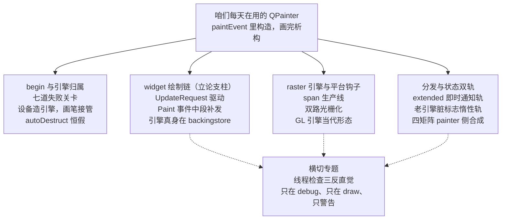
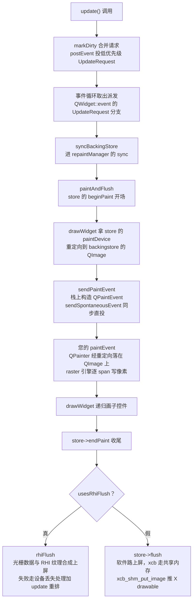
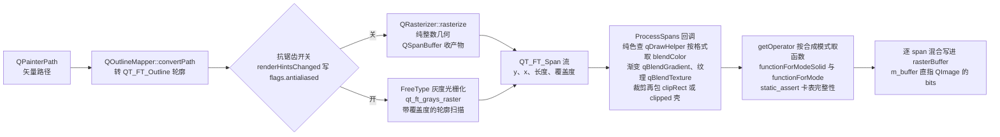

# QPainter 后端架构：引擎归属、分发双轨与 widget 绘制链

您在 paintEvent 里写下的每一笔，驱动它的绘制引擎都不在 widget 身上。QWidget::paintEngine 在 6.9.1 里是一个打一句警告然后返回空指针的空壳，真正干活的引擎长在窗口后备存储的 QImage 上，paintEvent 里的 QPainter 经过一层重定向落在后备存储的图像上作画，画完由平台插件把整块像素推上屏幕。笔者把 widget 绘制链从 update() 一路追到 xcb_shm_put_image，沿途每一跳都有行号可对，链路全貌咱们到正文第三大节逐环走通。还有一件事更反直觉，QPainter 的线程保护只在 debug 构建里存在，您发布出去的 release 程序里一行检查都没有，依据在 `qt_src/qt6.9.1/qtbase/src/gui/painting/qpainter.cpp:126-152`，咱们把它留作收尾的专题。

入门篇的 [2.1 QPainter 绘图基础](../../beginner/02-qtgui/01-qpainter-basic-beginner.md) 教过咱们在 paintEvent 里构造 QPainter、配 QPen 与 QBrush、画基本图元，进阶篇的 [2.1 QPainter 进阶：双缓冲、合成模式、抗锯齿](../../advanced/02-qtgui/01-qpainter-advanced.md) 一篇，讲了双缓冲、合成模式与抗锯齿的用法。这些都停在 API 的这一侧。专家层要问的是另一侧的问题，`QPainter p(this)` 那一行执行时引擎从哪来，一个 drawRect 调用怎么走到像素，paintEvent 为什么偏偏以事件的形式到达。QtBase 卷的工具咱们直接借用，事件怎么从队列走进 `QWidget::event` 见 07 篇（[事件循环源码拆解](../01-qtbase/07-event-loop-internals-expert.md)），postEventList 队列内部的三状态字段，见 20 篇（[事件循环源码深潜——退出协议、postEventList 内部与平台后端](../01-qtbase/20-event-loop-deep-dive-expert.md)），线程亲和的判定见 09 篇（[QThread 源码拆解](../01-qtbase/09-qthread-internals-expert.md)）。一路上还要对质十几处流传很广、在 6.9.1 源码里对不上号的说法，每一处都落到具体行号，您拿着行号自己能验。

本篇源码基线 `qt_src/qt6.9.1`，行号基于此版本，升级会漂移，对不上号时拿函数名或字段名进文件里搜。出场的源码文件按正文首次引用的顺序列在下面，qtbase 与 qtsvg 两边都有。

| 文件 | 角色 |
|---|---|
| `qt_src/qt6.9.1/qtbase/src/gui/painting/qpainter.cpp` | begin 七分支、线程检查、分发链、状态双轨、save 与 restore、end 收尾 |
| `qt_src/qt6.9.1/qtbase/src/gui/painting/qpaintdevice.h` | paintEngine 纯虚声明、painters 计数器 |
| `qt_src/qt6.9.1/qtbase/src/gui/image/qimage.cpp` | QImage::paintEngine 惰性创建与缓存 |
| `qt_src/qt6.9.1/qtbase/src/gui/image/qpixmap.cpp` | QPixmap::paintEngine 第一级转发 |
| `qt_src/qt6.9.1/qtbase/src/gui/image/qpixmap_raster.cpp` | QRasterPlatformPixmap 第二级转发 |
| `qt_src/qt6.9.1/qtbase/src/gui/painting/qpainter_p.h` | QPainterPrivate 字段、QPaintEngineDestructor、window 与 viewport 八整数 |
| `qt_src/qt6.9.1/qtbase/src/gui/painting/qpaintengine.h` | 纯虚清单、Type 枚举、setAutoDestruct 私有化 |
| `qt_src/qt6.9.1/qtbase/src/gui/painting/qpaintengine.cpp` | 基类默认实现的两级回退、drawTextItem 退化、selfDestruct 初值 |
| `qt_src/qt6.9.1/qtbase/src/widgets/kernel/qwidget.cpp` | UpdateRequest 分支、drawWidget、sendPaintEvent、paintEngine 空壳 |
| `qt_src/qt6.9.1/qtbase/src/gui/painting/qpaintdevice.cpp` | metric 基类兜底与警告 |
| `qt_src/qt6.9.1/qtbase/src/gui/painting/qbackingstore.cpp` | QBackingStore 的壳与 flush 转发 |
| `qt_src/qt6.9.1/qtbase/src/gui/painting/qpaintengineex.cpp` | extended 接口收逻辑坐标的现场 |
| `qt_src/qt6.9.1/qtbase/src/widgets/kernel/qwidgetrepaintmanager.cpp` | markDirty 投事件、sync、paintAndFlush、flush 双路 |
| `qt_src/qt6.9.1/qtbase/src/gui/painting/qrasterbackingstore.cpp` | 缺省平台 paintDevice 返回内部 QImage |
| `qt_src/qt6.9.1/qtbase/src/plugins/platforms/xcb/qxcbbackingstore.cpp` | xcb 侧 paintDevice 与共享内存推送 |
| `qt_src/qt6.9.1/qtbase/src/gui/painting/qpaintengine_raster_p.h` | QRasterPaintEngine 继承链 |
| `qt_src/qt6.9.1/qtbase/src/gui/painting/qpaintengine_raster.cpp` | begin、init、fillPolygon、rasterize、adjustSpanMethods |
| `qt_src/qt6.9.1/qtbase/src/gui/painting/qrasterizer.cpp` | 非抗锯齿光栅化的自家实现 |
| `qt_src/qt6.9.1/qtbase/src/gui/painting/qdrawhelper.cpp` | getOperator 查合成模式函数表 |
| `qt_src/qt6.9.1/qtbase/src/gui/painting/qcompositionfunctions.cpp` | 合成模式函数表本体与 static_assert |
| `qt_src/qt6.9.1/qtbase/src/gui/kernel/qplatformintegration.cpp` | 平台钩子缺省实现 |
| `qt_src/qt6.9.1/qtbase/src/gui/kernel/qplatformintegration.h` | createPlatformBackingStore 纯虚声明 |
| `qt_src/qt6.9.1/qtbase/src/plugins/platforms/xcb/qxcbintegration.cpp` | xcb 的 backingstore 三选一 |
| `qt_src/qt6.9.1/qtbase/src/plugins/platforms/windows/qwindowsgdiintegration.cpp` | Windows GDI 侧 |
| `qt_src/qt6.9.1/qtbase/src/gui/painting/qpainter.h` | QOpenGLPaintEngine 的 friend 残留声明 |
| `qt_src/qt6.9.1/qtbase/src/opengl/qopenglpaintengine_p.h` | QOpenGL2PaintEngineEx 类声明 |
| `qt_src/qt6.9.1/qtbase/src/opengl/qopenglpaintdevice.cpp` | GL 引擎的每线程缓存 |
| `qt_src/qt6.9.1/qtbase/src/openglwidgets/qopenglwidget.cpp` | QOpenGLWidgetPaintDevice |
| `qt_src/qt6.9.1/qtsvg/src/svg/qsvggenerator.cpp` | SVG 引擎的 type 落点 |

本篇不配 example，理由与 18 篇（[信号槽深度拆解](../01-qtbase/18-signal-slot-deep-dive-expert.md)）、20 篇一样直白，纯源码拆解，您对照 `qt_src` 翻原文就是最好的实验。动身前把四大支柱加一个横切专题的路线图对一遍。



## begin：设备造引擎，画笔只管接管

### 七道关卡，一道例外通道

常见说法把 `QPainter::begin` 描述成拿设备、拿引擎、开工三步走。笔者把 6.9.1 的 begin 函数体从头到尾过了一遍，它的失败分支比想象中密，入口两道检查就很有讲头。

`qt_src/qt6.9.1/qtbase/src/gui/painting/qpainter.cpp:1679-1689`

```cpp
    Q_ASSERT(pd);
    if (pd->painters > 0) {
        qWarning("QPainter::begin: A paint device can only be painted by one painter at a time.");
        return false;
    }

    if (d_ptr->engine) {
        qWarning("QPainter::begin: Painter already active");
        return false;
    }
```

第一道，设备的 painters 计数大于零就拒绝，一个绘制设备同一时刻只伺候一个画笔。第二道，画笔自己已经激活也拒绝。顺带看一眼最顶上的 Q_ASSERT，断言只在 debug 构建里生效，release 下您传一个空指针进来，崩溃点会深得多。数下去，整个 begin 一共七道会打警告并返回 false 的关卡，已有画笔占用，画笔已激活，设备交不出引擎，空 pixmap，空 image，Indexed8 或 CMYK8888 格式的 image，引擎自己的 begin 返回 false。中间夹着一条不算失败的正路，sharedPainter 通道，咱们留到单画笔协定一节细看。

引擎的交接动作在正路的中段。

`qt_src/qt6.9.1/qtbase/src/gui/painting/qpainter.cpp:1714-1719`

```cpp
    d->engine.reset(pd->paintEngine());

    if (!d->engine) {
        qWarning("QPainter::begin: Paint device returned engine == 0, type: %d", pd->devType());
        return false;
    }
```

`pd->paintEngine()` 这一句管着引擎从哪来，后面全篇都围着它转。旧教程常把引擎说成 painter 创建的，实况反着来，QPaintDevice 的 paintEngine 是纯虚函数，创建引擎是设备子类的责任，painter 只是接管指针。

`qt_src/qt6.9.1/qtbase/src/gui/painting/qpaintdevice.h:41`

```cpp
    virtual QPaintEngine *paintEngine() const = 0;
```

一行纯虚，把引擎的产地划给了设备。您要是继承 QPaintDevice 造自己的绘制目标，返回什么是您的自由，返回空指针就在上面那道关卡被拦下。设备家族里两位主力成员的实现各有看头，咱们挨个看。

### QImage 的引擎是惰性创建再缓存的

`qt_src/qt6.9.1/qtbase/src/gui/image/qimage.cpp:4284-4299`

```cpp
QPaintEngine *QImage::paintEngine() const
{
    if (!d)
        return nullptr;

    if (!d->paintEngine) {
        QPaintDevice *paintDevice = const_cast<QImage *>(this);
        QPlatformIntegration *platformIntegration = QGuiApplicationPrivate::platformIntegration();
        if (platformIntegration)
            d->paintEngine = platformIntegration->createImagePaintEngine(paintDevice);
       if (!d->paintEngine)
            d->paintEngine = new QRasterPaintEngine(paintDevice);
    }

    return d->paintEngine;
}
```

注意两级顺序。它先问平台的 createImagePaintEngine 要不要插手，平台默认返回空指针，依据咱们在平台钩子一节对行号。平台不给，它才自己 new 一个 QRasterPaintEngine。更值得记的是缓存位置，引擎指针存进 QImageData 的 paintEngine 字段，同一张 QImage 第二次 begin，拿回来的是同一个引擎对象，不是重新造的。引擎跨 painter 复用，正是后面 autoDestruct 一节的伏笔。

### QPixmap 转发两级，终点还是 QImage

`qt_src/qt6.9.1/qtbase/src/gui/image/qpixmap.cpp:1339-1342`

```cpp
QPaintEngine *QPixmap::paintEngine() const
{
    return data ? data->paintEngine() : nullptr;
}
```

`qt_src/qt6.9.1/qtbase/src/gui/image/qpixmap_raster.cpp:219-222`

```cpp
QPaintEngine* QRasterPlatformPixmap::paintEngine() const
{
    return image.paintEngine();
}
```

第一级转发给句柄 data，也就是平台像素数据对象。raster 平台上它是 QRasterPlatformPixmap，第二级转发给内部的 image，一个普普通通的 QImage。于是链条闭上了，raster 平台上 QPixmap 的绘制，本质是它内部 QImage 的 raster 绘制，上一节的惰性缓存在这里原样生效。旧资料爱讲 QPixmap 与 QImage 是两套渲染路径，qtbase 的源码里它们在引擎这一层是同一条路。

### autoDestruct 恒假，引擎的户口始终在设备侧

painter 接管引擎用的是带自定义删除器的 unique_ptr，删除器长什么样，直接决定引擎归谁删。

`qt_src/qt6.9.1/qtbase/src/gui/painting/qpainter_p.h:233-240`

```cpp
    struct QPaintEngineDestructor {
        void operator()(QPaintEngine *pe) const noexcept
        {
            if (pe && pe->autoDestruct())
                delete pe;
        }
    };
    std::unique_ptr<QPaintEngine, QPaintEngineDestructor> engine;
```

删除器先问 autoDestruct，为真才 delete。那 autoDestruct 谁来置真，答案在私有区。

`qt_src/qt6.9.1/qtbase/src/gui/painting/qpaintengine.h:208-209`

```cpp
    void setAutoDestruct(bool autoDestr) { selfDestruct = autoDestr; }
    bool autoDestruct() const { return selfDestruct; }
```

setAutoDestruct 是 private 的，笔者拿它在全 qtbase 源码树里搜，只有声明没有一处调用。再看初值，两个构造函数的初始化列表里写的都是 selfDestruct(false)，`qtbase/src/gui/painting/qpaintengine.cpp:666` 与 `:681`。两件事合起来，autoDestruct 恒为假，painter 的 end() 里那句 `d->engine.reset()` 只是放下指针，从头到尾没有 delete。引擎的存活由设备负责，QImage 把它缓存在自己的数据里，下回接着用。widget 那边 drawWidget 里对 paintOnScreen 引擎留了一道 autoDestruct 检查后手工 delete，paintOnScreen 指开了 WA_PaintOnScreen、绕开后备存储直接往屏幕上画的那类控件，位置在 `qtbase/src/widgets/kernel/qwidget.cpp:5655-5656`，设置点既然全树零调用，正常路径永远走不进那个分支。有的拆解文章说 painter 结束时可能顺手删掉引擎，把引擎寿命讲得跟 painter 一样长，方向反了。

begin 的尾部还有一段收尾动作值得看，它用设备的尺寸初始化画笔的坐标系。

`qt_src/qt6.9.1/qtbase/src/gui/painting/qpainter.cpp:1812-1822`

```cpp
    QRect systemRect = d->engine->systemRect();
    if (!systemRect.isEmpty()) {
        d->state->ww = d->state->vw = systemRect.width();
        d->state->wh = d->state->vh = systemRect.height();
    } else {
        d->state->ww = d->state->vw = pd->metric(QPaintDevice::PdmWidth);
        d->state->wh = d->state->vh = pd->metric(QPaintDevice::PdmHeight);
    }

    const QPoint coordinateOffset = d->engine->coordinateOffset();
    d->state->redirectionMatrix.translate(-coordinateOffset.x(), -coordinateOffset.y());
```

metric 是 QPaintDevice 的 protected 虚函数，设备子类各自报尺寸。基类也留了默认实现，谁都不认识的问题就打警告兜底。笔者拿警告串在 `qtbase/src/gui/painting/qpaintdevice.cpp` 里核过位置，落在 93 行，串里拼的词是 metrics，带复数 s，函数名却是单数 metric，一个容易看漏的小错位。window 与 viewport 的初值从这里来，它们随后在四矩阵一节还要出场。

### 单画笔协定的真实身份是一个 ushort

回到入口第一道关卡用的那个计数器。它的本体寒酸得让人意外。

`qt_src/qt6.9.1/qtbase/src/gui/painting/qpaintdevice.h:66`

```cpp
    ushort        painters;                        // refcount
```

一个无符号短整数，行尾注释写着 refcount。begin 的尾部加一，end 里减一。

`qt_src/qt6.9.1/qtbase/src/gui/painting/qpainter.cpp:1829-1833`

```cpp
    Q_ASSERT(d->engine->isActive());
    d->state->renderHints = QPainter::TextAntialiasing;
    ++d->device->painters;

    d->state->emulationSpecifier = 0;
```

`qt_src/qt6.9.1/qtbase/src/gui/painting/qpainter.cpp:1869-1877`

```cpp
    if (d->engine->isActive()) {
        ended = d->engine->end();
        d->updateState(nullptr);

        --d->device->painters;
        if (d->device->painters == 0) {
            d->engine->setPaintDevice(nullptr);
            d->engine->setActive(false);
        }
    }
```

减到零，引擎与设备的关联才被解除，setPaintDevice(nullptr)，随后 setActive(false)。咱们把加一和减一在两个函数里对上号再看：加一在 begin 尾部，减一在 end 中段，配对严丝合缝。常见说法给单画笔协定安了各种机制，锁、状态机、活跃标志，实况就是一个 16 位计数器加两句 qWarning。但是例外通道藏在 begin 的入口。

`qt_src/qt6.9.1/qtbase/src/gui/painting/qpainter.cpp:1691-1692`

```cpp
    if (QPainterPrivate::attachPainterPrivate(this, pd))
        return true;
```

attachPainterPrivate 返回 true 时 begin 直接返回成功，计数器的加一根本没走到。什么时候返回 true，设备的 sharedPainter 非空的时候。

`qt_src/qt6.9.1/qtbase/src/gui/painting/qpainter.cpp:242-252`

```cpp
    QPainter *sp = pdev->sharedPainter();
    if (!sp)
        return false;

    // Save the current state of the shared painter and assign
    // the current d_ptr to the shared painter's d_ptr.
    sp->save();
    ++sp->d_ptr->refcount;
    sp->d_ptr->d_ptrs.push_back(q->d_ptr.get());
    Q_UNUSED(q->d_ptr.release());
    q->d_ptr.reset(sp->d_ptr.get());
```

多个 QPainter 共享同一份 d_ptr，新画笔把自己的私有指针交出去，改挂在共享画笔的私有数据上，refcount 负责计数。计数器 painters 眼里自始至终只有一个 painter，所以共享通道不会被入口第一道关卡拦住。widget 绘制链里，drawWidget 传 sharedPainter 参数走的就是这里。您平时写代码碰不到它，它是 Qt 内部为单次绘制里多层重定向准备的，但排查绘制问题时知道它的存在，能省掉对着计数器算不对的困惑。

这就带出本篇第一个要当场讲清的风险。现象是这样的，您对一张 CMYK 格式的 QImage 调 begin，或者对空 pixmap 调 begin，返回值是 false，代码没检查返回值，接着一路 drawRect、drawText 画下去。后果是屏幕上什么都不出现，输出里每个绘制调用各打一句 Painter not active，因为失败分支里的 qt_cleanup_painter_state 已经把引擎指针清成空，后续每个 draw 函数开头那句 `if (!d->engine)` 全部命中警告然后直接返回。根因正是本节的七道关卡，Indexed8 与 CMYK8888 两种格式被明确拒画，依据在 `qt_src/qt6.9.1/qtbase/src/gui/painting/qpainter.cpp:1766-1774`，空图像的拒绝在 1762 到 1765。解法顺着机制走，begin 的返回值必须接，图像格式拿不准，convertToFormat 成 Format_ARGB32_Premultiplied 再画，CMYK 常见于印刷链路拿来的原图，直接当绘制目标是不行的。

第二个风险跟 painter 的生命周期有关。现象是这样的，有人把 QPainter 存成类的成员，一次 begin 之后长期持有，或者提前 return 忘了让 painter 析构。后果分两层，轻的一层是 end 里那句未配平警告，重的一层是设备被长期占用，同一张 QImage 上第二个画笔的 begin 被 `A paint device can only be painted by one painter at a time` 的警告拒绝，程序看起来莫名其妙画不出东西。根因有二，计数器要等 end 才减一，而 end 要么等您手动调，要么等析构函数兜底。

`qt_src/qt6.9.1/qtbase/src/gui/painting/qpainter.cpp:1474-1482`

```cpp
    d_ptr->inDestructor = true;
    QT_TRY {
        if (isActive())
            end();
        else if (d_ptr->refcount > 1)
            d_ptr->detachPainterPrivate(this);
    } QT_CATCH(...) {
        // don't throw anything in the destructor.
    }
```

`qt_src/qt6.9.1/qtbase/src/gui/painting/qpainter.cpp:1880-1884`

```cpp
    if (d->savedStates.size() > 0) {
        qWarning("QPainter::end: Painter ended with %d saved states", int(d->savedStates.size()));
    }

    d->engine.reset();
```

析构兜底确实存在，活跃就调 end，异常也不往外抛。但析构发生的时机由对象生命周期说了算，成员 painter 要等到宿主类析构才释放设备。解法是把 painter 的生命周期收在最短作用域，paintEvent 里栈上构造，离开作用域自动析构自动 end，这也是官方文档反复推的写法。后备存储那边还有一句配套警告值得认识，`qtbase/src/gui/painting/qbackingstore.cpp:177-178` 在 endPaint 时发现还有活跃画笔，会打 did you forget to destroy it 一类的提醒，见到它就该回去查 painter 的作用域。

## 分发与状态：一轨即时，一轨惰性

### drawLines 的四段式：extended 打头、补偿、落虚函数

引擎到手，咱们看一笔绘制怎么走。拿 drawLines 当标本，它把 QPainter 全部分发逻辑压缩在三十来行里。

`qt_src/qt6.9.1/qtbase/src/gui/painting/qpainter.cpp:4319-4346`

```cpp
    if (d->extended) {
        d->extended->drawLines(lines, lineCount);
        return;
    }

    d->updateState(d->state);

    uint lineEmulation = line_emulation(d->state->emulationSpecifier);

    if (lineEmulation) {
        if (lineEmulation == QPaintEngine::PrimitiveTransform
            && d->state->matrix.type() == QTransform::TxTranslate) {
            for (int i = 0; i < lineCount; ++i) {
                QLineF line = lines[i];
                line.translate(d->state->matrix.dx(), d->state->matrix.dy());
                d->engine->drawLines(&line, 1);
            }
        } else {
            QPainterPath linePath;
            for (int i = 0; i < lineCount; ++i) {
                linePath.moveTo(lines[i].p1());
                linePath.lineTo(lines[i].p2());
            }
            d->draw_helper(linePath, QPainterPrivate::StrokeDraw);
        }
        return;
    }
    d->engine->drawLines(lines, lineCount);
```

四段式。第一段问 extended，引擎若实现了 QPaintEngineEx 扩展接口，直接转给它，return 走人，后续全部跳过。第二段 d->updateState 同步状态，机制咱们到 setPen 一节拆。第三段查 emulationSpecifier，引擎声明了自己干不了的特性时，painter 侧补偿，最漂亮的补偿在纯平移场景，painter 自己把每条线段平移过去逐条转发，省得引擎碰它不擅长的变换，补偿不动就攒成 QPainterPath 走 draw_helper。第四段才是老老实实的引擎虚函数调用。整个 QPainter 的 draw 家族都是同一个骨架，drawPoints、drawEllipse、drawPath，无一例外。

### 引擎基类的两级回退，drawPath 的默认实现却是空的

轮到引擎侧。QPaintEngine 给子类划了五个纯虚函数。

`qt_src/qt6.9.1/qtbase/src/gui/painting/qpaintengine.h:117-143`

```cpp
    virtual bool begin(QPaintDevice *pdev) = 0;
    virtual bool end() = 0;

    virtual void updateState(const QPaintEngineState &state) = 0;

    virtual void drawRects(const QRect *rects, int rectCount);
    virtual void drawRects(const QRectF *rects, int rectCount);

    virtual void drawLines(const QLine *lines, int lineCount);
    virtual void drawLines(const QLineF *lines, int lineCount);

    virtual void drawEllipse(const QRectF &r);
    virtual void drawEllipse(const QRect &r);

    virtual void drawPath(const QPainterPath &path);

    virtual void drawPoints(const QPointF *points, int pointCount);
    virtual void drawPoints(const QPoint *points, int pointCount);

    virtual void drawPolygon(const QPointF *points, int pointCount, PolygonDrawMode mode);
    virtual void drawPolygon(const QPoint *points, int pointCount, PolygonDrawMode mode);

    virtual void drawPixmap(const QRectF &r, const QPixmap &pm, const QRectF &sr) = 0;
    virtual void drawTextItem(const QPointF &p, const QTextItem &textItem);
    virtual void drawTiledPixmap(const QRectF &r, const QPixmap &pixmap, const QPointF &s);
    virtual void drawImage(const QRectF &r, const QImage &pm, const QRectF &sr,
                           Qt::ImageConversionFlags flags = Qt::AutoColor);
```

纯虚的五个，begin、end、updateState、drawPixmap、type（type 的声明在 177 行，`= 0` 同款）。其余 draw 系带默认实现，有些资料随口说十五个。笔者逐行点过，122 到 143 行一共十四个。默认实现干的活是把高阶图元拆成低阶图元，第一级拆解以椭圆为例。

`qt_src/qt6.9.1/qtbase/src/gui/painting/qpaintengine.cpp:471-481`

```cpp
void QPaintEngine::drawEllipse(const QRectF &rect)
{
    QPainterPath path;
    path.addEllipse(rect);
    if (hasFeature(PainterPaths)) {
        drawPath(path);
    } else {
        QPolygonF polygon = path.toFillPolygon();
        drawPolygon(polygon.data(), polygon.size(), ConvexMode);
    }
}
```

引擎声明了 PainterPaths 特性就转 drawPath，否则咱们跟着再降一级，转凸多边形 drawPolygon。drawRects 是同款双回退，路径或多边形，位置在 `qtbase/src/gui/painting/qpaintengine.cpp:850-870`。这里有个位置容易记错的地方要单独说清。回退链的终点常被说成 drawPath，好像路径是万能底仓，实况是 QPaintEngine::drawPath 的默认实现是空的。

`qt_src/qt6.9.1/qtbase/src/gui/painting/qpaintengine.cpp:707-712`

```cpp
void QPaintEngine::drawPath(const QPainterPath &)
{
    if (hasFeature(PainterPaths)) {
        qWarning("QPaintEngine::drawPath: Must be implemented when feature PainterPaths is set");
    }
}
```

参数都懒得接。声明了 PainterPaths 特性却不实现 drawPath 的引擎，运行到这里得到一句警告，什么都没画。真正的路径拆解发生在 painter 侧，fill 与 stroke 的分离是 painter 用换笔的手法做的。

`qt_src/qt6.9.1/qtbase/src/gui/painting/qpainter.cpp:3117-3127`

```cpp
    QBrush oldBrush = d->state->brush;
    QPen oldPen = d->state->pen;

    setPen(Qt::NoPen);
    setBrush(brush);

    drawPath(path);

    // Reset old state
    setPen(oldPen);
    setBrush(oldBrush);
```

fillPath 的手法全在这几行，把笔换成 NoPen，画一遍路径，再把旧笔旧刷换回来，纯粹填色的路径就落进了引擎的 drawPath。咱们多看一眼换回来的两行，这两行保证 fillPath 跑完不留痕迹，调用方的笔刷状态原样奉还。drawPath 不满足条件时 painter 侧还有 draw_helper 兜底，按 StrokeDraw、FillDraw 分别处理。旧资料把 fill 加 stroke 的拆解安在引擎基类身上，6.9.1 里它在 painter 手里。

drawPolygon 的默认实现也值得看一眼，它的文档注明两个重载至少实现一个，代码里配了防递归断言。

`qt_src/qt6.9.1/qtbase/src/gui/painting/qpaintengine.cpp:293-296`

```cpp
void QPaintEngine::drawPolygon(const QPointF *points, int pointCount, PolygonDrawMode mode)
{
    Q_ASSERT_X(qt_polygon_recursion != this, "QPaintEngine::drawPolygon",
               "At least one drawPolygon function must be implemented");
    qt_polygon_recursion = this;
```

一个引擎两个 drawPolygon 都不实现，回退链会在自己身上转圈，断言就是防这个的。

### 文字的退化路线：不实现 drawTextItem 就把字当路径画

`qt_src/qt6.9.1/qtbase/src/gui/painting/qpaintengine.cpp:743-753`

```cpp
    QPainterPath path;
    path.setFillRule(Qt::WindingFill);
    ti.fontEngine->addOutlineToPath(0, 0, ti.glyphs, &path, ti.flags);
    if (!path.isEmpty()) {
        painter()->save();
        painter()->setRenderHint(QPainter::Antialiasing,
                                 bool((painter()->renderHints() & QPainter::TextAntialiasing)
                                      && !(painter()->font().styleStrategy() & QFont::NoAntialias)));
        painter()->translate(p.x(), p.y());
        painter()->fillPath(path, painter()->pen().brush());
        painter()->restore();
    }
```

drawTextItem 的默认实现有两条路。彩色字形的路在 726 到 740 行，字体引擎给出的格式是 ARGB 时，逐个字形取位图，用 painter 的 drawImage 一张张贴上来。普通字形走上面这段，addOutlineToPath 把字形轮廓加进 QPainterPath，然后 fillPath 填色。也就是说，引擎不实现文本能力时，文字在 painter 侧退化成矢量路径，fillPath 的换笔手法在这里又被用了一遍。您给自研引擎排文字渲染的优先级时，看引擎吃不吃 QPainterPath，吃得下，文字白送。

### setPen 的相等短路与两轨分流

状态怎么从 painter 流进引擎，setPen 是最小标本，咱们看源码。

`qt_src/qt6.9.1/qtbase/src/gui/painting/qpainter.cpp:3653-3671`

```cpp
    Q_D(QPainter);
    if (!d->engine) {
        qWarning("QPainter::setPen: Painter not active");
        return;
    }

    if (d->state->pen == pen)
        return;

    d->state->pen = pen;

    if (d->extended) {
        d->checkEmulation();
        d->extended->penChanged();
        return;
    }

    d->state->dirtyFlags |= QPaintEngine::DirtyPen;
```

三段。相等短路，新笔与旧笔相等直接返回，什么也不碰。然后按 extended 分轨，扩展引擎走即时通知轨，penChanged 当场告诉引擎，通知完就完。老引擎走惰性轨，只在 state 的 dirtyFlags 里标一个 DirtyPen 位，引擎此刻对换笔一事毫不知情。同步被推迟到下一次绘制调用开头的 d->updateState，drawLines 四段式的第二段就是它。您连续改十次画笔再画一笔，引擎只同步最后一次，中间的九次在引擎眼里没发生过。有的性能文章劝人少调 setPen，说每次调用都很贵，实况是相等短路加脏标志把常态开销压到了极低，真正贵的是每次改动都不相等、每次 draw 前都换笔。

updateState 的本体在私有类里，同步一次的全过程如下。

`qt_src/qt6.9.1/qtbase/src/gui/painting/qpainter.cpp:860-890`

```cpp
void QPainterPrivate::updateStateImpl(QPainterState *newState)
{
    // ### we might have to call QPainter::begin() here...
    if (!engine->state) {
        engine->state = newState;
        engine->setDirty(QPaintEngine::AllDirty);
    }

    if (engine->state->painter() != newState->painter)
        // ### this could break with clip regions vs paths.
        engine->setDirty(QPaintEngine::AllDirty);

    // Upon restore, revert all changes since last save
    else if (engine->state != newState)
        newState->dirtyFlags |= QPaintEngine::DirtyFlags(static_cast<QPainterState *>(engine->state)->changeFlags);

    // We need to store all changes made so that restore can deal with them
    else
        newState->changeFlags |= newState->dirtyFlags;

    updateEmulationSpecifier(newState);

    // Unset potential dirty background mode
    newState->dirtyFlags &= ~(QPaintEngine::DirtyBackgroundMode
            | QPaintEngine::DirtyBackground);

    engine->state = newState;
    engine->updateState(*newState);
    engine->clearDirty(QPaintEngine::AllDirty);

}
```

把状态对象塞给引擎，engine->state 指向 newState，然后 engine->updateState，引擎按脏标志逐项消化，最后清脏。无脏无换态时整个函数被外层的 updateState 跳过，判定在 897 行。中间两段 changeFlags 的往来要读仔细，save 之后发生的状态变更累积进 changeFlags，restore 时引擎持有的旧 state 与新 state 对不上，changeFlags 并进 dirtyFlags，引擎把 save 以来的变更挨个撤销。笔者特别标注一下归属，这个并入动作发生在 updateStateImpl 里，不在 restore 函数体内，有些拆解把它画进 restore 的调用栈深处，位置差一层。

save 与 restore 本身是引擎深参与的事，光 painter 记个数不够。

`qt_src/qt6.9.1/qtbase/src/gui/painting/qpainter.cpp:1558-1570`

```cpp
    std::unique_ptr<QPainterState> prev;
    if (d->extended) {
        // separate the creation of a new state from the update of d->state, since some
        // engines access d->state directly (not via createState()'s argument)
        std::unique_ptr<QPainterState> next(d->extended->createState(d->state.get()));
        prev = std::exchange(d->state, std::move(next));
        d->extended->setState(d->state.get());
    } else {
        d->updateState(d->state);
        prev = std::exchange(d->state, std::make_unique<QPainterState>(d->state.get()));
        d->engine->state = d->state.get();
    }
    d->savedStates.push(std::move(prev));
```

extended 引擎自己造状态对象 createState，老引擎则拷贝构造一份 QPainterState 压进 savedStates 栈，引擎的 state 指针跟着换到新副本上。restore 是镜像动作，弹栈、换回、再走一次状态同步，clip 有变化时还会借临时状态对象把裁剪历史重放一遍，函数体在 1580 到 1639 行。您的 save 与 restore 每一次都在引擎侧留了痕迹，配不平就等着 end 时的那句警告。

### 四矩阵在 painter 侧合成，engine 不认识 window 与 viewport

坐标系是双轨制的最后一块。入门篇的坐标变换一章教过 window 与 viewport 的映射，进阶篇同名一章讲的是 QTransform 矩阵组合，也就是世界变换那套，它们在源码里汇成一次乘法。

`qt_src/qt6.9.1/qtbase/src/gui/painting/qpainter.cpp:626-643`

```cpp
void QPainterPrivate::updateMatrix()
{
    state->matrix = state->WxF ? state->worldMatrix : QTransform();
    if (state->VxF)
        state->matrix *= viewTransform();

    txinv = false;                                // no inverted matrix
    state->matrix *= state->redirectionMatrix;
    if (extended)
        extended->transformChanged();
    else
        state->dirtyFlags |= QPaintEngine::DirtyTransform;

    state->matrix *= hidpiScaleTransform();
```

四个矩阵在 painter 侧乘成一个 state->matrix，世界变换、viewport 映射、重定向、高 DPI 缩放，一个不落。乘完按 extended 分轨通知，即时轨调 transformChanged，惰性轨标 DirtyTransform。window 与 viewport 的本体存在 QPainterState 里，八个整数，`qtbase/src/gui/painting/qpainter_p.h:132-133`，viewTransform 现场把它们折算成缩放加平移。

`qt_src/qt6.9.1/qtbase/src/gui/painting/qpainter.cpp:207-216`

```cpp
QTransform QPainterPrivate::viewTransform() const
{
    if (state->VxF) {
        qreal scaleW = qreal(state->vw)/qreal(state->ww);
        qreal scaleH = qreal(state->vh)/qreal(state->wh);
        return QTransform(scaleW, 0, 0, scaleH,
                          state->vx - state->wx*scaleW, state->vy - state->wy*scaleH);
    }
    return QTransform();
}
```

两行除法两个乘法，window 到 viewport 的映射就这么点内容，然后并入总矩阵。engine 从头到尾不知道 window 与 viewport 存在，它只见过合成后的 matrix。extended 引擎更进一步，连逻辑坐标都原样收下。QPaintEngineEx::drawRects 把矩形的四个角点直接摆进 QVectorPath，一个变换动作都不做。

`qt_src/qt6.9.1/qtbase/src/gui/painting/qpaintengineex.cpp:717-731`

```cpp
void QPaintEngineEx::drawRects(const QRectF *rects, int rectCount)
{
    for (int i=0; i<rectCount; ++i) {
        const QRectF &r = rects[i];
        qreal right = r.x() + r.width();
        qreal bottom = r.y() + r.height();
        qreal pts[] = { r.x(), r.y(),
                        right, r.y(),
                        right, bottom,
                        r.x(), bottom,
                        r.x(), r.y() };
        QVectorPath vp(pts, 5, nullptr, QVectorPath::RectangleHint);
        draw(vp);
    }
}
```

五个点外加 RectangleHint 标记，逻辑坐标直通 draw。变换的职责全在 painter，引擎只负责把逻辑形状变成像素。非 extended 引擎才需要 painter 侧手工补偿，drawLines 四段式的第三段咱们已经见过。

把 QPainter 薄不薄的问题也放在这里了结。有的文章说 QPainter 只是引擎的薄封装，转发而已。咱们在本节攒下的证据不够支持它，状态全驻 QPainterState，save 栈是 painter 的，四矩阵合成在 painter，fill 与 stroke 拆解在 painter，还有一个逆矩阵缓存。

`qt_src/qt6.9.1/qtbase/src/gui/painting/qpainter.cpp:2477-2478`

```cpp
    if (!d->txinv)
        const_cast<QPainter *>(this)->d_ptr->updateInvMatrix();
```

逆矩阵首次用到才算，算完缓存进 invMatrix，txinv 置真，restore 时置回失效。您 drawText 或走任何需要逆变换的路径，第二次以后吃的是缓存。有状态有缓存有合成逻辑的类，薄封装的说法立不住。

## widget 绘制链：UpdateRequest 驱动，Paint 事件是中段补发

### repaint 的真实起点不是 Paint 事件

本篇的立论支柱来了。流传最广的讲法是，widget 需要重绘时 Qt 投来一个 QEvent::Paint，paintEvent 被调用，绘制开始。链条方向反了。Paint 事件确实会到 paintEvent，但驱动重绘的不是它，它只充当绘制过程中段补发的一环。真正的驱动事件叫 UpdateRequest，它的消费分支长这样。

`qt_src/qt6.9.1/qtbase/src/widgets/kernel/qwidget.cpp:9311-9313`

```cpp
    case QEvent::UpdateRequest:
        d->syncBackingStore();
        break;
```

对比 Paint 事件的分支，它只做一件事。

`qt_src/qt6.9.1/qtbase/src/widgets/kernel/qwidget.cpp:9144-9149`

```cpp
    case QEvent::Paint:
        // At this point the event has to be delivered, regardless
        // whether the widget isVisible() or not because it
        // already went through the filters
        paintEvent((QPaintEvent*)event);
        break;
```

您调 update() 之后发生的事，起点在 repaint 管家 markDirty 里。

`qt_src/qt6.9.1/qtbase/src/widgets/kernel/qwidgetrepaintmanager.cpp:356-370`

```cpp
    switch (updateTime) {
    case UpdateLater:
        // Prevent redundant update request events, unless it's a
        // paint on screen widget, as these don't go through the
        // normal backingstore sync machinery.
        if (!widget->d_func()->shouldPaintOnScreen())
            updateRequestSent = true;
        QCoreApplication::postEvent(widget, new QEvent(QEvent::UpdateRequest), Qt::LowEventPriority);
        break;
    case UpdateNow: {
        QEvent event(QEvent::UpdateRequest);
        QCoreApplication::sendEvent(widget, &event);
        break;
        }
    }
```

update() 走 UpdateLater，投一个低优先级的 UpdateRequest 事件进队列，管家还用 updateRequestSent，把重复请求合并成队列里的一个。事件循环把它取出来送进 QWidget::event 的 UpdateRequest 分支，syncBackingStore 接手。

`qt_src/qt6.9.1/qtbase/src/widgets/kernel/qwidget.cpp:1772-1779`

```cpp
void QWidgetPrivate::syncBackingStore()
{
    if (shouldPaintOnScreen()) {
        paintOnScreen(dirty);
        dirty = QRegion();
    } else if (QWidgetRepaintManager *repaintManager = maybeRepaintManager()) {
        repaintManager->sync();
    }
}
```

常规路径进 repaintManager 的 sync，函数体在 `qtbase/src/widgets/kernel/qwidgetrepaintmanager.cpp:638-660`，它检查完顶层窗口的可绘制状态后调 paintAndFlush，paintAndFlush 的函数头在 703 行。paintAndFlush 才是绘制与上屏的总装车间，咱们把它的核心两段请出来。

`qt_src/qt6.9.1/qtbase/src/widgets/kernel/qwidgetrepaintmanager.cpp:883-900`

```cpp
    // Paint opaque non overlapped widgets.
    for (int i = 0; i < opaqueNonOverlappedWidgets.size(); ++i) {
        QWidget *w = opaqueNonOverlappedWidgets[i];
        QWidgetPrivate *wd = w->d_func();

        QWidgetPrivate::DrawWidgetFlags flags = QWidgetPrivate::DrawRecursive;
        // Scrolled and moved widgets must draw all children.
        if (!wd->isScrolled && !wd->isMoved)
            flags |= QWidgetPrivate::DontDrawOpaqueChildren;
        if (w == tlw)
            flags |= QWidgetPrivate::DrawAsRoot;

        QRegion toBePainted(wd->dirty);
        resetWidget(w);

        QPoint offset;
        if (w != tlw)
            offset += w->mapTo(tlw, QPoint());
        wd->drawWidget(store->paintDevice(), toBePainted, offset, flags, nullptr, this);
    }
```

`qt_src/qt6.9.1/qtbase/src/widgets/kernel/qwidgetrepaintmanager.cpp:903-912`

```cpp
    // Paint the rest with composition.
    if (repaintAllWidgets || !dirtyCopy.isEmpty()) {
        QWidgetPrivate::DrawWidgetFlags flags = QWidgetPrivate::DrawAsRoot | QWidgetPrivate::DrawRecursive
                | QWidgetPrivate::UseEffectRegionBounds;
        tlw->d_func()->drawWidget(store->paintDevice(), dirtyCopy, QPoint(), flags, nullptr, this);
    }

    store->endPaint();

    flush();
}
```

beginPaint 在 873 行先开场，然后两批 drawWidget，不重叠的不透明控件一批，剩余需要合成的一批，绘制目标都是 store->paintDevice()，endPaint 收尾，flush 上屏。绘制的推动者是 UpdateRequest 事件加 repaint 管家，全程没有 Paint 事件的影子。那 Paint 事件从哪来，答案在 drawWidget 内部。

`qt_src/qt6.9.1/qtbase/src/widgets/kernel/qwidget.cpp:5667-5671`

```cpp
void QWidgetPrivate::sendPaintEvent(const QRegion &toBePainted)
{
    Q_Q(QWidget);
    QPaintEvent e(toBePainted);
    QCoreApplication::sendSpontaneousEvent(q, &e);
```

drawWidget 走到您的控件时，现场构造一个栈上的 QPaintEvent，sendSpontaneousEvent 同步直投，paintEvent 就地执行。事件队列里自始至终没有过 Paint 事件，它是链路中段的同步补发，投递方式还是 spontaneous，语义上标记它来自系统。paintEvent 里 `QPainter p(this)` 的 this，此刻正被重定向到绘制目标上。您在 07 篇学过 sendEvent 与 postEvent 的同步异步之分，这里就是同步路的现场。

### 引擎真身在 backingstore 的 QImage 上

绘制目标是 store->paintDevice()，store 是窗口的后备存储。那 QWidget 自己的 paintEngine 呢，paintEvent 里的 painter 用的难道不是它？咱们直接看它的实现。

`qt_src/qt6.9.1/qtbase/src/widgets/kernel/qwidget.cpp:12657-12660`

```cpp
QPaintEngine *QWidget::paintEngine() const
{
    qWarning("QWidget::paintEngine: Should no longer be called");

```

函数体里先打警告，Windows 分支处理一段 WA_PaintOnScreen 的历史兼容后，12679 行返回空指针。笔者第一次翻到 12679 的 return nullptr，把上下文来回读了两遍才确认它是故意留空的，QPaintDevice 的 paintEngine 明明是纯虚函数，QWidget 作为绘制设备交出的引擎居然是空的。再拿 QWidgetPaintEngine 的名字在 qtbase 全树搜，零命中，旧资料里画的那个 widget 专用引擎类，6.9 的源码里已经不存在了。那 paintEvent 里的 QPainter 拿到的引擎从哪来，答案要接 begin 一节里 paintEngine 的纯虚入口，`QPainter p(this)` 时 painter 调用的 paintEngine 是纯虚入口，而 widget 在绘制期间被重定向了，重定向的目标就是 pdev，drawWidget 里能看到交接现场。

`qt_src/qt6.9.1/qtbase/src/widgets/kernel/qwidget.cpp:5554-5561`

```cpp
            QPaintEngine *paintEngine = pdev->paintEngine();
            if (paintEngine) {
                setRedirected(pdev, -offset);

                if (sharedPainter)
                    setSystemClip(pdev->paintEngine(), pdev->devicePixelRatio(), toBePainted);
                else
                    paintEngine->d_func()->systemRect = q->data->crect;
```

pdev 是 paintAndFlush 传进来的，来源是 store->paintDevice()。QBackingStore 的 paintDevice 本身是个壳。

`qt_src/qt6.9.1/qtbase/src/gui/painting/qbackingstore.cpp:157-165`

```cpp
QPaintDevice *QBackingStore::paintDevice()
{
    QPaintDevice *device = handle()->paintDevice();

    if (!qFuzzyCompare(d_ptr->deviceIndependentToNativeFactor(), qreal(1)) && device->devType() == QInternal::Image)
        return d_ptr->highDpiBackingstore.data();

    return device;
}
```

它转发给平台插件的后备存储，高 DPI 的分数缩放场景下换一层包装。平台侧给什么，缺省实现与 xcb 实现各看一眼。

`qt_src/qt6.9.1/qtbase/src/gui/painting/qrasterbackingstore.cpp:37-40`

```cpp
QPaintDevice *QRasterBackingStore::paintDevice()
{
    return &m_image;
}
```

`qt_src/qt6.9.1/qtbase/src/plugins/platforms/xcb/qxcbbackingstore.cpp:755-761`

```cpp
QPaintDevice *QXcbBackingStore::paintDevice()
{
    if (!m_image)
        return nullptr;
    return m_rgbImage.isNull() ? m_image->image() : &m_rgbImage;
}
```

两边交出来的都是 QImage，成员里的或者包装着的。再接上 QImage::paintEngine 的惰性缓存，全链闭合，widget 绘制用的引擎，是后备存储内部 QImage 的 raster 引擎，同一个窗口的多次重绘复用同一个引擎对象。开篇那句话的每一环现在都有行号了。您若在自己的代码里直接调 widget->paintEngine()，得到的是警告加空指针，若在 paintEvent 外对 widget 构造 QPainter，begin 在设备交不出引擎或引擎 begin 失败处拒绝，两条路都走不通，想离屏拿 widget 的像素，官方通道是 QWidget::render。

### flush 的并列双路：rhiFlush 不是失败回退

绘制进了后备存储，最后一步是上屏，flush 在 paintAndFlush 尾部被调，主体在 repaint 管家的 flush 里。

`qt_src/qt6.9.1/qtbase/src/widgets/kernel/qwidgetrepaintmanager.cpp:1042-1048`

```cpp
    // A widget uses RHI flush if itself, or one of its non-native children
    // uses RHI for its drawing. If so, we composite the backing store raster
    // data along with textures produced by the RHI widgets.
    const bool flushWithRhi = widget->d_func()->usesRhiFlush;

    qCDebug(lcWidgetPainting) << "Flushing" << region << "of" << widget
        << "to" << window << (flushWithRhi ? "using RHI" : "");
```

判定只有一个布尔，usesRhiFlush，窗口里有没有控件用 RHI 纹理作画。RHI 是 Qt 自家的渲染硬件抽象层，就是 QRhi 那一层，引文注释里的 RHI widgets 指经它出纹理的控件，纹理要与后备存储的光栅数据合成着上屏。笔者初读时以为 rhiFlush 是加速路、store->flush 是它失败后的回退，逐行对到分支尾才发现是并列二选一。

`qt_src/qt6.9.1/qtbase/src/widgets/kernel/qwidgetrepaintmanager.cpp:1068-1073`

```cpp
        QPlatformBackingStore::FlushResult flushResult;
        flushResult = store->handle()->rhiFlush(window,
                                                widget->devicePixelRatio(),
                                                region,
                                                offset,
                                                widgetTextures,
                                                translucentBackground);
```

`qt_src/qt6.9.1/qtbase/src/widgets/kernel/qwidgetrepaintmanager.cpp:1077-1086`

```cpp
        if (flushResult == QPlatformBackingStore::FlushFailedDueToLostDevice) {
            qSendWindowChangeToTextureChildrenRecursively(widget->window(),
                                                          QEvent::WindowAboutToChangeInternal);
            store->handle()->graphicsDeviceReportedLost(window);
            qSendWindowChangeToTextureChildrenRecursively(widget->window(),
                                                          QEvent::WindowChangeInternal);
            widget->update();
        }
    } else {
        store->flush(region, window, offset);
    }
```

真值走 rhiFlush，把后备存储的光栅数据与 RHI 控件产出的纹理合成上屏。假值走 store->flush，纯软件路。rhiFlush 内部真正失败的分支，FlushFailedDueToLostDevice，处理动作是通知图形设备丢失、给窗口换事件、再 update() 重排一轮，没有一处回退到 store->flush，两条路的选择权在窗口的控件构成，不在运行成败。QBackingStore::flush 收尾把区域换算成原生坐标后交给平台插件，转发动作在 `qtbase/src/gui/painting/qbackingstore.cpp:224` 的 handle()->flush。xcb 平台上的终点是共享内存推送。

`qt_src/qt6.9.1/qtbase/src/plugins/platforms/xcb/qxcbbackingstore.cpp:569-573`

```cpp
void QXcbBackingStoreImage::shmPutImage(xcb_drawable_t drawable, const QRegion &region, const QPoint &offset)
{
    for (const QRect &rect : region) {
        const QPoint source = rect.translated(offset).topLeft();
        xcb_shm_put_image(xcb_connection(),
```

逐矩形把共享内存里的图像推进 X 服务器的 drawable。到这里全链走完，咱们把整条链画下来对一遍。



图里 G 节点就是 Paint 事件的落点，栈上构造、同步直投，不经过事件队列，链路中段才轮到它。H 节点里提到的 span 也在这里给半句白话，它是 raster 引擎逐段填像素的水平小条带，怎么来的本节后头细拆。想深挖脏区合并与 store resize 的您记个入口，repaint 管家整个文件一千多行，本篇引用的行号够当路标，系统的拆解留给 QtWidgets 卷的渲染专题，【待链：05 widget 渲染篇尚未生产】。

## raster 引擎：span 生产线与平台钩子

### 孙辈继承，type 是虚函数不是构造字段

软件渲染的 QRasterPaintEngine，出身要对清楚。

`qt_src/qt6.9.1/qtbase/src/gui/painting/qpaintengine_raster_p.h:94`

```cpp
class Q_GUI_EXPORT QRasterPaintEngine : public QPaintEngineEx
```

它不是 QPaintEngine 的直系，中间隔着 QPaintEngineEx，所以 raster 引擎天然吃 extended 的即时通知轨，前面双轨制一节里 penChanged 的通知路，默认的软件引擎全走。type 的报法也看一眼。

`qt_src/qt6.9.1/qtbase/src/gui/painting/qpaintengine_raster_p.h:184`

```cpp
    Type type() const override { return Raster; }
```

虚函数现场返回，不是构造期存的字段。有的资料把 Type 讲成引擎的构造参数，两个东西。

### begin 只管状态，字节绑定在构造期就完成了

引擎拿到设备后干什么，笔者顺着 begin 读了一遍，没找到它把 rasterBuffer 接到图像字节上的动作，回头翻构造期的 init 才找到。看 begin 的开头。

`qt_src/qt6.9.1/qtbase/src/gui/painting/qpaintengine_raster.cpp:385-394`

```cpp
bool QRasterPaintEngine::begin(QPaintDevice *device)
{
    Q_D(QRasterPaintEngine);

    if (device->devType() == QInternal::Pixmap) {
        QPixmap *pixmap = static_cast<QPixmap *>(device);
        QPlatformPixmap *pd = pixmap->handle();
        if (pd->classId() == QPlatformPixmap::RasterClass || pd->classId() == QPlatformPixmap::BlitterClass)
            d->device = pd->buffer();
    } else {
        d->device = device;
    }
```

Pixmap 设备先统一成 QImage，pd->buffer() 取出平台像素数据内部的图像，与 QPixmap 两级转发一节呼应，raster 引擎眼里只有 QImage 一种目标。begin 的后半段全是状态准备。

`qt_src/qt6.9.1/qtbase/src/gui/painting/qpaintengine_raster.cpp:404-419`

```cpp
    d->systemStateChanged();

    QRasterPaintEngineState *s = state();
    ensureOutlineMapper();
    d->outlineMapper->setClipRect(d->deviceRect);
    d->rasterizer->setClipRect(d->deviceRect);

    s->penData.init(d->rasterBuffer.data(), this);
    s->penData.setup(s->pen.brush(), s->intOpacity, s->composition_mode, s->flags.cosmetic_brush);
    s->stroker = &d->basicStroker;
    d->basicStroker.setClipRect(d->deviceRect);

    s->brushData.init(d->rasterBuffer.data(), this);
    s->brushData.setup(s->brush, s->intOpacity, s->composition_mode, s->flags.cosmetic_brush);

    d->rasterBuffer->compositionMode = QPainter::CompositionMode_SourceOver;
```

裁剪矩形、笔数据、刷数据、合成模式复位 SourceOver，一串状态初始化。字节绑定呢，在构造期的 init 里。

`qt_src/qt6.9.1/qtbase/src/gui/painting/qpaintengine_raster.cpp:318-320`

```cpp
    d->rasterizer.reset(new QRasterizer);
    d->rasterBuffer.reset(new QRasterBuffer());
    d->outlineMapper.reset(new QOutlineMapper);
```

init 构造三大件，随后按设备类型走 switch，Image 类型时调 rasterBuffer 的 prepare。

`qt_src/qt6.9.1/qtbase/src/gui/painting/qpaintengine_raster.cpp:3747-3753`

```cpp
QImage::Format QRasterBuffer::prepare(QImage *image)
{
    m_buffer = (uchar *)image->bits();
    m_width = qMin(QT_RASTER_COORD_LIMIT, image->width());
    m_height = qMin(QT_RASTER_COORD_LIMIT, image->height());
    bytes_per_pixel = image->depth()/8;
    bytes_per_line = image->bytesPerLine();
```

`m_buffer = image->bits()`，光栅缓冲直接指向 QImage 的数据头。引擎在构造期就与目标图像的字节绑定了，begin 只是重置状态。您若复用同一引擎画两张不同的图，绑定的换手发生在引擎重建，不在 begin。排查图像串写一类的问题时，从引擎的所有权入手。

### 双路光栅化，同产一种 span

路径怎么变成像素。raster 引擎把多边形填充拆成一条流水线，入口 fillPolygon，产物叫 span，一段带 y 坐标、x 起点、长度与覆盖度的水平像素条带。

`qt_src/qt6.9.1/qtbase/src/gui/painting/qpaintengine_raster.cpp:1866-1874`

```cpp
    // Compose polygon fill..,
    QVectorPath vp((const qreal *) points, pointCount, nullptr, QVectorPath::polygonFlags(mode));
    ensureOutlineMapper();
    QT_FT_Outline *outline = d->outlineMapper->convertPath(vp);

    // scanconvert.
    ProcessSpans brushBlend = d->getBrushFunc(d->outlineMapper->controlPointRect,
                                              &s->brushData);
    d->rasterize(outline, brushBlend, &s->brushData, d->rasterBuffer.data());
```

三步。convertPath 把矢量路径转成 QT_FT_Outline 轮廓，getBrushFunc 按笔刷类型挑出混合回调，rasterize 开工。中间那个 QT_FT_Outline 的类型前缀来自 FreeType，Qt 把 FreeType 的灰度光栅化器整个搬了进来，等下就见到它。

`qt_src/qt6.9.1/qtbase/src/gui/painting/qpaintengine_raster.cpp:3539-3551`

```cpp
    if (!s->flags.antialiased) {
        initializeRasterizer(spanData);

        const Qt::FillRule fillRule = outline->flags == QT_FT_OUTLINE_NONE
                                      ? Qt::WindingFill
                                      : Qt::OddEvenFill;

        rasterizer->rasterize(outline, fillRule);
        return;
    }

    rasterize(outline, callback, (void *)spanData, rasterBuffer);
```

咱们把两个分支的引文对一遍，分岔点就一个条件，抗锯齿开没开，判据是 state 里的 flags.antialiased 标志位，写点在 renderHintsChanged，`qtbase/src/gui/painting/qpaintengine_raster.cpp:786-798`，按 renderHints 的 Antialiasing 位赋值。没开，走自家 QRasterizer，纯整数几何，快。开了，走另一个同名重载，内部把轮廓交给 FreeType 的灰度光栅化器，它就是构造期 init 里建的那个。

`qt_src/qt6.9.1/qtbase/src/gui/painting/qpaintengine_raster.cpp:311-315`

```cpp
    // The antialiasing raster.
    d->grayRaster.reset(new QT_FT_Raster);
    Q_CHECK_PTR(d->grayRaster.data());
    if (qt_ft_grays_raster.raster_new(d->grayRaster.data()))
        QT_THROW(std::bad_alloc()); // an error creating the raster is caused by a bad malloc
```

自家通道的入口再对一眼。

`qt_src/qt6.9.1/qtbase/src/gui/painting/qrasterizer.cpp:1166-1175`

```cpp
void QRasterizer::rasterize(const QT_FT_Outline *outline, Qt::FillRule fillRule)
{
    if (outline->n_points < 3 || outline->n_contours == 0)
        return;

    const QT_FT_Vector *points = outline->points;

    QSpanBuffer buffer(d->blend, d->data, d->clipRect);
```

QSpanBuffer 包装着回调与数据。两条路的产物是同一种东西，一段一段的 QT_FT_Span，每段带着 y 坐标、x 起点、长度、覆盖度，抗锯齿与否的差别只在覆盖度是不是整数。span 是整条生产线的通用中间格式，光栅化之后的所有环节都围着它转。

### 笔刷回调表与合成模式函数表

span 出来后由谁写进像素。QSpanData 是每笔绘制携带的笔刷数据包，begin 里 init 的 penData 与 brushData 都是它的实例，回调就按它的 type 字段配。getBrushFunc 挑出的回调，在它的 adjustSpanMethods 里配齐。

`qt_src/qt6.9.1/qtbase/src/gui/painting/qpaintengine_raster.cpp:4601-4635`

```cpp
    switch(type) {
    case None:
        unclipped_blend = nullptr;
        break;
    case Solid: {
        const DrawHelper &drawHelper = qDrawHelper[rasterBuffer->format];
        unclipped_blend = drawHelper.blendColor;
        bitmapBlit = drawHelper.bitmapBlit;
        alphamapBlit = drawHelper.alphamapBlit;
        alphaRGBBlit = drawHelper.alphaRGBBlit;
        fillRect = drawHelper.fillRect;
        break;
    }
    case LinearGradient:
    case RadialGradient:
    case ConicalGradient:
        unclipped_blend = qBlendGradient;
        break;
    case Texture:
        unclipped_blend = qBlendTexture;
        if (!texture.imageData)
            unclipped_blend = nullptr;

        break;
    }
    // setup clipping
    if (!unclipped_blend) {
        blend = nullptr;
    } else if (!clip) {
        blend = unclipped_blend;
    } else if (clip->hasRectClip) {
        blend = clip->clipRect.isEmpty() ? nullptr : qt_span_fill_clipRect;
    } else {
        blend = qt_span_fill_clipped;
    }
```

两段配表。第一段按笔刷内容选主回调，纯色查 qDrawHelper，一张按目标图像格式索引的辅助函数表，qDrawHelper[格式].blendColor，渐变统一 qBlendGradient，纹理 qBlendTexture。第二段按裁剪包一层，无裁剪直接用，矩形裁剪包 qt_span_fill_clipRect，任意区域裁剪包 qt_span_fill_clipped。进阶篇讲过的合成模式，落点是一张按模式索引的函数表，getOperator 查表的两行咱们直接引出来。

`qt_src/qt6.9.1/qtbase/src/gui/painting/qdrawhelper.cpp:3901-3902`

```cpp
    op.funcSolid = functionForModeSolid[op.mode];
    op.func = functionForMode[op.mode];
```

setCompositionMode 经 compositionModeChanged 把模式写进 rasterBuffer 的字段，写入位置在 `qtbase/src/gui/painting/qpaintengine_raster.cpp:778`。表本体长这样，中段三十多个表项略去。

`qt_src/qt6.9.1/qtbase/src/gui/painting/qcompositionfunctions.cpp:4212-4251`

```cpp
CompositionFunctionSolid qt_functionForModeSolid_C[] = {
        comp_func_solid_SourceOver,
        comp_func_solid_DestinationOver,
        comp_func_solid_Clear,
        comp_func_solid_Source,
        comp_func_solid_Destination,
        comp_func_solid_SourceIn,
        ...
        rasterop_solid_SetDestination,
        rasterop_solid_NotDestination
};
```

表按枚举值排布，下标即模式。编译期还有一道完整性检查。

`qt_src/qt6.9.1/qtbase/src/gui/painting/qcompositionfunctions.cpp:4253`

```cpp
static_assert(std::size(qt_functionForModeSolid_C) == QPainter::NCompositionModes);
```

数组尺寸必须等于枚举总数，少一个模式编译不过。整条生产线咱们串起来看一眼。



### 平台钩子与 GL 引擎的当代形态

后端选择的最后一块拼图在平台集成层。三个工厂函数决定默认后端。

`qt_src/qt6.9.1/qtbase/src/gui/kernel/qplatformintegration.cpp:265-268`

```cpp
QPlatformPixmap *QPlatformIntegration::createPlatformPixmap(QPlatformPixmap::PixelType type) const
{
    return new QRasterPlatformPixmap(type);
}
```

`qt_src/qt6.9.1/qtbase/src/gui/kernel/qplatformintegration.cpp:313-317`

```cpp
QPaintEngine *QPlatformIntegration::createImagePaintEngine(QPaintDevice *paintDevice) const
{
    Q_UNUSED(paintDevice);
    return nullptr;
}
```

QPixmap 默认走 raster 平台像素数据，谜底在这儿。createImagePaintEngine 缺省返回空，QImage::paintEngine 才会自己 new 光栅引擎。第三个工厂 createPlatformBackingStore 是纯虚，声明在 `qtbase/src/gui/kernel/qplatformintegration.h:113`，每个平台插件必交作业。xcb 交的选择题。

`qt_src/qt6.9.1/qtbase/src/plugins/platforms/xcb/qxcbintegration.cpp:273-287`

```cpp
QPlatformBackingStore *QXcbIntegration::createPlatformBackingStore(QWindow *window) const
{
    QPlatformBackingStore *backingStore = nullptr;

    const bool isTrayIconWindow = QXcbWindow::isTrayIconWindow(window);
    if (isTrayIconWindow) {
        backingStore = new QXcbSystemTrayBackingStore(window);
#if QT_CONFIG(xcb_native_painting)
    } else if (nativePaintingEnabled()) {
        backingStore = new QXcbNativeBackingStore(window);
#endif
    } else {
        backingStore = new QXcbBackingStore(window);
    }
    Q_ASSERT(backingStore);
    return backingStore;
}
```

托盘窗口、开了原生绘制的窗口、常规窗口，三选一，常规路就是 QXcbBackingStore，前面给 paintDevice 交 QImage 的正是它。Windows 的 GDI 集成交 QWindowsBackingStore，位置在 `qtbase/src/plugins/platforms/windows/qwindowsgdiintegration.cpp:38-41`。

GL 引擎的当代形态容易被旧资料带偏。QOpenGLPaintEngine 的类定义已经不在了，笔者拿类名在 6.9 全库搜，类定义零命中，qpainter.h 里只剩一行残留。

`qt_src/qt6.9.1/qtbase/src/gui/painting/qpainter.h:431`

```cpp
    friend class QOpenGLPaintEngine;
```

无类定义，仅残留 friend 声明，友元声明本身充当前向声明，编译不报错，只是它背后已经没有类了。当代的类叫 QOpenGL2PaintEngineEx。

`qt_src/qt6.9.1/qtbase/src/opengl/qopenglpaintengine_p.h:73`

```cpp
class Q_OPENGL_EXPORT QOpenGL2PaintEngineEx : public QPaintEngineEx
```

它是 QtOpenGL 模块里的类，不走平台插件那一套，笔者按文件路径核过归属，源文件住在 src/opengl 下。它同样继承 QPaintEngineEx 吃即时轨。引擎实例的发放处也值得记。

`qt_src/qt6.9.1/qtbase/src/opengl/qopenglpaintdevice.cpp:146-156`

```cpp
class QOpenGLEngineThreadStorage
{
public:
    QPaintEngine *engine() {
        QPaintEngine *&localEngine = storage.localData();
        if (!localEngine)
            localEngine = new QOpenGL2PaintEngineEx;
        return localEngine;
    }

private:
    QThreadStorage<QPaintEngine *> storage;
};
```

每线程一份的线程存储，首次取用时 new，之后同线程复用。QOpenGLPaintDevice::paintEngine 从这里领引擎，它的两位大用户，QOpenGLWidget 与 QOpenGLWindow，前者给引擎的设备是 QOpenGLWidgetPaintDevice，声明在 `qtbase/src/openglwidgets/qopenglwidget.cpp:529-534`。

最后清点 Type 枚举。

`qt_src/qt6.9.1/qtbase/src/gui/painting/qpaintengine.h:157-176`

```cpp
    enum Type {
        X11,
        Windows,
        QuickDraw, CoreGraphics, MacPrinter,
        QWindowSystem,
        OpenGL,
        Picture,
        SVG,
        Raster,
        Direct3D,
        Pdf,
        OpenVG,
        OpenGL2,
        PaintBuffer,
        Blitter,
        Direct2D,

        User = 50,    // first user type id
        MaxUser = 100 // last user type id
    };
```

笔者数过两遍，常规成员十七个，从 X11 排到 Direct2D，一半以上是历史地名，QuickDraw 是 macOS 前身时代的产物，OpenVG 属于退场的嵌入式矢量标准。Qt6 里活跃的是少数派，Raster 是默认软件路，OpenGL2 是 GL 路，Pdf 与 Svg 是打印与矢量导出，Direct2D 与 Blitter 在特定平台与嵌入式场景。SVG 的归属有个易错点，QSvgEngine 的 type 返回的是原生 SVG 枚举成员，不是 User 区，跨模块的证据在 `qtsvg/src/svg/qsvggenerator.cpp:171`，`Type type() const override { return QPaintEngine::SVG; }`。User 等于 50 到 MaxUser 等于 100 的区间是留给第三方引擎的，qtbase 全树零使用，您自研引擎想报个不与 Qt 冲突的类型，从这里取号。

## 线程检查只住在 debug 构建里

收尾的专题，开篇埋的那句话兑现。QPainter 不允许在非 GUI 线程使用，文档写得很硬，源码里负责把关的函数叫 qt_painter_thread_test，笔者把它整个请出来。

`qt_src/qt6.9.1/qtbase/src/gui/painting/qpainter.cpp:126-152`

```cpp
#ifndef QT_NO_DEBUG
static bool qt_painter_thread_test(int devType, int engineType, const char *what)
{
    const QPlatformIntegration *platformIntegration = QGuiApplicationPrivate::platformIntegration();
    switch (devType) {
    case QInternal::Image:
    case QInternal::Printer:
    case QInternal::Picture:
        // can be drawn onto these devices safely from any thread
        break;
    default:
        if (QThread::currentThread() != qApp->thread()
                // pixmaps cannot be targets unless threaded pixmaps are supported
                && (devType != QInternal::Pixmap || !platformIntegration->hasCapability(QPlatformIntegration::ThreadedPixmaps))
                // framebuffer objects and such cannot be targets unless threaded GL is supported
                && (devType != QInternal::OpenGL || !platformIntegration->hasCapability(QPlatformIntegration::ThreadedOpenGL))
                // widgets cannot be targets except for QGLWidget
                && (devType != QInternal::Widget || !platformIntegration->hasCapability(QPlatformIntegration::ThreadedOpenGL)
                    || (engineType != QPaintEngine::OpenGL && engineType != QPaintEngine::OpenGL2))) {
            qWarning("QPainter: It is not safe to use %s outside the GUI thread", what);
            return false;
        }
        break;
    }
    return true;
}
#endif
```

三重反直觉挨个对。第一重，检查整体包在 ifndef QT_NO_DEBUG 里，release 构建连函数都不编译，一个字节的检查都不存在。第二重，检查不住在 begin 里，笔者数过它的调用点，全文件恰好三处，4842 行与 4913 行的两处 drawPixmap 重载、6445 行的 drawTiledPixmap，全在绘制函数里，begin 一个都没有。也就是说检查按笔执行，不是按会话执行，一次 begin 一次检查的想象不成立。第三重，返回值被丢弃，三个调用点都不接返回值，警告打了，绘制照常往下走，它只报告不拦截。

豁免清单也念清楚。Image、Printer、Picture 三种设备任意线程放行，注释原话 can be drawn onto these devices safely from any thread，纯内存的 QImage 没有 GUI 资源纠缠，跨线程画它是安全的。Pixmap 看平台的 ThreadedPixmaps 能力，OpenGL framebuffer 看 ThreadedOpenGL，widget 分支的注释写着 QGLWidget 时代的例外，线程 GL 可用，且引擎是 OpenGL 或 OpenGL2，才算勉强安全。这套豁免与 09 篇讲的线程亲和是两套判定，QObject 的亲和管方法调用归属，这里的检查管绘制目标能不能碰。

这就带出本篇第三个要当场讲清的风险。现象是这样的，您在工作线程里对一个 QImage 画图，debug 构建下运行一切正常，因为它在豁免清单里，顺手把 QPixmap 或 widget 也一起画了，debug 下每个绘制调用打一句警告，画面居然也出来了。切到 release 发布，警告一句都没有，程序看着完全健康。后果是 QPixmap 与 widget 的绘制路径碰 GUI 线程的资源，平台插件的句柄、后备存储、GL 上下文，数据竞争没有警告没有异常，轻则偶发花屏，重则随机崩溃，且崩溃栈常常指回无辜的代码。根因正是上面的宏包裹，release 构建里防线整个不存在，debug 下的能跑只是警告没拦您。解法是把限制当编译期的约束而非运行期防线，QImage 随便跨线程画，QPixmap 与 widget 的绘制一律搬回 GUI 线程，跨线程交接用信号槽或 QMetaObject::invokeMethod 把 QImage 当参数投递，GUI 线程里再转 QPixmap。别把 debug 能跑当许可，见到警告就回去改。

## 官方文档参考

本篇基于 Qt 6.9.1 源码核对（本地检出 `qt_src/qt6.9.1`），线上文档随小版本更新，语义冲突时以源码为准。

[Qt 文档 · QPainter](https://doc.qt.io/qt-6/qpainter.html) -- begin 与 end 的官方约定、状态栈语义与绘制函数族参考

[Qt 文档 · QPaintEngine](https://doc.qt.io/qt-6/qpaintengine.html) -- Type 枚举、PaintEngineFeatures 特性位与纯虚接口的类参考

[Qt 文档 · QPaintDevice](https://doc.qt.io/qt-6/qpaintdevice.html) -- 设备侧 paintEngine 与 metric 的抽象约定

[Qt 文档 · QImage](https://doc.qt.io/qt-6/qimage.html) -- 图像格式清单与 paintEngine 语义，Indexed8 等格式的绘制限制出处

[Qt 文档 · QPixmap](https://doc.qt.io/qt-6/qpixmap.html) -- 与 QImage 的分工及平台相关的线程注意事项

[Qt 文档 · QBackingStore](https://doc.qt.io/qt-6/qbackingstore.html) -- 后备存储的 beginPaint、paintDevice、flush 生命周期约定

---

四大支柱走完，QtGui 卷就此开卷。引擎归属、分发双轨、widget 绘制链、raster 生产线，加上收尾的线程检查，每一处咱们都对过行号。回头看开篇那两句话，引擎不在 widget 身上，真身在后备存储的 QImage 里，线程保护只在 debug 里存在，现在每一条您都能拿着行号自己去验。

接下来轮到您动手。把 `qpainter.cpp` 的 begin 从 1677 行读到 1836 行尾，一百六十行里摞着七道关卡、一条共享通道、状态初始化与计数器收尾，拿本篇的行号逐个对过去，比读十遍文字都结实。再往下想延伸，坐标变换的矩阵运算与 QTransform 的优化在【待链：02 坐标变换篇尚未生产】，QImage 的像素格式与内存布局在【待链：03 图像格式篇尚未生产】，OpenGL 上下文的管理在【待链：05 OpenGL 上下文篇尚未生产】，widget 渲染的脏矩形与后备存储，专题在 QtWidgets 卷的渲染篇，【待链：05 widget 渲染篇尚未生产】。QtBase 卷的老朋友也都在，事件怎么派发回 07 篇（[事件循环源码拆解](../01-qtbase/07-event-loop-internals-expert.md)），队列深处的事，回 20 篇（[事件循环源码深潜——退出协议、postEventList 内部与平台后端](../01-qtbase/20-event-loop-deep-dive-expert.md)），线程亲和回 09 篇（[QThread 源码拆解](../01-qtbase/09-qthread-internals-expert.md)）。全部行号您直接进 `qt_src/qt6.9.1` 翻原文，函数名加字段名就是检索键。

## 待证三处

- qt_ft_grays_raster 内部的轮廓扫描算法。本篇只证了抗锯齿路经同名 rasterize 重载进入 FreeType 灰度光栅化器，其内部的单元格划分与 coverage 计算未逐行。候选 `qtbase/src/3rdparty/freetype/src/raster/raster.c` 与 Qt 侧的封装层。
- QOpenGL2PaintEngineEx 的 begin 与 GL 状态管理。本篇只证了类形态、模块归属与每线程缓存的发放处，引擎内部的着色器与顶点管理未展开。候选 `qtbase/src/opengl/qopenglpaintengine.cpp`。
- QWidgetRepaintManager 的脏区合并与 toClean 计算。本篇只引了 paintAndFlush 与 flush 的主干，脏区怎么从 dirty 与 dirtyWidgets 合成 toClean 未逐行。候选 `qtbase/src/widgets/kernel/qwidgetrepaintmanager.cpp` 的 calculateToplevelLayout 与 cleanRegion 一带。
